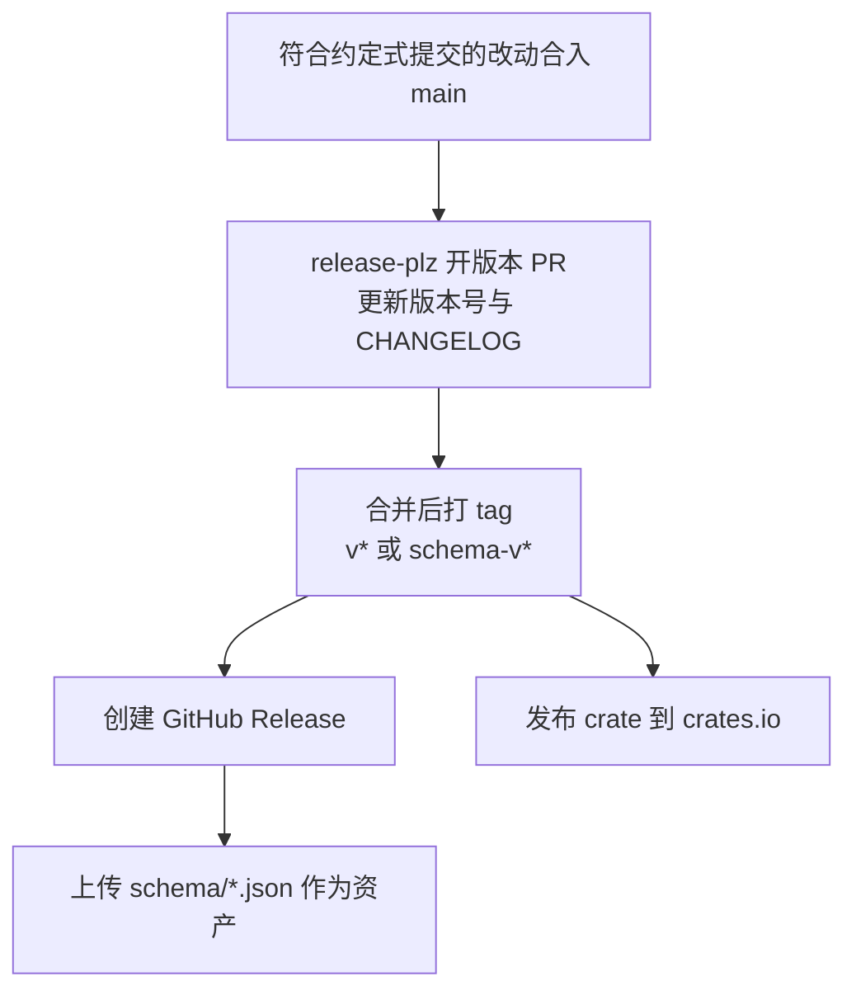
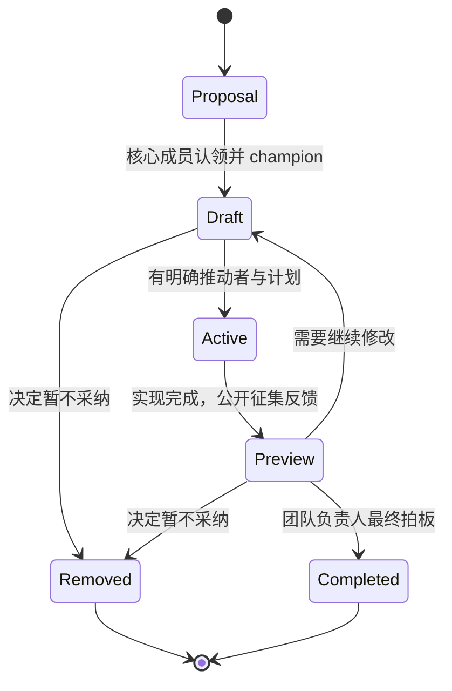

# 版本演进与治理

一份被几十个编辑器与 Agent 同时实现的协议，最大的风险不是设计得不够好，而是**改不动或改坏**。ACP 的答案是把「版本」拆成三层，各自解决一种问题，再配一条从提案到发布的固定路径。

## 三层版本各管一件事

| 层次 | 载体 | 何时变化 | 解决什么 |
|------|------|---------|---------|
| 协议版本 | `initialize` 里的 `protocolVersion` 整数 | 只在出现破坏性变更时 +1 | 决定这次连接按哪套规范解释 |
| 能力（capabilities） | `initialize` 双方各自声明的对象 | 每次加入非破坏性功能 | 让新功能可选、默认关闭 |
| 产物版本 | Rust crate 版本与 `schema-v*` 版本 | 随每次发布 | 让 SDK 与代码生成器管理自己的依赖 |

三层解耦带来一个必须向使用者讲清的事实：**crate 版本或 Schema 版本相同，不代表线缆兼容**。判断线缆兼容要看协商出来的 `protocolVersion`；在同一个协议版本内，再看双方交换的能力决定哪些可选功能可用；而产物版本只用于管理「本仓库的 Rust 与 Schema 输出」的兼容性——两份 Schema 可以描述同一个线缆协议版本，却在定义的组织方式上不同，从而影响下游代码生成。

版本协商本身规则很少但很硬：

| 情形 | 要求 |
|------|------|
| Client 发起 | 必须在 `initialize` 中带上自己支持的最新版本 |
| Agent 支持 | 必须回同一个版本 |
| Agent 不支持 | 必须回自己支持的最新版本 |
| Client 不接受 | 应当关闭连接并告知用户 |

## 仓库里的 tag 与发布物

同一个仓库并发三种发布节奏，靠 tag 前缀区分：

| Tag 形态 | 发布物 | 说明 |
|----------|-------|------|
| `v{{版本}}` | Rust crate `agent-client-protocol-schema` | 发布到 crates.io，发布名形如「Rust Crate vX.Y.Z」 |
| `schema-v{{版本}}` | v1 的 JSON Schema 产物 | 只建 GitHub Release，不上 crates.io；版本化 JSON 文件作为 Release 资产 |
| `schema-v2.0.0-alpha.*` | v2 的草案 Schema | 与 v1 并列发布，明确带 alpha 标记 |

发布链路由 release-plz 驱动，且是「先 PR、后发布」的两段式：

资产上传由一个独立的 workflow 负责：它只在 `published` 的 release 上触发，且 tag 以 `schema-v1` 或 `schema-v2` 开头时才动作，把对应目录下的所有 JSON 一起挂到 Release 上。这正是文档里让 SDK 作者「从 Release 下载 Schema」的落地方式。

## v1 到 v2：改动集中在语义，不在信封

v2 仍是草案，但它能说明这套版本机制在想什么。JSON-RPC 的分帧方式毫无变化——一次连接协商出一个版本后，始终只按那个版本解释消息；变化的是方法与语义。

| v1 方法 | v2 |
|---------|-----|
| `initialize` | 名字不变，参数与结果重构：两侧统一为 `info` + `capabilities`，`info` 变为必需 |
| `authenticate` / `logout` | 改名为 `auth/login` / `auth/logout`；不再需要单独的 logout 能力标记 |
| `session/new` | `mcpServers` 变为可选；响应不再返回 `modes` |
| `session/load` | **移除**，用 `session/resume` + `replayFrom` 表达回放 |
| `session/resume`、`session/list`、`session/close` | 从可选能力变为基线方法，只需声明 `capabilities.session` |
| `session/set_mode` | **移除**，改用 `session/set_config_option` |
| `session/request_permission` | 名字不变，参数重构：必填 `title`，可扩展 `subject` |
| `fs/*`、`terminal/*`（Client 侧） | **全部移除**，建议改用 MCP 服务器暴露同等能力 |
| `$/cancel_request` | 基本不变，但不再能用于取消已插入的 prompt |

`session/update` 的变体也随之调整，方向是「统一成按 ID 打补丁」：

| v1 | v2 |
|----|-----|
| `user_message_chunk` / `agent_message_chunk` / `agent_thought_chunk` | 保留，但 `messageId` 变为必填；新增整条消息的 upsert 变体 |
| `tool_call` + `tool_call_update` | 合并为 upsert 语义的 `tool_call_update`，首次出现即创建；新增内容块流式变体 |
| `plan` | 换成带 `planId` 与判别字段的 `plan_update` |
| `current_mode_update` | 移除，模式成为配置项 |
| — | 新增 `state_update`（前台运行/空闲/等待用户操作）与面向展示的终端变体 |

v2 的四个主题可以概括为：**超越回合**（前台状态从挂起的请求搬进通知，支持排队、后台工作与多客户端观察）、**统一 upsert**（消息、工具调用、终端输出都用「省略即不变、`null` 即清空、有值即替换、分片即追加」的同一套规则）、**Diff 重构**（旧文本/新文本换成结构化的文件变更，可表达新增、删除、移动、复制与二进制，并可附 git patch）、**默认前向兼容**（枚举接受未知取值，`_` 前缀留给实现方，`_meta` 出现在几乎所有层）。

关于草案的使用建议，官方给得很明确：**用版本协商和特性开关双重隔离**，不要在稳定前默认开启；并且不要把添加 v2 支持理解为可以放弃 v1。

## RFD：协议变更的固定入口

任何「实质性」变更都要先成为一份 RFD（Request for Dialog），也就是这个项目的 RFC 流程。它的特别之处在于**状态被显式管理**，每份提案都挂在一个生命周期阶段上。

| 阶段 | 含义 |
|------|------|
| Draft | 提案已进入流程，但可能仍在等设计、实现或维护者精力；实验性实现可以按 RFD 名字做特性门控 |
| Active | 当前正在推进的提案，代表可见度而非稳定性承诺；无人推进时退回 Draft |
| Preview | 已完整实现、进入公开评审期，通常挂几天再决定是否落地 |
| To be removed | 决定暂不采纳，但保留文档以备将来重新考虑 |
| Completed | 实现完成并合入；只有这个阶段才能代表不可逆承诺（原文用 one-way door 描述），因为此后变更可能意味着破坏性改动 |

治理结构是 BDFL：核心团队负责 champion 与讨论，最终决定权在团队负责人（Zed）。仓库里也留着相应的痕迹——「已接受协议变更」的 Issue 模板明确标注为仅限内部人员使用，外部提案要走 Discussions 的 protocol-suggestions 分类。提交规范同样参与自动化：约定式提交的类型决定版本号怎么涨，scope 约定用 `schema`、`unstable`、`unstable-v2`、`rust`、`rfd` 区分改动落点。

> 依据：`README.md:11-30`、`docs/protocol/v1/initialization.mdx:84-100`、`docs/protocol/v2/migration.mdx:24-76`、`docs/protocol/v2/migration.mdx:257-359`、`docs/announcements/acp-v2-draft.mdx:20-85`、`docs/rfds/about.mdx:19-83`、`.release-plz.toml:1-32`、`.github/workflows/release-plz.yml`、`.github/workflows/publish-schema.yml`、`schema/v1/Cargo.toml:1-15`、`schema/v1/CHANGELOG.md:1-20`、`MAINTAINERS.md:1-20`、`AGENTS.md:40-82`
