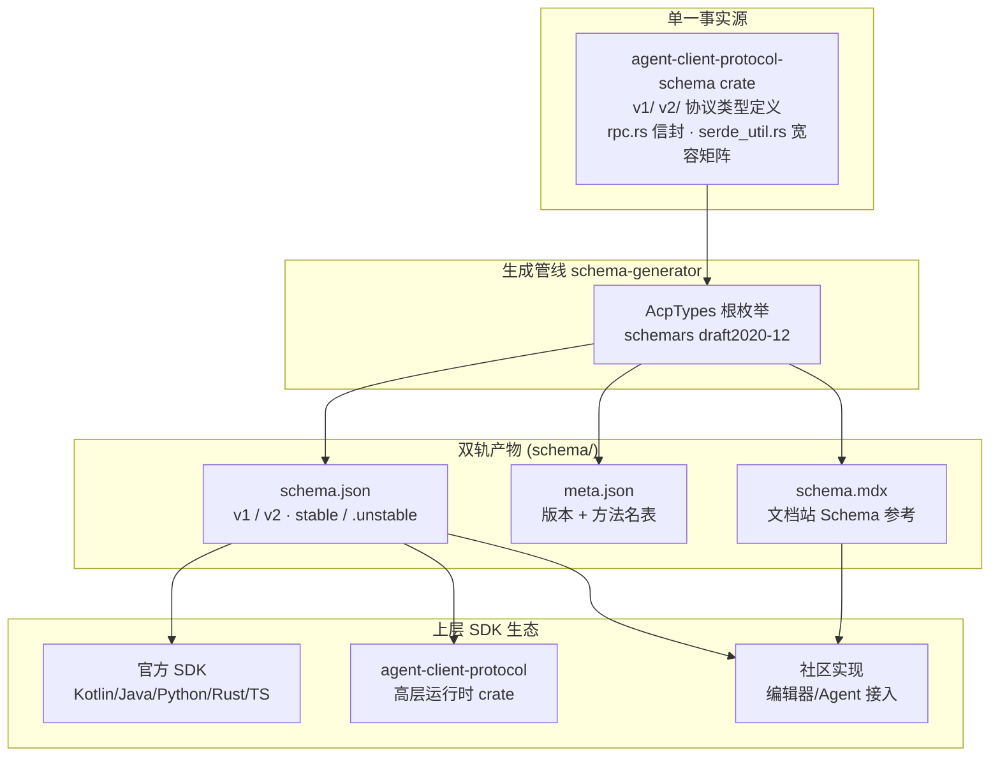

# Agent Client Protocol（ACP）深度解读

> **GitHub:** [github.com/agentclientprotocol/agent-client-protocol](https://github.com/agentclientprotocol/agent-client-protocol) · **协议规范:** [agentclientprotocol.com](https://agentclientprotocol.com)
> **本解读按 framework ⊗ 语言惯用法规格产出（全新分析）**
> **源码根:** `agent-client-protocol-schema/`（Rust 类型）+ `schema-generator/`（生成器）+ `schema/`（JSON Schema 产物）+ `docs/`（Mintlify 文档站）

## 子文档索引

- [`protocol-design.md`](protocol-design.md) — 协议核心：JSON-RPC 双向往来、initialize 握手、会话生命周期、prompt turn、elicitation
- [`schema-pipeline.md`](schema-pipeline.md) — Schema 生成管线：Rust 单一事实源 → JSON Schema 四件套
- [`versioning-evolution.md`](versioning-evolution.md) — 版本演进：protocolVersion 整数、capabilities 双轨、RFD 治理
- [`rust-idioms.md`](rust-idioms.md) — Rust 惯用法：serde 宽容反序列化矩阵、MaybeUndefined、schemars 双向投影

## 根因：编辑器与编码 Agent 之间没有标准接口

编码 Agent（Claude Code、Codex、Gemini CLI…）百花齐放，但**每个都私有定义了一套与编辑器交互的 CLI 约定**：编辑器想接入多个 Agent 就得写多个适配器，Agent 想被多个编辑器复用就得重复适配。ACP 要解决的根本问题：**给「代码编辑器 ⇄ 编码 Agent」定义一份双方都能实现的双向标准接口**，让编辑器一个协议接入所有 Agent、Agent 一个协议被所有编辑器复用。

它不是又一个 LLM API 网关，而是**协议规范本身 + 一套把协议固化为可编译产物的工程体系**——用 Rust 类型定义协议（编译器保证合法性）、用 `schema-generator` 生成 JSON Schema 与文档（单一事实源不漂移）、用 capabilities + 版本整数管理演进（稳定与进化两不误）。

## 概览

| 维度 | 说明 |
|------|------|
| 是什么 | 代码编辑器与编码智能体之间的标准化双向 JSON-RPC 2.0 协议 |
| 痛点 | 编辑器接入多家 Agent 需逐个适配；Agent 跨编辑器复用成本高 |
| 适用 | IDE/编辑器接入编码 Agent、Agent 供多编辑器复用、Agent 与编辑器工具互通 |
| 运行形态 | 协议规范 + Rust crate（`agent-client-protocol-schema`）+ JSON Schema 产物 + 文档站 |
| 传输 | 默认 stdio（编辑器以子进程启动 Agent），协议本身与传输解耦 |
| 授权 | Apache-2.0，由 Zed Industries 发起（BDFL 治理） |
| 生态 | Kotlin/Java/Python/Rust/TS 官方 SDK + 社区库；Claude Code、Codex、Zed、JetBrains 等接入 |

### 核心能力清单

| 能力 | 说明 |
|------|------|
| 双向消息模型 | Client⇄Agent 对等请求/响应 + 单向通知，非 MCP 式 host→server |
| 初始化协商 | `initialize` 握手：协议版本整数 + capabilities 能力协商 |
| 会话生命周期 | `session/new`/`load`/`resume`/`close`/`delete`/`list`（+unstable `fork`） |
| Prompt Turn | `session/prompt` + `session/update` 流式回显 + `stop_reason` 终止语义 |
| 权限请求 | `session/request_permission`：Agent 执行敏感操作前向用户要授权 |
| Elicitation | form/url 双模式向用户收集结构化输入（v1.7 稳定） |
| 内容模型 | ContentBlock 复用 MCP 结构，文本/图片/音频/资源零转换转发 |
| 工具调用 | ToolCall 全生命周期（发起/更新/授权/终止）+ 文件位置跟随 |
| MCP 集成 | 会话建立时转发编辑器配置的 MCP 服务器，stdio/HTTP/SSE 三传输 |
| 取消机制 | `session/cancel` + 协议级 `$/cancel_request` |
| 扩展机制 | `_meta` 字段、`_` 前缀扩展方法、自定义能力协商 |
| Schema 工程 | Rust 类型单一事实源 → `schemars` 生成 JSON Schema + 文档 + meta |

### 技术栈一览

| 层面 | 技术 |
|------|------|
| 协议语言 | JSON-RPC 2.0 |
| 核心实现 | Rust（`serde` + `serde_with` + `schemars`） |
| Schema 生成 | `schema-generator`（`schemars` draft2020-12 + transform） |
| 产物 | `schema/v1`、`schema/v2` 的 JSON Schema + meta.json + schema.mdx |
| 文档站 | Mintlify（MDX，`docs/`） |
| 构建 | Cargo workspace + npm scripts + `release-plz` + Prettier + typos |
| 质量门禁 | clippy pedantic + 生成式反向测试（源码-产物一致性）+ spellcheck |

## 架构总览

仓库是「**协议类型库 + 生成器 + 产物 + 文档**」的四层结构，全部围绕「Rust 类型作为协议单一事实源」组织：

### 模块职责映射

| 模块 | 路径 | 职责 |
|------|------|------|
| 协议类型库 | `agent-client-protocol-schema/src/` | 全部 wire 类型定义（v1 稳定 / v2 草稿），信封在 `rpc.rs` |
| 宽容反序列化 | `agent-client-protocol-schema/src/serde_util.rs` | `MaybeUndefined`/`SkipListener`/`IntoOption` 惯用法工具箱 |
| Schema 生成器 | `schema-generator/src/main.rs` | Rust 类型 → JSON Schema + meta + 文档（单文件 2238 行） |
| Schema 产物 | `schema/v1/`、`schema/v2/` | 版本化的 JSON Schema 与 meta 元数据 |
| 协议文档 | `docs/protocol/v1/`、`docs/protocol/v2/` | 规范正文（初始化/会话/prompt-turn/elicitation/…） |
| 变更治理 | `docs/rfds/` | 40+ RFD 提案，协议变更的 RFC 化流程 |

## 核心模块导读

| 模块 | 关注面 | 深读 |
|------|--------|------|
| 协议消息模型 | 双向 JSON-RPC 分类、initialize 协商、session 生命周期、prompt turn、elicitation、ContentBlock/ToolCall | [`protocol-design.md`](protocol-design.md) |
| Schema 生成管线 | Rust 单一事实源 → schema.json/meta.json/schema.mdx 四件套，生成式反向测试防漂移 | [`schema-pipeline.md`](schema-pipeline.md) |
| 版本演进 | protocolVersion 整数、capabilities 叠加、v1/v2 feature 双轨、RFD 治理流程 | [`versioning-evolution.md`](versioning-evolution.md) |
| Rust 惯用法 | `DefaultOnError`/`VecSkipError`/`SkipListener` 宽容矩阵、`MaybeUndefined` 三态、schemars 注入 | [`rust-idioms.md`](rust-idioms.md) |

## 同类项目对比

| 维度 | ACP | MCP | LSP | DAP |
|------|-----|-----|-----|-----|
| 定位 | 编辑器 ⇄ 编码 Agent | Host ⇄ Agent 工具/资源 | 编辑器 ⇄ 语言服务 | 调试器协议 |
| 消息模型 | 双向对等（JSON-RPC 2.0） | 单向 host→server（JSON-RPC 2.0） | 双向（JSON-RPC 2.0） | 双向（JSON-RPC 2.0） |
| 角色 | Client(编辑器) ↔ Agent | Host ↔ MCP Server | Client ↔ Language Server | Client ↔ Debug Adapter |
| 会话抽象 | 一等公民（多会话并发、恢复） | 无（单次工具调用） | workspace 级 | 调试会话 |
| 流式输出 | `session/update` 通知流 | 流式工具结果 | diagnostics/push | events |
| 权限/用户交互 | `request_permission` + elicitation 双模式 | 无内建（依赖宿主 UI） | 无 | 无 |
| 内容格式 | 复用 MCP ContentBlock | 定义 ContentBlock | 无（文本为主） | 无 |
| 代理自主性 | Agent 可主动请求文件/终端/权限 | Server 被动响应 | 服务端主动推送 | 被动响应 |
| 版本机制 | 整数 + capabilities + RFD | 协议版本 + capabilities | 版本协商 | 协议版本 |
| 权威实现 | Rust 类型 + 生成器 | Python/TS SDK | TS | TS |

ACP 的核心差异在**「会话」与「代理自主性」**：它不是让编辑器单向调用 Agent 的工具（那是 MCP 的事），而是把"编辑器与 Agent 的一次协作"建模成可创建、可恢复、可并发、可取消的会话，并让 Agent 能对等地向编辑器请求权限、文件、终端与用户输入——这是编码 Agent 场景特有、其他协议都不覆盖的信任边界与交互形态。与 MCP 是**互补而非竞争**：ACP 管编辑器⇄Agent，MCP 管 Agent⇄工具，两者在会话建立时衔接。

## 设计亮点

- **Rust 类型当真源**：协议规范以类型定义承载，编译器 + `cargo test` 即协议校验，JSON Schema/文档/meta 全部从同一份类型生成，杜绝文档漂移（[`schema-pipeline.md`](schema-pipeline.md)）。
- **宽容反序列化矩阵**：`DefaultOnError` + `VecSkipError` + `SkipListener` 让实现优雅接纳未来字段/未知枚举，坏数据跳过且留痕可观测（[`rust-idioms.md`](rust-idioms.md)）。
- **三层版本解耦**：整数版本管破坏性、capabilities 管功能叠加、artifact 版本管发行，v1/v2 在单仓库 feature 双轨共存互不扰动（[`versioning-evolution.md`](versioning-evolution.md)）。
- **"缺省即不支持"演进原则**：未声明能力一律视为不支持，新功能默认关闭，老客户端永不被未知能力坑到（[`protocol-design.md`](protocol-design.md)）。
- **RFD 治理 + 生成式反向测试**：协议变更走 RFC 化流程，而源码的宽容标注与产物 schema 的一致性由测试在 CI 锁死——"改协议"这件事被工程化。

## 总结

回到根因：ACP 让编辑器与编码 Agent 之间的通信有了标准答案。它的独特之处不止于协议语义本身（双向对等、会话抽象、elicitation），更在于**把协议规范工程化**——用 Rust 类型当单一事实源、用生成器产出多格式产物、用 capabilities 与版本整数把演进拆成可管理的层。这份解读覆盖协议消息模型、Schema 生成管线、版本演进机制与 Rust 惯用法四个关注面，是理解"现代编码 Agent 如何被标准接口收敛"的一份完整切片。

- [`protocol-design.md`](protocol-design.md) — 协议语义与消息模型
- [`schema-pipeline.md`](schema-pipeline.md) — 生成管线工程
- [`versioning-evolution.md`](versioning-evolution.md) — 版本演进与治理
- [`rust-idioms.md`](rust-idioms.md) — Rust 实现技巧

> **GitHub:** [github.com/agentclientprotocol/agent-client-protocol](https://github.com/agentclientprotocol/agent-client-protocol) · **协议规范:** [agentclientprotocol.com](https://agentclientprotocol.com)
