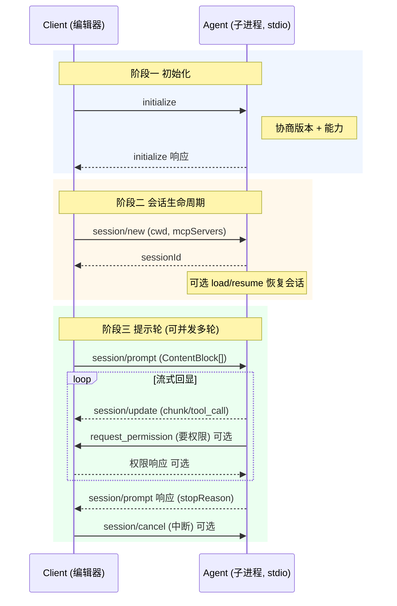

# 协议核心：JSON-RPC 双向往来与三阶段生命周期

> 本解读按 framework 类规格产出（协议规范 + Rust crate），关注面 1。
> 源码根：`agent-client-protocol-schema/src/v1/` 与 `src/rpc.rs`。

ACP 的协议层要回答的问题很具体：**两个运行在互不信任环境里、各自持有一半上下文（编辑器持有文件系统与用户，Agent 持有模型与工具）的程序，如何用一套既有别于「服务器-客户端」、又不过度抽象的语义完成对话？** 答案是 JSON-RPC 2.0 之上的**双向方法集 + 通知流**：Agent 不再是被动的执行器，而是可以和编辑器对等发请求、要权限、收信息。

## 双向消息模型的底层约定

### JSON-RPC 信封与三态 RequestId

协议信封直接复用 JSON-RPC 2.0 的 `request`/`response`/`notification` 三件套。`RequestId` 被建模为**三种 JSON 形态**的 untagged 枚举（`null`、数字、字符串），并把 JSON-RPC 规范本身明确标记为"不归协议所有权"（`clippy::exhaustive_enums` 豁免）：

[agent-client-protocol-schema/src/rpc.rs:26-31]()
<!-- anchor: #[allow(
    clippy::exhaustive_enums,
    reason = "This comes from the JSON-RPC specification itself"
)] … pub enum RequestId { -->

关键设计是 `Request<Params>` 用**泛型参数承载方法负载**——协议本体不关心每个方法的具体参数，只约定信封：

[agent-client-protocol-schema/src/rpc.rs:50-56]()
<!-- anchor: pub struct Request<Params> { … pub params: Option<Params>, -->
<!-- anchor: pub struct Request<Params> { … pub params: Option<Params>, -->

`Response<Result, Error>` 则把"成功/失败"建模为 untagged 枚举的**两个变体**，而非 `Result<T, E>` 的扁平字段，保证与 JSON-RPC 2.0 的 `result`/`error` 对象结构逐字对应：

[agent-client-protocol-schema/src/rpc.rs:68-81]()
<!-- anchor: pub enum Response<Result, Error> { … error: Error, -->

`JsonRpcMessage<M>` 把 `jsonrpc: "2.0"` 常量字段用 `#[serde(flatten)]` 与业务消息合并，是"信封套信封"的封装点；v2 草稿进一步引入非空 `JsonRpcBatch`（空批数组是 JSON-RPC 2.0 显式无效请求，用 `TryFrom` 拒绝）：

[agent-client-protocol-schema/src/rpc.rs:133-136]()
<!-- anchor: pub struct JsonRpcMessage<M> { … message: M, -->

### 三路消息分类：谁处理什么

协议把全部方法分成三路聚合枚举，分别对应"Agent 要处理的"（agent 侧）、"Client 要处理的"（client 侧）、"双方都参与的"（协议级）。这是理解整个 schema 的**路由骨架**：

- `ClientRequest`（客户端 → Agent 的请求：`initialize`/`authenticate`/`session/new`/`session/prompt`/`session/cancel`…）定义在 [agent-client-protocol-schema/src/v1/agent.rs:4779-4954]()
  <!-- anchor: pub enum ClientRequest { … ExtMethodRequest(ExtRequest), -->
- `AgentRequest`（Agent → 客户端的请求：文件读写、终端、权限请求、elicitation）定义在 [agent-client-protocol-schema/src/v1/client.rs:2671-2782]()
  <!-- anchor: pub enum AgentRequest { … ExtMethodRequest(ExtRequest), -->
- `AgentNotification`（Agent → 客户端的通知：`session/update`、`elicitation/complete`、扩展通知）定义在 [agent-client-protocol-schema/src/v1/client.rs:2864-2896]()
  <!-- anchor: pub enum AgentNotification { … ExtNotification(ExtNotification), -->

（`method()` 映射见下文）

每个聚合枚举带 `method()` 方法，把变体映射回方法名字符串——`ClientRequest::method()` 从 `AGENT_METHOD_NAMES` 常量查表，`AgentRequest::method()` 查 `CLIENT_METHOD_NAMES`。方法名用 `pub const` 常量集中定义，杜绝字符串散落（`agent.rs:4729` 的 `INITIALIZE_METHOD_NAME = "initialize"`）：

[agent-client-protocol-schema/src/v1/agent.rs:4728-4729]()
<!-- anchor: /// Method name for the initialize request. … pub(crate) const INITIALIZE_METHOD_NAME: &str = "initialize"; -->

> **Why 双向？** 与 MCP（host 单向调用 server）不同，ACP 的编辑器和编码 Agent 需要**互相请求**：Agent 改文件得问编辑器要权限，编辑器可能想读 Agent 的某个状态。协议刻意不在"谁请求谁"上做不对等假设，只约定方向与方法归属。这是"Editor ⇄ Agent"关系区别于"Host → Server"关系的核心形态差异。

## 三阶段生命周期

ACP 把一次交互拆成**初始化 → 会话生命周期 → 提示轮（prompt turn）**三个阶段，各自有明确的时序约束。下面是完整链路图（对应 `docs/protocol/v1/overview.mdx` 的 Message Flow）：

### 阶段一：initialize 握手与 capabilities 协商

`initialize` 是唯一先决方法：Client 声明自己**支持的最新协议版本**与**客户端能力**；Agent 决定采纳哪个版本、回报自己的**代理能力**。`InitializeRequest` 里 `protocol_version` 是必填，其余（能力、实现信息、`_meta`）均可缺省：

[agent-client-protocol-schema/src/v1/agent.rs:55-80]()
<!-- anchor: pub struct InitializeRequest { … pub meta: Option<Meta>, -->

版本协商规则（`docs/protocol/v1/initialization.mdx`）体现"向后兼容由版本号挡、向前演进由能力挡"的双层策略：

- 版本号是**单个整数**，只在破坏性变更时递增（`ProtocolVersion(u16)`，`version.rs:12`）。
- 能力（capabilities）**不属于破坏性变更**——Client 与 Agent 必须把所有未声明的能力视为不支持。新特性以能力方式加入，老实现遇见未知能力静默忽略即可。

`ProtocolVersion` 用 `newtype(u16)` + 显式常量表达"只有 V0/V1/LATEST"，V2 只在 `unstable_protocol_v2` feature 下编译进来：

[agent-client-protocol-schema/src/version.rs:12-24]()
<!-- anchor: pub struct ProtocolVersion(u16); … pub const V1: Self = Self(1); -->

能力协商的产物直接决定后续哪个方法可调：`loadSession` 决定能否 `session/load`，`promptCapabilities.image` 决定 prompt 里能否夹图片。`InitializeResponse` 里 `auth_methods` 用 `DefaultOnError<VecSkipError<_, SkipListener>>` 宽容反序列化——即便拿到含未知结构的鉴权方法列表也不整体失败：

[agent-client-protocol-schema/src/v1/agent.rs:132-165]()
<!-- anchor: pub struct InitializeResponse { … pub meta: Option<Meta>, -->

### 阶段二：会话生命周期

会话（session）是"一份独立上下文 + 历史 + 状态"的单位，同一连接可并发多个会话。`SessionId` 是透明 newtype（`serde(transparent)`，协议字段与 Rust 值一一对应）：

[agent-client-protocol-schema/src/v1/mod.rs:49-59]()
<!-- anchor: pub struct SessionId(pub Arc<str>); -->

会话核心是 `session/new`（建新会话，带 `cwd` 与 MCP 服务器清单）；围绕它延伸出**恢复**（`session/load` 重放历史、`session/resume` 免重放重连）、**删除/列举**（`session/delete`/`session/list`）、**关闭**（`session/close`）、**派生**（`session/fork`，unstable）等能力门控的方法族：

[agent-client-protocol-schema/src/v1/agent.rs:796-800]()
<!-- anchor: pub struct NewSessionRequest { … pub cwd: PathBuf, -->

> **Why `cwd` 是参数而非继承子进程？** 编辑器以子进程形式启动 Agent（`docs/get-started/architecture.mdx` 明说 stdio 通信），但会话的工作目录必须**由编辑器显式指定**并强制绝对路径，Agent 不能拿自己进程的 cwd 当工作区——否则多会话、多编辑器共享一个 Agent 进程时会串。`cwd` 成为会话的文件系统边界（配合 `additionalDirectories` 扩展根集）。

`mcpServers` 把"编辑器里用户配好的 MCP 服务器"转发给 Agent 直连——这是 ACP 与 MCP 的分工切点：**ACP 管编辑器和 Agent 的会话，MCP 管 Agent 的工具**。会话建立时 Agent 连接 stdio/HTTP/SSE 三种传输的 MCP 服务器（见 `docs/protocol/v1/session-setup.mdx`）。

### 阶段三：提示轮（Prompt Turn）

`session/prompt` 是核心方法：Client 发送 `ContentBlock` 列表（文本/图片/音频/资源），Agent 全程以 `session/update` 通知流式回报（消息块、thought、tool call、plan），最后以带 `stop_reason` 的响应收尾。`PromptRequest` 的 `prompt` 字段直接把 ContentBlock 向量带进请求：

[agent-client-protocol-schema/src/v1/agent.rs:3034-3061]()
<!-- anchor: pub struct PromptRequest { … pub meta: Option<Meta>, -->

`PromptResponse` 的必填字段只有 `stop_reason`，`usage`（token 统计）是 unstable feature 门控的可选字段——协议刻意不给"每轮必须报告 token"设硬约束，把计费精确度让给各实现取舍：

[agent-client-protocol-schema/src/v1/agent.rs:3096-3119]()
<!-- anchor: pub struct PromptResponse { … pub meta: Option<Meta>, -->

`StopReason` 枚举区分 `EndTurn`/`MaxTokens`/`MaxTurnRequests`/`Refusal`/`Cancelled` 五种终止，其中 `Cancelled` 有强制语义：**即使底层操作抛异常，Agent 也必须吞掉并回 `Cancelled`**，让编辑器可靠地感知中断完成：

[agent-client-protocol-schema/src/v1/agent.rs:3164-3182]()
<!-- anchor: pub enum StopReason { … Cancelled, -->

流式回显的载体是 `SessionUpdate` 枚举——用 `#[serde(tag = "sessionUpdate")]` 把判别字段放在顶层，与 JSON-RPC 的 `method` 字段区分开；它覆盖用户消息块、Agent 消息块、thought、tool call、plan、模式变化等十余种更新，是"实时进度"的全部语义出口：

[agent-client-protocol-schema/src/v1/client.rs:99-109]()
<!-- anchor: pub enum SessionUpdate { … ToolCallUpdate(ToolCallUpdate), -->

通知载体 `SessionNotification` 把 session_id + update 一起包进 `session/update` 方法——同一通知通道承载所有会话的更新，靠 `session_id` 路由：

[agent-client-protocol-schema/src/v1/client.rs:49-53]()
<!-- anchor: pub struct SessionNotification { … pub update: SessionUpdate, -->

**双向请求的典型**是 `session/request_permission`：Agent 在执行敏感工具调用前，向编辑器请求用户授权（`AgentRequest::RequestPermissionRequest`），编辑器把用户决策（允许/拒绝/取消）回传。这把"工具执行的信任边界"显式交给编辑器侧的用户，而非 Agent 单方面决定——ACP 的 Trusted 原则（`docs/get-started/architecture.mdx` 的设计哲学）在消息层的落地：

[agent-client-protocol-schema/src/v1/client.rs:2696-2696]()
<!-- anchor: RequestPermissionRequest(RequestPermissionRequest), -->

## 内容模型：ContentBlock 与 ToolCall

### ContentBlock：与 MCP 对齐的内容载体

内容层用 `ContentBlock` 枚举承载可展示信息，判别字段是 `type`（`#[serde(tag = "type", rename_all = "snake_case")]`）。五个变体 `Text`/`Image`/`Audio`/`ResourceLink`/`Resource` 直接复用 MCP 的 ContentBlock 结构：

[agent-client-protocol-schema/src/v1/content.rs:38-62]()
<!-- anchor: pub enum ContentBlock { … Resource(EmbeddedResource), -->

> **Why 复用 MCP？** `docs/protocol/v1/content.mdx` 明说这是设计决策：Agent 从 MCP 工具拿到的输出可直接转发给编辑器**无需转换**，避免"同一种内容在 MCP 和 ACP 里各定义一遍"的双轨漂移。代价是 ACP 的内容语义绑定 MCP 的演进节奏，内容类型扩展要等 MCP 先动。

### ToolCall：工具调用的状态机

`ToolCall` 描述模型请求执行的动作：`tool_call_id` + 标题 + 类型 + 状态 + 内容 + 影响的文件位置。注意它同时出现在两个方向——`SessionUpdate::ToolCall`（Agent 广播开始了什么工具调用）和 `AgentRequest::RequestPermissionRequest`（请求授权）里复用它，形成"先报后问"的流程：

[agent-client-protocol-schema/src/v1/tool_call.rs:29-68]()
<!-- anchor: pub struct ToolCall { … pub locations: Vec<ToolCallLocation>, -->

`ToolCallStatus` 枚举（进行中/成功/失败/取消）与 `ToolKind`（shell/文件/网络/…）组合，让编辑器能按工具类型给 UI 选图标与降级展示；`ToolCallLocation` 记录受影响的文件路径，支撑编辑器的"跟随光标"功能。

## Elicitation：把"向用户要结构化输入"变成一等方法

Elicitation（v1.7 起 stabilize）是 ACP 向 MCP 2026-07-28 发布候选的 elicitation 规范借来的能力，但**刻意收紧了两处**：① 必须显式声明 `mode`，不沿用 MCP 的"缺省即 form"；② 能力对象里每个模式必须显式存在，`{}` 不代表 form 支持。这反映了 ACP 在协议演进上"宁可多做一步显式协商，不留隐式默认"的取向：

[agent-client-protocol-schema/src/v1/elicitation.rs:1584-1589]()
<!-- anchor: pub struct CreateElicitationRequest { … pub message: String, -->

`ElicitationMode` 用 `#[serde(tag = "mode")]` 判别 form（受限 JSON Schema 表单）与 url（OAuth 等带外交互），并留 `Other` 变体承接未知 mode 的原始负载（防转发方丢字段）：

[agent-client-protocol-schema/src/v1/elicitation.rs:1640-1644]()
<!-- anchor: pub enum ElicitationMode { … Url(ElicitationUrlMode), -->

安全语义是 elicitation 的重点（`docs/protocol/v1/elicitation.mdx`）：form 模式禁止采集凭据类敏感信息，URL 模式要求编辑器"展示完整 URL、取得用户同意后才打开、在防止模型窥探的安全上下文打开"，且 Agent 必须校验完成交互的用户与发起者一致。这些约束落在协议文档层，靠各 SDK 的文档注释与测试兜底。

## 全局关联：协议层如何服务整体设计

回到根因——ACP 协议层的设计哲学是**让两种不平等的程序对等地对话**：

- **双向方法集**（`ClientRequest` vs `AgentRequest`）把"谁有权限做什么"显式化：Agent 要权限、编辑器给权限，而不是让 Agent 直接碰文件系统。
- **三阶段生命周期**（初始化→会话→提示轮）把"协商"与"使用"分离：所有兼容性决策集中在 `initialize` 一刻做完，之后会话内零协商。
- **能力门控**贯穿全部方法族：`session/load`、`session/delete`、`elicitation`、`fs/*`、`terminal/*` 全部以能力开关为前提，协议本体保持"最小必要"、演进靠叠加。
- **content 与 tool_call 复用 MCP** 是刻意的生态互操作：ACP 不重新发明内容格式，让 Agent 的 MCP 工具输出与 ACP 消息流无缝衔接。

## 总结

ACP 协议层 = JSON-RPC 2.0 信封 + 双向方法路由 + 三阶段生命周期 + MCP 对齐的内容/工具模型。它的全部设计判断都指向一个目标：**把"编辑器与编码 Agent 的协作"还原成一组可协商、可演进、可互操作的消息**，而不是某个产品私有的一套 CLI 约定。`session/update` 流式通知、`request_permission` 双向请求、`elicitation` 结构化询问，是它区别于 LSP/MCP 的三个标志性语义。

> 关联阅读：架构与生成管线见 [`schema-pipeline.md`](schema-pipeline.md)；版本演进机制见 [`versioning-evolution.md`](versioning-evolution.md)；Rust serde/schemars 实现技巧见 [`rust-idioms.md`](rust-idioms.md)。
