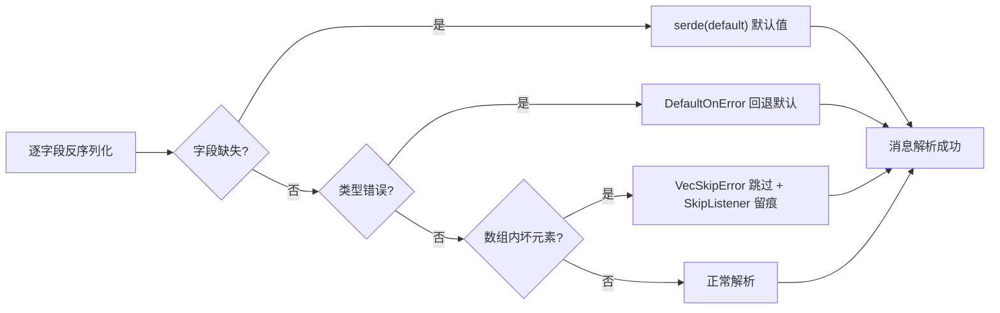

# Rust 惯用法：serde 宽容反序列化矩阵与 schemars 双向投影

> 本解读按 framework ⊗ 语言惯用法规格产出，关注面 4。
> 源码根：`agent-client-protocol-schema/src/`（serde_util.rs、rpc.rs、v1/*.rs）与 `schema-generator/src/main.rs`。

这是一个纯 schema crate——没有业务逻辑、没有运行时状态，**唯一的"业务"就是序列化与反序列化**。因此它的 Rust 技巧密集程度极高，全部围绕一个核心矛盾：**协议要求向前兼容（宽容地收下未来的字段），Rust 类型系统要求精确（严格地建模现在）**。这一节讲 ACP 用 serde/schemars 生态破解这对矛盾的四组惯用法。

## 宽容反序列化：协议演进安全的第一道防线

### DefaultOnError：坏字段退默认，而不是整条消息失败

协议层几乎每个可选字段都挂了 `#[serde_as(deserialize_as = "DefaultOnError")]` + `#[serde(default)]`。语义：**该字段缺失、为 null、类型错误，一律回退到默认值，绝不因单个字段失败拖垮整条消息解析**。

这条"宽容反序列化矩阵"的完整决策路径如下——外层字段级失败整体回退，数组内元素级失败逐个跳过且留痕：

以 `InitializeRequest` 的 `client_capabilities` 为例——老客户端可能不带这个字段，新客户端可能带未来才有的子字段，两条路都不能让握手失败：

[agent-client-protocol-schema/src/v1/agent.rs:58-62]()
<!-- anchor: #[serde_as(deserialize_as = "DefaultOnError")]
    #[cfg_attr(feature = "schemars", schemars(extend("x-deserialize-default-on-error" = true)))]
    #[serde(default)]
    pub client_capabilities: ClientCapabilities, -->

> **Why 这么激进地宽容？** 这是"缺省即不支持"（`versioning-evolution.md` 谈过的 capabilities 原则）在实现层的延伸：协议演进靠新增字段/枚举值，若老实现遇见新字段就解析失败，向前兼容就名存实亡。宽容反序列化让老实现能**优雅地忽略未来**，而 `schemars` 标注则确保生成的 JSON Schema 也声明同样的宽容（见 `schema-pipeline.md` 的反向测试）。

### VecSkipError + SkipListener：坏列表元素逐个跳过，且留痕

对 `Vec<T>` 字段，容忍粒度更细：`DefaultOnError<VecSkipError<_, SkipListener>>` 让**外层形状错误（null/字符串/对象）回退空向量，数组内单个坏元素跳过、好的保留**——协议里的鉴权方法列表、工具调用内容列表等都靠它扛脏数据。

跳过动作通过 `SkipListener` 交给 `serde_with::InspectError` hook：开 `tracing` feature 时每次跳过打一条 `warn!` 日志，关闭时退化成零成本的 `()`：

[agent-client-protocol-schema/src/serde_util.rs:38-57]()
<!-- anchor: #[cfg(feature = "tracing")]
#[derive(Debug, Clone, Copy, Default, PartialEq, Eq, Hash)]
#[non_exhaustive]
pub(crate) struct SkipListener; … pub(crate) type SkipListener = (); -->

> **Why 留痕？** 宽容 ≠ 静默。如果坏数据被静默丢弃，问题在将来某个时刻以更难定位的方式浮现；`SkipListener` 把"我跳过了什么"暴露给可观测性工具。且用 feature 开关让"可观测"在生产默认零成本——这是"宽容"与"可诊断"之间的精妙平衡。

测试对这套矩阵有系统性覆盖：`serde_util.rs` 的测试模块用 `ResilientVec`/`ResilientOptionVec` 两种哨兵类型验证"缺失 → 空、null → 空、错类型 → 空、数组内坏元素 → 跳过其余"的所有组合：

[agent-client-protocol-schema/src/serde_util.rs:104-108]()
<!-- anchor: struct ResilientVec { … values: Vec<u32>, -->

## MaybeUndefined：三态字段，比 Option 多表达一层

协议里不少字段需要区分"**未提供**（key 缺失）"与"**显式 null**"——比如清空一个配置项（显式 null）与根本不提它（缺失）语义不同。`Option` 表达不了这层区别，于是 `serde_util.rs` 引入 `MaybeUndefined<T>` 三态枚举：

[agent-client-protocol-schema/src/serde_util.rs:292-313]()
<!-- anchor: /// Similar to `Option`, but it has three states, `undefined`, `null` and `x`. … pub enum MaybeUndefined<T> { -->

序列化时 `Undefined` 由 `skip_serializing_if` 跳过，`Null` 序列化为 `null`，`Value` 序列化为值；反序列化走 `Option<T>` 桥接。配套 `IntoMaybeUndefined` trait 让 builder 方法同时接受 `T`/`Option<T>`/`MaybeUndefined<T>`：

[agent-client-protocol-schema/src/serde_util.rs:554-561]()
<!-- anchor: pub trait IntoMaybeUndefined<T> { … MaybeUndefined::Value(self) -->

（v2 的会话配置、`additionalDirectories` 等语义字段大量用到它——"清空"与"不提"必须区分。）

## 判别式枚举：untagged 与 tag 的两种选择

协议里两类枚举用了**相反**的 serde 策略，各安其位：

- **信封/负载聚合枚举用 `#[serde(untagged)]`**：`RequestId`、`Response`、`ClientRequest`、`AgentNotification` 等。它们没有自己的判别字段，靠"形状匹配"区分变体（`RequestId` 靠 null/number/string，`Response` 靠有没有 `result`/`error` 键）。untagged 对 JSON-RPC 这种信封层最忠实——wire 上就是没有判别字段。

- **内容/行为枚举用 `#[serde(tag)]`**：`ContentBlock`（`type`）、`SessionUpdate`（`sessionUpdate`）、`ElicitationMode`（`mode`）显式带判别字段，还配 `schemars(extend("discriminator" = ...))` 让 JSON Schema 也能用 discriminator 精确区分。判别字段值用 `snake_case`（`rename_all = "snake_case"`），与字段名的 `camelCase`（`serde(rename_all = "camelCase")`）形成"**字段 camelCase、判别值 snake_case**"的 wire 约定（`docs/protocol/v1/overview.mdx` 的 Conventions 明示）。

`ContentBlock` 是 tag 策略的典型：

[agent-client-protocol-schema/src/v1/content.rs:33-37]()
<!-- anchor: #[cfg_attr(feature = "schemars", derive(schemars::JsonSchema))]
#[derive(Debug, Clone, PartialEq, Deserialize, Serialize)]
#[serde(tag = "type", rename_all = "snake_case")] -->

聚合枚举另一关键点是 `#[non_exhaustive]` + `Other` 兜底变体：`ElicitationMode::Other(OtherElicitationMode)` 承接未知 mode 的**原始负载**，靠 `#[serde(flatten)]` 保留未知字段，让转发方不丢信息（`elicitation.rs:1654-1680`）。这又是"宽容"在枚举层的体现——未知判别值不再是硬错误。

## 新类型（newtype）与 builder：类型安全 + 链式构建

### 语义新类型

协议把 ID、路径等字符串都包成透明 newtype：`SessionId(Arc<str>)`、`ToolCallId(Arc<str>)`、`ElicitationId`、v2 的 `AbsolutePath`/`MediaType`。好处：编译器阻止"拿 sessionId 当 toolCallId"这类混淆，且 `serde(transparent)` 保证 wire 上仍是普通字符串（`schema-pipeline.md` 里 v2 测试断言这些类型 wire 兼容 JSON string）。

`SessionId` 用 `Arc<str>` 而非 `String`——协议消息在连接中被反复克隆/传递（多会话路由、存储），`Arc` 让克隆零拷贝：

[agent-client-protocol-schema/src/v1/mod.rs:47-51]()
<!-- anchor: #[derive(Debug, Clone, Serialize, Deserialize, PartialEq, Eq, Hash, Display, From)] … pub struct SessionId(pub Arc<str>); -->

### builder 风格 API + IntoOption

每个请求/响应类型都提供**消费型 builder**：`new()` 设必填字段，`meta()`/`agent_capabilities()` 等返回 `Self` 链式设置可选字段。为了让调用方"传值或传 Option 都行"，`IntoOption<T>` trait 对 `T` 和 `Option<T>` 都有实现：

[agent-client-protocol-schema/src/serde_util.rs:201-214]()
<!-- anchor: pub trait IntoOption<T> { … Some(self) -->

于是 `InitializeRequest::new(ProtocolVersion::V1).client_capabilities(caps).meta(meta)` 与 `.meta(Some(meta))` 都编译——`&str`、`Arc<str>`、`PathBuf` 等还专门给了特化实现。这是"协议类型要暴露给人写 SDK"的 API 设计：比裸字段更安全、比 `Option` 传参更顺手。

## schemars：用同一套类型同时喂 JSON Schema 与文档

`schemars` 的 `JsonSchema` 派生与 serde 属性共享同一套结构信息，这让"一份 Rust 类型 → JSON Schema"成为可能。ACP 在派生上做文章，把**协议语义（side、method、宽容标注）注入 schema**：

- `#[schemars(extend("x-side" = "agent", "x-method" = "initialize"))]` — 标记类型属于哪一侧、哪个方法，`MarkdownGenerator` 据此把类型分拣进 Agent/Client/Protocol 三章（`schema-generator/src/main.rs:781-810`）。
- `#[schemars(extend("x-deserialize-default-on-error" = true))]` — 把 `DefaultOnError` 宽容语义投影进 schema，让 JSON Schema 消费方也收到同样的宽容声明（上一节讲过，`schema-generator` 有反向测试保证源码标注与 schema 标注不漂移）。
- `#[schemars(extend("discriminator" = ...))]` — 让 tag 枚举在 JSON Schema 里也能被 discriminator 消费。
- `#[schemars(rename = "{Params}")]` / `#[schemars(inline)]` / `#[schemars(with = "...")]` — 对泛型信封与透明类型定制 schema 形状。

对 `ErrorCode`，schemars 的 `transform` hook 把枚举变体转成 `const` 整数 schema，并带上 `int32` format 与描述拼接：

[agent-client-protocol-schema/src/v1/error.rs:233-259]()
<!-- anchor: fn error_code_transform(schema: &mut Schema) { … schema.insert("const".into(), i32::from(code).into()); -->

> **Why 在派生层注入而非生成器层补丁？** 协议语义（谁的方法、是否宽容、判别字段）本来就在 Rust 类型上，写在派生属性里让它**跟着类型走**：改类型时语义随之更新，生成器不需要维护一份平行的映射表。代价是类型定义被 `#[cfg_attr]` 属性包围得较臃肿——这是"单一事实源"的排版税。

## 全局关联：惯用法回扣协议哲学

- **宽容反序列化 ↔ capabilities 演进**（`versioning-evolution.md`）：`DefaultOnError`/`VecSkipError`/`Other` 兜底让"未来加字段、加枚举值"在实现层无痛，是"新增能力不算破坏性变更"的代码基础。
- **schemars 注入 ↔ Schema 生成管线**（`schema-pipeline.md`）：`x-side`/`x-method`/`x-deserialize-*` 标注是生成器把类型分拣成文档与 schema 的输入，也是反向测试锁死一致性的检查点。
- **新类型 + builder ↔ 协议类型面**（`protocol-design.md`）：面向 SDK 开发者暴露的类型既要类型安全（newtype）又要顺手（builder），这套 API 设计是"协议要被人实现"的可采用性工程。

## 总结

ACP 的 Rust 惯用法是**"协议演进安全"与"Rust 类型安全"的一次系统性调和**：宽容反序列化矩阵让实现优雅地接纳未来，`MaybeUndefined`/`Other` 兜底让语义粒度更精确，新类型与 builder 让协议类型既安全又好用，schemars 注入让同一份类型同时驱动 JSON Schema 与文档。把这些串起来看，每一处惯用法都不是炫技，而是在回答同一个问题：**如何在严格的类型系统里，为一份必须向前兼容的协议建模。**

> 关联阅读：协议语义见 [`protocol-design.md`](protocol-design.md)；Schema 生成管线见 [`schema-pipeline.md`](schema-pipeline.md)；版本演进见 [`versioning-evolution.md`](versioning-evolution.md)。
