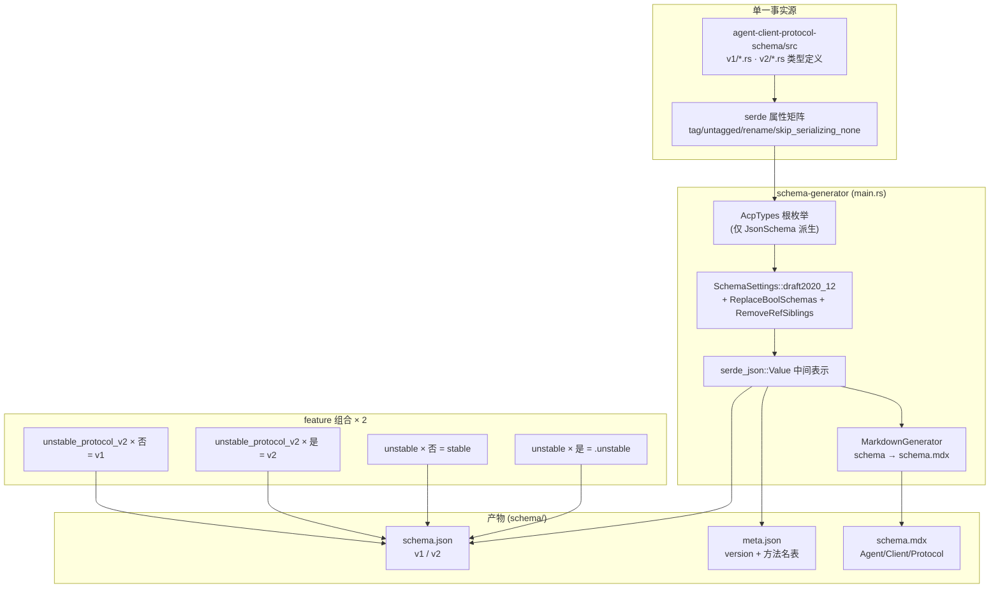

# Schema 生成管线：Rust 单一事实源 → JSON Schema 四件套

> 本解读按 framework 类规格产出（SDK + 代码生成器），关注面 2。
> 源码根：`schema-generator/src/main.rs`（2238 行，单文件承载全部生成逻辑）。

ACP 最不寻常的工程选择是：**协议规范的"权威文本"不是 Markdown，而是 Rust 类型定义**。JSON Schema、方法名清单、Schema 文档站页面全部由 `schema-generator` 从 Rust 类型一次性生成。这一节拆解这条"单一事实源"管线：为什么选 Rust 作源、生成器如何布局、产物如何不漂移。

## 为什么用 Rust 类型当协议源

协议文档（`.mdx`）可以改、可以被手工编辑与漂移；但**Rust 类型由编译器保证合法性**，且 `serde` 属性矩阵（`#[serde(tag)]`/`untagged`/`rename`）已经**完整表达了 wire 形态**——字段名、判别字段、可空性、枚举取值全在类型系统里。于是 ACP 把"协议定义"与"协议实现"合并成一个产物：改类型即改协议，`cargo test` 即协议校验。

这个选择还带来一个连锁收益：**同一份 Rust 定义同时服务三拨消费者**——Rust SDK 直接用类型（`serde` 运行时）、JSON Schema 消费方（`schemars` 生成 schema 供生成器/校验器）、文档站（`MarkdownGenerator` 生成 schema.mdx）。三者共享一份真源，不会出现"类型改了文档没改"。

## 生成器布局：一个根枚举，三个输出

`schema-generator` 的逻辑全在 `main.rs`：`main()` 调用 `root_schema_value()` 算出 schema 的 `serde_json::Value`，再交 `write_schema()` 落盘三件产物。

### 根枚举：用类型形状定义"协议入口"

生成器的源头是一个**只用于 `JsonSchema` 派生、不用于运行的枚举** `AcpTypes`。它把"ACP 上跑的每条消息"枚举为：Agent 发往 Client 的（Request/Response/Notification）、Client 发往 Agent 的、协议级通知，以及 v2 才有的 JSON-RPC **批量**变体：

[schema-generator/src/main.rs:98-115]()
<!-- anchor: #[expect(dead_code)]
#[derive(JsonSchema)]
#[serde(untagged)] … ProtocolLevel(JsonRpcMessage<Notification<ProtocolLevelNotification>>), -->

（注：展示引用路径规范化后为 `schema-generator/src/main.rs:98-115`）

`schemars` 对 untagged 枚举会为每个变体生成一份 `$defs` 定义 + 顶层 `anyOf` 分支，所以**"ACP 协议由哪些消息构成"直接编码进类型枚举**，而不是写在配置里。新增一个方法 = 给对应聚合枚举加变体 + 类型加 `x-side`/`x-method` 标注，生成器无需改动。

### 三种产物（`write_schema`）

`write_schema()` 在 `root_schema_value()` 生成的 Value 上，按当前 feature 组合选文件名，依次落盘：

1. **`schema.json`** — 完整 JSON Schema（draft 2020-12），供 SDK 生成器与消息校验器使用；
2. **`meta.json`** — 轻量元数据：`version` + 三张方法名表（agentMethods/clientMethods/protocolMethods），供生成器快速枚举方法名而不必解析整棵 schema；
3. **`schema.mdx`** — 把同一份 schema 转成文档站的 Schema 参考页（Agent/Client/Protocol Level 三章），由 `MarkdownGenerator` 产出。

命名规则见文件内注释（每份产物对应固定的 cfg 组合，生成互不覆盖）：

[schema-generator/src/main.rs:162-179]()
<!-- anchor: fn write_schema(schema_value: &serde_json::Value, schema_dir: &Path, docs_protocol_dir: &Path) { … (false, false) => "v1/schema.json", -->

（展示引用路径规范化后为 `schema-generator/src/main.rs:162-179`）

meta.json 里 `version` 字段由 feature 决定——带 `unstable_protocol_v2` 生成即声明协议版本 2，保证元数据与内容自洽：

[schema-generator/src/main.rs:194-204]()
<!-- anchor: #[cfg(feature = "unstable_protocol_v2")]
    let schema_protocol_version = ProtocolVersion::V2; … "protocolMethods": PROTOCOL_LEVEL_METHOD_NAMES, -->

（展示引用路径规范化后为 `schema-generator/src/main.rs:190-205`）

## 生成流程：从类型到四套产物的完整管线

`SchemaSettings` 配置里两个 `transform` 值得注意：`ReplaceBoolSchemas`（把 `true`/`false` 布尔 schema 展开为可读的对象 schema，且 `skip_additional_properties`）与 `RemoveRefSiblings`（把 `$ref` 旁边的兄弟属性合并进引用，避免引用丢失约束）：

[schema-generator/src/main.rs:146-156]()
<!-- anchor: fn root_schema_value() -> serde_json::Value { … let schema = generator.into_root_schema_for::<AcpTypes>(); -->

（展示引用路径规范化后为 `schema-generator/src/main.rs:146-160`）

## 防漂移：生成式测试把"源码-产物一致性"变成编译期契约

生成器的测试模块是这条管线最硬的设计。它不是测生成器正确性，而是**反过来测源码：扫描 `src/v1/*.rs` 与 `src/v2/*.rs` 的每个 `#[serde_as(deserialize_as = "DefaultOnError")]`，断言其下一行必然带 `x-deserialize-default-on-error` 的 schema 标注**；对每个 `pub meta: Option<Meta>` 字段同理：

[schema-generator/src/main.rs:547-567]()
<!-- anchor: fn source_default_on_error_fields_are_schema_annotated() { … "{}:{} missing {DEFAULT_ON_ERROR_EXTENSION}", -->

（展示引用路径规范化后为 `schema-generator/src/main.rs:546-621`）

> **Why 反向测试？** 协议里 `DefaultOnError`（缺字段/错类型就容错回默认）是"向前兼容"的重要实现手段——旧客户端发来的新字段、未知枚举值都不该让反序列化炸掉。如果某人新增容错字段但漏写 schema 标注，生成出的 schema 会宣称该字段严格校验，而 Rust 侧实际宽容处理——**schema 与实现就漂移了**。这条测试把漂移在 CI 里拦死，等于用类型系统 + 测试把"宽容语义"钉进协议。

`write_schema` 还顺带处理**文档链接版本化**：v2 生成时把 schema 内的协议文档 URL 从 `/protocol/` 重写为 `/protocol/v2/`，防止 v2 schema 指向 v1 文档（`schema_value_for_publication`，`main.rs:272-316`），并有测试断言不会出现双版本 `v2/v2/` 链接。

## 生成器如何让"方法名不重复声明"

协议方法名在源码里是 `pub const` 常量（`agent.rs:4728` 起），聚合枚举的 `method()` 查表引用。`meta.json` 的 `agentMethods`/`clientMethods` 直接从这些常量生成，因此**方法名只有一个事实来源**，SDK 生成器拿到 meta.json 就能枚举全部方法而不用猜。

## 全局关联：生成管线回扣整体设计

Schema 生成管线是 ACP"让程序验证，不让文档漂移"哲学的工程实现：

- **Rust 类型当真源** ↔ 协议层语义（`protocol-design.md`）：协议的一切可协商、可扩展设计（capabilities、`_meta`、扩展方法）最终都以 Rust 类型形态落地，才能被 `schemars` 忠实投影成 JSON Schema。
- **feature 组合矩阵** ↔ 版本演进（`versioning-evolution.md`）：v1/v2、stable/unstable 的四象限产物完全由 feature flag 决定，是"双轨演进"能在单仓库落地的机械基础。
- **容错反序列化标注** ↔ serde 惯用法（`rust-idioms.md`）：`DefaultOnError`/`VecSkipError`/`SkipListener` 是协议层"宽容"与代码层"可观测"之间的一根线，生成式测试确保这根线不断。

## 总结

ACP 的 schema 生成管线回答了"协议规范如何保持唯一事实源"：**用 Rust 类型承载协议、用 `schemars` 投影成 JSON Schema、用 feature 矩阵产出多版本产物、用反向测试锁死容错语义的源码-产物一致性**。它把"协议演进"从文档编辑工作变成"改类型 + 跑生成器 + CI 校验"的工程流水线，是理解 ACP 与其他 Markdown-first 协议（MCP、LSP）最本质的差异点。

> 关联阅读：协议语义见 [`protocol-design.md`](protocol-design.md)；版本与 feature 机制见 [`versioning-evolution.md`](versioning-evolution.md)；serde/schemars 惯用法见 [`rust-idioms.md`](rust-idioms.md)。
