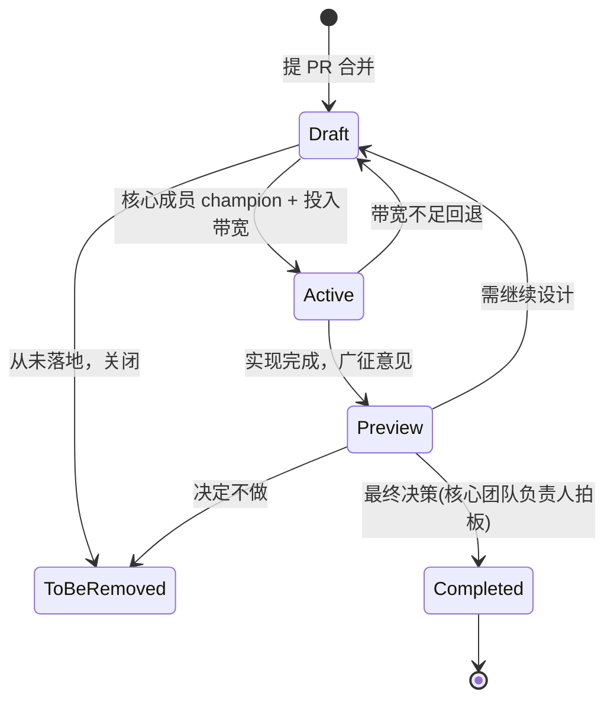

# 版本演进机制：protocolVersion、capabilities 双轨与 RFD 治理

> 本解读按 framework 类规格产出（公共 API 向前兼容策略），关注面 3。
> 源码根：`agent-client-protocol-schema/src/version.rs`、`src/lib.rs`、`schema-generator/src/main.rs` 与 `docs/rfds/`。

协议类项目最难的不是设计，而是**演进**——一个已有多家编辑器和多家 Agent 接入的协议，如何在加功能时不断掉老客户端、在破坏性变更时又不被历史包袱拖死。ACP 的答案是把演进拆成**三层解耦**：协议版本（整数，管破坏性）、能力（capabilities，管非破坏性）、产物版本（crate/schema release，管发行节奏）。外加一套 RFD 治理流程决定"什么变更值得做"。

## 三层版本体系的职责划分

| 层 | 载体 | 何时递增 | 谁消费 | 兼容性含义 |
|----|------|---------|--------|-----------|
| 协议版本 | `initialize` 里协商的整数 | 破坏性变更时 | 连接的双方 | 决定 wire 消息形状 |
| 能力 | `initialize` 里的 capabilities 对象 | 随时可加（非破坏） | 连接的双方 | 决定可选方法/参数是否可用 |
| 产物版本 | crate 版本（1.7.0）、schema release | 每次发行 | SDK 消费方 | 决定 SDK 生成器结构，不代表 wire 兼容 |

`README.md` 用一整段明示这一解耦：**wire 兼容性只能看协商出的 `protocolVersion`，不能从 artifact 版本推断**——两个 JSON Schema release 可能描述同一个 wire 兼容协议版本，只是定义组织方式不同（影响代码生成、不影响线上消息）。这条原则让 SDK 生成器的发布节奏与协议演进解耦。

## 协议版本：一个整数挡住破坏性变更

`ProtocolVersion` 是一个 `u16` 的 newtype，用显式常量表达已知版本，V2 仅在 `unstable_protocol_v2` feature 下存在：

[agent-client-protocol-schema/src/version.rs:12-24]()
<!-- anchor: pub struct ProtocolVersion(u16); … pub const V1: Self = Self(1); -->

关键语义在注释里："This version is only bumped for breaking changes. Non-breaking changes should be introduced via capabilities."（版本只用于破坏性变更，非破坏性改动一律走 capabilities）：

[agent-client-protocol-schema/src/version.rs:4-7]()
<!-- anchor: /// Protocol version identifier.
///
/// This version is only bumped for breaking changes. … -->

协商规则（`docs/protocol/v1/initialization.mdx`）：Client 报它支持的最新版本；Agent 若支持则回同样版本，否则回它支持的最新版本；Client 若接不住 Agent 回的版本，应断开并告知用户。**协商失败即断开**，没有降级重试——因为协议版本只在大版本破坏时动，协商失败意味着双方跨了不可跨越的鸿沟。

`LATEST` 常量在 v2 未启用时指 V1，启用后故意消失，强制选了 v2 草稿的实现必须显式写 V1 或 V2：

[agent-client-protocol-schema/src/version.rs:38-40]()
<!-- anchor: #[cfg(not(feature = "unstable_protocol_v2"))]
    pub const LATEST: Self = Self::V1; -->

## capabilities：非破坏性功能的叠加通道

协议文档明确："The introduction of new capabilities is not considered a breaking change. Therefore, Clients and Agents MUST treat all capabilities omitted in the initialize request as UNSUPPORTED."（新增能力不算破坏性变更，因此双方必须把所有未声明的能力视为不支持）。

这条"**缺省即不支持**"原则是 ACP 演进安全的核心：老客户端不认识新能力 → 不声明 → Agent 知道不能用，绝不会因为默认开启踩坑。能力的形状是**可选对象**——`loadSession: true`、`promptCapabilities: {image, audio, embeddedContext}`、`sessionCapabilities: {resume, close}` 等，方法族是否可用完全由能力门控（如 `session/load` 依赖 `loadSession`、`fs/*` 依赖 client 的 `fs` 能力）。

能力对象自身也参与扩展：`_meta` 里可以放自定义能力（如 `zed.dev: {workspace: true}`），实现自定义方法前先协商自定义能力——这样"扩展"也走显式协商，不靠猜。

## 双轨演进：v1 stable 与 v2 draft 在单仓库共存

v2 是 ACP 正在迭代的下一个大版本，但其类型与 v1 **在同一个 crate 里共存**，靠 feature flag 隔离：

[agent-client-protocol-schema/src/lib.rs:51-52]()
<!-- anchor: #[cfg(feature = "unstable_protocol_v2")]
pub mod v2; -->

v2 模块头部文档明确它"在草稿 RFD 落地时有意与 v1 wire 格式分叉"，类型可随时变：

[agent-client-protocol-schema/src/v2/mod.rs:1-10]()
<!-- anchor: //! Agent Client Protocol version 2 draft types.
//!
//! **EXPERIMENTAL.** This module is gated behind the `unstable_protocol_v2` … -->

> **Why 同库共存而非分仓？** ① 类型共享：v2 大量复用 v1 的 JSON-RPC 信封与公共类型，分仓要拆公共层；② 生成器复用：`schema-generator` 用同一套代码、按 feature 切换 import 即可产出 v2 schema（`main.rs:171-179` 的 cfg 分支）；③ 演进透明：v2 与 v1 的差异在 diff 里一目了然，rebase 成本集中。代价是 `lib.rs` 的 cfg 条件增多，编译矩阵变大。

双轨产物由 `schema-generator` 的 feature 组合矩阵承载——四象限 `(unstable_protocol_v2, unstable) → 文件名`，每份产物有**独占的文件名**，生成互不覆盖：

[schema-generator/src/main.rs:171-179]()
<!-- anchor: let schema_file: &str = match (
        cfg!(feature = "unstable_protocol_v2"),
        cfg!(feature = "unstable"),
    ) { … (false, false) => "v1/schema.json", -->

实际可观察到 v1 与 v2 的语义差异已在类型里成型：

- **v2 的 `initialize` 把实现信息变必填**：v1 里 `client_info: Option<Implementation>`（可省，注释"future versions this will be required"），v2 里是 `pub info: Implementation` 必填（`v2/agent.rs:61`）——`docs/protocol/v1/initialization.mdx` 早预告了这条路。
- **v2 收紧验证**：CHANGELOG 1.3.0 记 "require typed config values"、1.5.0 引入语义字符串类型（`AbsolutePath`/`SessionListCursor`/`MediaType`，v2 测试断言它们 wire 上仍是 JSON string）。
- **v2 支持 JSON-RPC batch**：批量信封进入 schema（`schema-generator` 的 `AcpTypes` 带 `unstable_protocol_v2` 的 BatchCall 变体）。
- **v2 改名归一**：`authenticate` → `auth/login`、`logout` → `auth/logout`、`session/load` 与 `session/resume` 统一（见 `schema/v2/meta.json` 与 CHANGELOG 1.3.0 "Unify session/load and session/resume"）。

这些差异全部由 `v2/` 模块与 `schema/v2/` 产物承载，v1 完全不受扰动——双轨演进在机制上成立。

## unstable feature：未定稿功能的"临时车道"

除了 `unstable_protocol_v2` 这辆大车，还有散落的 `unstable_*` 小 flag（`unstable_nes`、`unstable_mcp_over_acp`、`unstable_plan_operations`、`unstable_end_turn_token_usage`、`unstable_session_fork`、`unstable_llm_providers` 等）。CONTRIBUTING 明言"Unreleased features will be behind an unstable feature flag"：

[CONTRIBUTING.md:30-32]()
<!-- anchor: Unreleased features will be behind an `unstable` feature flag in the Rust crate. -->

这些 flag 承载的是**已实现但未定稿**的协议特性，与 RFD 流程配套：RFD 进入 Draft 即可开始实验实现，feature 名与 RFD 名对应（`about.mdx`："Experimental implementation may begin, properly feature-gated with the RFD name"）。稳定化的动作在 CHANGELOG 里清晰可查（如 1.7.0 "stabilize terminal authentication"、"stabilize elicitation"）。

## RFD 治理：决定"哪些变更值得做"

RFD（Request for Dialog）是 ACP 的 RFC 化流程（`docs/rfds/about.mdx`）。与 RFC 类似但**更贴近实现进度**，生命周期分五态：

状态是**可见性信号而非稳定性承诺**：Draft 表示"在流程里，可能还在等设计/实现/维护者带宽"；Active 表示"当前有维护者/工作组在推进"；Preview 表示"实现完毕等社区反馈"。只有 Completed 且涉稳定性承诺时才是一扇单行道（后续改动可能破坏协议）。

治理结构是 **BDFL 模型**：Zed 团队任 lead，最终决策由团队负责人拍板（`about.mdx` 明说 "final decision is always made by the core team lead"），champion 引导 RFD 走流程。这是新协议"保速度 + 为未来扩权留空间"的务实选择。

RFD 数量可观且覆盖协议各角落：`docs/rfds/` 下 40+ 个提案（`session-compaction`、`session-fork`、`mcp-over-acp`、`proxy-chains`、`request-cancellation`、`streamable-http-websocket-transport`、`auth-methods`、`diff-delete` 等），其中不少已稳定进 v1 或沉淀进 v2。

## 全局关联：版本机制与整体设计哲学

- **协议版本整数 ↔ 初始化协商**（`protocol-design.md`）：版本只挡破坏性，其余靠初始化一刻的 capabilities 谈妥——所以握手在生命周期最前面，之后零协商。
- **feature 双轨 ↔ schema 生成管线**（`schema-pipeline.md`）：v1/v2 × stable/unstable 四象限完全由 feature 驱动，生成器机械地投影，才让双轨演进能在单仓库维持可维护。
- **`_meta`/扩展方法 ↔ 版本安全**：协议把"未来可能新增的字段"预留成 `_meta`，把"可能冲突的方法名"用下划线前缀隔离——这些不是版本机制本身，却是让非破坏性演进"不撞版本"的缓冲垫。

## 总结

ACP 的版本演进把"改协议"这个高风险动作拆成了三层各管各的：**整数版本挡破坏、capabilities 叠加功能、artifact 版本管发行**，再用 feature flag 双轨 + RFD 治理决定变更节奏与取舍。这套机制的价值在于：它让协议可以在**不惊动已接入的编辑器与 Agent**的前提下持续演进，同时为大版本 v2 留出不被 v1 历史拖累的试验场——这正是协议标准化项目最难平衡的"稳定 vs 进化"。

> 关联阅读：协议语义见 [`protocol-design.md`](protocol-design.md)；Schema 生成管线见 [`schema-pipeline.md`](schema-pipeline.md)；Rust 惯用法见 [`rust-idioms.md`](rust-idioms.md)。
