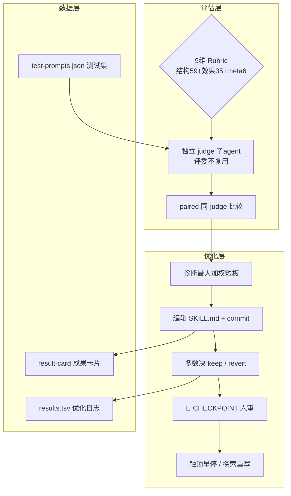
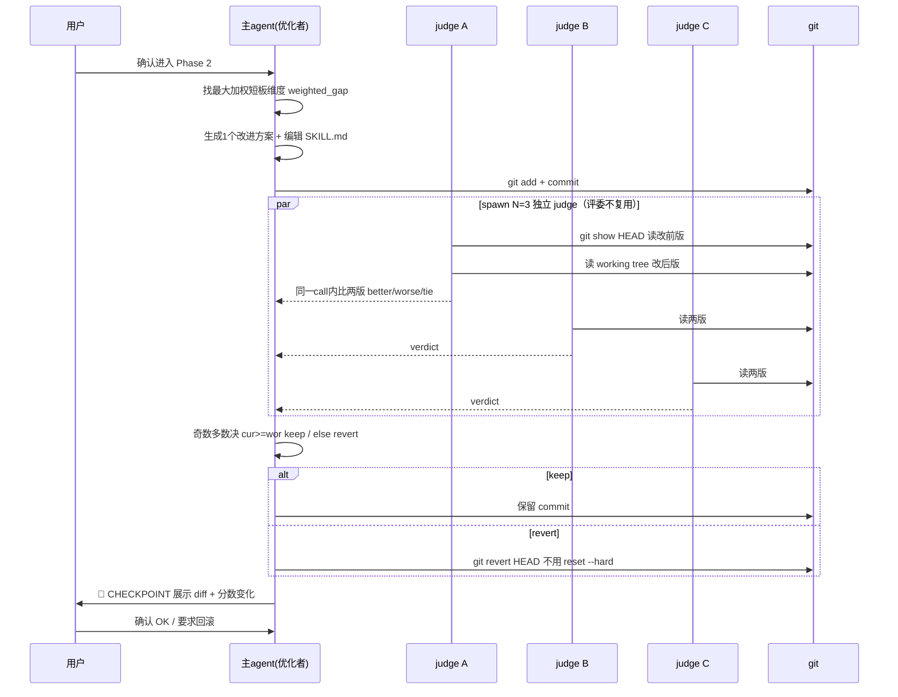

# Darwin Skill — 像训练模型一样优化 Agent Skills

> **GitHub:** [github.com/alchaincyf/darwin-skill](https://github.com/alchaincyf/darwin-skill) · 作者：花叔 Huashu
> **本解读按 agent ⊗ framework 类规格产出（全新分析）** · 版本 v2.1（2026-06-10）

## 子文档索引

- [`evaluation-rubric.md`](evaluation-rubric.md) — 9 维评估体系设计：权重依据、加权短板、LLM-judge 反偏差
- [`paired-ratchet.md`](paired-ratchet.md) — paired 比较棘轮机制：keep/revert 决策、探索性重写、数据模型

## 根因：Skill 数量过载后，需要「像训练模型一样」的优化闭环

Agent Skill 生态在快速扩张——Claude Code、Codex、Cursor、Gemini CLI、OpenCode 等 50+ runtime 都支持 `SKILL.md` 格式。当你有 10 个 Skills 时可以手动维护；当你有 60+ 个 Skills 时，你需要一个系统。传统 Skill 审查是**纯结构性的**（格式、编号、路径），但"一个格式完美的 Skill，跑出来的效果可能很差" [README.md:99-99]()。

<!-- snippet: 传统的 Skill 审查是**纯结构性的**：检查格式对不对、步骤有没有编号、路径能不能访问。 -->

darwin-skill 把 Andrej Karpathy 的 [autoresearch](https://github.com/karpathy/autoresearch)（写 `program.md` 定义目标 → agent 自主生成并测试代码变更 → 只保留可测量改进）整体搬到 Skill 优化领域，并叠加微软研究院的 SkillLens / SkillOpt 两篇论文。一句话根因：**通过一套可量化、可归因、有人把关的评分与改进循环，让 Skill 的质量只升不降。**

> autoresearch → darwin-skill 的映射：`program.md` → 本 SKILL.md、`train.py` → 每个待优化的 SKILL.md、`val_bpb` → 9 维加权总分、`git ratchet` → keep/revert 机制、`test set` → test-prompts.json [README.md:111-111]()。

<!-- snippet: | autoresearch | 达尔文.skill | 为什么这样映射 | -->

这个项目最特别的地方是**自指/递归性**：darwin-skill 优化别人那套 9 维 rubric，照样用来优化它自己——`references/skilllens-evidence.md` 记录了 `darwin-skill self-fix` 从 86.05 到 92.05（+6.0）的自指闭环实测 [references/skilllens-evidence.md:137-137]()。

<!-- snippet: | **darwin-skill (self-fix)** | **86.05** | **92.05** | **+6.0** | -->

## 概览

| 维度 | 说明 |
|------|------|
| 是什么 | Agent Skill 自主优化器：评估 → 改进 → 实测验证 → 人类确认 → 保留或回滚 → 成果卡片 |
| 痛点 | Skill 数量过载后纯结构审查失效；改完不知道效果是否真的更好；LLM 自评不可信 |
| 适用 | 维护大量 Skills 的 agent 开发/研究者；Skill 生态工程化 |
| 运行形态 | 一份高度结构化的 `SKILL.md` 方法论文档（Agent Skill，跨 runtime 通用） |
| 评估体系 | 9 维加权 rubric（结构 59 / 效果 35 / meta 6，总分 100） |
| 验证机制 | paired 同-judge 比较 + 奇数多数决（v2.1）+ human-in-the-loop 三层守关 |
| 数据载体 | results.tsv（优化日志）+ test-prompts.json（测试集）+ result-card 成果卡片 |
| 授权 | MIT |

### 核心能力清单

| 能力 | 说明 |
|------|------|
| 9 维评估 rubric | 结构维度（Frontmatter/工作流/失败模式/检查点/具体性/资源）、效果维度（架构/实测）、meta 维度（反例黑名单） |
| paired 比较棘轮 | v2.1 升级：绝对分数降级为 triage，keep/revert 走同-judge paired 比较 + 奇数多数决，消除换尺噪声 |
| 自主优化循环 | Phase 0～3：初始化 → 测试 prompt 设计 → 基线评估 → 每轮单维度 hill-climbing → 汇总报告 |
| 人在回路 | 🔴 CHECKPOINT / 🛑 STOP 三层守关，区别于 SkillOpt 的全自动 |
| Runtime 中立性 gate | 红灯扫描，防「在 Claude Code 里」等措辞导致跨 runtime 拒装 |
| 反例黑名单 | 8 条 darwin 操作会踩的坑（同 context 自评、git reset --hard、凑分堆冗余等） |
| 成果卡片 | templates/result-card.html 三风格 + scripts/screenshot.mjs 高清截图 |
| 高杠杆策略 | 显性视觉标记、if-then 三段式 fallback、维度相关簇、触顶早停（HL-1~4） |

### 技术栈一览

darwin-skill 不是传统代码库，其"技术栈"是一套跨 runtime 的协议 + 学术依据 + 工程底座：

| 层面 | 技术 |
|------|------|
| 协议 | Agent Skills 协议（`SKILL.md`），跨 50+ skills-compatible runtime |
| 学术依据 | autoresearch（Karpathy）、SkillLens（arXiv 2605.23899）、SkillOpt（arXiv 2605.23904） |
| 工程底座 | git（revert 棘轮）+ results.tsv + test-prompts.json |
| 视觉产物 | HTML 模板 + playwright 截图脚本（`scripts/screenshot.mjs`） |
| 生态 | 微软已把 darwin-skill 列入 SkillOpt 官方集成名单 |

## 架构总览

darwin-skill 的"架构"不是传统模块分层，而是一条贯穿的**优化流水线**：用 9 维 rubric 打分 → 找最大加权短板 → 针对短板生成改进 → 编辑 + commit → paired 比较多数决 → keep 或 revert → 人类确认。评分与改进共享一套 rubric，评价决策与优化动作通过 git 状态机衔接：

### 模块职责映射

| 关注面 | 核心载体 | 职责 |
|--------|---------|------|
| 评估体系 | SKILL.md「评估 Rubric」「评分规则」 | 9 维打分 + 独立 judge + paired 决策 |
| 优化循环 | SKILL.md「自主优化循环」 | Phase 0~3 单维度 hill-climbing |
| 棘轮机制 | SKILL.md「棘轮机制」 | keep/revert 保住基线只升不降 |
| Runtime 审查 | references/runtime-neutrality.md | 红灯扫描 gate |
| 反例约束 | SKILL.md「反例黑名单」 | 自我约束避免踩坑 |
| 成果与数据 | templates/ + scripts/ + results.tsv | 可视化 + 日志 + 测试集 |

## 核心链路：单轮优化决策

每次优化轮的核心是一个**「改 → 评 → 决策」闭环**。v2.1 的关键是把「评分」从绝对值改成同行 judge 的 paired 比较（为什么：LLM judge 给的是抽样不是测量，`参考 paired-ratchet.md`）：

完整 Phase 0~3 流程与诊断规则见 [`paired-ratchet.md`](paired-ratchet.md)。

## 核心模块导读

| 模块 | 关注面 | 深读 |
|------|--------|------|
| 9 维评估体系 | 权重设计、评分规则、独立 judge、加权短板、LLM-judge 反偏差 | [`evaluation-rubric.md`](evaluation-rubric.md) |
| paired 棘轮机制 | keep/revert 多数决、触顶早停、探索性重写、human-in-the-loop、数据模型 | [`paired-ratchet.md`](paired-ratchet.md) |

## 四条高杠杆策略（HL）

实战验证的高回报操作，详细数据见 [`evaluation-rubric.md`](evaluation-rubric.md) 与 `references/skilllens-evidence.md`：

- **HL-1 显性视觉标记是 dim4 的杠杆**：加 🔴 CHECKPOINT / 🛑 STOP，靠「必须」措辞不行——LLM 解析时扫描视觉标记。4 行改动撬动 dim4 +3 分 [SKILL.md:310-310]()。

<!-- snippet: **HL-1（dim4）显性视觉标记是杠杆**：加 🔴 CHECKPOINT / 🛑 STOP，靠「必须」措辞不行——LLM 解析时扫描视觉标记。 -->
- **HL-2 if-then 三段式 fallback 表**：把「症状/解法」升级为「触发条件 / 一线修复 / 仍失败兜底」三段式，是 SkillLens failure-mechanism encoding 的落地 [SKILL.md:311-311]()。

<!-- snippet: **HL-2（dim3）if-then 三段式 fallback 表**： -->
- **HL-3 维度相关簇警告**：dim2/3/4 是相关簇，找最大加权短板时同时看相关簇再决定是否同步改 [SKILL.md:312-312]()。

<!-- snippet: **HL-3（Phase 2 诊断）维度相关簇警告**：dim2/3/4 是相关簇 -->
- **HL-4 触顶自动 break**：连续 2 轮 Δ<2 分就 break，+0.15 是停手信号不是继续信号 [SKILL.md:313-313]()。

<!-- snippet: **HL-4（Phase 2 退出）触顶自动 break**： -->

## 同类项目对比

| 维度 | darwin-skill | autoresearch | SkillOpt（微软） | 传统结构审查 |
|------|--------------|--------------|------------------|--------------|
| 领域 | Agent Skill 优化 | 任意代码自动实验 | Agent Skill 进化 | Skill 格式检查 |
| 运行形态 | 一份 SKILL.md 方法论 | 脚本/提示词 | Python 库 | 手工/工具 |
| 评估 | 9 维 rubric（结构+效果+meta） | loss（`val_bpb`，确定性） | validation-gated edits | 结构是否规范 |
| 决策 | paired 同-judge + 奇数多数决 | 绝对值比大小 | 独立验证 | 人工目检 |
| 人在回路 | 🔴 CHECKPOINT / 🛑 STOP 三层 | 全自主 | 全自主 | 全人工 |
| 自指 | 用自己优化自己（self-fix +6.0） | — | 生态互证 | — |

**darwin-skill vs SkillOpt 的关键区别**：SkillOpt 是全自主系统，darwin-skill 强调 human-in-the-loop——Skill 的好坏比 validation loss 更微妙，关键阶段强制暂停让人做最终判断 [README.md:235-235]()。

<!-- snippet: **达尔文 vs SkillOpt 的关键区别**：SkillOpt 是全自主系统，达尔文.skill 强调 human-in-the-loop -->

darwin-skill 相对传统结构审查，不看"写得规不规范"，而看"改完实际跑出来的效果是否真的更好" [SKILL.md:26-26]()。

<!-- snippet: 与纯结构审查的区别：不只看 SKILL.md 写得规不规范，更看改完后**实际跑出来的效果是否更好** -->

## 设计亮点

- **paired 比较替代绝对分数**：这是本 skill 最反直觉也最扎实的一笔。它识别出 LLM judge 打分是"抽样不是测量"，绝对总分 = 用两台未校准磅秤量节食前后 [SKILL.md:63-63]()。

<!-- snippet: LLM judge 给的是**抽样、不是测量** -->
  改走同行 judge 一次 call 内比两版，让"那把不准的尺对两版等量作用、在比较时抵销" [SKILL.md:215-215]()。这是 RLHF 用 pairwise 不用 absolute scoring 的同一原理。

<!-- snippet: 照 9 维 rubric 当【比较准则】（不是各打绝对分） -->
- **评分与优化解耦 + 评委不复用**：评价用独立子 agent（避免「自己改自己评」），下一轮换全新评委避免锚定效应 [SKILL.md:23-23]()。

<!-- snippet: 4. **独立评分** — 评分用子agent，避免「自己改自己评」的偏差 -->
- **用 git 当棘轮底盘**：keep/revert 各成 commit，且禁用 `git reset --hard` 改用 `git revert`，保住可追溯链 [SKILL.md:379-379]()。

<!-- snippet: 会丢工作树未提交改动；CI 历史断裂 -->
- **框架即自我约束**：darwin 把自己会踩的坑显式编码成反例黑名单，每轮改动前对表自查——这是该 skill 对自己练习 SkillLens「failure-mechanism encoding」原则 [SKILL.md:387-387]()。

<!-- snippet: 每轮 Phase 2 改动前对照本表一次 -->

## 不足与风险

- **fine-grained 判别仍不可信**：即使 meta-rubric 把 judge 准确率从 46.4% 提到 73.8%，仍每 4 次决策错 1 次——所以强制人审，但这也意味着**不能全自动跑完**，规模效益打折扣。
- **方法论强依赖 LLM 判断**：rubric 评分、paired 比较全部由 LLM 完成，模型的推理能力上限就是优化效果上限。
- **非开箱即用**：作为一份 `SKILL.md`，没有独立 CLI/库；要跑起来依赖宿主 agent 执行循环，也无法脱离 git/测试 prompt 的工程前提。

## 可借鉴的设计

- **把"评价"与"被测者"分离到不同评判者**，避免自评乐观偏差——可迁移到任何 LLM 评测，不只 Skill。
- **用 paired 相对比较代替绝对打分**，比绝对分对 judge 换尺更鲁棒；同类评测（如 DeepEval 的 LLM-as-Judge）也可借鉴多数决。
- **棘轮 + 显式回滚**：只保留可测量的改进，其余干净回滚——任何"自动改写内容"型工具都该有这层保险。
- **把失败路径编码进规范**：写"不要做 Y"与写"应该做 X"同等重要，且应单独成章节可检索。

## 总结

darwin-skill 的根因是"Skills 数量过载后，需要一套像训练模型一样的系统化优化闭环"。它用**可量化的 9 维 rubric**回答"哪个 Skill 最弱、先改谁"，用 **paired 同-judge 多数决棘轮**回答"这次改动到底真进步了没"（只保留确证改进、自动回滚退步、分数只升不降），用**人在回路三层守关**回答"哪些决策该交给人的判断力"。理解它的钥匙：评估体系（怎么打分）、棘轮机制（怎么决定保留/回滚）、autoresearch→SkillOpt 学术谱系（设计从哪来），以及它自己不断强化的自指闭环。

- [`evaluation-rubric.md`](evaluation-rubric.md) — 深入 9 维评估体系与 LLM-judge 反偏差设计
- [`paired-ratchet.md`](paired-ratchet.md) — 深入 paired 棘轮、keep/revert 决策与数据模型

> **GitHub:** [github.com/alchaincyf/darwin-skill](https://github.com/alchaincyf/darwin-skill)
