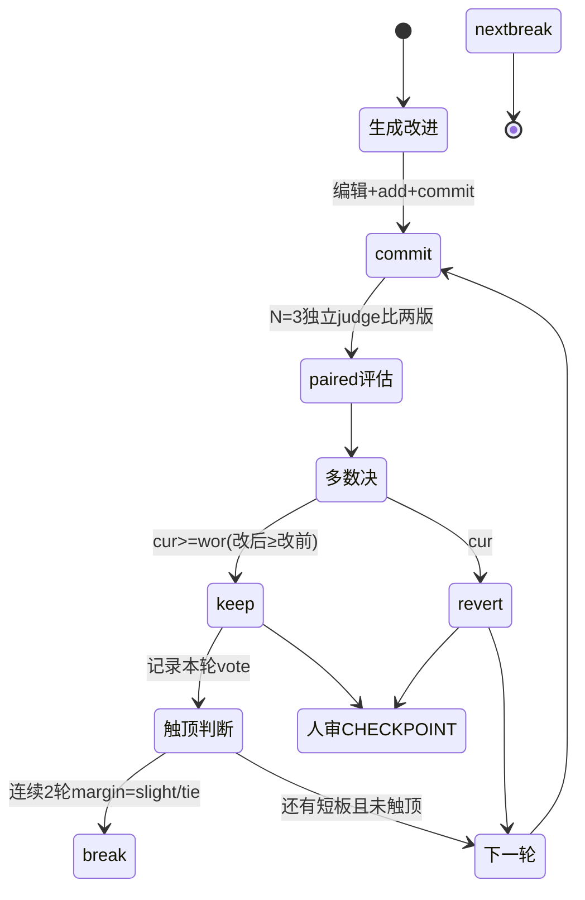
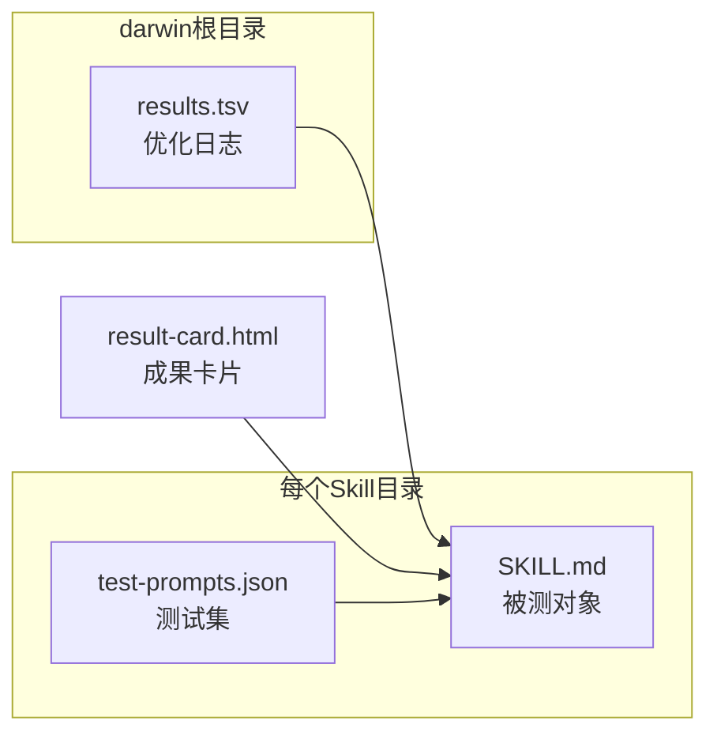

# Paired 比较棘轮机制深度解读

> 关联：[`README.md`](README.md) · darwin-skill 从 v1→v2→v2.1 逐步打磨的"只保留改进、自动回滚退步"核心机制。

## 一句话

darwin-skill 的棘轮机制回答一个难题：**autoresearch 用确定性 loss 判断"改好没改好"，但 Skill 的"好坏"只能靠 LLM judge——而 LLM 打分不稳定，连"新分比旧分高"都不能证明真的变好了。** 它的解法分两步：先用版本演进从头纠正"用绝对分当棘轮"这个 1.0 的概念错误，再用 **paired 同-judge 比较 + 奇数多数决** 让棘轮建立在统计上更可靠的决策上，最后用人在回路守住最终判断。

## v1 → v2.1：棘轮基准从「绝对分数」演进到「paired 比较」

棘轮机制的问题史就是这门 skill 的核心教训。三版对"什么叫改进"的定义完全不同：

| 版本 | keep/revert 判定依据 | 问题 |
|------|---------------------|------|
| v1 | 新绝对总分 > 旧绝对总分 | **假退步**：同一份没改的文字换个 judge 差 ±8，绝对分里很大一块是换尺噪声 |
| v2 | paired 同-judge 比较 + 多数决 | 基本成型，但保留"绝对分也能做参考"的尾巴 |
| v2.1 | keep/revert 一律走 paired；绝对分**只做 triage** | 明确砍掉绝对分在 keep/revert 中的角色 [SKILL.md:8-8]() |

<!-- snippet: > **v2.1 · 2026-06-10** — keep/revert 棘轮从「绝对分数 delta」改为「**paired 同-judge 比较 + 奇数 N 多数决** -->

v2.1 升级的导火索是一个具体教训：实测一支**只加了 3 个 🔴 字元**的 skill、单评却 −8.5，全是 judge 换尺、非真实退步 [SKILL.md:62-62]()。

<!-- snippet: 一支只加了 3 个 🔴 字元的 skill、单评却 −8.5，全是 judge 换尺、非真实退步 -->

**为什么绝对分不可靠（反事实推理）**：如果一台磅秤每称一次随机偏 ±1kg，用它量"节食前后体重差"得到的结果大半是磅秤噪声而非真实体重差。LLM judge 给绝对分就是这种"未校准磅秤"——分数住在「文字 × judge 当下选的标准」里。pairwise 比较（一次 call 内同一 judge 比两版）则是"同一台磅秤量前后"，误差在相减时抵销。这跟 RLHF 用 pairwise preference 而不用 absolute scoring 是同一个道理 [SKILL.md:63-63]()。

<!-- snippet: pairwise preference >> absolute scoring 是 LLM judge 的已知结论 -->

## keep/revert 决策：paired 比较 + 奇数多数决

Phase 2 每轮的决策核心在这两条（`SKILL.md:211-229`）：

**Step 4 — paired 重新评估**：spawn N=3 独立 judge，每个**在同一次 call 内**读改前版（`git show HEAD`）和改后版（working tree），照 9 维 rubric 当**比较准则**（不是各打绝对分），回 `{better | worse | tie} + margin{clear|slight} + 一句理由` [SKILL.md:212-212]()。

<!-- snippet: spawn N=3 独立 judge，每个【同一次 call 内】读两版： -->

N 取奇数是多数决的需要；close call 时升到 5。**关键机制是 within-judge cancellation**：同一 judge 在心里那把不准的尺，对两版等量作用、在比较时抵销。

**Step 5 — 共识决策（多数决）**：`cur` = 投 better 的 judge 数，`wor` = 投 worse 的。

- `cur >= wor`（多数说改后 ≥ 改前，含 tie）→ **keep**；再检查是否触顶（连续 2 轮多数判 margin=slight 或 tie → break 进 Phase 3）
- `cur < wor`（多数说 worse）→ **revert**，`git revert HEAD` 创建新 commit 回滚 [SKILL.md:221-221]()。

<!-- snippet: if cur >= wor:  # 多数说改后 ≥ 改前（含 tie） -->

决策关键一句：**单评绝对分数出现「负 delta」≠ revert 信号**，必须经 paired 多数判 worse 才 revert，否则在丢真实增益 [SKILL.md:229-229]()。

<!-- snippet: # 单评绝对分数出现「负 delta」≠ revert 信号；必须经 paired 多数判 worse 才 revert -->

### 决策状态机

## 触顶早停与探索性重写：啃下 hill-climbing 的局部最优

棘轮保证"只升不降"，但 hill-climbing 有天然天花板——只做小步改进会卡在局部最优。darwin-skill 用两条互补策略处理：

**触顶早停（HL-4）**：连续 2 轮 Δ<2 分就 break。+0.15 是停手信号不是继续信号，硬凑 MAX_ROUNDS=3 会引入 over-engineering（`SKILL.md:313`）。

<!-- snippet: 连续 2 轮 Δ < 2 分 → break 进 Phase 3。+0.15 是停手信号不是继续信号 -->

**探索性重写（Phase 2.5）**：当连续 2 个 skill 都在 round 1 就 break（涨不动）时，对瓶颈 skill 做一次**结构性重写**而非微调——`git stash` 保存当前最优版，从头重写 SKILL.md，重新评估；重写版更优则采用，否则 `git stash pop` 恢复 [SKILL.md:249-249]()。

<!-- snippet: 2. git stash 保存当前最优版本 -->

为什么需要重写：微调是在现有结构里补丁，能提升局部；但当现有结构本身是瓶颈时，只有"先拆后建"才能突破。这与代码领域的"重构 vs 微调"是同一逻辑。Phase 2.5 被 __CHECKPOINT__ 强约束，必须征得用户同意后才执行 [SKILL.md:257-257]()。

<!-- snippet: **🔴 CHECKPOINT · 🛑 STOP：必须征得用户同意后才执行。** -->

## 人在回路：三层守关，回扣根因

darwin-skill 自述与 SkillOpt 最关键的区别就是 human-in-the-loop [README.md:64-64]()。

<!-- snippet: **3. Human in the Loop 三层守关**（达尔文区别于 SkillOpt 全自动设计的核心） -->

三层强制暂停点：

| 关卡 | 位置 | 暂停动作 |
|------|------|---------|
| Phase 1 基线评估 | 基线评分卡展示后 [SKILL.md:180-180]() | 自动 + 人工审报告，决定改什么 |
| Phase 2 单维度优化 | 每轮结束 🔴 CHECKPOINT | 展示 diff + 分数变化，等用户确认 |
| Phase 3 回归测试 | 🛑 STOP | 涨幅低于阈值强制停手 |

<!-- snippet: > **🔴 CHECKPOINT · 🛑 STOP：暂停等用户确认，再进入优化循环。** -->

为什么必须人审：Skill 的好坏比 validation loss 更微妙——loss 是确定性可复现的，Skill 质量含设计判断。即便 paired 比较比绝对分可靠，每 4 次决策仍可能错 1 次（73.8% 准确率），关键决策交给人的判断力。

## 反例黑名单：棘轮的第一道保险

darwin-skill 把自己可能踩的坑编码成"反例黑名单"，每轮 Phase 2 改动前对照自查。这既是它产品质量的来源，也是 SkillLens「failure-mechanism encoding」维度对自身的应用。与棘轮最相关的是前两条：

| # | 反模式 | 为什么是棘轮杀手 | 替代 |
|---|--------|-----------------|------|
| 1 | 同 context 自评自改 | 我刚改的肯定更好（乐观偏差），棘轮形同虚设 | 独立子 agent + paired 多数决 |
| 1b | 拿绝对分 delta 当棘轮 | 换尺噪声冒充真退步，false-revert 丢真实增益 | 绝对分只 triage，keep/revert 走 paired [SKILL.md:378-378]() |
| 2 | `git reset --hard` 当回滚 | 丢工作树未提交改动、CI 历史断裂 | `git revert HEAD` 建反向 commit [SKILL.md:378-378]() |

<!-- snippet: | 1b | **拿绝对分数 delta 当 keep/revert 棘轮** -->

严格自律让棘轮不被自己的偏差破坏：`git reset --hard` 这种不可逆操作被显式列禁，回滚一律走可追溯的 `git revert`。

## 数据模型：results.tsv 与 test-prompts.json

darwin-skill 的"存储"是非关系型轻量文件（TSV + JSON），这是它作为无状态方法论文档的必然取舍——不依赖数据库，任何 runtime 都能读写。

### 实体关系

### 存储选型与理由

作者没有引入数据库，而是用 `results.tsv` + `test-prompts.json` 两个纯文本文件。理由可从形态推断：darwin-skill 是跨 runtime 的 SKILL.md，没有任何 runtime 依赖、不引入新依赖是约束规则第 2 条 [SKILL.md:394-394]()——数据库会破坏"任何 agent 都能跑"的中立性。TSV/JSON 通用、可 grep、可 diff、可进 git，是方法论式工具存储元数据的最轻选择。

<!-- snippet: 2. **不引入新依赖** — 不添加skill原本没有的scripts或references文件 -->

### 核心存储格式

**results.tsv** 的 9 列设计（`SKILL.md:288-302`）承载完整的优化审计链路。`eval_mode` 列是关键设计——它必须标注一次评估的性质，因为不同性质的分数可信度完全不同，不能混用：

| 列 | 内容 | 说明 |
|----|------|------|
| timestamp | 时间戳 | 排序/审计 |
| commit | git commit hash | 可追溯 |
| skill | skill 名 | 归属 |
| old_score / new_score | 分数 | paired 行记 vote 比数（如 `3-0 better`） |
| status | baseline / keep / revert / error | 决策结果 |
| dimension | 改的维度 | 归因 |
| note | 备注 | 记 vote 理由 / runtime_warn |
| **eval_mode** | paired / full_test / dry_run | **可信度分级，keep/revert 权威依据** |

`eval_mode` 的三级划分 [SKILL.md:297-297]() 与「品质控制」主线呼应：

<!-- snippet: `eval_mode` 列：`paired`（同 judge 比改前/改后，**keep/revert 权威依据**） -->

- `paired`：同 judge 比改前/改后，是 keep/revert 的权威依据
- `full_test`：子 agent 跑 prompt，参考
- `dry_run`：模拟推演，仅供参考（占比过高则分数不可信）

### Schema 演进策略

TSV/JSON 无迁移层，演进靠**向后兼容**。一个证据：Runtime 审查要把红灯命中写进 results.tsv 时，明确"不新增列，写入已有 `note` 列以保持向后兼容" [references/runtime-neutrality.md:55-55]()。

<!-- snippet: 命中项以 `runtime_warn=N` 形式写入 results.tsv 的 `note` 列（不新增列、保持向后兼容） -->

### 读写路径

- **写入**：每轮优化 Phase 2 Step 5 后追加一行到 results.tsv；Phase 0.5 写入 test-prompts.json。
- **读取**：Phase 0 读取现有 results.tsv 看历史；Phase 2 Step 4 读 test-prompts.json 驱动 dim8 实测。
- **异常处理**：results.tsv 缺失则建表头；损坏（列数不匹配）则备份为 `.bak` 后重建并告知用户——不静默跳过的原则 [SKILL.md:357-357]()。

<!-- snippet: | results.tsv 缺失 | 文件不存在 | 新建并写表头行（9列：含 eval_mode） -->

## 一篇小型的可复现实验：self-fix 自指闭环

darwin-skill 用自己优化自己，这是全部机制的最强实证——若这套方法论有效，用它优化它自己的过程中应该能观察到分数上升（`references/skilllens-evidence.md:137`）。

<!-- snippet: | **darwin-skill (self-fix)** | **86.05** | **92.05** | **+6.0** -->

这个自指闭环同时是方法论的风险：darwin 用自己定制的 rubric 评自己的改动，存在潜在的自我确认；但它又用独立 judge + paired 比较制衡了这一点（这套制衡机制正是本 skill 的精华）。

## 与 README 的全局关联

棘轮机制不是孤立存在——它是整个 darwin-skill 的**决策内核**：评估 rubric（[`evaluation-rubric.md`](evaluation-rubric.md)）产出"哪最弱/改哪个"，棘轮决定"这次改动保留还是回滚"，而二者共享同一套"LLM 判断不可信、需 paired + 人审"的底层信念。回到根因，棘轮让"像训练模型一样优化"成立——没有它，优化行为会随时间积累局部退化，无法做到"分数只升不降"。
