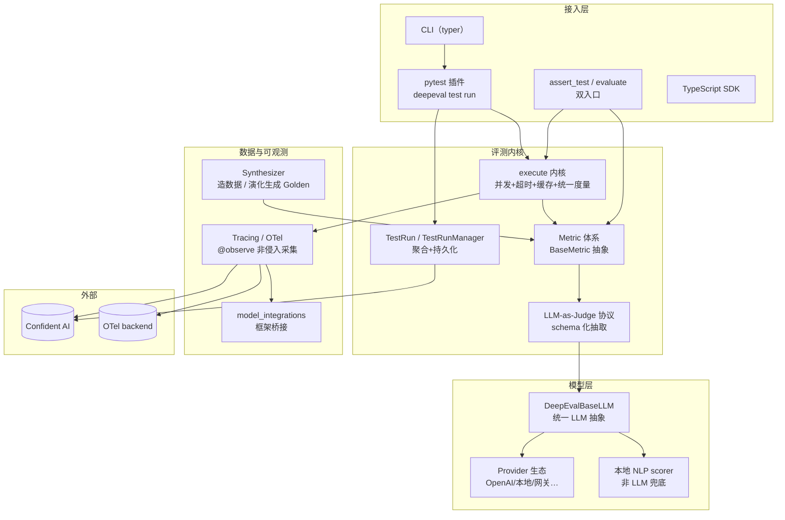

# DeepEval — LLM 评测框架

> **GitHub:** [github.com/confident-ai/deepeval](https://github.com/confident-ai/deepeval) · **文档:** [deepeval.com](https://deepeval.com)
> **本解读按 framework ⊗ Python 类规格产出（全新分析，非增量 patch）** · 版本 v4.1.7

## 子文档索引

- [`evaluation-core.md`](evaluation-core.md) — 评测核心链路：assert/evaluate 双入口 + 并发/超时/缓存执行内核 + TestRun 聚合
- [`metrics-judges.md`](metrics-judges.md) — Metric 体系与 LLM-as-Judge 协议：schema 化抽取判官 + GEval/DAG 两类判官
- [`tracing.md`](tracing.md) — Tracing/OpenTelemetry 可观测：span 即 LLMTestCase + REST/OTLP 双路由
- [`synthetic-data.md`](synthetic-data.md) — Synthesizer 测试数据合成：四来源 + 演化生成 Golden
- [`model-layer.md`](model-layer.md) — 模型层抽象与框架集成：DeepEvalBaseLLM + Provider 生态 + 环境开关
- [`cli-testing.md`](cli-testing.md) — CLI 与 pytest 插件：评测进 CI/CD gate 的两种路径

## 根因：LLM 输出质量如何量化、回归与对比

大模型应用的输出是**不可精确断言**的——同样的输入可能给出千百种合理回复，无法像传统单测一样 `assert result == expected`。DeepEval 要解决的根本问题，用 README 自述说是 *"similar to Pytest but specialized for unit testing LLM apps"*：**把 LLM 评测收敛为可组合的评测原语**——Test Case（被测对象）→ Metric（评分标准）→ LLM-as-Judge（打分）→ TestRun（聚合回归），并让评测结果可直接进 CI gate、可选对接到 Confident AI 平台做端到端可观测。

它不是又一个大模型 API 封装，而是一套**"评测即工程"的系统**：ML 特有的 Judge 协议、多级评测 scope、自动造数据、非侵入 trace，共同回答"这条输出到底好不好、比上次强还是弱、该不该发版"。

## 概览

| 维度 | 说明 |
|------|------|
| 是什么 | 类似 pytest、专注 LLM 应用单元测试的评测框架/库 |
| 痛点 | LLM 输出不可断言；量化、回归、对比、进 CI 都缺标准手段 |
| 适用 | RAG/Agent/对话/MCP 应用的输出质量评测、prompt/模型选型对比、CI gate |
| 运行形态 | Python 库（`pip install`）+ CLI + pytest 插件 + TypeScript SDK |
| 判官机制 | LLM-as-Judge（QAG / G-Eval / DAG）+ 本地 NLP scorer 兜底 |
| 核心能力 | 50+ metric、Synthesizer 造数据、OpenTelemetry tracing、多框架集成、Optimizer |
| 授权 | Apache-2.0，Confident AI 出品 |

### 核心能力清单

| 能力 | 说明 |
|------|------|
| 50+ 现成 metric | RAG（faithfulness/contextuality）、Agentic（任务完成/工具正确性）、多轮、MCP、多模态 |
| LLM-as-Judge 协议 | schema 化抽取三级降级 + GEval log-prob 加权 + DAG 确定性分数 |
| 双评测入口 | `assert_test`（pytest 断言语义）+ `evaluate`（免 pytest，notebook 友好） |
| 三 Scope | End-to-End / Trajectory-based / Component-level 三级评测 |
| Synthesizer | 文档/上下文/从零/已有四类来源 + 演化生成 Golden |
| Tracing | `@observe` 非侵入采集，OpenTelemetry REST/OTLP 双路由上传 |
| CI gate | `deepeval test run` = 带插件 pytest，退出码即 pass/fail |
| 平台对接 | 本地优先 + 可选上传 Confident AI 端到端可观测 |

### 技术栈一览

| 层面 | 技术 |
|------|------|
| 核心语言 | Python ≥3.9 + 部分 TypeScript SDK |
| 数据模型 | Pydantic v2（LLMTestCase/Golden/TestRun/Span） |
| CLI | typer + click |
| 可观测 | OpenTelemetry（api/sdk + grpcio）|
| 判官后端 | OpenAI SDK + 本地 scorer + 多 provider |
| 测试 | pytest + pytest-xdist/repeat/rerunfailures/asyncio |
| 重试 | tenacity |

## 架构总览

DeepEval 的主体是一个可复用 Python 库，围绕**"评测原语"**组织，核心是一条贯穿的链路：**造数据 → 评测 → 打分 → 聚合 → 追踪/上传**。框架内核（评测原语 + 判官协议 + trace）与扩展层（CLI/pytest 插件/框架集成/平台对接）清晰分层：

## 核心模块导读

| 模块 | 关注面 | 深读 |
|------|--------|------|
| 评测执行内核 | assert/evaluate 双入口 + 并发/超时/缓存 + TestRun 聚合，所有评测的共同执行路径 | [`evaluation-core.md`](evaluation-core.md) |
| Metric + Judge | BaseMetric 抽象、统一 schema 判官协议、GEval log-prob / DAG 确定性两类判官 | [`metrics-judges.md`](metrics-judges.md) |
| 可观测采集 | `@observe` span≈LLMTestCase、OpenTelemetry REST/OTLP 双路由 | [`tracing.md`](tracing.md) |
| 合成数据 | Synthesizer 四来源 + 演化生成 Golden 冷启动评测 | [`synthetic-data.md`](synthetic-data.md) |
| 模型抽象 | DeepEvalBaseLLM 统一判官后端 + Provider 生态 + 环境开关 | [`model-layer.md`](model-layer.md) |
| CLI / CI | pytest 插件织入 + `deepeval test run` 包装 pytest 成 CI gate | [`cli-testing.md`](cli-testing.md) |

## 设计亮点

- **「span 即 LLMTestCase」**：tracing 的自研 span 直接带 `llm_test_case`/`metrics` 字段，让判官 LLM 把每个 span（单次 LLM 调用/检索/工具）当测试用例打分——这是"组件级评测"成立的前提（[deepeval/tracing/types.py:102-103]()）。
- **统一判官协议 + 三级降级**：`generate_with_schema_and_extract` 先试 schema 实例、再 JSON、最后 `trimAndLoadJson` 兜底，保证"总有一条路把 LLM 回复变结构化"（[deepeval/metrics/utils.py:525-536]()）。
- **`__init_subclass__` 自动埋点两处复用**：BaseMetric 与 DeepEvalBaseLLM 都靠它自动接入 tracing，judge 的每次调用零成本进 trace，无需手写埋点（[deepeval/models/base_model.py:51-62]()）。
- **order 自愈**：多 `evaluate()` 累积的 order 重复会被检测并全量重编号，避免上传 Confident 后显示 Skipped（[deepeval/test_run/test_run.py:229-231]()）。

> 设计细节的权衡沿深处，见各子文档。

## 同类项目对比

| 维度 | DeepEval | ragas | TruLens | LangSmith Evals | pytest（裸） |
|------|----------|-------|---------|-----------------|-------------|
| 定位 | LLM 评测框架（类似 pytest） | RAG 评测库 | LLM 可观测+评测 | 评测+eval 平台 | 通用测试框架 |
| 判官机制 | LLM-as-Judge（G-Eval/DAG）+ 本地 scorer | LLM-as-judge | LLM feedback | LLM judge | 无（需自写断言） |
| Metric | 50+ 跨场景 | RAG 专用 | 通用 + 自定义 | 可配置 | 无 |
| 造数据 | Synthesizer 演化生成 | — | — | — | 无 |
| Tracing | @observe + OTel 双路由 | 轻量 | 深度 OTel | 平台内 | 无 |
| CI 接入 | pytest 插件原生 | 手动 | 手动 | 平台 | 原生 |
| 免 pytest | evaluate() 独立 | ✓ | ✓ | — | — |

DeepEval 的核心差异在于**把"LLM 评测"做成一等工程的完整闭环**：类似 pytest 的断言心智 + 统一 LLM-judge 协议 + 自动造数据 + 非侵入 trace，覆盖面最广。代价是抽象层多、上手成本高于纯 RAG 评测库（如 ragas），且深度平台化能力集中在 Confident AI（time 推理等部分能力为平台付费功能）。

## 总结

DeepEval 把"评测不可断言的 LLM 输出"从手工脚本变成了一套有边界的系统工程。理解它的四把钥匙：**Metric + 统一 Judge 协议**负责"如何打分"，**TestRun + 双入口**负责"如何聚合/进 CI"，**@observe Tracing**负责"非侵入采集 + 组件级评测"，**Synthesizer**负责"数据从哪来"。Model 抽象层则让它插进既有 LLM/框架栈而不绑架技术选型。

- [`evaluation-core.md`](evaluation-core.md) 深入评测执行链路与 TestRun 聚合
- [`metrics-judges.md`](metrics-judges.md) 深入 Judge 协议与两类判官
- [`tracing.md`](tracing.md) 深入可观测与 span 抽象
- [`synthetic-data.md`](synthetic-data.md) 深入合成数据
- [`model-layer.md`](model-layer.md) 深入模型抽象
- [`cli-testing.md`](cli-testing.md) 深入 CI/CD 接入

> **GitHub:** [github.com/confident-ai/deepeval](https://github.com/confident-ai/deepeval) · **文档:** [deepeval.com](https://deepeval.com)
