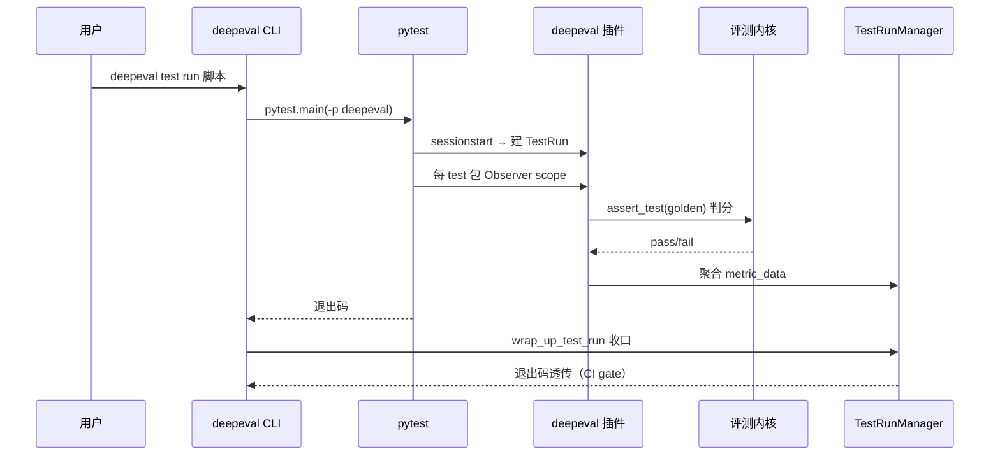

# DeepEval — CLI 与 pytest 插件（评测进 CI）

## 在项目中的角色与根因

本关注面是 DeepEval 的**DX/交付入口**。根因：评测如果只是库函数，很难进 CI/CD 或聚合跨测试结果。DeepEval 用两条路径解决——**pytest 插件**（`deepeval test run`，让评测成为标准的 CI gate）与 **CLI 命令家族**（typer）。二者本质是包装同一个评测内核（见 evaluation-core.md），只是不同的"驱动外壳"。

## pytest 插件：评测即断言

pyproject 注册 `pytest11` entry-point 为 `deepeval.plugins.plugin`（`pyproject.toml:15-16`），因此**只要安装了 deepeval，pytest 会自动装载该插件**。关键 hooks 织入 pytest 生命周期：

- `pytest_addoption`（[deepeval/plugins/plugin.py:20-20]()）：加 `--identifier` 等自定义选项；
- `pytest_sessionstart`（[deepeval/plugins/plugin.py:51-60]()）：在测试进程里建 `TestRun`，并设置 telemetry scope（`skip_if_empty=True` 让无关 pytest 套件保持静默，不误报为一次评测）；
- `pytest_runtest_call`（[deepeval/plugins/plugin.py:85-98]()）：**核心织入点**——用 hookwrapper 把每个测试包进 deepeval evaluation scope（`EvalSession(mode=EvalMode.EVALUATE)` + `Observer`），使测试内 `@observe` 产生的 span 能通过 `assert_test(golden=..., metrics=...)` 挂到 in-flight test run。

<!-- snippet: @pytest.hookimpl(hookwrapper=True)
def pytest_runtest_call(item: pytest.Item):
    """Wrap each test in a deepeval evaluation scope so `@observe` spans get
    attached to the in-flight test run via `assert_test(golden=..., metrics=...)`.
    """
    if not get_is_running_deepeval():
        yield
        return

    from deepeval.tracing.tracing import Observer, trace_manager
    from deepeval.tracing.types import EvalMode, EvalSession

    prev_session = trace_manager.eval_session
    trace_manager.eval_session = EvalSession(mode=EvalMode.EVALUATE) -->

`pytest_sessionfinish`（[deepeval/plugins/plugin.py:110-114]()）在会话结束做收尾。

> 设计决策七：**用 hookwrapper 而非改用户测试代码织入 trace 采集**。pytest 的 hook 系统让 deepeval 无需侵入用户测试文件即可为每次测试建立 evaluation scope，span 自动关联到 test run。代价是对 pytest 内部生命周期有较强耦合，且 `pytest_runtest_call` 里手写 `Observer(`__enter__/__exit__`)` 需要 careful 的异常安全（用 `try/finally` 保证恢复 `trace_manager.eval_session`）。

## CLI：`deepeval test run` 包装 pytest

CLI 主 app 用 typer 建（[deepeval/cli/main.py:61-62]()，注册 `test` 子命令）。

<!-- snippet: app = typer.Typer(name="deepeval", no_args_is_help=True)
app.add_typer(test_app, name="test") -->

`run` 命令（[deepeval/cli/test/command.py:47-49]()）是 `test` 子命令的执行体。

<!-- snippet: def run(
    ctx: typer.Context,
    test_file_or_directory: str, -->

其内部最终调用 `pytest.main(pytest_args)`（[deepeval/cli/test/command.py:184-184]()）把 `-p deepeval` 插件传给 pytest——即 `deepeval test run` 本质是"带 deepeval 插件的 pytest 调用"。退出码透传给 shell，使 CI 能判断 pass/fail。

<!-- snippet:     pytest_retcode = pytest.main(pytest_args) -->

命令家族还包括：`generate`（数据生成）、`login`/`logout`（Confident 认证）、`gate`（governance）、`inspect`（本地 TUI）、大量 `set-*/unset-*` provider 配置命令。

## 两条路径共享 TestRunManager

`deepeval test run`（包 pytest）与 `evaluate()` 只是外层驱动不同，**TestRun 聚合与上传逻辑完全复用**（都由 `global_test_run_manager` 与 `wrap_up_test_run()` 收口，见 evaluation-core.md）——CLI 模式下 finalize 延迟到 pytest 全跑完后一次收口，避免重复上传。

## 核心流程

## 与其他模块协同

- 依赖 **evaluation-core**（TestRun 聚合）与 **tracing**（Observer span 采集）；
- 复用 **confident** 上传；
- 三个外层（pytest 插件 / CLI / evals_iterator）共享 execution 内核，插件只是"让 pytest 的收集/生命周期接管评测"的适配层。

## 已知问题

- `pytest_sessionfinish`（[deepeval/plugins/plugin.py:112-112]()）内的 `print("Running teardown with pytest sessionfinish...")` 是明显的调试残留，会污染 CI 输出；【标注：真实存在，非推断】
- `cli/main.py` 的大量 provider `set-*/unset-*` 命令是高度重复的模板代码，维护成本较高。

## 关键权衡小结

- **pytest 插件 + 独立 evaluate() 双轨**：插件让评测融入既有 pytest 工程（CI 复用现成基础设施），`evaluate()` 让 notebook/无 pytest 场景也能跑。代价是维护两条接入路径与 pytest 版本的兼容性。
- **评测即断言、断言即 gate**：通过把分数收敛成 `assert_test` 的 pass/fail + pytest 退出码透传，DeepEval 把"LLM 质量评测"无缝嵌入标准 CI 门禁，弱化了对专属 report 系统的依赖。
