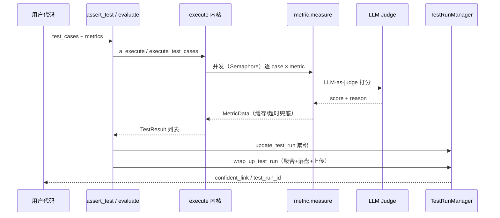

# DeepEval — 评测核心链路

## 在项目中的角色与根因

DeepEval 是一台"LLM 评测机器"，本关注面是它的**主入口 + 执行内核**：所有评测最终都汇聚到 `assert_test()`（单用例断言）或 `evaluate()`（批量用例），由 `evaluate/execute` 内核把一套 metric 逐条作用到每个 test case 上，产出 `TestResult`，再累积进 `TestRun` 并持久化/上传。

它被三个外层共用：pytest 插件（`deepeval test run`）、CLI、Dataset 的 `evals_iterator()`——三者只是"驱动外壳"，复用同一执行内核。

根因：LLM 评测要回答三个问题——**单条够不够好**（assert）、**一批整体如何**（aggregate）、**如何回归/对比**（TestRun 持久化 + 上传）。而 metric 的调用天然是"外部 LLM 依赖 + 网络 + 慢"的组合，评测内核必须同时处理并发放大、超时容错、结果缓存、批量聚合，而不是让用户手写 for 循环逐条跑。

## 双入口：assert 语义与批量聚合分离

`assert_test()` 是"单用例断言"入口。失败 metric 的收集专门兼容了用户自定义 metric 未处理 `score == undefined` 的场景，避免未定义分数触发误判（[deepeval/evaluate/evaluate.py:144-147]()）。

<!-- snippet: # This try block is for user defined custom metrics,
# which might not handle the score == undefined case elegantly
try:
    if not metric_data.success: -->

flaky 语义：flaky 用例失败只告警、不阻断 CI，非 flaky 才 `raise AssertionError`，让评测结果可直接作为 CI gate（[deepeval/evaluate/evaluate.py:158-161]()）。

<!-- snippet:         if test_case is not None and test_case.flaky:
            # Flaky test cases don't block CI: warn (shows up in pytest's
            # warnings summary) but don't raise
            warnings.warn( -->

`evaluate()` 是"批量用例"入口（[deepeval/evaluate/evaluate.py:169-176]()），默认 `run_async=True` 走并发执行，结束后统一 `wrap_up_test_run()` 上传并落盘（[deepeval/evaluate/evaluate.py:298-304]()）。二者内部都调到同一执行内核。

<!-- snippet: def evaluate(
    test_cases: Union[List[LLMTestCase], List[ConversationalTestCase]],
    metrics: Optional[
        Union[
            List[BaseMetric],
            List[BaseConversationalMetric],
        ]
    ] = None, -->

> 设计决策一：**把"断言"从"批量评测"里剥离成两个入口，共享执行内核**。`assert_test` 天然贴合 pytest 的断言模型（进 CI），`evaluate` 独立于 pytest（notebook/脚本友好）——用"一个内核、两层语义"换两套工作流，代价是 `evaluate.py` 里两条几乎平行的分支逻辑。

### trace-scoped assert：golden 驱动

用户只传 `golden`、未传 `test_case` 时走 `_assert_test_from_current_trace()`，从当前活动 trace（由 pytest 插件 / Observer 设定）反解出 test_case——基于 trace 的 trajectory 评测的接入点（[deepeval/evaluate/evaluate.py:98-100]()）。

<!-- snippet: if golden and not test_case:
        # Trace-scoped assert_test: read the active trace set by the plugin.
        test_result = _assert_test_from_current_trace( -->

## 执行内核：并发、超时、缓存、统一度量

### 并发放大

异步执行 `a_execute_test_cases()` 用 `asyncio.Semaphore(max_concurrent)` 限流（[deepeval/evaluate/execute/e2e.py:346-350]()）。

<!-- snippet:     semaphore = asyncio.Semaphore(async_config.max_concurrent)

    async def execute_with_semaphore(func: Callable, *args, **kwargs):
        async with semaphore:
            return await _await_with_outer_deadline( -->

同步版 `execute_test_cases()` 用 `evaluate_test_cases` 闭包顺序遍历（[deepeval/evaluate/execute/e2e.py:127-129]()）。

<!-- snippet: def evaluate_test_cases(
        progress: Optional[Progress] = None, pbar_id: Optional[int] = None
    ): -->

两版都按 LLMTestCase / ConversationalTestCase 分流 metric 类型，避免类型错配（[deepeval/evaluate/execute/e2e.py:120-123]()）。

<!-- snippet:         if isinstance(metric, BaseMetric):
            llm_metrics.append(metric)
        elif isinstance(metric, BaseConversationalMetric):
            conversational_metrics.append(metric) -->

### 超时容错

单 metric 超 deadline 时，把"正在执行"的 metric 标记失败、其余排空，避免单条慢 metric 拖垮整批（[deepeval/evaluate/execute/e2e.py:253-258]()）。

<!-- snippet:         except (asyncio.TimeoutError, TimeoutError):

            msg = _timeout_msg("evaluating metric", deadline_timeout)
            for i, metric in enumerate(metrics_for_case):
                if metric.skipped:
                    continue -->

超时消息引导用户用环境变量 `DEEPEVAL_PER_TASK_TIMEOUT_SECONDS_OVERRIDE` 调整（[deepeval/evaluate/execute/_common.py:62-64]()）。

<!-- snippet:         f"Timed out after {seconds:.2f}s while {action}. "
        "Increase DEEPEVAL_PER_TASK_TIMEOUT_SECONDS_OVERRIDE or set "
        "DEEPEVAL_LOG_STACK_TRACES=1 for full traceback." -->

### 结果缓存

命中缓存后复用已缓存的 `metric_data`（[deepeval/evaluate/execute/e2e.py:200-201]()）。

<!-- snippet:                         if cached_metric_data:
                            metric_data = cached_metric_data.metric_data -->

写缓存时对 `metric_data` 深拷贝并把 `evaluation_cost` 归零，使缓存的 metric 不计入 EvaluationCost（[deepeval/evaluate/execute/e2e.py:617-620]()）。

<!-- snippet: cache_metric_data = deepcopy(metric_data)
                cache_metric_data.evaluation_cost = (
                    0  # Create new copy and save 0 for cost
                ) -->

### 统一度量

不管同步异步、不管异常种类，单 metric 的执行都归一化到 `_execute_metric()`（[deepeval/evaluate/execute/_common.py:243-255]()）：包装 `metric.measure()`，对 `MissingTestCaseParamsError` / `TypeError` / 通用异常三分处理（skip / ignore / re-raise），并复位 metric 状态。

<!-- snippet: def _execute_metric(
    metric: BaseMetric,
    test_case: Union[LLMTestCase, ConversationalTestCase],
    show_metric_indicator: bool,
    in_component: bool,
    error_config: ErrorConfig,
) -> Optional[str]:
    try:
        metric.measure(
            test_case,
            _show_indicator=show_metric_indicator,
            _in_component=in_component,
        ) -->

## TestRun 聚合与持久化

`TestRun` 是整次评测的聚合模型（[deepeval/test_run/test_run.py:148-152]()）：并列存 `test_cases`（LLMApiTestCase）与 `conversational_test_cases`，累计 `evaluation_cost`（[deepeval/test_run/test_run.py:184-188]()）。`TestRunManager` 是进程级单例（[deepeval/test_run/test_run.py:1272-1272]()）。

<!-- snippet: class TestRun(BaseModel):
    test_file: Optional[str] = Field(
        None,
        alias="testFile",
    ) -->

`wrap_up_test_run()`（[deepeval/test_run/test_run.py:1094-1099]()）收口四件事：`construct_metrics_scores()` 聚合各 metric 通过/失败（[deepeval/test_run/test_run.py:1123-1123]()）、`sort_test_cases()` 排序并对多 evaluate() 累积的 order 重复自愈重编号（[deepeval/test_run/test_run.py:229-231]()）、`save_test_run_locally()` 落盘，最后在 `is_confident()` 时上传 Confident AI（[deepeval/test_run/test_run.py:1161-1163]()）。

<!-- snippet: def wrap_up_test_run(
        self,
        runDuration: float,
        display_table: bool = True,
        display: Optional[TestRunResultDisplay] = TestRunResultDisplay.ALL,
    ) -> Optional[Tuple[str, str]]: -->

order 自愈的针对性：多次 `evaluate()` 累积进同一 test run 时每次 order 从 0 开始，产出 `[0,0,1,1,...]`；Confident AI 把 `order` 当唯一位置标识，重复会显示 Skipped，故检测到重复后全量重编号（[deepeval/test_run/test_run.py:229-231]()）。

<!-- snippet:         if has_duplicates:
            for i, test_case in enumerate(test_cases):
                test_case.order = i -->

## 核心流程

## 关键权衡小结

- **同步/异步双执行器共享 metric 语义**：同步闭包（[deepeval/evaluate/execute/e2e.py:127-129]()）与异步 `_a_execute_*`（[deepeval/evaluate/execute/e2e.py:346-350]()）都调 `_execute_metric`，前者顺序后者并发。代价是代码重复，换来"notebook 可用 + 生产可并发"两条清晰路径。超时当一等错误（[deepeval/evaluate/execute/e2e.py:253-258]()），宁可标失败也不拖垮整批。

<!-- snippet: def evaluate_test_cases(
        progress: Optional[Progress] = None, pbar_id: Optional[int] = None
    ): -->

- **TestRun 作为可回归的态**：内存单例 + 序列化缓存双写，CLI 模式下延迟到 `wrap_up_test_run()` 一次收口避免重复上传（[deepeval/evaluate/evaluate.py:286-290]()）——这是"评测结果可进 CI gate"的基石。

<!-- snippet:         # In CLI mode (`deepeval test run`), the CLI owns finalization and will
        # call `wrap_up_test_run()` once after pytest finishes. Finalizing here
        # as well would double finalize the run and consequently result in
        # duplicate uploads / local saves and temp file races, so only
        # do it when we're NOT in CLI mode. -->
