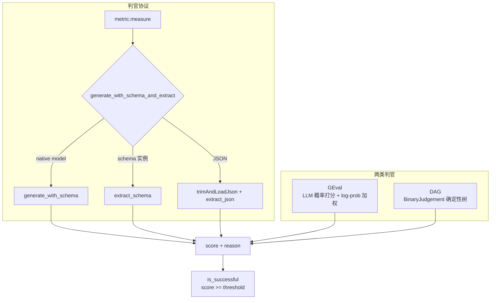
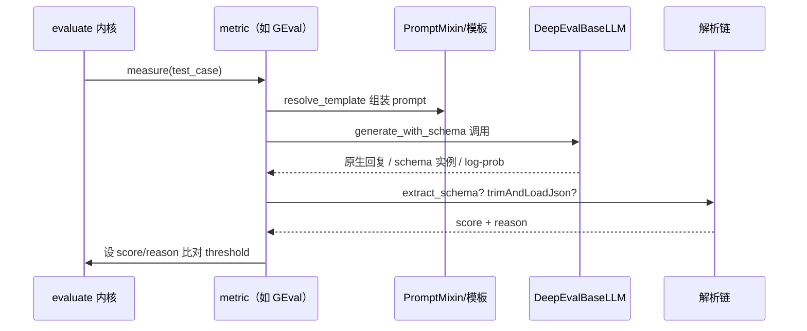

# DeepEval — Metric 体系与 LLM-as-Judge 协议

## 在项目中的角色与根因

本关注面是 DeepEval 的"尺子"。官方定义：**test case 是被测对象，metric 是某条具体标准的评分逻辑**。50+ 个 metric 几乎全部采用 LLM-as-a-Judge（QAG / G-Eval / DAG），输出 0-1 分 + reason，用 `threshold`（默认 0.5）+ `flaky` + `strict_mode` 判定 pass/fail。

根因：LLM 评测最难的既不是"调模型"也不是"跑流程"，而是**"怎么打分"这件事本身**——每次 metric 都要让 LLM 当一次判官、对结果评分并给出可解释的理由。如果每条 metric 各自手搓 LLM 调用和 JSON 解析，必然混乱且难维护。DeepEval 因此收敛出一个**统一的判官协议**（schema 化抽取），让"新造一个 metric"变成"填评分标准 + 输出 schema"。

## Metric 抽象与自动追踪

`BaseMetric`（[deepeval/metrics/base_metric.py:54-59]()）定义统一状态字段：`threshold`/`score`/`reason`/`success`/`strict_mode`/`async_mode`/`verbose_mode`/`include_reason`/`error`/`evaluation_cost`/`input_tokens`/`output_tokens`。

<!-- snippet: class BaseMetric(PromptMixin):
    threshold: Optional[float] = None
    score: Optional[float] = None
    reason: Optional[str] = None
    success: Optional[bool] = None
    evaluation_model: Optional[str] = None -->

通过判定集中在 `is_successful()`：`threshold` 为空则不判；`error` 非 None 视作失败；否则 `score >= threshold`，`TypeError` 兜底为 False（[deepeval/metrics/base_metric.py:96-102]()）。

<!-- snippet:         elif self.error is not None:
            self.success = False
        else:
            try:
                self.success = self.score >= self.threshold
            except TypeError:
                self.success = False -->

一个精巧机制：`__init_subclass__` 会在**任何 metric 子类实例化时自动调用 `observe_methods(cls)`** 接入 tracing，把每次 `measure` 自动记录进 trace，无需每条 metric 手写埋点（[deepeval/metrics/base_metric.py:77-81]()）。

<!-- snippet:     def __init_subclass__(cls, **kwargs):
        super().__init_subclass__(**kwargs)
        from deepeval.tracing.internal import observe_methods

        observe_methods(cls) -->

> 默认方向是 `score >= threshold`（分数越高越好）；`HallucinationMetric` 等"越少越好"的 metric 通过反向覆写来适配，体现"同一抽象、两种方向"的灵活性。

## 统一判官协议：schema 化抽取

所有 LLM 类 metric 的核心执行收敛到 `generate_with_schema_and_extract()`（[deepeval/metrics/utils.py:510-536]()），这条协议是三段式：

1. **native model**：直接 `model.generate_with_schema(prompt, schema=schema_cls)` 并累计成本；
2. **schema 实例命中** → 直接走 `extract_schema`（强类型结果）；
3. **否则** `trimAndLoadJson` 兜底解析成 JSON → 走 `extract_json`。

<!-- snippet:     if metric.using_native_model:
        result, cost = metric.model.generate_with_schema(
            prompt, schema=schema_cls
        )
        metric._accrue_cost(cost)
        accrue_token_usage(metric, cost)
    else:
        result = metric.model.generate_with_schema(prompt, schema=schema_cls)
    if isinstance(result, schema_cls):
        return extract_schema(result)
    data = trimAndLoadJson(result, metric)
    return extract_json(data) -->

异步版 `a_generate_with_schema_and_extract()`（[deepeval/metrics/utils.py:539-544]()）与同步版同构，支撑 `a_measure` 并发。

> 设计决策二：**三级降级容错链**（schema 实例 → JSON → `trimAndLoadJson` 兜底）。LLM 输出天然不稳定，强制它输出严格 schema 会高频失败；这条链先给最强约束，命中即强类型，否则逐级放松，保证"总有一条路能把判官回复变成结构化结果"。代价是 `trimAndLoadJson` 需要做不少容错文本处理（[deepeval/metrics/utils.py:431-431]()）。

<!-- snippet: def trimAndLoadJson -->

## LLM-as-Judge 实例：G-Eval

`GEval` 是 canonical 的科研式 LLM-as-judge（[deepeval/metrics/g_eval/g_eval.py:49-49]()）。其评分路径（[deepeval/metrics/g_eval/g_eval.py:310-337]()）：

- 若模型**不支持 log-prob**，直接抛 `AttributeError` 降级；
- 否则用 `a_generate_raw_response(prompt, top_logprobs=...)` 拿到带 token 概率的原始响应；
- `strict_mode` 下直接返回 `score`；否则用 `calculate_weighted_summed_score` 按 log-prob 给 score 加权——让"模型更确定"的判断权重更高，对抗随机/flaky。

<!-- snippet:         try:
            # don't use log probabilities for unsupported gpt models
            if no_log_prob_support(self.model):
                raise AttributeError("log_probs unsupported.")

            # Don't have to check for using native model
            # since generate raw response only exist for deepeval's native model
            res, cost = await self.model.a_generate_raw_response(
                prompt, top_logprobs=self.top_logprobs
            ) -->

prompt 模板通过 `make_template_class("GEval")` 加载（`g_eval/templates/`），配合 `templates/resolver.py` 的 `resolve_template` 统一渲染。

## 确定性判官：DAG

当需要**确定性分数**而非 LLM 概率打分时，DeepEval 提供 DAG（有向无环图）metric：节点即判定，`BinaryJudgementNode`（[deepeval/metrics/dag/nodes.py:223-223]()）/ `NonBinaryJudgementNode`（[deepeval/metrics/dag/nodes.py:312-312]()）组合成判定树，由 `runner.py` 编排确定性执行。

## 判官回复归一化

`verdict_from_json`（[deepeval/metrics/utils.py:489-489]()）把 judge 的自然语言回复（如 "No, it's off-topic"）归一化为 `no`/`yes`，供二分类类 metric 复用，避免啰嗦前缀污染判定。

## 核心流程（单 metric 一回）

## 与其他模块协同

- 依赖 **models 层**（`DeepEvalBaseLLM.generate_with_schema`）做判官执行后端；
- 被 **evaluation-core** 的 `_execute_metric` 调度（`metric.measure`）；
- `__init_subclass__` 自动接 **tracing**（`observe_methods`）；【待主 agent 验证：`observe_methods` 的观察粒度】
- `initialize_model`（[deepeval/metrics/utils.py:674-674]()）按 `USE_*_MODEL` 环境变量选择默认 provider。

## 关键权衡小结

- **无独立 Judge 类，Judge 逻辑内嵌在 metric 中**：与其他评测库不同，DeepEval 没有单独的"judge"实体，而是让每类 metric 自带判官逻辑 + 共享 `generate_with_schema_and_extract` 协议。换来"一个 metric = 一种评分标准 + 其专属 prompt/schema"的高内聚，代价是 judge 复用需要靠继承/工具函数而非接口组合。
- **LLM 概率打分 vs DAG 确定性**：GEval 用 log-prob 加权提升可靠性但不可复现；DAG 用确定性判定树换取可复现分数——两条轨满足"研究向"与"生产向"两种诉求。
- **自动 observe 的侵入与透明并存**：`__init_subclass__` 自动埋点让用户零成本获得 trace，隐藏了侵入性，但也意味着"任何 metric 都会被记录"，需要 tracing 层承担调度与去重。
