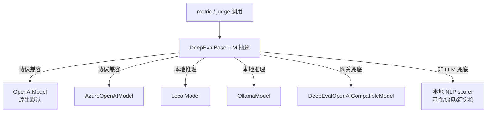

# DeepEval — 模型层抽象与框架集成

## 在项目中的角色与根因

本关注面是 DeepEval 的**判官执行后端 + 接入桥**。根因：LLM-as-Judge 需要一个统一的 LLM 调用抽象，让"造一条 metric"不必关心底层是 OpenAI 还是本地模型；同时要能把外部 LLM 框架（LangChain/LlamaIndex 等）的 input/output 桥接进 trace，使评测不绑架用户既有的 LLM 栈。

## 统一 LLM 抽象：DeepEvalBaseLLM

`DeepEvalBaseLLM`（[deepeval/models/base_model.py:46-49]()）是 judge 调用的抽象基类：定义 `generate`/`a_generate`（同步/异步）、`get_model_name` 等抽象方法，子类（各 provider）实现。

<!-- snippet: class DeepEvalBaseLLM(ABC):
    def __init__(self, model: Optional[str] = None, *args, **kwargs):
        self.name = parse_model_name(model)
        self.model = self.load_model() -->

关键机制：`generate_with_schema()`（[deepeval/models/base_model.py:125-131]()）做**schema 参数探测**——先尝试 `generate(*args, schema=...)`，`TypeError` 说明 provider 不支持 schema，降级为普通 `generate()`。这让 judge 协议（见 metrics-judges.md）能用统一调用兼容"支持/不支持结构化输出"的 provider。

<!-- snippet:     def generate_with_schema(self, *args, schema=None, **kwargs):
        if schema is not None:
            try:
                return self.generate(*args, schema=schema, **kwargs)
            except TypeError:
                pass  # this means provider doesn't accept schema kwarg
        return self.generate(*args, **kwargs) -->

与 BaseMetric 同构，`DeepEvalBaseLLM` 也用 `__init_subclass__` 自动 `observe_methods(cls, span_type="llm", allowed_methods=[generate, a_generate, generate_raw_response, ...])`（[deepeval/models/base_model.py:51-62]()）——**每个 provider 的生成方法自动被记录为 `LlmSpan`**，这是模型层与 tracing 的天然接线，无需每个 provider 手写埋点。

<!-- snippet:     def __init_subclass__(cls, **kwargs):
        super().__init_subclass__(**kwargs)
        from deepeval.tracing.internal import observe_methods

        observe_methods(
            cls,
            span_type="llm",
            allowed_methods=[
                "generate",
                "a_generate",
                "generate_raw_response",
                "a_generate_raw_response", -->

## Provider 生态

具体 provider 都继承 `DeepEvalBaseLLM`，覆盖主流后端：

| Provider | 类 | 定位 |
|----------|-----|------|
| OpenAI | `OpenAIModel`（[deepeval/models/llms/openai_model.py:47-47]()） | 默认 / 原生 |
| Azure | `AzureOpenAIModel`（[deepeval/models/llms/azure_model.py:40-40]()） | 企业 OpenAI |
| 本地 | `LocalModel`（[deepeval/models/llms/local_model.py:29-29]()） | 本地推理 |
| Ollama | `OllamaModel`（[deepeval/models/llms/ollama_model.py:23-23]()） | 本地 Ollama |
| 网关 | `DeepEvalOpenAICompatibleModel`（[deepeval/models/llms/gateway_model.py:164-164]()） | 兼容 OpenAI 协议的网关 |

> 设计决策六：**transformer 网关 + 兼容类兜底**。`DeepEvalOpenAICompatibleModel` 让任何"OpenAI 兼容协议"的服务（vLLM/本地/代理）都能接入，是深Eval 生态融入的关键，用"协议兼容"而非"逐家 SDK 适配"换取覆盖面，代价是这些兼容类需要依赖 OpenAI 协议假设。

## 默认模型选择：环境开关

`metrics/utils.py` 的 `should_use_*_model()` 系列按 `USE_*_MODEL` 环境变量决定默认判官 provider（如 `should_use_openai_model`，[deepeval/metrics/utils.py:613-613]()），`initialize_model`（[deepeval/metrics/utils.py:674-674]()）据此实例化。这让"换判官"成为改环境变量而非改代码的事件。

## 本地 NLP scorer：非 LLM 兜底

除 LLM judge 外，`models/` 还提供本地确定性 scorer（如 `hallucination_model.py`/`summac_model.py`/`detoxify_model.py`/`unbias_model.py`/`answer_relevancy_model.py`），用于不需要 LLM 判官的场景（如毒性/偏见检测用轻量本地模型），降低延迟与成本。

## 框架集成桥接

`model_integrations/` 是连接桥：把外部 LLM 框架的 input/output 参数写入 tracing span 属性，使既有框架调用自动进入 deepeval 的 trace 体系，支撑 agentic 集成（openai_agents、anthropic 等）。对应的 `integrations/*instrument_*`（如 `instrument_crewai()`/`instrument_agentcore()`）接入各框架，与 openinference 桥接（见 tracing.md）一起构成"接入既有栈"的完整路径。

## 与其他模块协同

- **metrics-judges** 通过 `DeepEvalBaseLLM.generate_with_schema` 调用判官；
- **tracing** 通过 `__init_subclass__` 自动把 provider 的 generate 记为 `LlmSpan`；
- **synthesizer** 用模型层做数据合成；
- **evaluation-core** 的 metric 间接经模型层调 LLM。

## 关键权衡小结

- **统一抽象 vs 每家 SDK 自有能力**：`DeepEvalBaseLLM` 收敛了 generate/a_generate，但每家 SDK 可能有独特能力（如 log-prob）。`generate_with_schema` 用 `TypeError` 探测兼容，`observe_methods` 名单化扩展——在"收敛统一"与"保留差异"之间，DeepEval 选择"抽象收窄主路径 + 探测/名单保留扩展"。
- **自动 observe 一处两用**：BaseMetric 和 DeepEvalBaseLLM 都靠 `__init_subclass__` 自动埋点，让 judge 的每次 LLM 调用零成本进 trace。代价是"凡是继承都自动被观察"，要求 tracing 层足够健壮。
- **本地 scorer 作为第三条腿**：并非所有评测都要 LLM——本地确定性 scorer 补齐了"低成本/确定性/无外部依赖"的评测诉求，与 LLM-as-judge、DAG 构成三种强度可选的判官。
