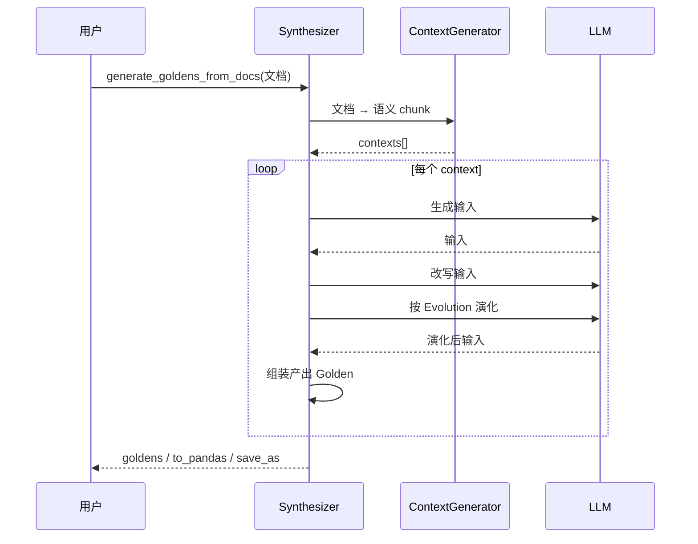

# DeepEval — Synthesizer / 测试数据合成

## 在项目中的角色与根因

本关注面是 DeepEval 的**造数据层**。根因：评测冷启动最大的障碍是**没有测试数据**——真实数据稀缺、标注成本高。DeepEval 用 `Synthesizer` 让 LLM **自动合成 goldens**（待测样例）来冷启动评测流程。

官方刻意强调其边界：合成的数据用来**补足而非替代**真实数据，官方文档明确提示"谨慎使用合成数据"。它产出两种单元——`Golden`（单轮）/ `ConversationalGolden`（多轮），二者是 `EvaluationDataset` 的构成单元。

## Golden：待发育的 test case

`Golden` 被官方定义为"待发育的 test case"（[deepeval/dataset/golden.py:9-18]()）：只需 `input` + 期望结果，而 `actual_output`/`retrieval_context`/`tools_called` 这些**动态字段留待评测时填充**——这正是它区别于 `LLMTestCase` 的本质：LLMTestCase 是一次完整交互的蓝图，Golden 是"测试用例的种子"。

<!-- snippet: class Golden(BaseModel):
    id: Optional[str] = Field(default=None, exclude=True)
    input: str
    actual_output: Optional[str] = Field(
        default=None, serialization_alias="actualOutput"
    )
    expected_output: Optional[str] = Field(
        default=None, serialization_alias="expectedOutput"
    )
    context: Optional[List[str]] = Field(default=None) -->

`ConversationalGolden`（[deepeval/dataset/golden.py:130-130]()）是多轮版本，用 `turn`s（role/content）表示对话，配合多轮类 metric 评测。

## 四类来源 + 演化阶段

`Synthesizer`（[deepeval/synthesizer/synthesizer.py:117-117]()）支持四类输入来源：

| 来源 | 入口 | 数据 | 流程 |
|------|------|------|------|
| 文档 | `generate_goldens_from_docs` | 非结构化文档 | 文档→chunk→context→golden |
| 上下文 | `generate_goldens_from_contexts` | 已有 context 列表 | context→输入生成→改写→演化→golden |
| 从零 | `generate_goldens_from_scratch` | 无 | 纯 LLM 生成 |
| 从已有 | `generate_goldens_from_goldens` | 已有 goldens | 潜在/改写扩增 |

其中**演化（evolution）**是核心手法：`Evolution` 枚举定义了一组"让输入变得更难/更有代表性"的变换，如 `REASONING`（加推理）、`MULTICONTEXT`（多上下文）、`CONCRETIZING`（具体化）、`CONSTRAINED`（约束条件）、`COMPARATIVE`（比较）、`HYPOTHETICAL`（假设）、`IN_BREADTH`（广度）等（[deepeval/synthesizer/types.py:4-11]()）。

<!-- snippet: class Evolution(Enum):
    REASONING = "Reasoning"
    MULTICONTEXT = "Multi-context"
    CONCRETIZING = "Concretizing"
    CONSTRAINED = "Constrained"
    COMPARATIVE = "Comparative"
    HYPOTHETICAL = "Hypothetical"
    IN_BREADTH = "In-Breadth" -->

`PromptEvolution`（[deepeval/synthesizer/types.py:14-20]()）是面向 prompt 的演化变体（去掉多上下文），用于 prompt 评测数据。

> 设计决策五：**演化让合成数据"越变越难/越变越像真实"**。直接让 LLM 凭空生成问题往往简单、雷同；通过逐条演化（推理/约束/比较...）把简单输入改写成更难、更贴近业务边界的用例，提升评测数据的覆盖度与区分度。代价是多次 LLM 调用，合成成本上升。配置经 `EvolutionConfig`/`FiltrationConfig`/`StylingConfig`/`ContextConstructionConfig` 定制（`deepeval/synthesizer/config.py`）。

## 演化核心流程

每个 context 内的生成（`_a_evolve_input`，[deepeval/synthesizer/synthesizer.py:1642-1642]()）是链式演进：先生成输入 → 改写 → 按 Evolution 演化 → 产 Golden。输出可 `to_pandas()` 转 DataFrame 或 `save_as()` 落盘（[deepeval/synthesizer/synthesizer.py:1771-1771]()）。

## 多轮对话：ConversationSimulator

与 Synthesizer 互补，`deepeval/simulator/` 的 `ConversationSimulator` 专门模拟多轮对话的 `turn` 序列，产出 `ConversationalGolden`，供多轮类 metric 使用。二者分工：Synthesizer 面向单轮/静态事实，Simulator 面向多轮交互轨迹。

## 与其他模块协同

- 产出喂给 **EvaluationDataset**（`dataset/evaluate`，[deepeval/dataset/dataset.py:1646-1646]()）与 `evals_iterator`（[deepeval/dataset/dataset.py:1510-1510]()，把 golden yield 给用户 app 采集 trace 后评测）；
- 依赖 **models 层**做 LLM 合成调用；
- Golden 是 **evaluation-core** 的 `assert_test(golden=...)` 输入形态（见 evaluation-core.md 的 golden 驱动小节）。

## 关键权衡小结

- **合成数据的价值边界**：能冷启动、扩覆盖，但官方反复提醒"补足非替代"。合成数据可能固化 LLM 自身的偏差（self-bias），关键业务仍需真实数据交叉验证——这是评测领域的通用教训，DeepEval 选择"提供能力 + 边界提示"而非替用户判断。
- **四来源 + 演化 = 灵活 + 高成本**：多样化输入生成为不同场景（文档导入/纯生成/扩增），演化提升质量但增加 LLM 调用次数，成本与覆盖面需要用户权衡（靠 config 开关部分演化类型）。
- **Golden 的"种子"设计降低评测 API 心智负担**：用户只管提供输入与期望，动态字段评测时自动补齐，与 LLMTestCase 解耦，天然适配 trace 驱动的 trajectory 评测。
