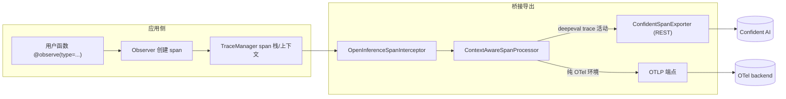

# DeepEval — Tracing / OpenTelemetry 可观测

## 在项目中的角色与根因

本关注面是 DeepEval 的**采集层**：通过 `@observe` 非侵入式记录 LLM 应用的一次完整 agent 执行，形成"嵌套 span 组成的 trace"。它是 trajectory（整条路径）与 component（单个组件）两级评测的数据基础——评测核心要能拿到 trace 才能对"轨迹"或"单个 span"分别打分。

根因一句话：**「span 即 LLMTestCase」是 DeepEval 评测的前提，裸 OTel span 不是**。OTel 原生 span 是通用扁平的 attribute 容器，无法表达"这个 span 是一次可被 LLM 判官直接打分测试的 LLM 调用"——它需要携带 `input`/`output`/`retrieval_context`/`tools_called` 等测试用例字段，并区分 agent/llm/retriever/tool 四类语义。因此必须自研一层 span 抽象，再桥接回 OTel 导出。

## 自研 span 抽象：span 即可评测的用例

`BaseSpan` 直接声明 `llm_test_case` 与 `metrics` 字段——每个 span 可挂一个待评测的测试用例和若干 metric，评测时判官 LLM 直接拿 span 当测试用例打分（[deepeval/tracing/types.py:87-94]()）。

<!-- snippet: class BaseSpan(BaseModel):
    model_config = make_model_config(arbitrary_types_allowed=True)

    uuid: str
    status: TraceSpanStatus
    children: List["BaseSpan"] = Field(default_factory=list)
    trace_uuid: str = Field(serialization_alias="traceUuid")
    parent_uuid: Optional[str] = Field(None, serialization_alias="parentUuid") -->

按语义向下派生四类子 span：`AgentSpan`/`LlmSpan`/`RetrieverSpan`/`ToolSpan`（[deepeval/tracing/types.py:128-128]()，由 `AgentSpan` 起），各自带类型专属字段（如 `LlmSpan` 的 model/top_k、`RetrieverSpan` 的 top_k/embedder），方便判官针对性打分。`Trace` 聚合这些 span 成树（[deepeval/tracing/types.py:182-182]()）。

<!-- snippet: class AgentSpan(BaseSpan): -->

<!-- snippet: class Trace(BaseModel): -->

> 设计决策三：**两级 span→trace 抽象**。trace 表示一次完整执行（trajectory 级），span 是其中单个组件（component 级），两者都可被 metric 评测。这让"给整条 agent 轨迹打分"与"给某次 LLM 调用的检索质量单独打分"共用同一套数据结构和判官协议。

## 非侵入采集：装饰器截面

`observe` 装饰器（[deepeval/tracing/tracing.py:1302-1309]()）是采集入口。它按函数形态分类处理（普通函数/async/同步生成器/async 生成器），并在 `decorator` 里用 `_should_skip_observe()` 做条件跳过（如 `_internal` 需开启 `CONFIDENT_TRACE_INTERNAL`）。

<!-- snippet: def observe(
    _func: Optional[Callable] = None,
    *,
    metrics: Optional[List[BaseMetric]] = None,
    metric_collection: Optional[str] = None,
    type: Optional[
        Union[Literal["agent", "llm", "retriever", "tool"], str]
    ] = None, -->

用户只需给 agent/llm/retriever/tool 函数加 `@observe(type=...)`，装饰器自动创建并管理 span 生命周期（进/出 trace_manager），无需手写 span 的 begin/end。这与手写埋点相比，以"约定优于配置"换极低接入成本，代价是装饰器需要兼容 4 种函数形态带来的内部复杂度。

`trace_manager` 是进程级单例（[deepeval/tracing/tracing.py:1016-1016]()），`Observer` 核心类在其上管理当前 span 栈。

## 桥接 OpenTelemetry：双路由导出

桥接层在 `integrations/openinference/otel.py` 的 `instrument_openinference()`（[deepeval/integrations/openinference/otel.py:66-66]()）创建 `TracerProvider`，挂两个组件：`OpenInferenceSpanInterceptor` + `ContextAwareSpanProcessor`。`deepeval.instrument()` 即包装此函数。

`ContextAwareSpanProcessor`（[deepeval/tracing/otel/context_aware_processor.py:82-82]()）做**双路由**：当 deepeval 自己的 trace 处于活动态时走 REST（ConfidentSpanExporter），否则走标准 OTLP 端点（`_otlp_endpoint`，[deepeval/tracing/otel/context_aware_processor.py:77-77]()）。

> 设计决策四：**REST/OTLP 双路由**。deepeval 原生评估时数据走自家 Confident 的上传 REST，保证评测结果与 trace 一起进平台；但在纯 OTel 监控环境中（用户已有 collector），同一份代码不重复采集两份，直接走标准 OTLP。这正是"本地优先 + 可插拔可观测"的落地——一套埋点，两条出路。

## 与其他模块协同

- `BaseMetric.__init_subclass__` 的 `observe_methods` 让 metric 自动被记录进 trace（见 metrics-judges.md）；
- **evaluation-core** 的 `_assert_test_from_current_trace` 在 trace 活动时反解 test_case 评测（见 evaluation-core.md）;
- **Confident AI 上传**最终由 `confident/api.py` 的 `Api` 完成（evaluation-core 的 `wrap_up_test_run` 触发），trace 与评测结果一并上传；
- `model_integrations` 把框架的 input/output 参数写进 span 属性（见 model-layer.md）。【待主 agent 验证：各 span attribute 的序列化契约】

## 关键权衡小结

- **自研 span 模型 vs 裸 OTel**：前者把"可评测的 LLMTestCase"作为一等字段，直接服务判官；代价是需要手工桥接回 OTel 导出，增加了 `openinference` 拦截链路。这是"评测框架"相对"可观测平台"的本质差异——可观测平台关心 span 概览，评测框架关心 span 能否被 LLM 打分。
- **非侵入 vs 可观测性损耗**：装饰器零样板接入，但自动 observe 会采集所有 metric 调用，需 tracing 层承担状态切换与去重（ContextAwareSpanProcessor 双路由正是为此）。
- **两级 scope 统一数据结构**：trajectory 与 component 用同一 span 树，评测内核只需按需取"整 trace"或"单个 span"挂 metric，逻辑统一。
