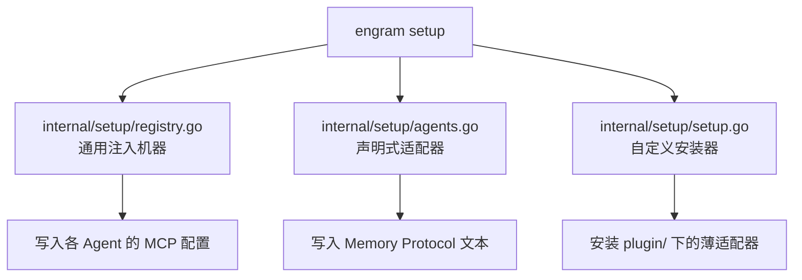
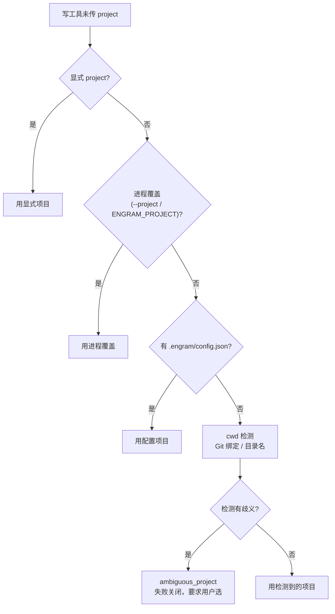

# 接入 Agent

Engram 宣称 Agent 无关。这页讲清"怎么把它接到你的 Agent 上"：支持哪些目标、`engram setup` 做了什么、插件与 hooks 的作用，以及 Engram 如何判断"现在属于哪个项目"。

## 支持哪些 Agent

`engram setup <agent>` 覆盖 14 个内置目标，另有任意 MCP 兼容 Agent 的手动接入。

| Agent | Slug | 接入形态 |
|-------|------|---------|
| Claude Code | `claude-code` | 原生 marketplace 插件（hooks/skills/压缩恢复）+ MCP 注册 |
| Pi | `pi` | `gentle-engram` 包，Pi 原生 HTTP 记忆工具 |
| OpenCode | `opencode` | TypeScript 插件 + MCP 注册 |
| Codex | `codex` | MCP 注册 + 信息性指令文件 + 插件（hooks） |
| Gemini CLI | `gemini-cli` | MCP 注册 + system prompt 压缩恢复 |
| Antigravity CLI | `antigravity-cli` | 共享 `~/.gemini` 配置的 MCP 注册 + GEMINI.md 协议 |
| Windsurf | `windsurf` | MCP 注册 + `global_rules.md` 协议 |
| Qwen Code | `qwen` | `~/.qwen/settings.json` MCP 注册 + QWEN.md 协议 |
| Kiro | `kiro` | MCP 注册 + 协议 |
| Cursor | `cursor` | MCP 注册 |
| VS Code (Copilot) | `vscode-copilot` | MCP 注册 |
| Kilo Code | `kilocode` | MCP 注册 |
| Kimi Code | `kimi` | MCP 注册 |
| CommandCode | `commandcode` | MCP 注册 |

## setup 做了什么

`internal/setup` 是**注册表驱动**的：每个适配器在 `agents.go` 里声明 slug、描述、安装目录与验证提示，通用的注入机器在 `registry.go`，特殊安装器在 `setup.go`。一次 `engram setup` 通常写入 MCP 配置和（可选的）Memory Protocol 文本，普通 stdio 场景**不要求你先手动起服务器**。

下图是 setup 的落点关系。



该看什么：大部分工作是把"一段 JSON/TOML/YAML 配置 + 一段协议文本"注入到各 Agent 约定位置；复杂的宿主逻辑在 `plugin/` 里以薄适配器形式存在。

## 插件与 hooks

`plugin/` 下每个 Agent 一个薄适配器，承载宿主才能做的事（hooks、压缩恢复、会话身份），核心行为仍留在 Go 侧。

| 集成 | 覆盖 |
|------|------|
| OpenCode | TypeScript 插件 + MCP 注册 |
| Claude Code | marketplace 插件（hooks/脚本/skills）；`setup` 只注册 MCP |
| Codex | `plugin/codex/` 资源；`setup` 尽力安装 marketplace 插件并写 MCP/指令配置 |
| Pi | `plugin/pi/` 暴露 Pi 原生 HTTP 工具；0.99.0+ 内置 MCP 处理其他服务器 |

**关键行为**：Claude Code 装好插件后能在会话启动时**注入前一次上下文**；而裸 MCP（无插件）不会注入，Agent 只能自己调 `mem_context` 去取。压缩（compaction）后的恢复也依赖这条链路——先持久化压缩后的交接摘要，再取回。

插件脚本的验证边界是"记忆/会话工作流"，不承担云 bootstrap 编排——云配置/认证/enroll/升级请用 CLI。

## 项目解析：这段记忆属于哪个仓库

Engram 的项目判定有一条明确优先级，决定了记忆被归到哪个"项目桶"：

```
显式 project 参数 → 进程覆盖(engram mcp --project, 然后 ENGRAM_PROJECT)
   → 适用的 .engram/config.json → cwd 检测
```

下图是隐式写入时的解析顺序。



该看什么：歧义时**失败关闭**，不会自行编一个项目；写工具不该把 `project` 当任意覆盖参数乱传。

### Git 初始化导致项目漂移

一个容易踩的坑：在仓库首次初始化 Git（或首次设置 remote）后，Engram 检测到的项目名可能从"目录名"变成"remote 名"。Engram 会先检查本地会话历史：若该工作目录此前以 `local-app` 产生过历史，而 Git 现在建议 `remote-app`，隐式选择会以 `project_transition_conflict` 停下，而不是静默切范围。想要持久选择，用 `engram init local-app` 显式指定。这个检查**只改未来解析，不合并也不搬迁**已分裂的记忆。

## 边界与限制

- **hook 的身份解析是客户端本地行为**：`engram hook resolve-hook-project` 用 hook JSON 里的绝对 `cwd` 在本地文件系统上探测，不打开数据库、不建绑定；`ENGRAM_URL` 非空时走客户端本地探测，空时走服务端解析。
- **HOME 本身是 Git 仓库时需要显式项目**：从 HOME 的未跟踪子目录捕获，不会被当成项目意图，需 `--project` / `ENGRAM_PROJECT` / `.engram/config.json` 明确指定。
- **工作树规范**：普通注册会把目录规范到 worktree 根；续期保留首个非空存储目录。

> 依据：`docs/AGENT-SETUP.md`、`docs/PLUGINS.md`、`internal/setup/agents.go`、`internal/setup/registry.go`、`DOCS.md`、`README.md`
