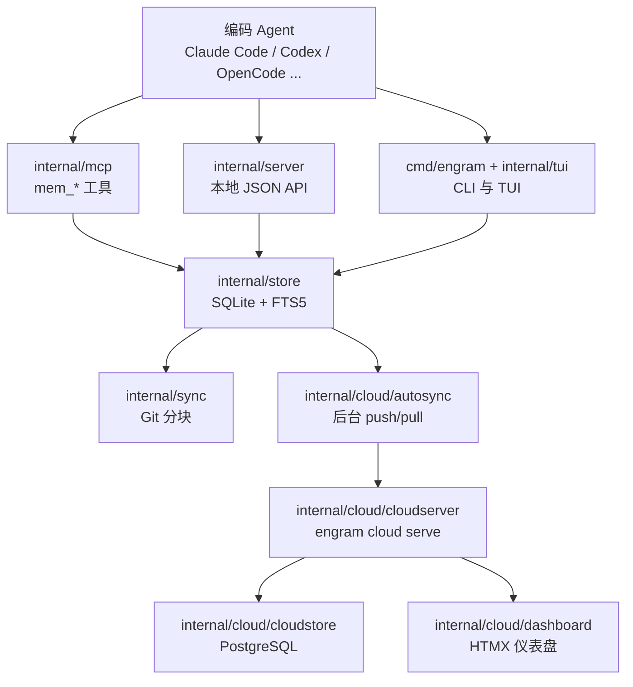
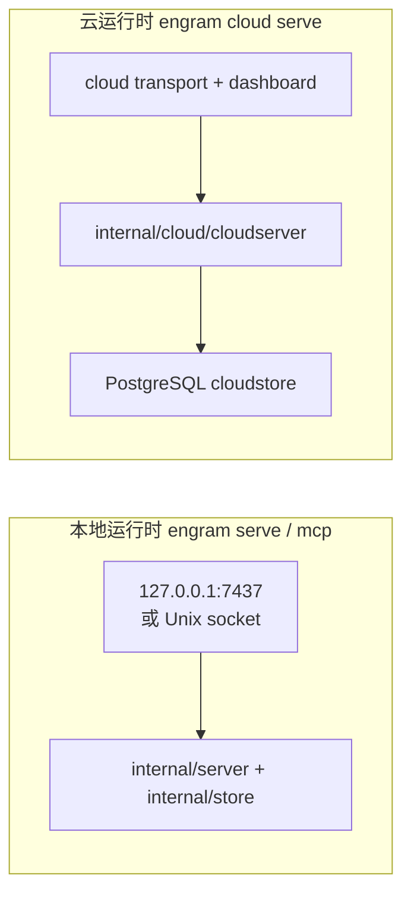
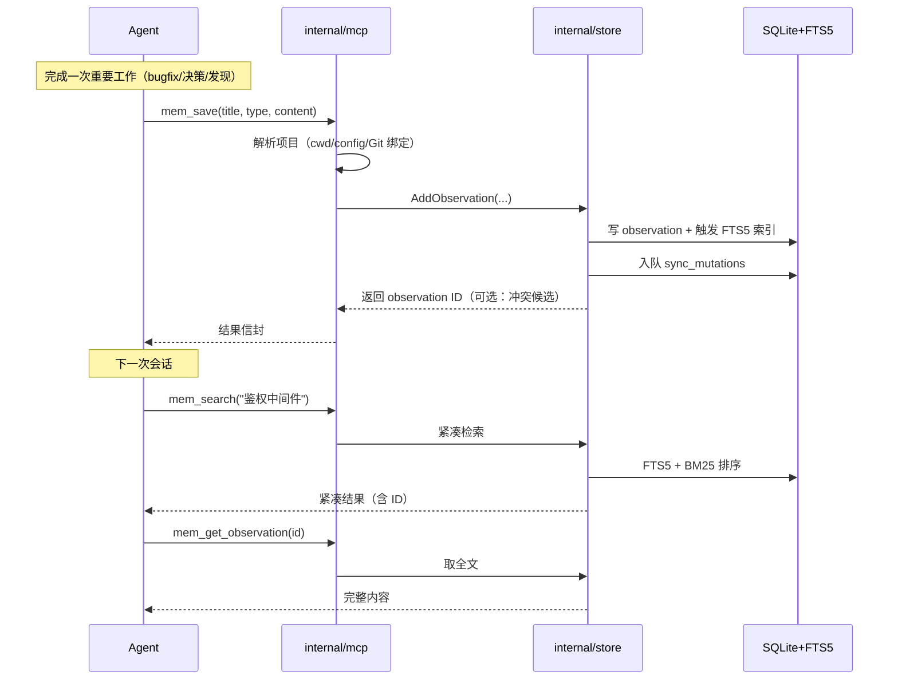

# 架构

Engram 的全部代码围绕一句话组织：**本地 SQLite 是事实源，云只是可选复制**。理解架构，关键是分清"谁存数据"（store）与"谁只是接口"（CLI、MCP、HTTP、TUI、插件）。

## 整体形态

下面这张图是一次记忆读写所经过的层次。所有入口最终都落到 `internal/store`，本地与云是两条独立的运行时。

该看什么：接口层全部**薄**——它们只解析输入、调用 store、返回结果，不重复实现持久化规则。复杂度集中在中部的 `internal/store`，右侧的云是可选分支，去掉它本地记忆依然完整工作。

## 分层与职责

| 层 | 目录 | 负责什么 | 不负责什么 |
|----|------|---------|-----------|
| 命令/组装 | `cmd/engram` | 解析 CLI、装配 store/server/mcp/tui/sync/cloud | 放 SQL 或深层业务规则 |
| 本地事实源 | `internal/store` | SQLite、FTS5、session/observation/prompt/relation、去重、topic upsert、脱敏删除、同步 mutation 队列 | 渲染 HTML、直连云 HTTP |
| MCP 接口 | `internal/mcp` | 向 Agent 暴露 `mem_*` 工具，按 cwd 解析项目，profile 分级 | 在 store 之外持久化 |
| 本地 HTTP | `internal/server` | `engram serve` 的 JSON API，写后通知 autosync | 暴露云/仪表盘路由 |
| 分块同步 | `internal/sync` | 导出/导入 `.engram/` 分块、manifest、抽象 transport | 决定云鉴权、渲染仪表盘 |
| 云编排 | `internal/cloud/autosync` | 后台 push/pull、租约、游标、退避、降级状态 | 实现 HTTP 或具体 SQL |
| 云运行时 | `internal/cloud/cloudserver` | `/sync/*`、认证边界、仪表盘挂载、服务端强制 | 存本地数据、混 HTML 与 SQL |
| 云持久化 | `internal/cloud/cloudstore` | PostgreSQL 中的 chunk/mutation/读模型/审计 | 决定 HTTP 路由 |
| 浏览器 UI | `internal/cloud/dashboard` | 服务端渲染 `/dashboard/*`、HTMX、templ | 只在视觉层"模拟"策略 |
| 项目解析 | `internal/project` | 项目探测与规范化 | 访问 store 去取数 |
| Agent 安装 | `internal/setup` | 注册表驱动的 Agent 集成安装 | 编排未实现的自动云流程 |
| 宿主适配 | `plugin/` | 每个 Agent 的薄适配器（hooks/脚本） | 承载应留在 Go 里的核心行为 |

## 两套运行时不要混用

Engram 有两条**物理分离**的运行时，混淆它们是理解错误的常见来源：

| 运行时 | 启动命令 | 主要包 | 数据形态 |
|--------|---------|--------|---------|
| 本地 API | `engram serve` | `cmd/engram`、`internal/server`、`internal/store` | 本地 JSON，SQLite |
| MCP stdio | `engram mcp` | `cmd/engram`、`internal/mcp`、`internal/store` | MCP 工具，SQLite |
| 直接 CLI | `engram search` / `save` / `sync` | `cmd/engram`、`internal/store`、`internal/sync` | stdout + SQLite/分块 |
| TUI | `engram tui` | `internal/tui`、`internal/store` | Bubbletea 终端 |
| 云 | `engram cloud serve` | `internal/cloud/*`、`cmd/engram/cloud.go` | 云 HTTP，Postgres，仪表盘 |

## 主链路：一次保存与一次检索

记忆流**不是从数据库开始的**，而是从 Agent 判断"这值得记"开始。下面这张时序图串起保存链路和下一次会话的检索链路。

该看什么：注意 `mem_save` 在写 observation 的同时**入队 sync mutation**——这是后续 Git/云同步的数据来源；检索走的是"先紧凑后下钻"的渐进式路径，避免一次性把全文塞进上下文。

## 关键设计取舍

- **本地优先，云可选**：`internal/store` 是唯一事实源，云故障不影响本地记忆。代价是没有天然的跨机一致性——同步是最终一致的复制。
- **Agent 决定存什么**：不做原始工具调用 firehose，节省了压缩成本与延迟。代价是记忆质量依赖 Agent 遵循 Memory Protocol。
- **单二进制**：所有能力压在一个 Go 进程里，部署极简。代价是无法只更新某个子系统。
- **chunk 式 Git 同步而非单一大 JSON**：每次同步生成新分块 + 小 manifest，减少合并冲突、允许多机并行产生记忆。代价是要维护 imported-chunk 追踪避免重复导入。
- **仪表盘策略必须落到服务端**：如果某个开关真的改变权限或同步，它必须在 cloudserver/cloudstore 强制，而不是只在 HTML 里"看起来"生效。

> 依据：`docs/codebase/mental-model.md`、`docs/codebase/repository-map.md`、`docs/codebase/memory-core.md`、`docs/codebase/interfaces.md`、`docs/codebase/sync-and-cloud.md`
