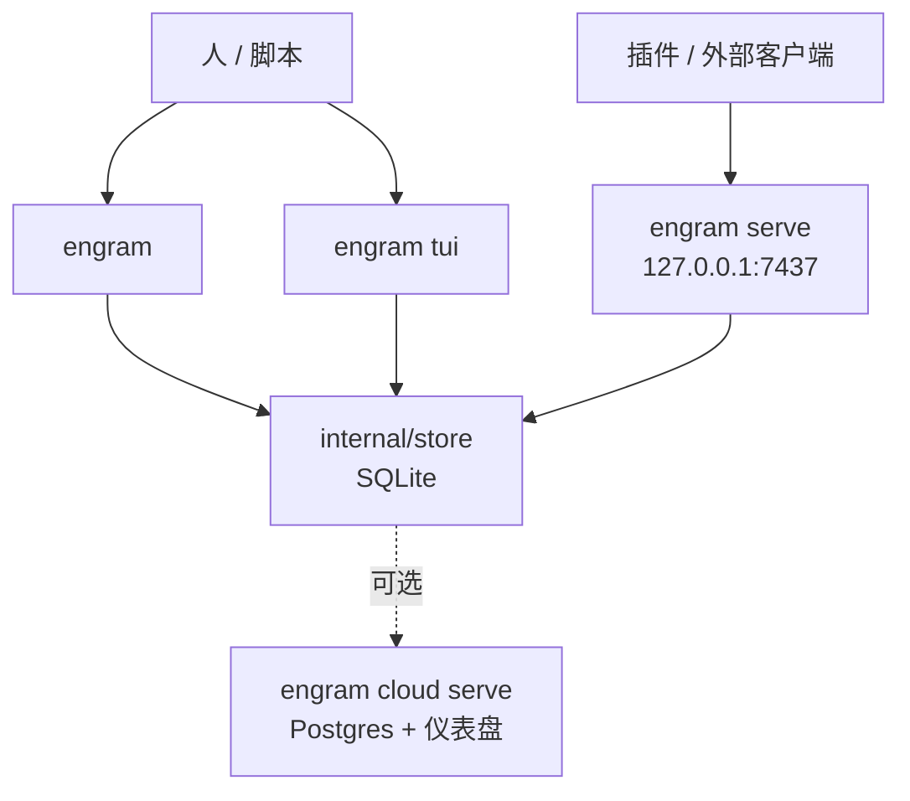

# 接口：CLI、HTTP 与 TUI

MCP 是给 Agent 用的主接口，但 Engram 还提供三种面向人和脚本的接口：CLI、本地 HTTP API、终端 TUI。它们都读写同一个本地 store——接口只是"壳"，不改变数据规则。本页给出各接口的可用面，作为查询手册。

## 三个接口的分工

下图展示三种本地接口与 store 的关系，以及它们和云运行时的分界。

该看什么：CLI、TUI、本地 HTTP 全部落在同一个 SQLite；云运行时是独立进程、独立存储，本地接口不会把数据写进云库。

## CLI 命令

`engram help` 给实时用法。命令分四组：本地记忆操作、项目维护、冲突审计、可选云。

| 命令 | 作用 | 关键参数 |
|------|------|---------|
| `engram setup [agent]` | 安装某个 Agent 集成 | 见 [agents-and-setup.md](agents-and-setup.md) |
| `engram serve [port]` | 启动本地 HTTP API | 默认端口 `7437` |
| `engram mcp` | 启动 stdio MCP 服务器 | `--tools`、`--project` |
| `engram tui` | 启动终端 UI | — |
| `engram search <query>` | 搜索记忆 | `--project P` / `--all`、`--match all\|any` |
| `engram save <title> <msg>` | 保存一条记忆 | `--project P` |
| `engram context [project]` | 最近上下文 | `--older-history` |
| `engram timeline <obs_id>` | 某条记忆的时序上下文 | `--project P` / `--all` |
| `engram stats` | 记忆统计 | `--all` |
| `engram export [file]` / `import <file>` | JSON 备份导出/导入 | `--all` |
| `engram sync` | 导出新记忆到 `.engram/`（默认排除 prompt） | `--include-prompts`、`--cloud --project P`、`--all` |
| `engram doctor` | 只读诊断 | `--json`、`--check CODE` |
| `engram conflicts ` | 冲突审计：list/show/stats/scan/deferred/prune | — |
| `engram projects ` | 项目列表、别名、合并、剪枝、所有权修复 | `list`/`alias`/`merge`/`consolidate`/`prune`/`rescue-ownership` |
| `engram init [name]` | 初始化 `.engram/config.json` | `--force` |
| `engram test [suite]` | 运行隔离自测 | `--quick`、`--json` |
| `engram obsidian-export` | 导出为 Obsidian 图谱（beta） | `--all` |
| `engram cloud ` | 云配置、enroll、upgrade、serve | 见 [sync-and-cloud.md](sync-and-cloud.md) |

## 本地 HTTP API

`engram serve` 在 loopback 地址（默认端口 7437，或选定的 POSIX Unix socket）上暴露 JSON API。按资源分组如下：

| 资源 | 端点示例 | 说明 |
|------|---------|------|
| Health | `GET /health` | 用实时聚合查询检查 store，失败返回 `500` |
| Sessions | `POST /sessions`、`POST /sessions/{id}/end`、`GET /sessions/recent` | 注册/续期/结束会话，支持 `resume: true` |
| Observations | `POST /observations`、`GET /observations/{id}`、`PATCH`/`DELETE`（需 `expected_project`）、`PUT/DELETE .../pin` | 记忆 CRUD、回放安全保存、pin |
| Search | `GET /search?q=...` | FTS5 检索，支持 compact |
| Timeline | `GET /timeline?observation_id=N` | 前后文 |
| Context | `GET /context`、`GET /context/compaction?session_id=X` | 手动格式化上下文 / 压缩会话上下文 |
| Prompts | `POST /prompts`、`GET /prompts/search`、`DELETE /prompts/{id}` | 用户提问 |
| Review | `GET /review`、`POST /review/mark_reviewed` | 复习清单 |
| Passive | `POST /observations/passive` | 只持久化可识别的结构化学习 |
| Export/Import | `GET /export`、`POST /import` | 版本化 JSON 备份，原子导入 |
| Stats/Doctor | `GET /stats`、`GET /doctor` | 统计与只读诊断 |
| Project | `GET /project/current`、`POST /projects/rescue-ownership` | 项目探测、所有权修复 |
| Sync Status | `GET /sync/status` | 本地节点同步/降级状态 |

**认证边界**：本地 API 默认零配置（路由开放）；设了 `ENGRAM_HTTP_TOKEN` 后，仅少数**写/删**路由（`DELETE /sessions|observations|prompts`、`GET /export`、`POST /import` 等）要求 Bearer。这只是实例级选择性认证，**不是项目授权**；本地模型假设单用户受信客户端。

云运行时（`engram cloud serve`）另有一组 `/sync/*` 路由（pull/push/mutations/session-authorities/prompt-pair-claims）与 `/dashboard/*`，属于独立的云边界，详见 [sync-and-cloud.md](sync-and-cloud.md)。

## 终端 TUI

`engram tui` 是一个 Bubbletea 交互界面，直接读本地 store。导航方式：

| 按键 | 作用 |
|------|------|
| `j` / `k` | 上下移动 |
| `Enter` | 下钻查看详情 |
| `c` | 复制内容到剪贴板 |
| `/` | 搜索 |
| `Esc` | 返回 |

TUI 的代码刻意分成 `model.go`（状态/屏幕）、`update.go`（输入/转移）、`view.go`（渲染）、`styles.go`（样式），经典的单向数据流结构。

## 边界与限制

- **接口薄，规则厚在 store**：三种接口只做解析与适配，真正的持久化、去重、所有权规则都在 `internal/store`。
- **本地不隔离互不信任客户端**：loopback TCP 本身不认证调用方，Unix socket 只是传输选择而非权限模型。
- **云路由不在本地运行时**：`engram serve` 不暴露云/仪表盘路由；两者是不同的二进制子命令与包。

> 依据：`DOCS.md`、`docs/codebase/interfaces.md`、`README.md`、`internal/server/server.go`、`internal/tui/model.go`
