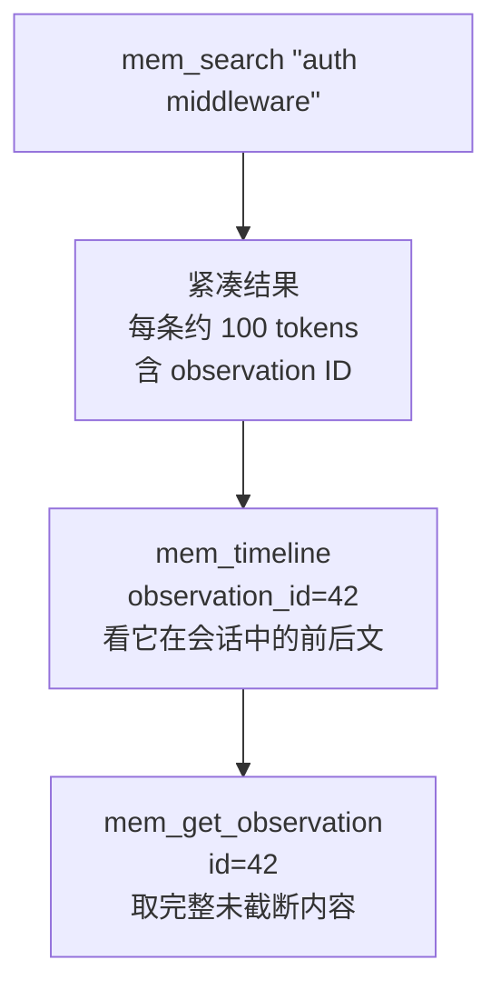
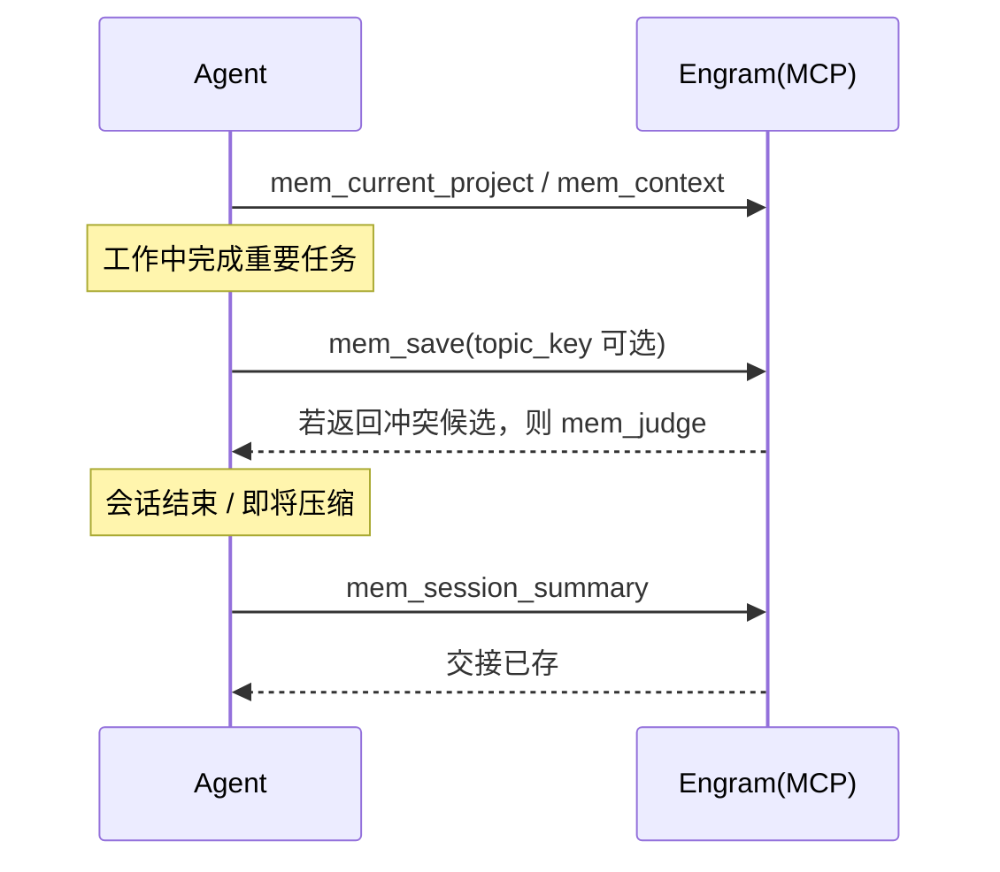

# MCP 工具

MCP（Model Context Protocol）是 Engram 与 Agent 之间的主接口。Agent 通过 stdio 连接 `engram mcp`，拿到一组 `mem_*` 工具来保存、检索、整理记忆与会话。这页讲清：有哪些工具、怎么分级、Agent 应该按什么顺序用它们。

## 工具是怎么分级的

`engram mcp` 支持三种工具 profile。分级不是安全边界（隐藏工具≠项目授权），而是**上下文预算**的控制手段——不需要的工具不必塞进模型。

| profile | 用在哪 | 内容 |
|---------|--------|------|
| `all` | `engram mcp` 默认 | 注册全部 27 个工具 |
| `agent` | 正常 Agent 会话 | 23 个工具：save/search/context/session summary/current project/judge/doctor 等 |
| `admin` | 人工策展、TUI、仪表盘 | 含 `mem_delete`、`mem_stats`、`mem_timeline`、`mem_merge_projects` 等管理工具 |

两个 profile 只共享 `mem_judge_many` 与 `mem_session_finalize`；`mem_consolidate` 与这两个一样是 Go/MCP 独有，不对 Pi 等适配器开放。

## 27 个工具一览

下表按用途分组，让 Agent 面对不同意图时知道该挑哪个。

| 意图 | 起始工具 | 说明 |
|------|---------|------|
| 确认当前项目 | `mem_current_project` | 推荐的第一个调用，确认检测到的项目及来源 |
| 恢复最近上下文 | `mem_context` | 取回最近会话历史 |
| 找以前的知识 | `mem_search` | 紧凑检索，返回带 ID 的预览 |
| 找用户原始提问 | `mem_search_prompts` | 检索已存的 prompt |
| 细看一条结果 | `mem_timeline` / `mem_get_observation` | 时间线上下文 / 取全文 |
| 保存或修订知识 | `mem_save` / `mem_update` / `mem_suggest_topic_key` | 存新记忆 / 改已有 / 建议 topic_key |
| 合并多条观察 | `mem_consolidate` | 预览并显式确认后合并 |
| 保留用户请求 | `mem_save_prompt` | 存一条 prompt |
| 会话交接/收尾 | `mem_session_summary` / `mem_session_start` / `mem_session_end` / `mem_session_finalize` | 摘要 / 开始 / 结束 / 原子收尾 |
| 复习陈旧知识 | `mem_review` | `list` 列出待复习、`mark_reviewed` 标记 |
| 判断记忆关系 | `mem_judge` / `mem_judge_many` / `mem_compare` | 单条 / 批量 / 对比判断 |
| 固定/取消固定 | `mem_pin` / `mem_unpin` | 让重要记忆突出 |
| 删除 | `mem_delete` | 默认软删除，可选硬删除 |
| 统计与诊断 | `mem_stats` / `mem_doctor` / `mem_list_projects` | 计数 / 只读诊断 / 项目列表 |
| 项目维护 | `mem_merge_projects` | 合并相似项目名 |
| 被动捕获 | `mem_capture_passive` | 宿主侧的被动采集入口 |

## 渐进式检索：三层下钻

这是 Engram 省 token 的核心机制——**不要一次把全文塞进上下文**。下图展示检索的三层递进。

该看什么：第一层只花很少 token 就能判断"这条值不值得深看"；只有当周围上下文重要时才走时间线；只有确需完整内容时才走 `mem_get_observation`。搜索结果只是**预览，不是完整记录**。

## Agent 应遵循的工作流

Engram 把"存什么"的判断交给 Agent，所以它随包提供一份 Memory Protocol。核心纪律：

1. **写前先定位**：会话开始用 `mem_current_project` 确认项目，再用 `mem_context` / `mem_search` 恢复相关历史。
2. **先搜后写**：要重新讨论某决定、Bug、约定前，先用聚焦词搜一遍，别重复劳动。
3. **渐进取回**：search → timeline → get_observation，按需加深。
4. **有意识地保存**：只存完成的修复、决策、发现、配置变更、模式、长期用户约束；不存原始工具输出，也不存每一轮对话。
5. **演进的知识要稳定**：给演进主题一个稳定 `topic_key`，复用更新而非新开竞争记忆。
6. **留交接**：会话结束前存 `mem_session_summary`（Goal / Instructions / Discoveries / Accomplished / Next Steps / Relevant Files）。
7. **压缩后恢复**：先持久化压缩后的交接摘要，再 `mem_context` 取回最近历史。

下图是这套工作流在会话生命周期里的位置。

## 边界与限制

- **工具可用性随 profile 变**：不同 MCP profile 注册的工具不同，Agent 应先用工具发现机制（如 `ToolSearch`）确认某个延迟工具是否存在。
- **判断需要显式确认**：`mem_save` 返回冲突候选时，Agent 必须用 `mem_judge` 定夺或向用户确认敏感关系，不能自行忽略。
- **所有权断言不是鉴权**：`mem_update` / `mem_delete` 传入的 `expected_project` 是所有权一致性断言，用于原子校验存储所有者，不是身份认证或授权。

> 依据：`DOCS.md`、`docs/codebase/interfaces.md`、`README.md`、`internal/mcp/mcp.go`
