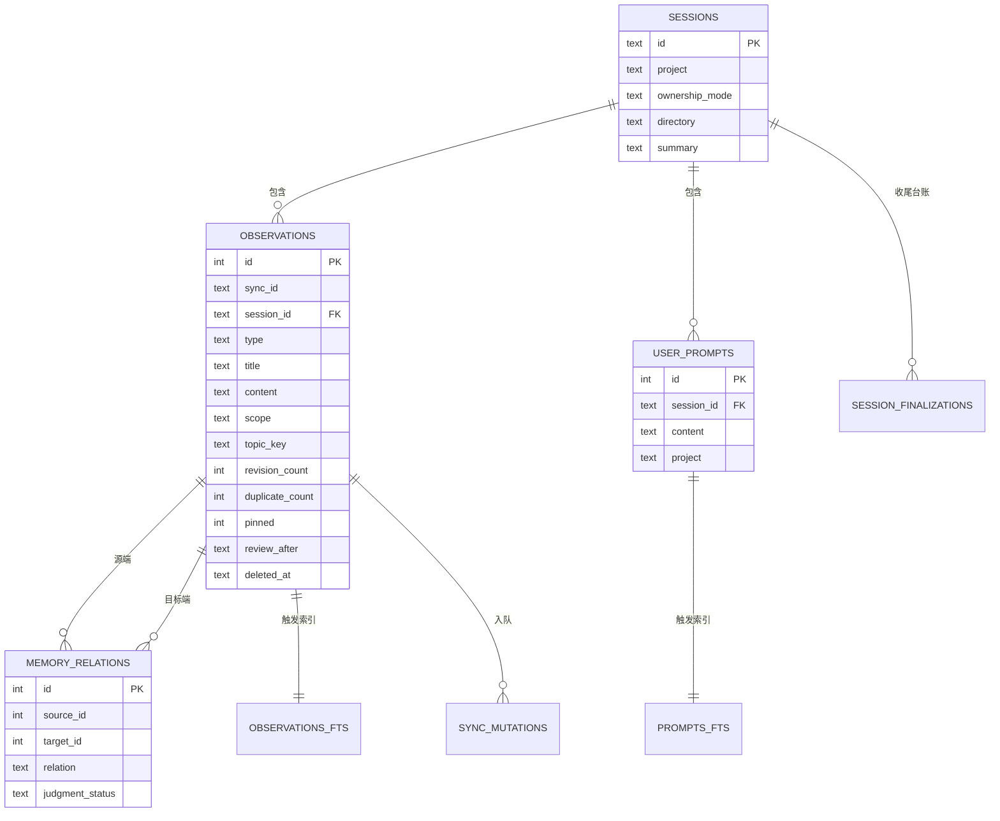
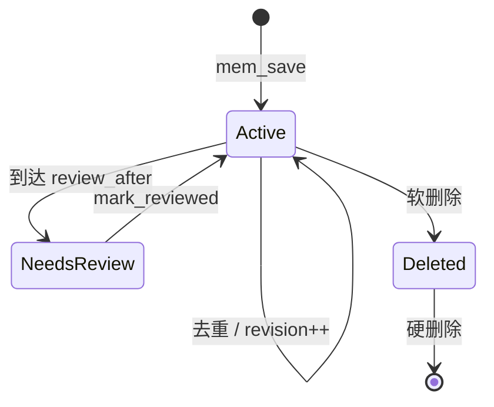

# 记忆模型

这页讲 Engram 里"记忆"到底长什么样：有哪几类实体、它们怎么组织、怎么避免重复、怎么随时间演化。理解了这套模型，就理解了 `internal/store` 的存在理由。

## 概念地图

Engram 的记忆不是"一堆文本"，而是四类有关系的实体。下图是它们的结构与关联。

该看什么：`observations` 是记忆的主体，`sessions` 把它分组，`user_prompts` 单独存用户原始提问，`memory_relations` 存记忆之间的判断关系。FTS 表由触发器同步，`sync_mutations` 是同步的变更队列。

## 四类实体

| 实体 | 作用 | 关键字段 | 关系 |
|------|------|---------|------|
| `sessions` | 归组一次 Agent 会话的工作 | `id`、`project`、`ownership_mode`、`directory`、`summary` | 一对多 observation / prompt |
| `observations` | 主体记忆：决策、Bug、模式、发现、会话摘要 | `type`、`title`、`content`、`scope`、`topic_key`、`revision_count`、`review_after` | 属于 session；两两间可有 relation |
| `user_prompts` | 用户原始提问，作为可检索上下文 | `content`、`project`、`session_id` | 属于 session；删除记入 `prompt_tombstones` |
| `memory_relations` | `mem_judge` 产出的记忆间关系判断 | `relation`、`judgment_status`（pending/judged/orphaned/ignored） | 连接两条 observation |

此外还有一组**同步专用**的表：`sync_mutations`（有序变更队列）、`sync_chunks`（已导入分块追踪）、`sync_state`、`sync_delete_tombstones`、`sync_apply_deferred`（依赖缺失或所有权不匹配时暂缓应用）。它们保证同步的幂等与"不静默丢弃"。

## 作用域 scope

每条 observation 带一个 `scope`，决定它被谁看见：

| scope | 含义 | 典型用途 |
|-------|------|---------|
| `project`（默认） | 属于某个项目 | 项目内的架构、Bug、约定 |
| `personal` | 个人记忆，不随项目共享 | 个人偏好、本机环境 |
| `global` | 机器级、跨项目 | 跨仓库通用的经验 |

注意 `personal` / `global` 仍**有所有者**，作用域不等于逃过所有权检查。

## topic_key：让记忆随主题演进

默认每次 `mem_save` 都新建一条 observation。但很多知识是**随时间演化**的（架构决定、长期特性、约定）。`topic_key` 把保存变成**upsert**：当 `project + scope + topic_key` 三者相同时，更新已有记录（`revision_count++`）而不是新开一条。

键的约定是**两级的斜杠小写 kebab-case**：`family/description`，例如 `architecture/auth-model`、`decision/database-choice`。

| 情况 | 用 topic_key？ | 原因 |
|------|---------------|------|
| 会演进的架构/设计决定 | 是 | 历史收在一条记录里，revision 递增 |
| 跨会话的长期特性 | 是 | 会话间的单一事实源 |
| 项目级模式/约定 | 是 | 一条权威条目随成熟度更新 |
| 已闭环的自包含 Bug 修复 | 否 | 单条即可，无需再更新 |
| 一次性发现/事实 | 否 | 建了永不复用反而添噪音 |
| 同一大主题下多个独立决定 | 否，用不同键 | 不同决定必须不同键，否则互相覆盖 |

不确定用哪个键时先调 `mem_suggest_topic_key`，它按类型与标题给出建议族（`architecture/*`、`bug/*`、`decision/*`、`pattern/*`、`config/*`、`discovery/*`、`learning/*`）。

## 去重与冲突

- **精确去重**：滚动窗口内以 `hash + project + scope + type + title` 判断重复，命中则不新增行，只更新 `duplicate_count`、`last_seen_at`、`updated_at`。
- **话题 upsert**：同 topic_key 视为同一主题的修订，`revision_count` 递增。
- **冲突候选**：`mem_save` 可返回"可能相关/冲突"的候选。相关判断是**词法启发式**（共享 topic_key、或标题至少两个显著词相同），不是语义检测；Agent 需用 `mem_judge` 定夺。

## 生命周期与复习

记忆不会一到期就消失。`review_after` 是按类型给的**复习提醒**：

| 类型 | 初始复习间隔 |
|------|-------------|
| `config`、`preference` | 3 个月 |
| `discovery`、`pattern`、`decision` | 6 个月 |
| `architecture`、`bugfix`、`policy` | 12 个月 |
| 未映射类型（如 `learning`、`session_summary`） | 无默认 |

逾期记忆仍可检索，只是 `state` 标为 `needs_review`；`mem_review action="list"` 把它们列出，`action="mark_reviewed"` 重启该类型的复习间隔。**硬过期尚未实现**。

下图是单条 observation 的状态流转。

该看什么：软删除（`deleted_at`）只是隐藏，`mem_search`、`mem_context`、时间线都会忽略它，但底行仍在；只有显式硬删除才真正移除。

## 数据怎么流转

写入路径：`mem_save` → 记 observation → 触发 FTS5 索引 → **同事务**入队一条 `sync_mutations`。读取路径：FTS5 + BM25 召回 → 可选关联 `memory_relations` 做冲突提示 → 返回紧凑预览，按需下钻全文。

> 依据：`docs/codebase/memory-core.md`、`DOCS.md`、`README.md`、`internal/store/store.go`
