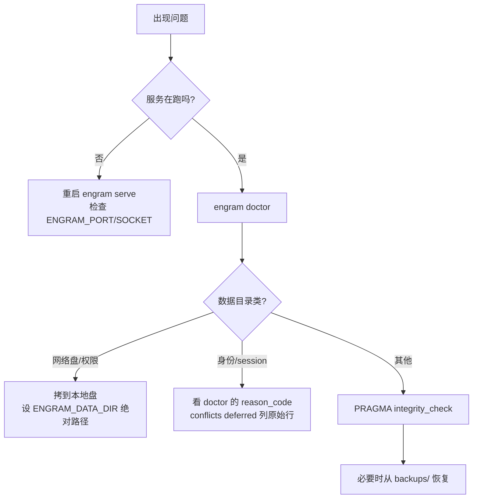

# 运维

这页面向"把它装起来、跑稳、出问题能查"的读者。Engram 运维的核心优势是简单：一个二进制、一个 SQLite 文件、零服务依赖。复杂的地方只在云与数据目录安全。

## 安装方式

| 平台 | 方式 | 命令 |
|------|------|------|
| macOS / Linux | Homebrew | `brew install gentleman-programming/tap/engram` |
| Windows | `go install` | `go install github.com/Gentleman-Programming/engram/v3/cmd/engram@latest` |
| 全平台 | 下载 release 二进制 | 从 GitHub Releases 取稳定版 |
| 源码 | `go build` / `go install` | 见安装文档 |

生产与安全支持请用**最新稳定版**；release candidate 只作预发布验证。

## 数据目录与文件

- 默认数据目录 `~/.engram`，可用**绝对路径**的 `ENGRAM_DATA_DIR` 覆盖（相对路径被拒绝）。
- 数据库是单文件 `~/.engram/engram.db`（外加 WAL 的 `-wal` / `-shm` 边车）。
- SQLite 配置：WAL 模式、`busy_timeout` 5000ms、`synchronous NORMAL`、外键 ON。

**数据目录安全**：SQLite 的持久 WAL 在网络文件系统上不安全。Engram 会在打开/迁移/改动数据库前**拒绝**已知的 NFS 与 SMB/CIFS 目录；未知文件系统仍兼容，但不代表已证明本地。若报网络文件系统，先停掉所有 engram 进程，把 `engram.db`、`engram.db-wal`、`engram.db-shm` **三件套一起**拷到本地，再设 `ENGRAM_DATA_DIR` 并跑 `engram doctor` 与 `PRAGMA integrity_check`。

## 关键环境变量

| 变量 | 类型 | 默认 | 说明 |
|------|------|------|------|
| `ENGRAM_DATA_DIR` | 路径 | `~/.engram` | 数据目录；非空即用，须为绝对路径 |
| `ENGRAM_PORT` | 数字 | `7437` | 本地 HTTP 端口；非法回落 7437 |
| `ENGRAM_SOCKET` | 路径 | 未设 | POSIX Unix socket；不能与端口并用 |
| `ENGRAM_PROJECT` | 项目名 | cwd 检测 | 进程级默认项目覆盖（别名或路径会被拒） |
| `ENGRAM_HTTP_TOKEN` | 字符串 | 未设 | 本地 HTTP 选择性 Bearer 认证 |
| `ENGRAM_TIMEZONE` | IANA 名 | 系统本地 | TUI / 仪表盘时间显示 |
| `ENGRAM_AGENT_CLI` | `claude`\|`opencode` | 未设 | `conflicts scan --semantic` 的 LLM 运行器 |
| `ENGRAM_NO_UPDATE_CHECK` | flag | 未设 | 设 `1` 关闭更新检查 |
| `ENGRAM_CLOUD_SERVER` | URL | 未设 | 云服务器地址（autosync/`sync --cloud`） |
| `ENGRAM_CLOUD_TOKEN` | 字符串 | 未设 | 云 Bearer token |
| `ENGRAM_CLOUD_AUTOSYNC` | flag | 未设 | 设 `1` 开启后台自动同步（需 token+server） |
| `ENGRAM_CLOUD_ALLOWED_PROJECTS` | 列表 | 未设 | 云服务端项目白名单，`*` 允许全部 |
| `ENGRAM_CLOUD_MAX_PUSH_BYTES` | 字节 | `8388608` | 云 push 载荷上限 |
| `ENGRAM_DATABASE_URL` | DSN | 未设 | `engram cloud serve` 的 Postgres 连接 |

## doctor：只读诊断

`engram doctor` 对本地 SQLite 与 MCP 注册跑**只读**诊断：它发现、解释、给安全建议，但基础命令**不修数据、不迁移、不删行、不动同步游标**。可用 `--json` 与 `--check <CODE>` 过滤单项检查。

下图是"出了问题先看哪里"的排查顺序。

该看什么：多数"没记忆了"其实是服务没跑或数据目录不对；`doctor` 会把网络盘、空 session 身份、项目别名冲突等问题分类报出，且**不猜测、不自动修复**（避免编造身份数据）。

## 自测与升级

- **二进制自测**：`engram test [suite] [--quick] [--json]` 跑隔离的可靠性与性能检查，适合验证发布二进制。
- **升级检查**：多数命令会检查 GitHub release 更新；`ENGRAM_NO_UPDATE_CHECK=1` 可全关。
- **brew 升级注意**：macOS 上 `brew upgrade engram` 会替换二进制并杀掉正在跑的 `engram serve`，autosync 会静默停止，直到你重新启动；用 launchd 模板可让它跨升级与重启存活，升级后跑 `engram cloud status` 确认 `Local daemon: running`。
- **云升级/回滚**：用 `engram cloud upgrade <doctor|repair|bootstrap|remirror|status|rollback> --project <name>`。

## 边界与限制

- **不自动修复**：doctor 是只读的；修复要么走显式 `--apply`（如 repair、rescue-ownership），要么人工。
- **备份隐私**：Unix 上自动修复快照在 `backups/` 下以 `0600`/`0700` 预留，但旧快照不追溯改权限——里面是明文记忆库，需自行审阅。
- **Windows 备份受 ACL 支配**：不使用 Unix 权限位。

> 依据：`docs/INSTALLATION.md`、`docs/DOCTOR.md`、`DOCS.md`、`README.md`
