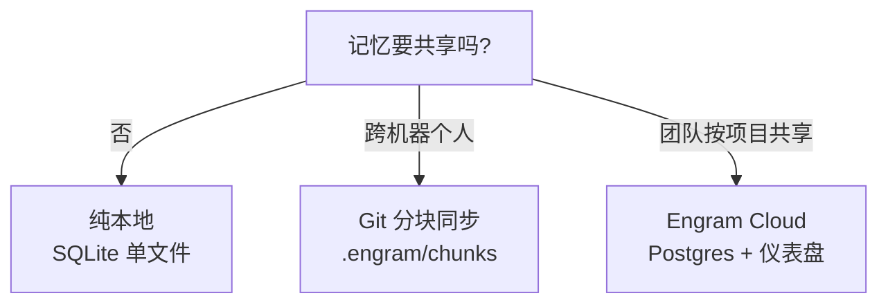

# 概览

## 一句话定位

Engram 是**给 AI 编码 Agent 用的本地优先持久记忆**：一个 Go 单二进制，把 Agent 主动存下的结构化记忆写进本地 SQLite + FTS5，再通过 MCP、HTTP、CLI、TUI 四种接口读回，全程不需要 Node.js、Python 或 Docker。

## 解决什么问题

问题的根源是**会话边界**。AI 编码 Agent（Claude Code、Codex、OpenCode 等）每次会话结束就清空上下文——你昨天讲过的架构决定、上周踩过的坑、这个仓库的命名约定，今天要重新解释一遍。上下文一旦被压缩（compaction），连本会话内的记忆也丢了。

现有做法有两个极端：把所有工具调用原样记下来（噪音大、要在检索时再压缩），或者完全依赖人工整理笔记（不现实）。Engram 选第三条路：**让 Agent 自己判断什么值得记**。Agent 手握 LLM 和刚刚发生的事实，让它直接写一条结构化摘要，比事后用另一个模型压缩一遍更便宜、更干净。

## 给谁用 / 典型场景

| 场景 | 用法 | Engram 提供的价值 |
|------|------|------------------|
| 个人开发者 | 装好插件后无感运行 | 跨会话记住决策与踩坑，不用重复解释项目 |
| 多机开发者 | 用 Git 同步 `.engram/` 分块 | 记忆随仓库走，换机器不丢 |
| 团队共享 | 自建 Engram Cloud + 按项目 enroll | 项目级共享记忆与浏览器可见 |
| 在 TUI 里翻记忆 | `engram tui` | 浏览、搜索、复制 Agent 记得的东西 |
| 写脚本/集成 | 本地 HTTP API | 把记忆接进自定义工作流 |

## 核心能力一览

先看一张图：Engram 把"用哪种形态"拆成一个很轻的选择——默认纯本地，需要跨机就用 Git 分块，需要团队共享才引入自建云。

该看什么：三条路径不是互斥的层级，而是同一份本地记忆的不同扩散半径；无论选哪条，本地 SQLite 都保持权威。

下表把这套能力摊开：

| 能力 | 说明 | 典型场景 |
|------|------|---------|
| 主动保存 | `mem_save` 存结构化 observation（What/Why/Where/Learned） | Bug 修复后留一条可检索记录 |
| 渐进式检索 | 先用 `mem_search` 拿紧凑预览，再按需 `mem_get_observation` 取全文 | 省 token 地找回上下文 |
| 话题演进 | `topic_key` 让同一主题的保存变成**就地更新**（`revision_count++`） | 架构决定的持续演进 |
| 精确去重 | 哈希 + project + scope + type + title 滚动窗口内去重 | 同一结论不重复灌库 |
| 会话交接 | `mem_session_summary` 存 Goal/Discoveries/Accomplished/Next Steps/Files | 会话结束留交接、压缩后恢复 |
| 复习提醒 | `review_after` 按类型给复习间隔，过期标 `needs_review` | 让陈旧知识浮出而不是静默过期 |
| 冲突呈现 | `mem_judge` 给两条记忆的关系下判断并存 `memory_relations` | 相关/冲突记忆交给 Agent 判断 |
| 四级接口 | MCP / HTTP / CLI / TUI 共用一个本地 store | 任何 Agent、任何工作流都能接 |
| 可选云 | `engram cloud serve` 暴露同步传输、仪表盘、认证 | 团队按项目共享 |
| 可移植 | Git 分块导出（`.engram/chunks/*.jsonl.gz`） | 记忆进版本库、跨机携带 |

## 技术栈

| 组件 | 用途 | 选型理由 |
|------|------|---------|
| Go（`go 1.26`） | 编译成单二进制 | 零运行时依赖，`go install` / brew 即用，跨 macOS / Linux / Windows |
| SQLite（`modernc.org/sqlite`，纯 Go） | 本地持久化 | 免 CGO；单文件 `engram.db`，备份与迁移简单 |
| FTS5 | 全文检索 | 内置于 SQLite，零额外进程，trigram 支持子串匹配 |
| WAL 模式 | 并发读 | 读写不互相阻塞；`busy_timeout` 5000ms |
| `mark3labs/mcp-go` | MCP stdio 服务器 | 标准 MCP 协议，Agent 侧零适配 |
| Bubbletea / Lipgloss | 终端 UI | 交互式 TUI，Catppuccin 配色 |
| `jackc/pgx` + PostgreSQL | 云侧持久化 | 仅 `engram cloud serve` 使用，与本地库分离 |
| `a-h/templ` + HTMX | 云仪表盘 | 服务端渲染 HTML，无重型前端框架 |

**选择代价**：纯本地意味着没有内置的向量语义检索（只靠 FTS5 词法 + 可选 LLM 判官）；单二进制意味着所有能力都压在一个进程里，这是刻意的简洁取舍。

## 与同类项目的差异

Engram 明确对标并受 [claude-mem](https://github.com/thedotmack/claude-mem) 启发，但设计取向相反。核心差异：

| 维度 | Engram | claude-mem |
|------|--------|-----------|
| 语言/依赖 | Go，单二进制零依赖 | TS + Python，需 Node/Bun/uv |
| Agent 绑定 | 无，任何 MCP Agent | 仅 Claude Code |
| 检索 | SQLite FTS5 内置 | ChromaDB 向量库（独立进程） |
| 存什么 | 仅 Agent 主动整理的摘要 | 原始工具调用 + AI 压缩 |
| 压缩时机 | Agent 内联（它本就有 LLM） | 额外 Claude API 调用 |
| 进程 | 一个二进制（或 MCP stdio 无进程） | Worker 服务 + ChromaDB |
| 自动捕获 | 否，Agent 决定 | 是，全量捕获后压缩 |
| 许可 | MIT | AGPL-3.0 |

## 现状与边界

- **语义是词法的**：默认检索是 FTS5 词法与 BM25 排序，`--semantic` 的 LLM 判官只在词法召回的候选对上工作，发现不了完全无关的语义相似。
- **本地不做多租户隔离**：本地 store 面向单用户受信客户端，`expected_project` 是所有权一致性断言而非鉴权；真正的项目级授权边界在 cloud 服务器。
- **云编排未自动化**：插件层的自动云 enroll 尚缺，云流程需 CLI 驱动。
- **复习不等于过期**：`review_after` 是提醒，逾期记忆仍可检索，硬过期未实现。
- **不支持网络盘**：已知 NFS / SMB 数据目录会在打开前被拒绝。

> 依据：`README.md`、`docs/COMPARISON.md`、`docs/codebase/mental-model.md`、`go.mod`、`DOCS.md`、`docs/intended-usage.md`
