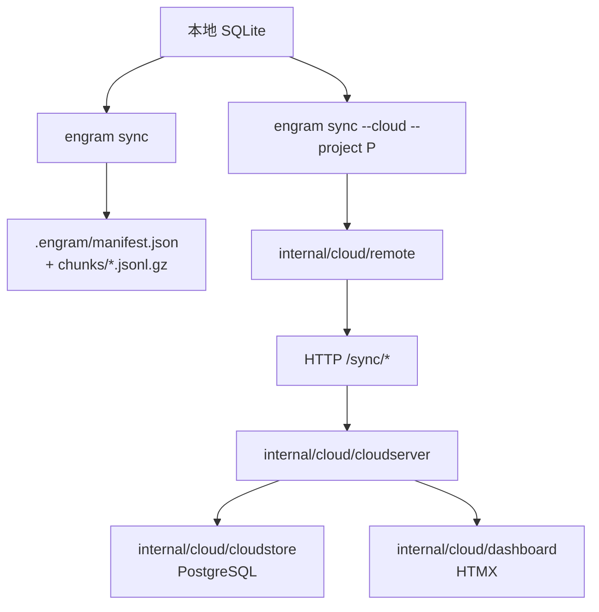

# 同步与云

Engram 的本地 SQLite 是权威，但记忆需要能跨机器、跨团队流动。它提供**两条彼此独立**的路径：面向个人的 Git 分块同步，和面向团队的 Engram Cloud 复制。两者的共同前提是——**同步不改变所有权**，本地库永远是事实源。

## 两条同步路径

下图对比两条路径的数据走向。它们都从本地 store 出发，但落点不同。



该看什么：Git 路径产出的是**可提交进版本库**的文件；云路径是一条 HTTP 复制链路，服务端用 Postgres 存读模型、用仪表盘做浏览。

## Git 分块同步

`internal/sync` 刻意**不用一个大的共享 JSON 文件**，而是每次同步生成新的分块（`.engram/chunks/*.jsonl.gz`）加一个小小的 `manifest.json`。原因很实际：分块能减少 Git 合并冲突，也允许多台机器并行产生记忆而互不踩踏。

| 特性 | 行为 |
|------|------|
| 携带内容 | 项目内的 session、observation、以及未被孤儿化的 `memory_relations` |
| 默认排除 | **prompt 默认不导出**（含历史导入过的）；需要显式 `--include-prompts` |
| 删除墓碑 | prompt 删除墓碑仍会随行（只带身份与删除元数据，不带内容） |
| 关系传递 | 关系以 `relation` 同步 mutation 形式随块旅行，导入复用同一幂等路径 |
| 导入去重 | `sync_chunks` 按 `target_key + chunk_id` 记录已导入分块，避免重复 |

**重要边界**：这不是脱敏。observation 等共享字段仍可能含敏感数据，提交前要自己检查；已生成的分块永不重写，排除 prompt 也不会从 Git 历史里删掉已保留的内容。

## 云 autosync

`internal/cloud/autosync/manager.go` 跑在长生命周期进程里，负责把本地变更持续推上云、把云端变更拉下来。它协调这些事：

- SQLite 租约（避免重复 worker）
- 待推 mutation 的 push
- 基于游标的 pull
- 延迟重放（`sync_apply_deferred`）
- 带抖动的退避
- 降级状态（带 `reason_code` 与消息）

**业务铁律：同步被阻塞时要大声、可见地失败，绝不静默丢弃。** 一个典型的落地：拉取到"空白 session 身份"的历史 mutation 时，本地不做 fail-closed（那会永久卡住游标、堵死后续所有 mutation），而是隔离进 `sync_apply_deferred` 并记 `sync_session_identity_invalid`，其余照常应用、游标继续前进；同时 `engram doctor` 会把它作为 warning 报出。真正无法解码的 payload 才是 fail-closed 的传输故障。

## cloud serve 运行时

`engram cloud serve` 是一个与本地运行时**物理分离**的服务：

| 组件 | 目录 | 作用 |
|------|------|------|
| 云运行时 | `internal/cloud/cloudserver` | `/sync/*` 传输、认证边界、挂载仪表盘、服务端强制 |
| 云持久化 | `internal/cloud/cloudstore` | Postgres 中的 chunk、mutation、读模型、控制、审计 |
| 仪表盘 | `internal/cloud/dashboard` | 服务端渲染 `/dashboard/*`，HTMX + templ |
| 认证 | `internal/cloud/auth` | Bearer token、项目范围授权、签名的仪表盘会话 |

云使用**项目级授权**：authenticated 模式下需要 `ENGRAM_CLOUD_TOKEN` + `ENGRAM_CLOUD_ALLOWED_PROJECTS`（或管理型 token 的项目 grant），并需要显式的非默认 `ENGRAM_JWT_SECRET`。

## 快速上手（本地冒烟）

自建云最快的一条路是先跑本地烟测，确认链路通：

```bash
docker compose -f docker-compose.cloud.yml up -d
engram cloud config --server http://127.0.0.1:18080
engram cloud enroll smoke-project
engram sync --cloud --project smoke-project
```

之后用 `engram cloud upgrade <doctor|repair|bootstrap|remirror|status|rollback> --project <name>` 完成升级与修复；`remirror` 会从权威本地数据重建云端状态。

## 边界与限制

- **云需要逐项目 enroll**：`engram sync --cloud` 必须指定单个 `--project`，不能与 `--all` 组合。
- **插件层未编排云**：插件的自动云 enroll/login/upgrade 目前没有实现，云流程走 CLI。
- **最终一致**：同步是复制，不是分布式事务；跨机一致性是最终达成的。
- **仪表盘开关要落到服务端**：任何改变权限/同步的开关，必须在 cloudserver/cloudstore 强制，而不是仅改动 HTML。

> 依据：`docs/codebase/sync-and-cloud.md`、`docs/engram-cloud/README.md`、`DOCS.md`、`internal/sync/sync.go`、`internal/cloud/autosync/manager.go`
