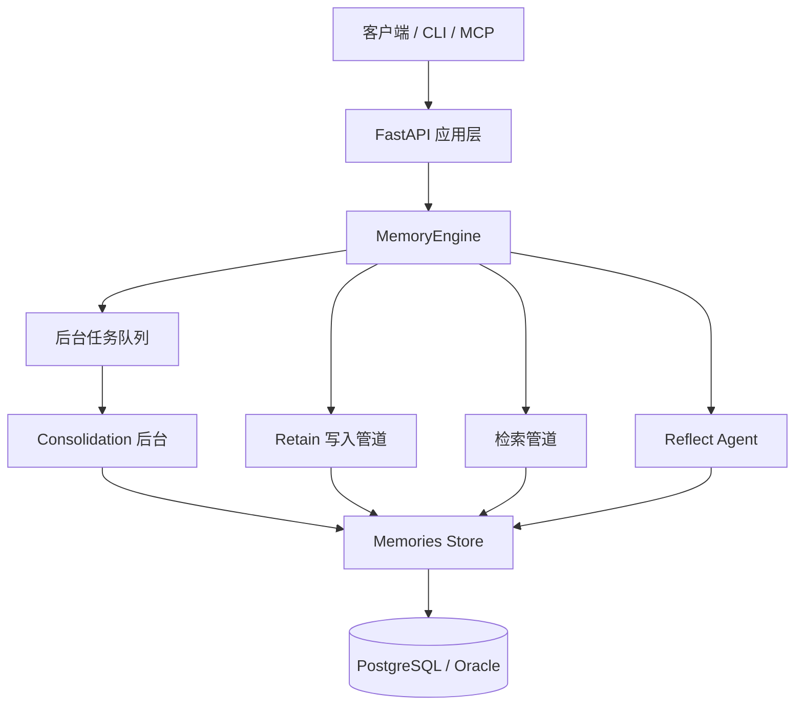
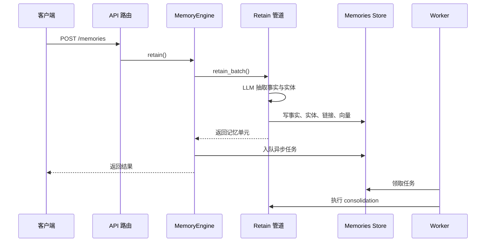

# 系统架构

## 整体形态

Hindsight 是一个**单体服务 + 后台 worker** 的架构：对外是一个 FastAPI 应用（同时承载 REST API 与 MCP 端点），对内由一个中心对象 `MemoryEngine` 承载全部业务逻辑；耗时的工作交给一张数据库任务表排队的后台 worker 去跑。它没有引入独立的向量数据库或消息中间件——关系数据、向量、全文检索和任务队列都在同一个 PostgreSQL（或 Oracle）里。

上图的关键是中间那条 `Memories Store`：写入管道、检索管道、reflect agent 和后台 consolidation 都通过同一层接口访问记忆，而这一层再向下对接具体数据库。因此"换存储后端"不会波及业务逻辑。

## 分层与职责

| 层 | 负责 | 不负责 |
|----|------|--------|
| 接入层 | 路由、参数校验、鉴权、限流、把 HTTP/MCP 调用翻译成引擎调用 | 任何记忆逻辑 |
| 引擎层（`MemoryEngine`） | 编排写入、检索、反思、刷新；决定何时入队后台任务 | 具体 SQL |
| 领域管道 | retain / search / reflect / consolidation 各自的分阶段处理 | 进程与生命周期管理 |
| 存储层 | 把领域操作翻译成 SQL，屏蔽 PostgreSQL 与 Oracle 差异 | 业务判断 |
| 后台 worker | 从任务表领取并执行异步作业（consolidation、刷新、webhook 投递等） | 请求路径上的同步工作 |

引擎层承担了最关键的复杂度：它既是**同步请求的编排者**，又是**异步作业的调度者**，还持有各类缓存（bank 信息、统计、embedding 缓存等）。之所以集中在一层，是因为一次写入会横跨文档、分块、事实、实体、链接多张表，这些写入必须在同一条一致性边界内协调——分散到各个 handler 里会难以保证。

## 模块地图

仓库是一个多语言 monorepo，后端全部源码集中在 `hindsight-api-slim`：

| 目录 | 职责 |
|------|------|
| `hindsight-api-slim/hindsight_api/engine/` | 引擎主体：retain、search、reflect、consolidation、db、memories、storage |
| `hindsight-api-slim/hindsight_api/api/` | FastAPI 应用、REST 路由、MCP 中间件 |
| `hindsight-api-slim/hindsight_api/worker/` | 后台任务轮询器与执行器 |
| `hindsight-api-slim/hindsight_api/extensions/` | 扩展点基类、加载器与内置扩展（多租户、memory defense） |
| `hindsight-api-slim/hindsight_api/alembic/` | 数据库迁移版本 |
| `hindsight-api/` | PyPI 包入口（`pip install hindsight-api`） |
| `hindsight-all/`、`hindsight-all-npm/`、`hindsight-embed/` | 嵌入式运行（自动拉起本地服务与进程内数据库） |
| `hindsight-clients/` | Python / TypeScript / Go / Rust 客户端 |
| `hindsight-cli/` | Rust 命令行工具 |
| `hindsight-control-plane/` | Next.js Web 控制台 |
| `hindsight-integrations/` | 各框架、编码代理与低代码平台的适配包 |
| `docker/`、`helm/`、`monitoring/` | 部署编排与 Grafana 仪表盘 |

## 主链路

一次写入请求会横跨同步路径与异步路径。下面这张时序图说明 `retain` 从进入服务到后台作业被触发的全过程——注意响应在后台作业开始**之前**就已经返回，这是理解系统时延特征的关键。

该看什么：同步路径只保证"事实与索引已写好"，观察固化、心智模型刷新等"变聪明"的动作全部在返回之后由 worker 完成。因此写入的接口延迟与记忆成熟度是两件事。

检索请求的主链路更短：`POST /memories/recall` 进入引擎后，四路召回并行发起，融合与重排串行收尾，全程不写库。

## 关键设计取舍

| 取舍 | 选择 | 代价 |
|------|------|------|
| 任务队列 | 用数据库表 `async_operations` + `FOR UPDATE SKIP LOCKED` 领取 | 无需外部消息中间件，部署简单；但队列吞吐受数据库限制 |
| worker 位置 | 默认内嵌在 API 进程（随应用 lifespan 启动），也可独立进程运行 | 单机部署方便；需要按负载调整 worker 数量与并发 |
| 存储抽象 | 领域层面向 `memories` 接口，数据库方言由 `db` 层的 ops 抽象 | 支持多后端；引入一层间接与方言改写的维护成本 |
| 配置解析 | 配置在每次请求时按 全局 → 租户 → bank 解析 | 多实例间行为一致；每请求有一次解析开销 |
| 服务形态 | 单体服务而非微服务 | 部署与调试简单；横向扩展靠多副本 + 共享数据库 |

> 依据：`hindsight-api-slim/hindsight_api/server.py:25-87`、`hindsight-api-slim/hindsight_api/api/__init__.py:17-109`、`hindsight-api-slim/hindsight_api/api/http.py:5073-5361`、`hindsight-api-slim/hindsight_api/engine/memory_engine.py:2621-3008`、`hindsight-api-slim/hindsight_api/worker/poller.py:320-708`、`hindsight-api-slim/hindsight_api/engine/db/base.py:23-205`
