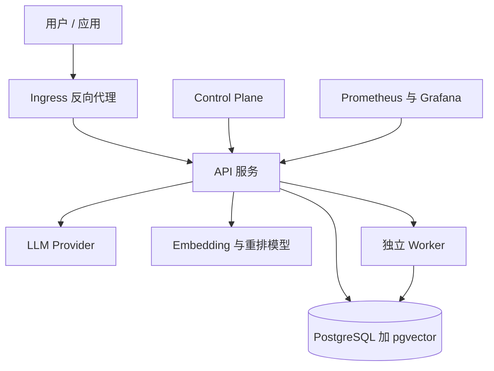

# 部署与运维

## 部署形态

Hindsight 是一个标准的有状态服务：一个 API 进程 + 一个数据库，后台 worker 默认与 API 同进程、也可独立部署。它对外只需要数据库和（可选的）模型服务。

该看什么：**数据库是唯一必须的外部依赖**。embedding 与重排模型可以指向本地推理服务（Helm chart 里内置了 TEI 部署），LLM 则指向任一受支持的服务商；worker 既可以随 API 进程启动，也可以拆成独立工作负载。

## 落地方式

| 方式 | 适合 | 说明 |
|------|------|------|
| Docker Compose | 本地与测试 | 仓库提供多套场景编排（本地模型、CUDA、外部 PG、不同向量扩展等） |
| Helm Chart | Kubernetes | 含 API/worker、Control Plane、PostgreSQL、模型服务、HPA、Ingress、ServiceMonitor 等模板 |
| pip 安装 | 裸机 | `pip install hindsight-api` 后直接启动服务 |
| 嵌入式 | 单机/无外部依赖 | 进程内 PostgreSQL，适合本地与嵌入式 SDK |
| 托管云 | 免运维 | 闭源托管版，本文档不覆盖其内部实现 |

最小可运行形态只需要一个 LLM 密钥：数据库可以用进程内的 pg0，其他组件都有默认值。

## 配置体系

配置按三级解析：**全局（环境变量）→ 租户（扩展提供）→ bank（数据库）**。解析发生在每次请求时，以保证多副本之间行为一致。全局层从 `HINDSIGHT_API_` 前缀的环境变量读取，并支持 `.env` 文件；bank 层可在运行时通过 API 更新，但跨字段的约束会在写入时重新校验。

| 分组 | 涉及内容（示例） |
|------|------------------|
| LLM | provider、模型、密钥、多模型路由 |
| 数据库 | 连接串、向量扩展、全文扩展、维护调度 |
| Embedding / Reranker | 模型来源与本地推理服务地址 |
| 检索 | 预算区间、各路开关与阈值 |
| 可观测性 | tracing、指标、日志 |
| 扩展与 webhook | 扩展类路径与其配置、事件订阅 |
| Control Plane | 数据面地址与访问密钥 |

环境变量前缀统一为 `HINDSIGHT_API_`；扩展各自的配置由 `HINDSIGHT_API_<前缀>_*` 提供。

## 后台 worker

耗时作业（观察固化、心智模型刷新、webhook 投递等）统一进入数据库任务表，由 worker 领取执行。默认情况下，API 进程在启动时拉起一个轮询器；生产环境可以把 worker 拆成独立进程，并调整并发与领取批量。任务表本身的领取用数据库行锁跳过已被占用的行，因此多副本同时消费是安全的。

## 事件与扩展

**Webhooks** 用于让外部系统订阅记忆生命周期，目前支持三类事件：

| 事件 | 触发时机 |
|------|----------|
| `retain.completed` | 一次写入完成 |
| `consolidation.completed` | 一次观察固化完成 |
| `memory_defense.triggered` | 安全策略命中 |

投递同样走后台队列，带签名（支持时间戳形式的防重放签名）与固定退避重试序列。

**扩展点**让部署方替换或增强若干关键部件，通过环境变量指向实现类即可加载：

| 扩展点 | 作用 |
|--------|------|
| Tenant | 多租户与 API key 鉴权 |
| Memories | 替换底层记忆存储实现 |
| Operation Validator | 校验操作合法性 |
| Memory Defense | 敏感信息扫描策略 |
| HTTP / MCP | 增加自定义端点或工具 |

扩展可以携带自己的数据库迁移，并声明属于某个 bank 的自定义表，从而被删库与备份流程覆盖。

**Memory Defense** 是一个可选的、按 bank 开启的安全策略：写入时扫描常见密钥与个人信息（内置几十条正则模式，如各类 API token、私钥、连接串、卡号等），命中后可以**脱敏**（就地替换为可识别标签）或**拦截**（该条内容不落库），并可选地发出事件通知。信用卡等候选还会经过额外校验以降低误报。

## 可观测性与排障

服务暴露健康检查、就绪、存活、版本与指标端点；指标涵盖 LLM 调用、token 用量与操作延迟。仓库自带一组 Grafana 仪表盘，分别面向服务、LLM 与操作维度。

排障时的第一手信息是**后台任务**：写入后的观察与心智模型没出现、webhook 没到，先去任务表看对应作业的状态（等待、执行中、失败），再决定重试或恢复。

## 升级与回滚

数据库迁移在服务启动时自动应用（无需单独的迁移步骤）。因此升级通常是：更新镜像或版本 → 启动 → 迁移自动向前推进。**回滚需要谨慎评估**：一旦新版本已应用了不可逆的迁移，退回旧版本可能需要配套的数据库恢复，请以备份为准。

## 边界与限制

- **文档未覆盖托管云的内部实现**：本文档只描述本仓库的开源代码。
- **Oracle 部署需要商用数据库与授权**。
- **自定义扩展与自定义表由部署方负责其正确性**：核心只保证生命周期与迁移被纳入统一管理。
- **合规与安全策略的具体规则需要按部署环境调整**：内置模式面向通用场景。

> 依据：`hindsight-api-slim/hindsight_api/config.py:114-131`、`hindsight-api-slim/hindsight_api/config.py:4192-4260`、`hindsight-api-slim/hindsight_api/config_resolver.py:1-9`、`hindsight-api-slim/hindsight_api/worker/poller.py:562-708`、`hindsight-api-slim/hindsight_api/worker/main.py:55-169`、`hindsight-api-slim/hindsight_api/webhooks/models.py:9-13`、`hindsight-api-slim/hindsight_api/webhooks/manager.py:20-74`、`hindsight-api-slim/hindsight_api/extensions/loader.py:172-179`、`hindsight-api-slim/hindsight_api/extensions/memory_defense.py:167-236`、`helm/hindsight/values.yaml:1`
