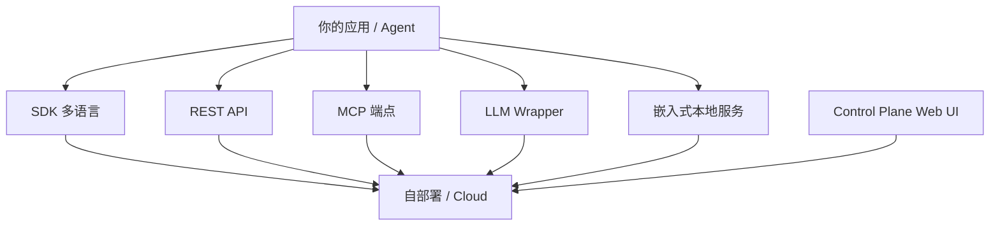

# 接入方式与集成

## 接入面全貌

Hindsight 对外的接入口有好几类：既有给应用代码用的 SDK，也有给通用工具用的 MCP 端点，还有"零代码改动"的 LLM Wrapper 与各类框架适配。它们连接的是同一个服务——自部署实例或托管版。

看图要点：**所有入口最终都落到同一个服务**，因此能力没有"高级入口/低级入口"之分，差别只在调用风格与集成成本。

## 客户端 SDK

| SDK | 入口 | 公开能力 |
|-----|------|----------|
| Python | `hindsight_client.Hindsight` | `retain` / `recall` / `reflect`，另有异步变体 |
| TypeScript | `HindsightClient` | 同名三方法，内置退避重试 |
| Go | `hindsight` 包 | 按资源的操作方法（记忆、检索、反思等） |
| Rust | 生成式客户端 | 方法由 OpenAPI 规格在构建期生成 |

Python 与 TypeScript 提供贴近使用场景的便捷方法；Go 与 Rust 更接近底层接口。Rust 客户端的方法体是构建时从 OpenAPI 规格生成的，因此以生成的 API 为准。

## 命令行与 Web 控制台

| 工具 | 形态 | 用途 |
|------|------|------|
| CLI | Rust 单二进制 | 管理 bank、记忆、文档、实体、心智模型、webhook、审计等；含交互式 TUI |
| Control Plane | Next.js 应用 | 浏览器里查看记忆、实体图谱、心智模型、webhook 与审计日志 |

CLI 覆盖的资源面很广，几乎与服务端 API 一一对应；它支持用环境变量或命名 profile 配置目标服务地址与密钥。Control Plane 本身不直接连数据库，而是通过自己的后端代理到数据面 API。

## MCP 端点

每个服务实例都内置一个 MCP（Model Context Protocol）端点，默认按 bank 提供：

| 端点 | 形态 | 说明 |
|------|------|------|
| `/mcp` | 多 bank | 工具带可选的 `bank_id` 参数，并可管理 bank |
| `/mcp/{bank_id}/` | 单 bank | 从 URL 取 bank，不暴露 bank 管理工具 |

MCP 端点把 retain、recall、reflect 以及记忆、文档、心智模型等操作**作为工具暴露**，因此任何支持 MCP 的客户端（含各类编码代理）都能直接调用。工具会区分只读与破坏性操作，并按 bank 做工具级过滤。

## LLM Wrapper 与框架集成

最省事的接入方式是 **LLM Wrapper**：把一个普通的 LLM 客户端包一层，之后的每次调用都会自动"调用前检索、调用后写入"，应用代码几乎不用改。它由独立的 LiteLLM 集成包提供，底层经 LiteLLM 覆盖大量模型。

仓库内的集成包按目标分成几类：

| 类别 | 代表 | 接入方式 |
|------|------|----------|
| LLM Wrapper | LiteLLM 集成 | 包裹 OpenAI/Anthropic 客户端 |
| Agent 框架 | LangGraph、LlamaIndex、CrewAI、Pydantic AI、OpenAI Agents SDK、Google ADK 等 | 框架级适配器 |
| 编码代理 | Claude Code、Codex、Cursor、GitHub Copilot、opencode 等 | 安装 hook / 写入规则，自动从 git 历史与历史会话建库 |
| 低代码/自动化 | n8n、Zapier、Dify 等 | 节点或插件 |

**编码代理**这一类值得单说：它提供一个安装器，为检测到的编码代理自动接线，按仓库建立 bank，把项目上下文在 agent 启动时注入——这类集成基本无需手写代码。

## 嵌入式运行

如果不想部署服务，可以让 Hindsight 以嵌入式方式在本地跑起来——它会在进程内管理一个本地服务与一个**进程内 PostgreSQL**（`pg0`），无需外部数据库。

| 形态 | 语言 | 机制 |
|------|------|------|
| `hindsight-embed` | 任意（CLI） | 管理并转发到一个本地 daemon |
| Python 嵌入式 | Python | 客户端首次使用时自动拉起 daemon |
| Node.js 嵌入式 | Node | 通过 `uv` 启动 daemon 并轮询健康检查 |

`pg0` 是一个"进程内 PostgreSQL 管理器"：它启动本地 PostgreSQL 进程、按实例名隔离、自动分配端口，并返回一个真实的连接串。这让单机与测试场景完全不需要预先准备数据库。

## 边界与限制

- **SDK 与 CLI 的完备度不同**：CLI 与 REST API 覆盖的资源面最广，各语言 SDK 侧重常用操作。
- **集成包成熟度不一**：数量多、覆盖面广，但各包的维护程度有差异，接入前应针对目标框架验证。
- **MCP 默认开启**：单 bank 端点默认启用，公开部署时需要留意其鉴权配置。
- **嵌入式模式的定位是本地/单机**：它省去外部数据库，但不适合作为高并发生产部署的形态。

> 依据：`hindsight-clients/python/hindsight_client/hindsight_client.py:465-720`、`hindsight-clients/typescript/src/index.ts:343-639`、`hindsight-clients/go/hindsight_client.go:39`、`hindsight-clients/rust/src/lib.rs:23-70`、`hindsight-cli/src/main.rs:73-159`、`hindsight-api-slim/hindsight_api/api/mcp.py:333-520`、`hindsight-api-slim/hindsight_api/mcp_tools.py:43-790`、`hindsight-integrations/litellm/hindsight_litellm/wrappers.py:1690-1793`、`hindsight-embed/hindsight_embed/cli.py:1-24`、`hindsight-all-npm/src/server.ts:13-70`、`hindsight-api-slim/hindsight_api/pg0.py:19-98`
