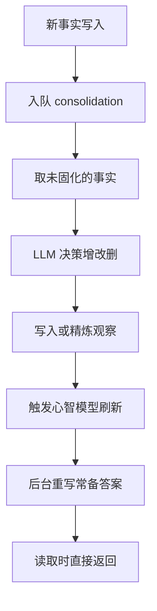

# 后台学习机制

## 这个能力解决什么

写入和检索解决的是"存取"，但 Hindsight 的卖点是**学习**：记忆不该是一堆越积越多的碎片，而应该逐渐沉淀出稳定判断。这需要一套**在请求之外运行**的机制，把散落的事实合并、去重、提炼，并把反复要用的答案预先算好。

关键取舍是：这些工作**不能放在写入或检索的同步路径上**——它们慢、依赖 LLM、且不影响单次请求的正确性。所以它们全部走后台作业。

## 观察（Observation）是怎么形成的

写入的事实不会自动变成判断。后台的 consolidation 作业负责这一步：它读取尚未固化的事实，让 LLM 判断应该新建、更新还是删除观察，然后把结果落库。观察在存储上就是一条类型为 `observation` 的记忆单元，额外记录**出现次数**和**它来自哪些源记忆**。

几个要点：

- **观察引用证据而非覆盖事实**：它记住支撑自己的源记忆 id，因此可以回溯到原文；新证据到来时被**精炼**而不是重写。
- **有去重环节**：当一条新观察与已有观察高度接近时，系统会判定并折叠（fold）而不是重复创建；这也是融合策略中"交替融合"存在的原因——融合若把近似观察排在预算之外，LLM 看不到它就会造出重复。
- **观察带"趋势"**：根据证据时间分布，观察会被算出稳定、增强、减弱、新增、陈旧等趋势标签，供读取方判断它是否还成立。

## 心智模型与知识页

**心智模型（mental model）** 是对一个固定问题的常备答案。它的刷新是一条完整管道：确定作用范围、决定做全量还是增量、在限定范围内做一次"有边界的反思"、产出结构化的变更。这条管道**只计算不写入**，计算成功后才更新答案与刷新时间；失败则保留旧内容，不会把答案置空。

刷新本身也是异步作业，可以由 consolidation 完成后触发，也可以由定时扫描触发。这样设计的结果是：**读取心智模型是一次纯数据库读**，没有检索、没有 LLM 调用，agent 启动时可以立刻加载一份"已经想清楚的知识"。

**知识页（knowledge page）** 是心智模型的一层人类友好包装：同样由后台维护，但以文件夹与页面的层级组织（表 `knowledge_pages`），支持搜索，并能导出为普通 markdown——这样它既能在系统内被 agent 读，也能被人当作文档保存。

## 触发与调度

| 触发方式 | 说明 |
|----------|------|
| 写入后自动 | bank 同时开启观察与自动 consolidation 时，retain 完成后自动入队 |
| 定时扫描 | 心智模型刷新有独立的定时节拍配置 |
| 手动 API | 可显式触发 consolidation、刷新或清理心智模型 |
| 恢复入口 | 提供对卡住/失败的 consolidation 的恢复接口 |
| Worker 消费 | 上述作业统一由后台 worker 从任务表领取执行 |

## 边界与限制

- **成熟有延迟**：观察与心智模型是异步产物，写入后立刻查询可能还看不到它们。
- **决策依赖 LLM**：增、改、删的判断由模型给出，模型能力直接影响观察质量与去重效果。
- **观察会漂移**：随着证据变化，同一条观察的内容可能被重写，读取方应以最后一次刷新为准。
- **心智模型需要定义问题**：它只回答你预先问的问题，不会自动覆盖所有疑问。

> 依据：`hindsight-api-slim/hindsight_api/engine/consolidation/consolidator.py:1469-1529`、`hindsight-api-slim/hindsight_api/engine/consolidation/consolidator.py:1336-3467`、`hindsight-api-slim/hindsight_api/engine/memories/pg/consolidation.py:95-323`、`hindsight-api-slim/hindsight_api/engine/memory_engine.py:6826-6854`、`hindsight-api-slim/hindsight_api/engine/memory_engine.py:17301-18384`、`hindsight-api-slim/hindsight_api/engine/reflect/observations.py:15-130`、`hindsight-api-slim/hindsight_api/engine/maintenance.py:629`
