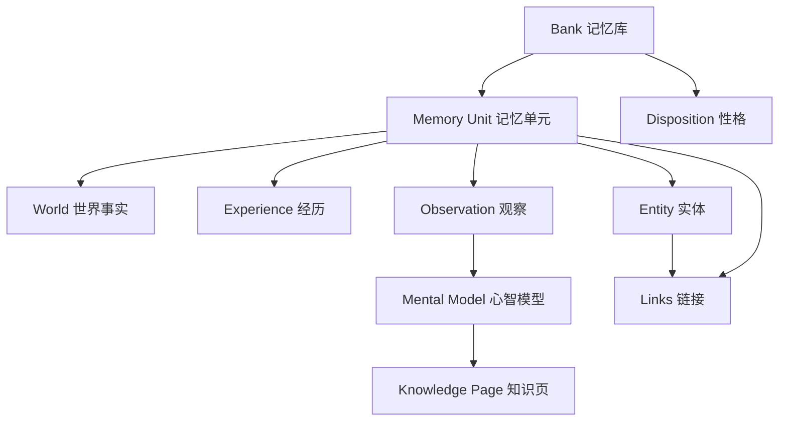

# 记忆模型与核心概念

这一页交代理解 Hindsight 必须先建立的几个概念。后面几页（写入、检索、反思、后台学习）都建立在这套词汇上，读之前先把这页过一遍会省很多力。

## 概念地图

Hindsight 把记忆组织成一张有中心、有演化的网：`bank` 是隔离单位，事实与经历是**原料**，观察是对原料的**判断**，心智模型是对判断的**常备答案**，实体与链接则把这一切横向连起来。

看图要点：**往下的箭头是"提炼"，横向的箭头是"关联"**。世界事实与经历是并列的两类原料，观察是它们共同沉淀的结果；实体与链接则不区分类型地连接所有记忆单元，是检索时的"图谱通道"。

## 逐个概念解释

| 概念 | 一句话定义 | 在系统里的角色 |
|------|-----------|----------------|
| Bank（记忆库） | 一个隔离的记忆容器，通常对应一个用户、agent 或项目 | 一切操作的作用域；严格不串库 |
| Memory Unit（记忆单元） | 一条被抽取出来的、可独立检索的记忆 | 存储的基本行，带类型、时间、向量、标签 |
| World fact（世界事实） | 关于外部世界的事实断言 | 与经历并列的原料类型 |
| Experience（经历） | agent 自身经历/做过的事 | 与事实并列的原料类型 |
| Observation（观察） | 从多条记忆固化出的、带证据的信念 | 承载"当前判断"，随新证据增强或削弱 |
| Mental model（心智模型） | 对某个固定问题的常备答案 | 读取时是纯数据库读，不触发检索与 LLM 调用 |
| Knowledge page（知识页） | 隐藏了机制的心智模型，像 wiki 一样分文件夹组织 | 可搜索、可导出为 markdown |
| Entity（实体） | 从记忆中抽取并归一化的命名对象（人、组织等） | 图谱检索的锚点；保留原生字形 |
| Link（链接） | 记忆单元之间的关系边 | 分时间、语义、因果三类，供图谱通道扩展 |
| Disposition（性格） | bank 级别的推理倾向，如怀疑、字面、共情 | 影响 reflect 如何权衡记忆 |
| Tag / Document | 组织与过滤记忆的标签；文档是写入时的来源单位 | 支撑按来源与主题筛选 |

## 概念之间怎么组合

理解这套模型，关键是把"一次写入"和"长期演化"分开看。

**一次写入**：内容被切成分块，LLM 从每块里抽出若干**记忆单元**，每个单元被标记为世界事实或经历；同时抽出**实体**并把它归一化（"张伟"与"张伟（研发）"归到同一个实体），再在相关记忆单元之间建三类链接。写入结束时，原料就位。

**长期演化**：后台的 consolidation 把相关的记忆单元固化成**观察**——观察不是覆盖事实，而是引用事实：它记住支持自己的那些记忆单元 id，并带上证据引用（原文引述）和出现次数。新证据到来时，观察被"精炼"而不是重写，因此一条信念可以随着证据累积而增强、削弱甚至失效。

**常备答案**：对反复被问的问题，bank 可以定义**心智模型**。系统在后台按固定问题重写答案并落库，agent 读取时只是读一行数据。**知识页**是心智模型的一层人类友好包装：同样由后台维护，但以文件夹与页面的形式组织，并能导出为普通 markdown。

**性格**：`disposition` 是 bank 级别的三个特质（怀疑、字面、共情），它们不改变存了什么，只改变 reflect 在推理时的倾向——比如高怀疑度会让 agent 更倾向于要求证据而非采信单一断言。

> 依据：`hindsight-api-slim/hindsight_api/engine/response_models.py:16`、`hindsight-api-slim/hindsight_api/engine/retain/types.py:331`、`hindsight-api-slim/hindsight_api/engine/reflect/observations.py:15-130`、`hindsight-api-slim/hindsight_api/engine/memories/pg/consolidation.py:268-323`、`hindsight-api-slim/hindsight_api/engine/reflect/prompts.py:161-186`、`hindsight-api-slim/hindsight_api/engine/schema.py:45-65`
