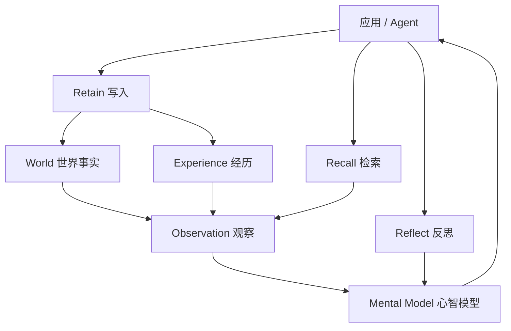

# 项目概览

## 一句话定位

Hindsight 是给 AI agent 用的长期记忆层：它不是把对话历史存下来再塞回提示词，而是把信息拆成事实、经历和判断，建成一套可检索、可演化、可推理的记忆，让 agent 在多次会话之间真正"学到东西"。

## 解决什么问题

大多数 agent 的"记忆"其实是**上下文窗口的延长**：把历史消息或文档切块，做向量检索，再把命中的片段拼进提示词。这套做法有三个绕不开的痛点：

- **记不牢也记不准**：向量相似度擅长"找像的"，但回答"Alice 现在在哪儿工作""上个月发生了什么"这类问题时，往往召回一堆相关片段，却没有一条是当前事实。
- **冲突无从裁决**：新旧信息同时被召回时，模型没有依据判断哪条更可信、哪条已经过时。
- **不会积累**：每次会话都从零检索，agent 无法形成"我对这个用户的稳定判断"。

Hindsight 针对这三点分别给出机制：把信息归一化成**带时间的结构化记忆**、用**证据与时间**组织**观察（observation）**来承载判断、用**心智模型（mental model）**把稳定结论预先算好，让 agent 启动时直接读到"已结案的知识"，而不是每次重新发现。

## 给谁用 / 典型场景

| 使用者 | 想要什么 | Hindsight 提供 |
|--------|---------|----------------|
| 对话式 agent 开发者 | 记住每个用户是谁、偏好什么 | 以 `bank`（记忆库）做隔离，按用户/会话组织记忆 |
| 自主任务型 agent | 跨多次运行积累经验 | 经历（experience）与观察（observation）随时间演化 |
| 编码代理用户 | 项目长期上下文不丢 | 以仓库为单位建 bank，从 git 历史与历史会话积累 |
| 平台/基础设施团队 | 一处记忆、多个应用共享 | 服务化部署，多语言客户端 + MCP 端点 |

## 核心能力一览

| 能力 | 说明 | 典型场景 |
|------|------|----------|
| Retain（写入） | 用 LLM 抽取事实、时间、实体与关系，归一化后建立检索通道 | 把对话、文档、工具调用结果写进记忆 |
| Recall（检索） | 语义、关键词、图谱、时间四路并行召回，融合后重排 | "关于 X 我知道什么" |
| Reflect（反思） | 让 agent 带着工具做多轮推理，而非一次查表 | 风险评估、归因分析、总结判断 |
| 观察（Observation） | 后台把相关事实固化成带证据的信念，随新证据增强或削弱 | 稳定偏好、反复出现的模式 |
| 心智模型 / 知识页 | 对固定问题的"常备答案"，后台重写、读取时零 LLM 调用 | agent 启动时加载既有认知 |
| Memory Bank 隔离 | 每个 bank 一个独立"大脑"，严格不串库 | 多租户、多项目、多用户 |
| 多语言 | 端到端保持输入语言，实体保留原生字形 | 中文人名不被转写成拼音 |
| Memory Defense | 按 bank 可开启的密钥/PII 扫描，命中即脱敏或拦截 | 防止密钥被写进记忆 |

上面这些能力不是并列的功能点，而是同一条链路的不同环节：写入 → 检索 → 反思 → 后台固化 → 再被检索。下图给出它们的相对位置。

看图要点：用户直接调用的是左侧三个操作，而右侧的观察与心智模型由系统在后台从事实中提炼——它们既不是用户写进去的，也不是检索时才现算的，这是 Hindsight 与"纯检索式记忆"最本质的区别。

## 技术栈

| 组件 | 用途 | 选型说明 |
|------|------|----------|
| Python 3.11+ / FastAPI / uvicorn | 后端服务与 HTTP ASGI 应用 | 服务由 `MemoryEngine` 装配成 FastAPI app |
| PostgreSQL + pgvector | 默认存储：关系、向量、全文在同一库 | 避免为向量检索单独维护一套数据库 |
| Oracle AI Database 23ai | 企业部署的等价存储后端 | 通过数据库方言改写层实现 |
| SQLAlchemy 2.0 + Alembic | 表结构与版本化迁移 | 迁移由程序在启动时驱动，无需外部配置文件 |
| asyncpg | 异步 PostgreSQL 驱动 | 服务全程异步，驱动需支持连接重置控制 |
| FastMCP | 内置 MCP server | 每个 bank 暴露一组工具端点 |
| 多 LLM provider 适配层 | 接入 25+ 种模型服务 | 含托管 API、本地推理（Ollama 等）与订阅型（Codex/Claude Code 等） |
| toktok-rs | 分词与 token 计数 | 与 tiktoken 同 id、更快、词表随包分发 |
| Rust（CLI） | 命令行客户端 | 单二进制，含交互式 TUI |
| Next.js（Control Plane） | Web 控制台 | 代理数据面 API，供人查看与管理记忆 |

## 与同类方案的差异

| 对比对象 | 它擅长 | Hindsight 的不同 |
|----------|--------|------------------|
| 纯向量检索（RAG 式记忆） | 语义相近的片段召回 | 额外维护实体、时间、因果关系，并用观察承载"当前事实" |
| 知识图谱式记忆 | 显式的实体关系推理 | 不要求用户预先建模；图谱由写入时自动抽取，并与向量、全文共用一套检索 |
| 对话历史回放 | 完整保留原始上下文 | 把原始内容压成结构化记忆，用证据回溯，而不是无限堆提示词 |

> 以上差异来自项目自述；面向选型的定量对比应以官方基准测试页为准，本文档不转述具体分数。

## 现状与边界

- 系统默认以 PostgreSQL 为存储，**嵌入式模式**使用进程内 PostgreSQL（pg0），适合本地与单机场景；大规模部署需要外部数据库。
- **LLM 质量直接决定记忆质量**：事实抽取、观察固化、心智模型刷新都依赖模型能力，配置里的模型选型是效果上限的关键变量。
- 集成生态覆盖面广但成熟度不一，接入前建议针对目标框架单独验证。
- Oracle 后端与扩展机制面向企业场景，文档中只做机制说明。

> 依据：`README.md:22-52`、`README.md:275-369`、`hindsight-api/README.md:1-20`、`hindsight-api-slim/pyproject.toml:1-40`、`hindsight-api-slim/hindsight_api/api/__init__.py:17-109`
