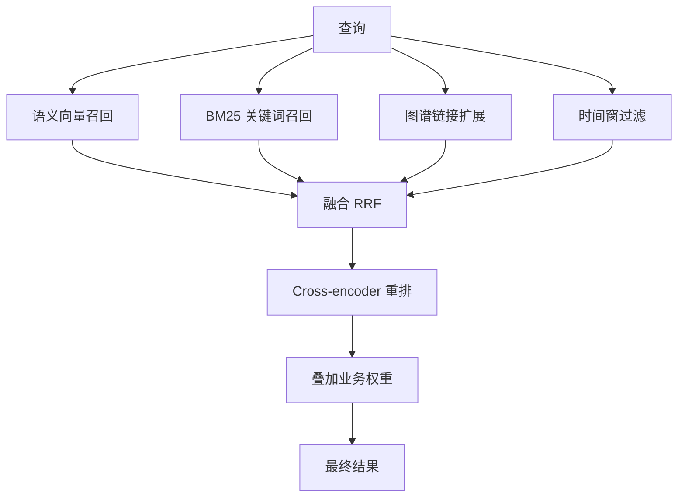

# 检索链路（Recall）

## 这个能力解决什么

Recall 负责回答"关于这个查询，记忆里最相关的是什么"。它面对的核心矛盾是：**没有一个单一检索策略能同时覆盖所有问法**。

向量检索擅长语义相近，但会把"Alice 在 Google"和"Alice 在 Meta"同时召回，分不清哪个是当前事实；关键词检索擅长精确命中专有名词，但换个说法就失效；时间类问题（"上个月发生了什么"）靠相似度根本表达不出来；而实体和因果关系只能靠关系网络去扩展。因此 Hindsight 不做"选一个最好的策略"，而是**四路一起跑，再融合**。

## 怎么用

Recall 的输入以查询文本为主，其余参数控制检索的范围与预算。

| 参数 | 作用 | 何时调整 |
|------|------|----------|
| `query` | 查询文本 | — |
| `budget` / 思考预算 | 控制每路召回规模与图谱遍历深度 | 结果太少就调大，延迟敏感就调小 |
| `fact_types` | 限定检索哪几类记忆 | 只要当前判断就限定为观察 |
| `tags` / `tag_groups` | 按主题、来源过滤；`tag_groups` 支持把多组标签做布尔组合 | 多用户或多项目共库时的隔离手段 |
| `temporal_window` | 显式指定时间范围 | 问题带明确时间但自动解析不可靠时 |
| `reranking` | 选择重排策略（cross-encoder 或决策模型） | 想要更低延迟或更贴业务判断时改用决策模型 |

查询文本若含时间表达，系统会先做一次时间约束抽取——这一步是纯 CPU 工作，会被放到事件循环之外执行，避免拖慢同进程内的其他请求。过长的查询会被截断到支持的上限，而不是直接报错。

## 内部怎么运转

四路召回并行发起，各自返回一份带分数的排序列表；融合阶段把多份列表合成一份，重排阶段再用更强的模型精排，最后叠加若干业务权重。

四路各自的特点：

- **语义召回**：向量近邻，覆盖"说法不同但意思相近"的情况。
- **关键词召回**：BM25 精确匹配，保证专有名词、标识符不被语义漂移漏掉。
- **图谱召回**：从语义种子出发，沿实体共现、语义近邻、因果关系三类链接向外扩展，捞出"相关但没有直接语义相似"的记忆。
- **时间召回**：在时间窗内检索并按链接扩散，处理时序问题。

**融合**默认用倒数排名融合（RRF）：每个文档的得分是它在各路中排名的倒数之和（`1/(k+rank)`，k 取常数）。它的好处是不依赖各路分数量纲是否可比，只看排名。系统另提供一种**交替融合**作为替代——按各路排名轮流取位，保证每路的头部结果都拿到名额；它针对的是"融合会把只在单路排第一的结果平均掉"这类场景。

**重排**有两类选择。默认用一个 cross-encoder 模型，把查询与候选成对打分，比向量相似度更准；重排之后，系统再叠加若干业务权重：新近度、时间匹配度、证据数量等，以乘性方式调整最终排序。另有一条**决策模型重排**路径：对每个候选单独问决策模型"展示它是否有助于回答问题"，用一批秒级判断给整个候选池定序——它排序即终序，不再叠加新近度/时间/证据数量那套乘性权重。两者用 `reranking` 参数切换。

有一处值得注意的细节：重排后若结果带时间加成，排序只会按重排后的分数稳定衰减，而不会因为排名靠后就把这份时间加成反复打折——这保证了"时间相关"的结果不会因为一次后处理而丢掉它本该有的权重。

## 边界与限制

- **四路都开启不等于四路都有用**：关键词、时间、图谱三路都可以按配置或请求关闭；如果目标是纯语义检索，关掉它们能省下相应开销。
- **融合策略不是万能的**：RRF 对"单路独强"的结果不友好，这也是交替融合存在的原因；选哪种取决于使用场景。
- **两种重排各有代价**：cross-encoder 更通用、但要在本地或远端跑一次精排；决策模型重排延迟更低、更贴业务判断，但排序即终序、不再享受新近度等加成，且需要额外配置决策模型服务。
- **延迟随思考预算增长**：图谱扩展与重排是主要成本来源，预算越大延迟越高。
- **时间解析依赖语言支持**：时间约束抽取对语言有依赖，写中文、混合语言的时间表达时可能出现解析偏差，必要时用显式时间窗兜底。

> 依据：`hindsight-api-slim/hindsight_api/engine/search/retrieval.py:100-272`、`hindsight-api-slim/hindsight_api/engine/memories/pg/recall.py:29-320`、`hindsight-api-slim/hindsight_api/engine/memories/pg/link_expansion.py:51-133`、`hindsight-api-slim/hindsight_api/engine/search/fusion.py:29-131`、`hindsight-api-slim/hindsight_api/engine/search/reranking.py:58-364`、`hindsight-api-slim/hindsight_api/engine/search/decision_reranker.py:1-60`、`hindsight-api-slim/hindsight_api/engine/memory_engine.py:9293-9990`
