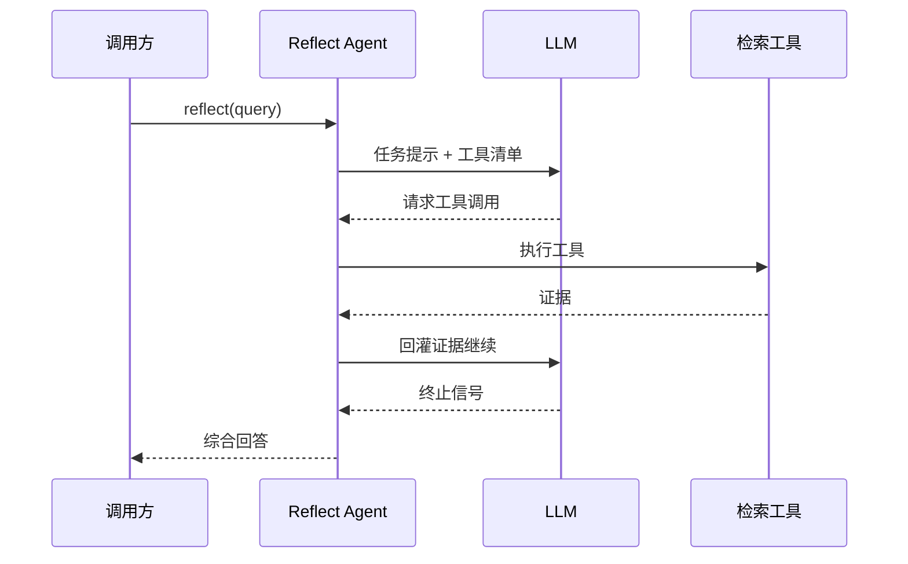

# 反思操作（Reflect）

## 这个能力解决什么

Recall 回答的是"检索到什么"，Reflect 回答的是"想明白什么"。有些问题不是查一次表能答的：为什么某类客户会流失？这个项目现在有哪些风险？要回答它们，agent 必须先取一批证据，判断还缺什么，再取更多，最后综合——这是一个**带工具的多轮推理过程**，而不是一次检索。

Reflect 就是把这条推理链固化成一个可调用的操作：调用方给一个问题，系统用 LLM 驱动一个 agent，让它自己决定查什么、查几轮、什么时候给答案。

## 怎么用

Reflect 的输入是一个问题，输出是一段带依据的回答。它与 recall 的选择判据很简单：

| 需求 | 用哪个 |
|------|--------|
| 我要拿到相关记忆条目，自己处理 | Recall |
| 我要一个综合判断或解释 | Reflect |
| 我要在固定问题上反复拿到一致答案 | 预先定义心智模型，用 Recall 读 |

Reflect 还会受 bank 的**性格（disposition）**影响：怀疑、字面、共情三个特质会改变它权衡证据的方式。

## 内部怎么运转

Reflect 的主体是一个循环：模型看到当前证据，决定调用工具或给出答案；工具结果回灌后继续下一轮，直到模型给出终止信号或达到迭代上限。

该看什么：**每一轮都可能触发真正的数据库检索**，所以 reflect 的成本与延迟是"迭代次数 × 单轮开销"，与 recall 的单次检索不在一个量级。

Agent 可用的工具是分层设计的，越靠上质量越高、越靠下越接近事实本身：

| 工具 | 检索对象 | 定位 |
|------|---------|------|
| `search_mental_models` / `read_mental_models` | 已维护的心智模型 | 最高质量：别人已经想过的结论 |
| `search_observations` | 固化的观察（带新鲜度） | 中间层：已提炼但更贴近近期证据 |
| `recall` | 原始记忆单元 | 事实底线：用于校验与补充细节 |
| `expand` | 指定记忆的上下文/分块 | 需要原文时下钻 |

工具返回的结果会先被精简：分数量、内部指针等模型读不懂也用不上的字段会被剥掉，只保留身份、文本、日期、标签、证据引用与实体名等可推理的内容。

## 边界与限制

- **成本显著高于 recall**：多轮 LLM 调用叠加多轮检索，适合"值得深想"的问题，不适合高频查表。
- **有迭代上限**：达到上限时会走一次强制的最终综合，而不是无限循环。
- **受证据上限约束**：推理质量取决于检索到的证据，证据缺失时反思也只能得出保守结论。
- **性格是倾向不是事实**：disposition 改变的是推理风格，不会改变记忆里存了什么。

> 依据：`hindsight-api-slim/hindsight_api/engine/reflect/agent.py:532-591`、`hindsight-api-slim/hindsight_api/engine/reflect/agent.py:1193-1230`、`hindsight-api-slim/hindsight_api/engine/reflect/agent.py:992-1046`、`hindsight-api-slim/hindsight_api/engine/reflect/tools.py:118-560`、`hindsight-api-slim/hindsight_api/engine/reflect/observations.py:15-130`、`hindsight-api-slim/hindsight_api/engine/reflect/prompts.py:161-186`
