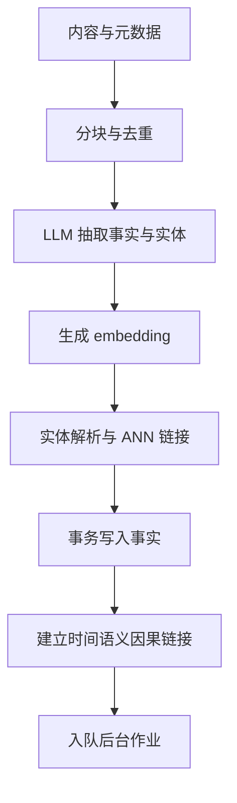

# 写入链路（Retain）

## 这个能力解决什么

Retain 是记忆的入口。它要解决的问题是：用户给的是一段自然语言（对话、文档、工具结果），而系统后续要对它做时间推理、实体推理和语义检索——因此原始文本必须先被翻译成**带结构、带时间、带关系**的记忆单元。

直接存原文再靠向量检索是不够的：那样既无法回答"现在的事实是什么"，也无法沿实体或因果链扩展。Retain 的核心工作，就是在写入时把这份"结构"提前建好。

## 怎么用

Retain 以"一批内容"为单位提交，每条内容除了正文还可带上下文、时间戳、文档归属与元数据。这些字段决定了记忆后续能否被正确过滤与推理。

| 输入 | 作用 | 影响 |
|------|------|------|
| `content` | 要被记住的正文 | 抽取的原料 |
| `context` | 这条内容的背景说明 | 帮助抽取消歧 |
| `timestamp` | 事件发生时间 | 决定时间推理与时间链接 |
| `document_id` | 归属的文档 | 支持按文档更新/重处理（delta retain） |
| `tags` | 主题/来源标签 | 检索时可过滤 |
| `metadata` | 自定义键值对 | 供 reflect 判断来源可信度 |

一次提交可以混合多条内容；若它们属于不同文档，系统会按文档拆组分别处理，避免彼此的更新互相牵连。

## 内部怎么运转

Retain 是一条分阶段的管道，其中**读密集的准备工作与事务写入被刻意分开**：先并行做完所有需要读取已有数据的重活，再用尽可能短的事务把结果写进去，以缩短锁持有时间。

各阶段的职责：

- **分块与去重**：把内容切成可抽取的块。对已有文档做 delta retain 时，只重新处理内容发生变化的分块，未变的分块保留原有事实、实体与链接。
- **事实与实体抽取**：这是唯一大量调用 LLM 的阶段。模型输出带有世界事实/经历的类型标记、时间信息与因果关系；代码把"assistant 自述"类内容映射为经历，其余为世界事实，并过滤掉退化（无信息量）的产物。
- **向量化**：为抽取出的文本生成 embedding，供后续语义检索使用。
- **实体解析**：把抽出的实体名归一化为规范实体（去重、消歧），并用已有 embedding 做近邻匹配，判断新实体是否就是库里已有的某个实体。
- **事务写入**：把记忆单元、单元-实体关联一次性写入，再建立时间、语义、因果三类链接。
- **入队后台作业**：写入完成后，把观察固化、心智模型刷新等交给后台 worker，不阻塞接口返回。

## 边界与限制

- **抽取质量等于模型质量**：retain 的关键阶段完全依赖 LLM。若模型对某段内容抽不出任何事实，结果是"文档存下来了，但在 recall/reflect 里不可达"，直到被重新处理。
- **写入与成熟是两件事**：retain 返回时，事实与索引已经可用，但观察和心智模型尚未更新——依赖"已固化判断"的查询要等后台作业完成。
- **delta retain 有前提**：只重处理变化分块，依赖文档分块的哈希比对；对内容变化较大的更新，效果等价于重写文档。
- **元数据会随记忆一起被 reflect 看到**：写入时打上的 `metadata` 会成为 reflect 判断来源可信度的依据，因此不该往里面塞不该被推理的内容。

> 依据：`hindsight-api-slim/hindsight_api/engine/retain/orchestrator.py:1421-1530`、`hindsight-api-slim/hindsight_api/engine/retain/orchestrator.py:628-870`、`hindsight-api-slim/hindsight_api/engine/retain/fact_extraction.py:171-251`、`hindsight-api-slim/hindsight_api/engine/retain/entity_processing.py:157-200`、`hindsight-api-slim/hindsight_api/engine/retain/link_creation.py:15-110`、`hindsight-api-slim/hindsight_api/engine/retain/embedding_processing.py:15-60`、`hindsight-api-slim/hindsight_api/engine/retain/fact_storage.py:66`
