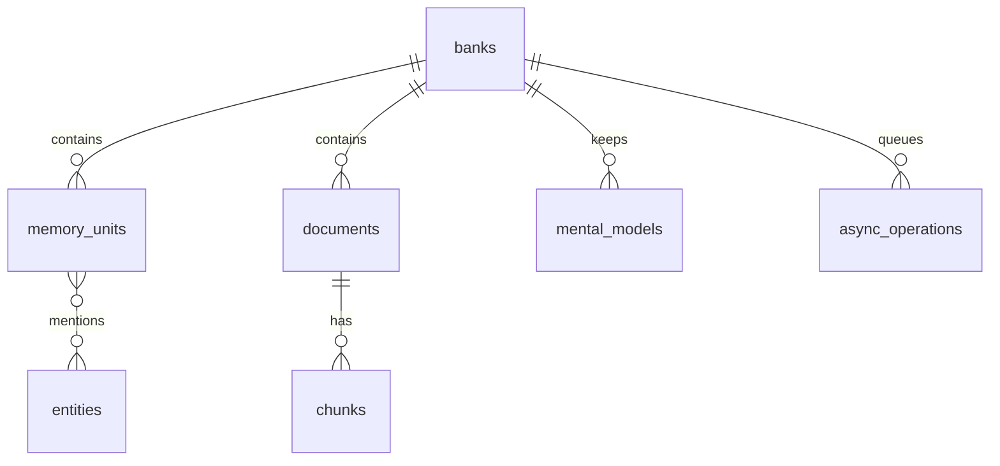

# 存储与数据模型

## 为什么用这种存储

Hindsight 没有采用"关系库 + 独立向量库 + 图数据库"的组合，而是把**结构化关系、向量、全文检索和任务队列全部放进一个关系型数据库**（默认 PostgreSQL，企业场景可用 Oracle）。这个选择的原因很直接：一次检索要同时用语义、关键词、图谱和时间四路，如果它们分散在三个系统里，每路都要跨系统查询再在应用层拼接，一致性和延迟都会变差；放在一个库里，四路可以在一到几条 SQL 里并行完成。

代价也随之而来：向量与全文检索依赖数据库扩展（或商用特性），因此**可用的索引类型取决于部署环境**。

## 数据全貌

记忆的核心是一张 `memory_units` 表——世界事实、经历、观察都是它的行，靠类型字段区分。围绕它的是身份（bank）、来源（document/chunk）、关系（entity/link）与后台产物（mental model/knowledge page/队列）。

该看什么：**记忆之间的链接不是单独一张边表就完了**——实体是独立实体表，单元与实体的关联、实体之间的共现各自成表，这样图谱检索才能在两侧都快速扩展。数据量增长时，第一个瓶颈通常出现在记忆单元表与其向量/全文索引上。

## 核心表

| 表 | 作用 | 说明 |
|----|------|------|
| `banks` | 记忆库 | 隔离单位，携带背景与性格配置 |
| `memory_units` | 记忆单元 | 事实、经历、观察统一存于此，含向量与时间字段 |
| `memory_links` | 记忆之间的边 | 时间、语义、因果三类关系 |
| `entities` / `unit_entities` | 实体与关联 | 归一化实体，以及"哪个记忆提到它" |
| `entity_cooccurrences` | 实体共现 | 图谱检索扩展用的统计 |
| `documents` / `chunks` | 来源与分块 | 支撑按文档更新与 delta retain |
| `mental_models` / `mental_model_history` | 常备答案及其版本 | 读取即数据库读 |
| `knowledge_pages` | 知识页层级 | 文件夹与页面的组织 |
| `async_operations` | 后台任务队列 | worker 用 `FOR UPDATE SKIP LOCKED` 领取 |
| `observation_sources` / `observation_history` | 观察的证据与历史 | 支撑证据回溯与精炼 |
| `directives` / `webhooks` | 行为指令与事件订阅 | 运行期配置 |

## 多后端怎么抽象

存储抽象分成两层：**领域层**面向一套 `memories` 接口（写入、检索、consolidation 等操作），**数据库层**再用 `db` 与 `ops` 抽象屏蔽方言差异。这样做的直接好处是业务代码不需要知道底层是 PostgreSQL 还是 Oracle。

| 抽象 | 位置 | 作用 |
|------|------|------|
| 连接与后端 | `engine/db/base.py` | 定义数据库连接与后端接口 |
| PostgreSQL 实现 | `engine/db/postgresql.py` | 基于 asyncpg |
| Oracle 实现 | `engine/db/oracle.py` | 基于 python-oracledb，并把 PG 方言改写成 Oracle 语法 |
| SQL 片段抽象 | `engine/db/ops.py` | 把易产生差异的 SQL 片段抽成可替换实现 |

**向量检索**支持 `pgvector`（默认）、`pgvectorscale`、`vchord` 与 AlloyDB 的 `scann`，不同选择对应不同索引类型（HNSW、DiskANN 等）；**全文检索**支持原生 `tsvector`、`vchord`、`pg_textsearch`、`pgroonga`、`pg_search` 等。这些都在建表迁移时根据环境变量检测并校验——配了扩展但环境没装，迁移会直接报错而不是静默降级。

文件类内容（附件、导出物）由独立的文件存储层处理，抽象在 `engine/storage/base.py`，提供 PostgreSQL、S3、GCS、Azure 等实现。

## 演进方式

schema 通过 Alembic 迁移管理，但**不需要手写 alembic.ini**：迁移由程序在启动时驱动，自动指向内置的版本目录。扩展可以在自己的包里带上迁移，被同一套生命周期、同一把锁、同一张版本表管理——这保证了核心与扩展的 schema 版本始终对得上。

## 边界与限制

- **索引能力受部署环境影响**：想用 DiskANN 或 ScaNN 就必须在数据库侧预先安装对应扩展。
- **Oracle 支持依赖商用数据库**：方言改写层覆盖了常见差异，但 Oracle 部署需要对应驱动与授权。
- **向量维度与模型绑定**：更换 embedding 模型时需要考虑已有向量的兼容性。
- **任务表也是数据表**：队列与业务数据同库，队列积压会与业务查询争抢数据库资源。

> 依据：`hindsight-api-slim/hindsight_api/engine/db/base.py:23-205`、`hindsight-api-slim/hindsight_api/engine/db/oracle.py:343-1399`、`hindsight-api-slim/hindsight_api/engine/db/ops.py:338`、`hindsight-api-slim/hindsight_api/engine/schema.py:45-65`、`hindsight-api-slim/hindsight_api/alembic/versions/5a366d414dce_initial_schema.py:33-95`、`hindsight-api-slim/hindsight_api/engine/storage/base.py:14`、`hindsight-api-slim/hindsight_api/migrations.py:267`
