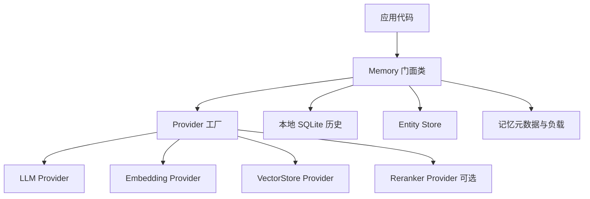
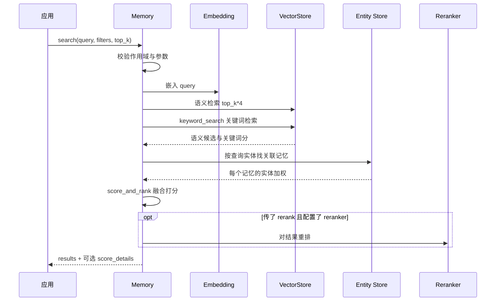

# 系统架构

## 整体形态

Mem0 开源 SDK 的形状可以概括为**一个门面类 + 四个可插拔 Provider + 三处存储**。门面类是 `Memory`（及其异步孪生 `AsyncMemory`），它是应用唯一需要认识的入口；四类 Provider（LLM、Embedding、VectorStore、Reranker）决定了"用谁的计算、存进谁的库"；三处存储分别承担不同的查询模式。下图给出各部分的归属关系。

该看什么：三条从 `Memory` 出去的线对应三种不同的存法——**向量库**存嵌入用于相似度检索，**Entity Store** 存实体及其关联记忆用于检索加权，**本地 SQLite** 存变更历史与最近消息用于上下文与审计。为什么要分开存、代价是什么，见下方「关键设计取舍」。

## 分层与职责

| 层 | 代表文件 | 负责什么 | 不负责什么 |
|----|---------|---------|-----------|
| 门面层 | `mem0/memory/main.py` | 对外 API（add/search/update/delete…）、作用域校验、编排各阶段 | 不实现具体的存储与模型调用 |
| 抽象基类层 | `mem0/memory/base.py`、`mem0/vector_stores/base.py` | 定义 `MemoryBase` 与 `VectorStoreBase` 的接口契约 | 不提供运行逻辑 |
| Provider 层 | `mem0/llms/`、`mem0/embeddings/`、`mem0/vector_stores/`、`mem0/reranker/` | 各厂商/各存储的具体实现 | 不参与编排 |
| 工厂层 | `mem0/utils/factory.py` | 按 provider 名把配置实例化为具体对象 | 不持久化状态 |
| 配置层 | `mem0/configs/` | Pydantic 配置模型、提取用的提示词模板 | 不执行业务逻辑 |
| 工具层 | `mem0/utils/` | 实体抽取、BM25 打分、词形还原、spaCy 模型加载 | 不感知业务语义 |
| 客户端层 | `mem0/client/` | 走 HTTP 访问自托管/托管 API 的 `MemoryClient` | 不触碰本地存储 |
| 服务层 | `server/` | 自托管 REST API、认证、Dashboard | 不参与 SDK 内部编排 |

## 模块地图

| 目录 / 模块 | 职责 | 关键概念 |
|------------|------|---------|
| `mem0/memory/` | 门面类与编排；`main.py` 是核心 | ADD-only 管线、多信号检索、作用域 |
| `mem0/configs/` | 配置模型与提示词 | `MemoryConfig`、`MemoryItem`、`MemoryType` |
| `mem0/utils/` | 检索与抽取的算法工具 | BM25 归一化、实体候选解析 |
| `mem0/llms/`、`mem0/embeddings/`、`mem0/vector_stores/`、`mem0/reranker/` | 四类 Provider 实现 | 每种后端一个文件 |
| `mem0/client/` | 平台/自托管客户端 | `MemoryClient`、`AsyncMemoryClient` |
| `mem0/proxy/` | OpenAI 兼容的 `chat` 门面 | 自动注入相关记忆 |
| `server/` | 自托管服务 | 认证、API key、Dashboard |
| `cli/` | 命令行客户端 | 双实现（Node / Python） |
| `mem0-ts/` | TypeScript SDK | OSS 与 client 两套入口 |
| `integrations/`、`skills/` | 编辑器与框架集成 | MCP、插件、skills |

## Memory 是怎么被组装出来的

`Memory` 的构造函数接受一个 `MemoryConfig`，然后按顺序做四件事：用 `EmbedderFactory` / `VectorStoreFactory` / `LlmFactory` 分别造出 embedding 模型、向量库、LLM；开一个 SQLite 连接作为历史库；如果配置里给了 reranker，再按 `RerankerFactory` 造一个。实体存储（Entity Store）**不在构造时创建**，而是第一次用到时才懒加载——这个选择是为了避免不使用实体能力时也去连一次向量库。

这里有一个容易被忽略的降级点：构造时会检查所用向量库是否实现了 `keyword_search`。若没有实现（基类默认实现就等于不支持），Mem0 会打一条 warning，之后检索只走语义相似度，不报错。这解释了为什么"换个向量库"可能悄悄损失混合检索能力。

## 一次检索的完整链路

检索是 Mem0 最能体现设计的地方：它不只是向量检索，而是把三路信号算完再融合。下图是一次 `search` 调用经过的环节。

该看什么：语义检索会**过量召回**（`top_k` 的 4 倍，且不少于 60），因为后面还要用关键词与实体信号重新排序；三种信号只有在分数阶段才合并。融合规则、阈值语义与各信号权重见 [retrieval.md](retrieval.md)。

## 关键设计取舍

| 取舍 | 选了什么 | 没选什么 | 代价 |
|------|---------|---------|------|
| 写入语义 | ADD-only：一次 LLM 调用只增不删 | 传统"提取 + 对比 + 增删改"的多轮 LLM 流程 | 记忆会累积冗余，靠去重与检索精度补偿；要纠正需显式 `update`/`delete` |
| 存储布局 | 向量、实体、历史分三处 | 全部塞进一个库 | 需要维护三处一致性；删除时要同步清理实体链接 |
| Provider 接入 | 工厂 + 字符串路径反射加载 | 编译期硬绑定 | 提供者名拼错要到运行时才报错 |
| 同步 / 异步 | `Memory` 与 `AsyncMemory` 两份镜像实现 | 一套代码两种模式 | 维护成本翻倍，但接口形状严格对称，便于按需替换 |
| 能力降级 | 缺关键词检索或 spaCy 时静默降级 | 直接报错 | 能力悄悄变弱，靠 warning 提示，需读日志才能察觉 |
| 历史存储 | 本地 SQLite | 集中式数据库 | 单机语义，多实例不共享历史 |

> 依据：`mem0/memory/main.py:482-547`、`mem0/memory/base.py:4-63`、`mem0/vector_stores/base.py:4-85`、`mem0/utils/factory.py:35-280`、`mem0/__init__.py:1-6`
