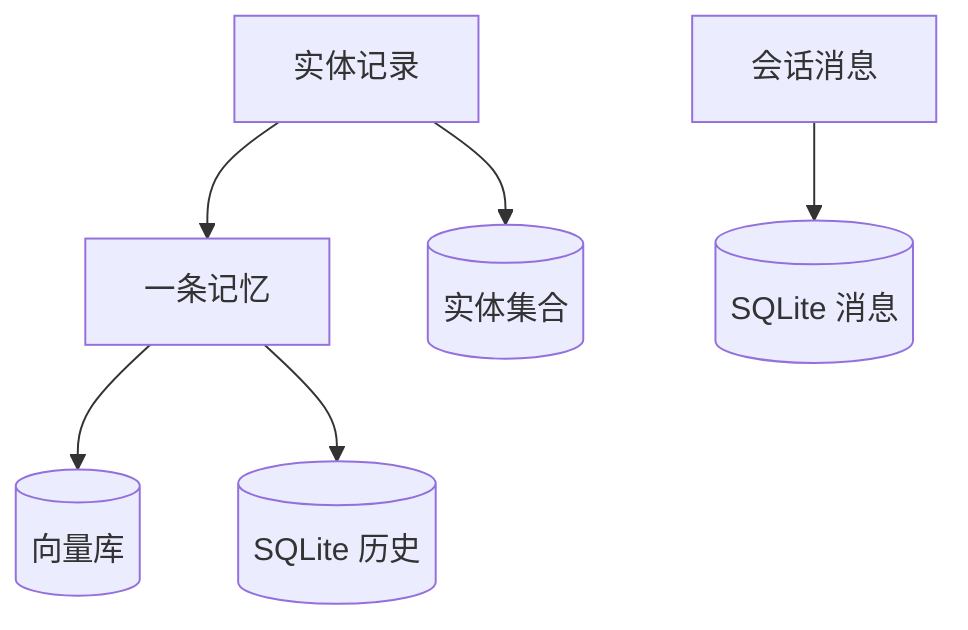
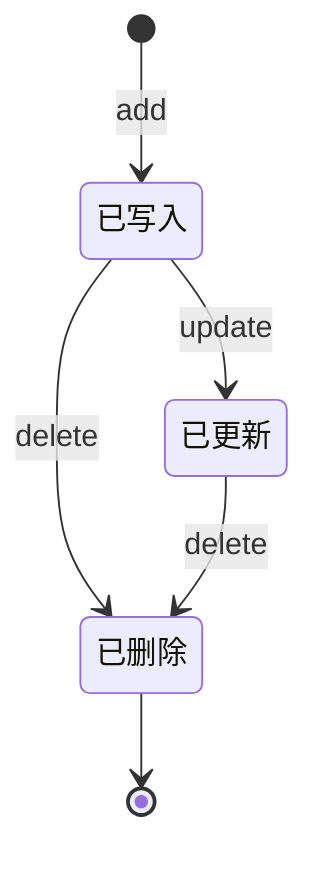

# 数据模型

## 数据全貌

一条"记忆"在 Mem0 里不是单一记录，而是分布在三处：向量库里存它的向量与负载（记忆的事实、元数据）、本地 SQLite 里存它的变更历史、实体存储里有一批记录反过来指向它。会话消息单独存在 SQLite 的另一张表里。

该看什么：`Mem` 到 `V` 是主干（检索就查这里），`Ent` 回指 `Mem` 是检索加权的依据，`H` 与 `MSG` 是审计与上下文，不参与检索。三处要在删除时保持一致——删记忆会同时清理它在实体记录里的链接。

## 记忆的负载字段

记忆存在向量库的 payload 里，字段分三类：**核心字段**（Mem0 内部使用）、**提升字段**（检索返回时被提到结果顶层）、**自定义 metadata**（原样保留）。检索返回时，非核心非提升的字段会聚合进结果的 `metadata`。

| 字段 | 类别 | 说明 |
|------|------|------|
| `data` | 核心 | 记忆的事实文本，检索命中的就是它 |
| `hash` | 核心 | 事实文本的 MD5，写入去重依据 |
| `text_lemmatized` | 核心 | 词形还原后的文本，供 BM25 匹配 |
| `created_at` / `updated_at` | 核心 | ISO 时间戳，创建与最近更新 |
| `user_id` / `agent_id` / `run_id` | 提升 | 三轴作用域，检索与过滤的基础 |
| `actor_id` / `role` | 提升 | 来源角色与说话人 |
| `attributed_to` | 提升 | 提取时标注的归属 |
| `expiration_date` | 提升 | 过期日期，过期后默认不出现在检索结果中 |
| 其余键 | metadata | 调用方传入的自定义元数据，支持增强过滤算子 |

## 三轴作用域

Mem0 用 `user_id`、`agent_id`、`run_id` 三个维度给记忆划范围，`add` 与 `search` 都要求**至少提供一个**，否则直接报校验错误。作用域同时决定两件事：写入时写进 payload 的哪些键，以及查询时的过滤条件。

一个刻意的约束：这三个身份键**只由函数参数决定**。调用方在自定义 metadata 里塞 `user_id` 之类的键会被剥掉，防止一次写入被 metadata 悄悄放进未声明的范围。相比之下，`actor_id` 是查询期的收窄条件，不会写进存储模板。

## 本地 SQLite 的两张表

历史库默认落在 `~/.mem0/history.db`（可用 `MEM0_DIR` 或配置改路径）。它建两张表：

**`history`** —— 每条记忆的每次变更记一行，是 `history(memory_id)` 的数据源：

| 字段 | 说明 |
|------|------|
| `id` | 变更记录主键 |
| `memory_id` | 关联的记忆 |
| `old_memory` / `new_memory` | 变更前后的文本 |
| `event` | 事件类型（ADD / UPDATE / DELETE） |
| `created_at` / `updated_at` | 时间戳 |
| `is_deleted` | 是否已删除 |
| `actor_id` / `role` | 来源 |

**`messages`** —— 按会话范围存最近的原始消息，供提取阶段消解代词与指代：

| 字段 | 说明 |
|------|------|
| `id` | 主键 |
| `session_scope` | 由作用域拼出的会话标识 |
| `role` / `content` / `name` | 消息本身 |
| `created_at` | 时间戳 |

## 实体记录

实体记录也存在向量库里，但放在**按向量库 provider 与集合名派生的独立集合**中，与记忆集合分开。它的负载是：

| 字段 | 说明 |
|------|------|
| `data` | 实体文本 |
| `entity_type` | 实体类型标签（PROPER / QUOTED / TOPIC / IDENTIFIER） |
| `linked_memory_ids` | 该实体关联的记忆 ID 列表 |
| `user_id` / `agent_id` / `run_id` | 作用域副本，检索时按此过滤 |

`linked_memory_ids` 是这个设计的核心：检索时先由查询实体命中实体记录，再由列表反查该给哪些记忆加权。

## 生命周期

一条记忆从产生到消失经历新增、更新、删除三个动作，每个动作都会在 `history` 表留痕。删除时还会同步清理实体记录里对它的引用（若引用清空则删除该实体记录）。

此外还有一条与状态正交的"过期"线：带 `expiration_date` 的记忆在到期后默认不出现在检索与列举结果里，除非显式要求包含过期项。过期不改变 `history` 中的记录，也不删除向量。

## 历史表如何演进

`history` 表带一个自迁移逻辑：启动时检查已有表的列是否与预期一致，若不一致（例如来自更早的、带群聊列的老版本），就把旧表改名、按新结构建表、把**交集列**的数据搬过去，再删旧表。整个迁移包在一个事务里，失败会回滚。这解释了"升级 mem0 版本后老历史数据还在"的原因，也说明历史库结构与代码强绑定——跨大版本升级时它是需要关注的一处。

## 边界与限制

- **历史不是分布式存储**：SQLite 文件按本地生效，多实例部署不共享历史与最近消息。
- **记忆的"事实文本"才是检索对象**：原始消息不进向量库，只进 `messages` 表。
- **字段演进无版本号**：payload 是自由字典，新增字段不需要迁移；只有 SQLite 的表结构演进被显式处理。

> 依据：`mem0/memory/storage.py:11-160`、`mem0/memory/storage.py:227-325`、`mem0/memory/main.py:314-404`、`mem0/memory/main.py:600-645`、`mem0/memory/main.py:1680-1719`、`mem0/memory/main.py:1951-2114`、`mem0/configs/base.py:16-57`
