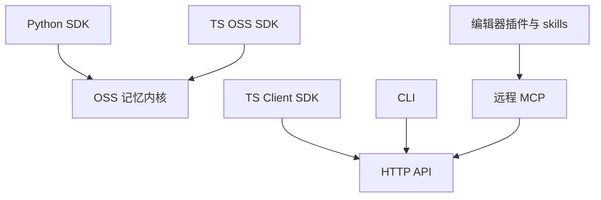

# 生态与接入方式

## 生态总览

Mem0 的每种接入方式最终都落到两个去处之一：**本地内核**（OSS SDK 直连 Provider）或 **HTTP API**（自托管 Server 与托管平台共用同一套客户端语义）。CLI、编辑器插件与 MCP 都只认 HTTP，因此它们天然同时适配自托管与托管两种后端。

该看什么：`Core` 一侧只有 Python 与 TypeScript 两个实现，它们各自把同一套管线移植过去（TS 版同样实现多信号检索）；`HTTP` 一侧则是一批薄客户端，换后端不改用法。

## TypeScript SDK

`mem0-ts` 一个包名（`mem0ai`）导出两个入口：

| 入口 | 导入路径 | 定位 |
|------|---------|------|
| OSS SDK | `mem0ai/oss` | 本地直连 Provider 的 `Memory` 类，与 Python 版对标 |
| 平台客户端 | `mem0ai` | 走 HTTP 的 `MemoryClient`，适配自托管与托管 |
| 社区适配 | `mem0-ts/src/community` | 目前是 LangChain 适配 |

OSS 入口的 `Memory` 类实现了与 Python 一致的检索步骤：查询嵌入、过量召回的语义检索、关键词检索与 BM25 打分、实体加权、候选构建与可选重排。差别在于依赖的向量库实现各自决定是否支持关键词检索——不支持时返回空，检索退化为纯语义。

## CLI

CLI 有 **Node 与 Python 两份实现**，行为对齐（同样的命令、选项与输出模式），并由一份共享的命令规格文件作为单一事实来源；`mem0 help --json` 直接读这份规格输出机器可读的命令树，方便 Agent 调用。

| 命令 | 作用 |
|------|------|
| `init` | 初始化：交互式登录、写配置，或走 agent 自助开户 |
| `add` / `search` / `get` / `list` / `update` / `delete` | 记忆 CRUD 与检索 |
| `import` | 从 JSON 文件批量导入 |
| `config` | 查看/设置本地配置 |
| `entity` | 列出实体、级联删除某实体的记忆 |
| `event` | 查看后台事件状态 |
| `status` / `whoami` / `identify` | 连通性检查与身份标注 |

CLI 的配置存在用户目录下的一个 JSON 文件里（写入时会收紧文件权限），凭据来源优先级是命令行参数、环境变量、配置文件、默认值。它把默认后端指向托管平台的 API 地址，因此 CLI 开箱即用面向托管；要接自托管需要显式改 base URL。

## MCP 与 skills

这两者是**并列的两条分发渠道**，解决的问题不同：

- **MCP**：仓库里的插件配置声明的是一个**远程 MCP 服务器**，让宿主的 Agent 能调用 Mem0 的记忆工具。开源仓库本身不含本地 MCP server 实现。
- **skills**：给 Agent 注入"怎么用 Mem0"的知识，分两类——**参考型**（常驻上下文，讲 SDK/CLI 用法）与**流水线型**（按需触发，如"把 Mem0 接入现有仓库""验证接入产物""从 OSS 迁移到平台"）。

对支持原生插件的宿主（如 OpenCode），仓库提供的是一个**原生插件**而非 MCP：它直接注册一组记忆工具（增删改查、实体列表、事件状态等），不需要额外配置 MCP server。

## 集成清单

`integrations/` 下每个子目录是一种宿主或框架的适配，形态不一：

| 集成 | 形态 | 用途 |
|------|------|------|
| `mem0-plugin` | 多平台插件包（配置 + 钩子 + skills + 脚本） | 给编辑器/编码 Agent 加持久记忆 |
| `n8n-nodes-mem0` | n8n 社区节点 | 在工作流里读写记忆，也可作为 AI Agent 工具 |
| `openclaw` | 插件 | 给 OpenClaw agent 加跨会话记忆 |
| `pi-agent-plugin` | 插件 | 给 Pi Agent 加记忆工具与技能 |
| `vercel-ai-sdk` | SDK Provider | 通过 `createMem0()` 接入 Vercel AI SDK |
| `zapier-mem0` | Zapier 集成 | 在 Zap 里做记忆的增查删 |

## 边界与限制

- **CLI 只实现了托管后端**：后端接口留了抽象，但当前只有平台实现，自托管需自行补一个后端类。
- **两份 CLI 会有版本漂移**：Node 与 Python 实现分别发版，共享规格文件是约束，但不是自动同步。
- **MCP 依赖远程服务**：仓库内的 MCP 配置指向远程地址，离线或受限网络下不可用。
- **社区适配很薄**：TypeScript 的社区入口目前只有 LangChain 一项。

> 依据：`mem0-ts/src/oss/src/memory/index.ts:193`、`mem0-ts/src/oss/src/memory/index.ts:1322`、`cli/node/src/index.ts:26`、`cli/node/src/config.ts:15`、`cli/node/src/backend/platform.ts:25`、`cli/CLI_SPECIFICATION.md`、`cli/python/pyproject.toml`、`skills/README.md`、`integrations/mem0-plugin/mcp_config.json`、`integrations/n8n-nodes-mem0/README.md`、`integrations/vercel-ai-sdk/README.md`
