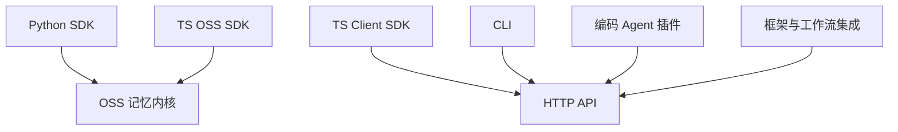
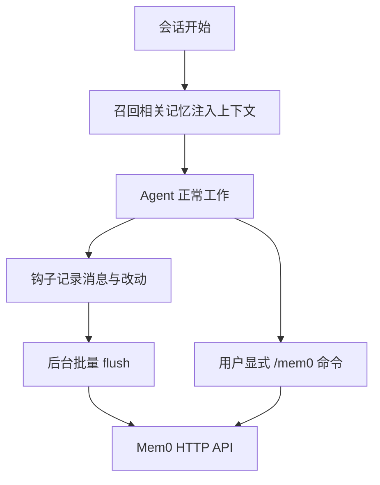

# 生态与接入方式

## 生态总览

Mem0 的每种接入方式最终都落到两个去处之一：**本地内核**（OSS SDK 直连 Provider）或 **HTTP API**（自托管 Server 与托管平台共用同一套客户端语义）。CLI、插件与框架集成都走 HTTP，因此它们天然同时适配自托管与托管两种后端。

该看什么：`Core` 一侧只有 Python 与 TypeScript 两个实现，它们各自把同一套管线移植过去（TS 版同样实现多信号检索）；`HTTP` 一侧则是一批薄客户端，换后端不改用法——CLI、插件、框架集成彼此并列，区别只在"谁在调用"。下面按形态分组介绍，插件类单独成节，因为它与框架集成解决的不是同一类问题。

## TypeScript SDK

`mem0-ts` 一个包名（`mem0ai`）导出两个入口：

| 入口 | 导入路径 | 定位 |
|------|---------|------|
| OSS SDK | `mem0ai/oss` | 本地直连 Provider 的 `Memory` 类，与 Python 版对标 |
| 平台客户端 | `mem0ai` | 走 HTTP 的 `MemoryClient`，适配自托管与托管 |
| 社区适配 | `mem0-ts/src/community` | 目前是 LangChain 适配 |

OSS 入口的 `Memory` 类实现了与 Python 一致的检索步骤：查询嵌入、过量召回的语义检索、关键词检索与 BM25 打分、实体加权、候选构建与可选重排。差别在于依赖的向量库实现各自决定是否支持关键词检索——不支持时返回空，检索退化为纯语义。

最近若干个版本里，TS 版与 Python 版的"行为对齐"集中在一批边角上：会话作用域键中的分隔符转义、Redis / Valkey 读取时保留蛇形的作用域 ID、Bedrock 的显式 provider 覆盖。这些改动让两个实现对外表现一致，细节见 [data-model.md](data-model.md) 与 [provider-system.md](provider-system.md)。

## CLI

CLI 有 **Node 与 Python 两份实现**，行为对齐（同样的命令、选项与输出模式），并由一份共享的命令规格文件作为设计基准；`mem0 help --json` 输出机器可读的命令树，方便 Agent 调用。

| 命令 | 作用 |
|------|------|
| `init` | 初始化：交互式登录、写配置，或走 agent 自助开户 |
| `add` / `search` / `get` / `list` / `update` / `delete` | 记忆 CRUD 与检索 |
| `import` | 从 JSON 文件批量导入 |
| `config` | 查看/设置本地配置 |
| `entity` | 列出实体、级联删除某实体的记忆 |
| `event` | 查看后台事件状态 |
| `status` / `version` | 连通性检查与版本号输出 |
| `whoami` / `identify` | 身份标注 |

最近一轮 CLI 变化有三处，都是"把平台侧已有的能力暴露给命令行用户"：

| 变化 | 影响 |
|------|------|
| 新增 `mem0 version` 子命令 | 不连后端即可打印版本；与全局 `--version` 等价 |
| `add` 新增 `--agent-custom-instructions` | 为 agent 作用域的抽取单独指定指令，覆盖项目级设置 |
| `search --filter` 的帮助文本改为给出真实语法 | 明确支持 `{"AND": [...]}` / `{"OR": [...]}` 形态，并附分类过滤示例 |

需要留意：`version` 子命令目前只存在于两份 CLI 的实际注册表与帮助面板中，共享的 `cli-spec.json` 命令清单尚未收录它；以规格文件驱动 `help --json` 的脚本取不到这一项。

CLI 的配置存在用户目录下的一个 JSON 文件里（写入时会收紧文件权限），凭据来源优先级是命令行参数、环境变量、配置文件、默认值。它把默认后端指向托管平台的 API 地址，因此 CLI 开箱即用面向托管；要接自托管需要显式改 base URL。

## 插件与 MCP：编码 Agent 的接入形态

插件是仓库里形态最"重"的一类接入：它们不只暴露工具，还会在会话的特定时机（开始、提交提示、工具调用前后、压缩上下文）自动抓取、自动召回。这类接入的共同前提是一个 **Mem0 Platform API key**。

该看什么：自动捕获是**异步**的——写入不在对话路径上，所以刚说完的内容不会立刻出现在下一次检索里；显式命令（搜索、忘记、暂停）则直接打 API。

| 插件包 | 覆盖宿主 | 形态 |
|--------|---------|------|
| `integrations/claude-code-plugin` | Claude Code | 独立插件（钩子 + 后台 flush worker + 只读检索工具 + 一个 Sonnet 子代理），按 `mem0@mem0-plugins` 发布 |
| `integrations/mem0-plugin` | Cursor、Codex、Kimi、OpenCode、Antigravity | 多平台插件包（配置 + 钩子 + skills + 脚本） |
| `integrations/deepseek-plugin` | DeepSeek Harness | 原生 Cordis 插件，注册 `search_memory` / `add_memory` 两个工具 |
| `integrations/openclaw` | OpenClaw | 插件 |
| `integrations/pi-agent-plugin` | Pi Agent | 插件 |

Claude Code 的插件已经从 `mem0-plugin` 中**拆出独立目录并独立演进**：新版把"九读写工具"收敛成一个只读的 `search_memories`，写入改由后台 worker 统一 flush，并引入了按仓库作用域的两条记忆通道（共享项目记忆与个人记忆）。从旧版升级是破坏性的——命令名与本地配置键都会失效，记忆本身保留。

`mem0-plugin` 仍服务于其余宿主。它在 Codex 上的钩子是可选项，需要跑一次安装脚本；同一目录下还提供一套 skills，供不支持原生插件的宿主使用。

## MCP 与 skills

这两者是**并列的两条分发渠道**，解决的问题不同：

- **MCP**：仓库里的插件配置声明的是 Mem0 的 MCP 服务，让宿主的 Agent 能调用 Mem0 的记忆工具。开源仓库本身不含本地 MCP server 实现，离线或受限网络下不可用。
- **skills**：给 Agent 注入"怎么用 Mem0"的知识，分两类——**参考型**（常驻上下文，讲 SDK/CLI 用法）与**流水线型**（按需触发，如"把 Mem0 接入现有仓库""验证接入产物""从 OSS 迁移到平台"）。它不提供数据通路，只提供使用姿势。

对支持原生插件的宿主（如 DeepSeek Harness、OpenClaw），仓库提供的是**原生插件**而非 MCP：它直接注册记忆工具，不需要额外配置 MCP server。

## 集成清单

`integrations/` 下每个子目录是一种宿主或框架的适配，形态不一：

| 集成 | 形态 | 用途 |
|------|------|------|
| `claude-code-plugin` | Claude Code 专用插件（钩子 + 后台 flush + 只读检索 + 子代理） | 跨会话记忆与 token 节省，按 marketplace 发布 |
| `mem0-plugin` | 多平台插件包（配置 + 钩子 + skills + 脚本） | 给 Cursor、Codex、Kimi、OpenCode、Antigravity 加持久记忆 |
| `deepseek-plugin` | 原生宿主插件（Cordis） | 给 DeepSeek Harness 的 Agent 加记忆工具 |
| `mem0-strands` | Python 库，实现 Strands 的 `MemoryStore` | 挂在 Agent 循环上，每轮自动召回并注入，无需工具调用 |
| `openclaw` | 插件 | 给 OpenClaw agent 加跨会话记忆 |
| `pi-agent-plugin` | 插件 | 给 Pi Agent 加记忆工具与技能 |
| `vercel-ai-sdk` | SDK Provider | 通过 `createMem0()` 接入 Vercel AI SDK |
| `n8n-nodes-mem0` | n8n 社区节点 | 在工作流里读写记忆，也可作为 AI Agent 工具 |
| `zapier-mem0` | Zapier 集成 | 在 Zap 里做记忆的增查删 |

这里有两种截然不同的接法，选型时值得分清：**工具式**（暴露若干记忆工具，由模型决定何时调用）与**循环式**（把记忆挂进 Agent 的执行循环，每轮自动召回与写入）。`mem0-strands` 是后者的代表，`deepseek-plugin`、`n8n` 节点属前者。工具式更可控；循环式对模型不可见、无需提示词配合，但每一轮都会多一次检索。

## 边界与限制

- **CLI 只实现了托管后端**：后端接口留了抽象，但当前只有平台实现，自托管需自行补一个后端类。
- **两份 CLI 会有版本漂移**：Node 与 Python 实现分别发版，共享规格文件是约束，但不是自动同步（`version` 子命令尚未进规格文件就是一例）。
- **仓库内不再含本地 MCP server**：MCP 入口指向远程的 Mem0 MCP 服务；离线或受限网络下不可用。
- **社区适配很薄**：TypeScript 的社区入口目前只有 LangChain 一项。
- **插件依赖 Platform API key**：这几类插件都调用托管 API，不自带 OSS 后端。

> 依据：`mem0-ts/src/oss/src/memory/index.ts:568-580`、`mem0-ts/src/oss/src/utils/casing.ts:1-22`、`cli/python/src/mem0_cli/app.py:278-292`、`cli/python/src/mem0_cli/app.py:371-380`、`cli/python/src/mem0_cli/app.py:1092-1101`、`cli/python/src/mem0_cli/commands/utils.py:97-99`、`cli/python/src/mem0_cli/app.py:1155-1210`、`cli/node/src/index.ts:95-99`、`cli/node/src/index.ts:832-838`、`cli/node/src/index.ts:150-175`、`cli/node/src/help.ts:32-50`、`cli/cli-spec.json`、`cli/CLI_SPECIFICATION.md`、`integrations/claude-code-plugin/README.md`、`integrations/mem0-plugin/README.md`、`integrations/mem0-plugin/plugin.json`、`integrations/deepseek-plugin/README.md`、`integrations/mem0-strands/README.md`、`skills/README.md`、`marketplace.json`、`integrations/n8n-nodes-mem0/package.json`、`integrations/zapier-mem0/package.json`
