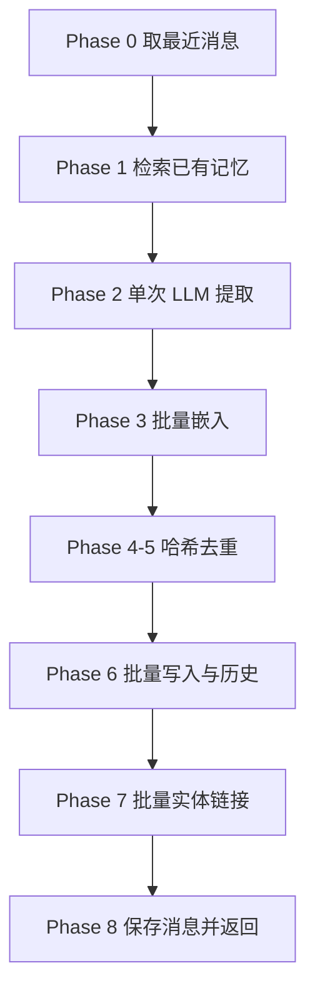
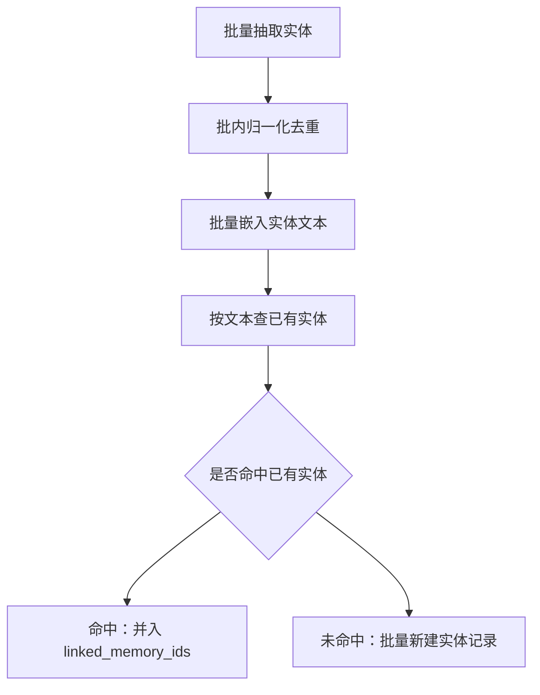

# 记忆写入管线

## 这个链路解决什么

`add` 是 Mem0 的写入入口。它面对的输入是一段对话（若干条 `role`/`content` 消息）加一个作用域（`user_id` / `agent_id` / `run_id`）。要做的事是：**把对话里值得长期记住的事实挑出来，去重后存好，并把其中提到的实体与这些记忆关联起来**。

"挑出来"这一步交给 LLM，但 Mem0 并不让 LLM 自由发挥——它给 LLM 的既包括新消息，也包括**已有记忆**和**最近消息**，要求 LLM 只做新增（ADD）、跳过语义重复的内容，并给出新记忆与旧记忆的关联。这样一次 `add` 只需要一次 LLM 调用，不必像"先提取、再对每条记忆单独判断增删改"那样反复往返。

## 两种写入模式

| 方式 | 触发 | 行为 |
|------|------|------|
| 提取模式（默认） | `infer=True` | 走完整的 ADD-only 管线，LLM 从对话中提炼事实 |
| 原样模式 | `infer=False` | 不调用 LLM，把每条消息原样嵌入并逐条存储，事件一律记为 ADD |
| 程序记忆 | `memory_type="procedural_memory"`（需 `agent_id`） | 走专用的 Procedural Memory 流程，用于流程/操作类知识 |

原样模式的用途是"我就是要一字不差地存这句话"，代价是检索时面对的是原始文本而非精炼事实。程序记忆与普通记忆共用同一套存储，只是生成方式不同。

## 提取管线的八个阶段

`infer=True` 时，写入被拆成一条分阶段流水线。它被设计成**分阶段批量化**：能批量做的（嵌入、插入、历史写入、实体检索）都合并成一次调用，不能批量的（LLM 提取）只做一次。

该看什么：`Phase 2` 是唯一的 LLM 调用点，也是整条链路最慢、最容易失败的一步；它前后的阶段（上下文收集、嵌入、去重、实体链接）都是本地或批量操作。下面按阶段说明各自在防什么问题。

| 阶段 | 做什么 | 防的是什么 |
|------|--------|-----------|
| Phase 0 上下文收集 | 从本地 SQLite 取该会话最近的消息 | 让 LLM 能消解代词与省略的指代 |
| Phase 1 已有记忆检索 | 用当前对话在向量库检索相近的已有记忆（取前 10 条） | 给 LLM 提供去重与关联的参照 |
| Phase 2 LLM 提取 | 一次调用产出新增事实清单，可带 `linked_memory_ids` | 避免多轮往返；失败会抛错而非静默返回空 |
| Phase 3 批量嵌入 | 把所有提取出的文本一次性嵌入 | 减少嵌入调用次数 |
| Phase 4-5 去重 | 对每条记忆文本算 MD5，与已有哈希、本批已见哈希比对 | 同一事实重复写入 |
| Phase 6 批量持久化 | 批量写入向量库，并批量写入历史表 | 逐条写入的性能损耗 |
| Phase 7 实体链接 | 批量抽取实体、批量检索已有实体、批量插入新实体 | 让检索阶段能用实体信号加权 |
| Phase 8 收尾 | 保存本轮消息，返回新增记忆列表 | 保证下一轮 Phase 0 有上下文 |

## 防幻觉的一个细节：把 UUID 换成序号

给 LLM 看"已有记忆"时，Mem0 不直接暴露记忆的 UUID，而是把每条已有记忆按顺序编号（`"0"`、`"1"`…）后交给 LLM，等 LLM 返回关联关系时再映射回真实 UUID。这样 LLM 不可能"编造一个看起来像 UUID 的字符串"，关联要么命中真实映射、要么被丢弃。

LLM 输出的解析也留了后手：先尝试按 JSON 解析，失败则从文本里截取首个 `{` 到末个 `}` 再试，并剔除代码块围栏与 `<think>` 段。即便最终为空，本次对话的消息**仍会**被保存，只是不产生新记忆——这是为了不让"模型这次没抽出东西"变成"上下文断档"。

## 实体是怎么被链接起来的

Phase 7 负责把记忆文本与实体关联。它先对所有新记忆批量抽取实体，再在**批内**按归一化文本全局去重，然后对每个唯一实体做一次"先精确匹配、再语义匹配"的判定。

该看什么：实体判定有两条命中路径——**精确匹配**（归一化后文本相同）优先，其次才是**语义匹配**（相似度不低于 0.95，阈值很高，只接受几乎同义的实体）。实体记录里保存了一份 `linked_memory_ids`，检索阶段就是靠它把"查询里出现的实体"换算成"哪些记忆该被加权"。

实体抽取本身由 spaCy 完成，产出带类型标签的候选（如 PROPER / QUOTED / TOPIC / IDENTIFIER）。若没装 spaCy 或模型不可用，抽取会返回空列表，管线继续跑但**不产生实体链接**——这是能力降级而非报错，见 [retrieval.md](retrieval.md)。

## 旁路：程序记忆如何对待"空回答"

程序记忆只调一次 LLM，让它总结出一段可复用的流程文本，然后剥掉外围代码块直接存成一条记忆。这里有两个容易踩的坑，项目的处理方式值得对照：

| 坑 | 现象 | 处理 |
|----|------|------|
| LLM 返回多段内容 | 某些 Agent 框架把模型输出作为 `[{"text": ...}, ...]` 的块列表传下来 | 先把块列表拼成字符串，再剥代码块；拼完仍不是字符串才当作空 |
| LLM 拒答或返回空 | 后续嵌入与去重会对着空串跑，报错位置离真正原因很远 | 在生成后立刻检查，空内容直接抛 `ValueError`，并在消息里点明"模型可能拒绝了请求或返回了空响应" |

前一条对提取管线同样生效，因为两条链路共用同一个"剥代码块"的工具函数。

## 边界与限制

- **去重是文本级的**：哈希基于记忆文本，改写一个字的同义事实不会被判为重复，只会作为新记忆累积。这是 ADD-only 语义的必然结果。
- **实体链接依赖 spaCy**：没装 `[nlp]` extra 或模型加载失败时，实体链路整体跳过。
- **提取质量取决于 LLM 与提示词**：`custom_instructions` 可以追加约束，作用域为 `agent_id` 且无 `user_id` 时还会追加一段 agent 场景的说明。
- **实体/记忆不是事务性的**：写记忆与写实体是两段独立操作，实体链接失败只记 warning，不会回滚已写入的记忆。
- **带特殊字符的实体 ID 会开启新的上下文缓冲**：会话作用域键由三段 ID 拼成，键里的分隔符会被转义。ID 含 `%`、`&` 或 `=` 的用户，转义规则生效后其"最近消息"缓冲会清空一次并在下一次写入时重新填充；已存记忆不受影响。详见 [data-model.md](data-model.md)。

> 依据：`mem0/memory/main.py:760-876`、`mem0/memory/main.py:879-1206`、`mem0/memory/main.py:1391-1410`、`mem0/memory/main.py:1993-2032`、`mem0/memory/main.py:3671-3710`、`mem0/memory/utils.py:115-138`、`mem0/configs/prompts.py:468-946`、`mem0/configs/prompts.py:1016-1062`、`mem0/memory/storage.py:257-325`、`mem0/utils/entity_extraction.py:751-772`、`docs/changelog/sdk.mdx`
