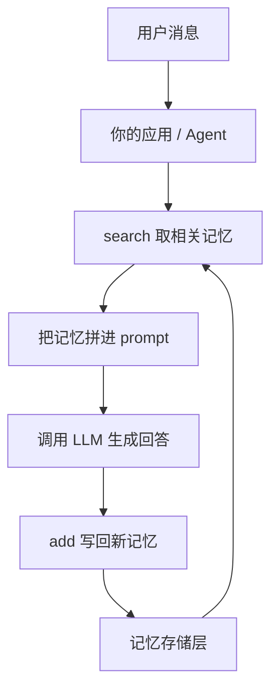

# Mem0 概览

## 一句话定位

Mem0 是 AI Agent 的**长期记忆层**。它把「记住用户」这件事从应用里抽出来：应用不再需要自己维护对话历史、自己决定哪些信息值得留、自己实现检索，而是调用 `add` 存记忆、调用 `search` 取记忆，中间的提取、去重、嵌入、索引都由 Mem0 完成。

## 解决什么问题

Agent 默认是**无状态**的。每次对话从零开始，用户上次说过的偏好、上个月做过的决定、跨会话的约定都会丢。业界对此有几条常见出路，各自有硬代价：

| 做法 | 代价 |
|------|------|
| 把全部历史塞进 prompt | 上下文窗口有限，token 成本随对话线性增长 |
| 传统 RAG（文档切块检索） | 缺时间感与关系感，检索只看语义相似度，容易召回"看起来像"但不相关的内容 |
| 微调模型 | 更新慢、成本高，无法随用户即时变化 |

Mem0 的定位介于两者之间：**不重放历史，只存"事实"**。它把对话压缩成一条条自包含的事实陈述（如"用户偏好靠窗座位"），存进向量库，检索时再用多路信号把它们捞回来。应用侧只需要在"回答前"和"回答后"各加一次调用。

下图是应用使用 Mem0 的最小循环——它说明 Mem0 在系统里的位置：不在模型内部，而在应用与模型之间。

该看什么：Mem0 的价值集中在 `S` 与 `W` 两个动作上——**读**要能捞出正确的事实，**写**要能把对话变成干净、去重的事实。这两条链路是后续 [memory-pipeline.md](memory-pipeline.md) 与 [retrieval.md](retrieval.md) 的主题；图外的东西（怎么接模型、怎么选存储）见 [provider-system.md](provider-system.md)。

## 给谁用 / 典型场景

| 场景 | 用到 Mem0 的哪一点 |
|------|-------------------|
| 个性化助手 / 客服机器人 | 跨会话记住用户偏好与历史工单 |
| 多 Agent 协作 | 用 `agent_id`、`run_id` 隔离并共享上下文 |
| 企业知识沉淀 | 把交互中反复出现的事实固化成可检索条目 |
| 编码助手 / 桌面 Agent | 通过 CLI、Claude Code 插件或其他宿主的插件直接读写记忆 |

需要按"谁"隔离记忆是常见诉求，Mem0 用 `user_id` / `agent_id` / `run_id` 三个作用域维度表达，详情见 [data-model.md](data-model.md)。

## 三种运行形态

同一套内核以三种方式交付，选择取决于"谁来运维"：

| | Library（SDK） | Self-Hosted Server | Cloud Platform |
|---|---------------|-------------------|----------------|
| 适合 | 试验、原型、内嵌进自己的服务 | 团队要跑在自己的基础设施上 | 想要零运维的生产环境 |
| 安装 | `pip install mem0ai` / `npm install mem0ai` | `docker compose`（自托管栈） | 注册托管账号取 API key |
| 有无 Dashboard | 无 | 有 | 有 |
| 认证与 API key | 无 | 有 | 有 |
| 数据在哪 | 你自己的向量库与本地文件 | 你的 Postgres + 向量库 | Mem0 托管环境 |
| 入口 | `Memory` 类 | REST API + Dashboard | `MemoryClient` 走托管 API |

三者共享同一套概念（记忆、作用域、add/search），但**不是同一份代码**：Library 用 `Memory` 类直连本地 Provider，Self-Hosted 与 Platform 都通过 `MemoryClient` 调用 HTTP 接口。自托管 Server 的细节见 [self-hosted-server.md](self-hosted-server.md)，客户端 SDK 与 CLI 见 [ecosystem.md](ecosystem.md)。

## 核心能力一览

| 能力 | 说明 |
|------|------|
| 记忆 CRUD | `add` / `search` / `get` / `get_all` / `update` / `delete` / `history` |
| 多级作用域 | `user_id` / `agent_id` / `run_id` 三轴隔离记忆空间 |
| ADD-only 提取管线 | 一次 LLM 调用只做新增，批量嵌入、哈希去重、批量实体链接 |
| 多信号检索 | 语义向量 + BM25 关键词 + 实体加权三路评分融合 |
| 实体链接 | 从记忆文本中抽取实体，跨记忆链接以提升检索相关性 |
| 元数据过滤 | 支持 `eq` / `in` / `gt` / `AND` / `OR` / `NOT` 等增强过滤算子 |
| 程序记忆 | 可创建 Procedural Memory（流程/操作类知识） |
| Provider 插件 | LLM / Embedding / VectorStore / Reranker 四类，可按名注册 |
| 过期与历史 | 记忆可带 `expiration_date`；变更以历史记录留痕 |
| 多语言交付 | Python SDK、TypeScript SDK、Python/Node 双实现 CLI |
| 编码 Agent 接入 | Claude Code 插件、多平台插件包、DeepSeek Harness / Strands / Vercel AI SDK 集成 |

## 技术栈

| 层面 | 技术 | 作用 |
|------|------|------|
| 配置与数据模型 | Pydantic v2 | `MemoryConfig`、各 Provider Config、返回的 `MemoryItem` |
| 默认 LLM / Embedding | OpenAI（`gpt-5-mini` / `text-embedding-3-small`） | 开箱即用的默认组合 |
| 默认向量库 | Qdrant | `pip install mem0ai` 后无需额外配置即可跑 |
| 关键词检索 | 内置 BM25 打分 + spaCy 词形还原 | 混合检索的第二个信号 |
| 实体抽取 | spaCy（`en_core_web_sm`，`[nlp]` extra） | 实体链接与检索加权 |
| 本地历史 | SQLite（标准库 `sqlite3`） | 存 `history` 与最近消息 |
| 自托管服务 | FastAPI + SQLAlchemy + Alembic + Postgres(pgvector) | Server 的 API、元数据表与向量存储 |
| 遥测 | PostHog（匿名，可用 `MEM0_TELEMETRY` 关闭） | 使用统计；提示配置已改为本地文件 + 哈希分桶，不再走功能开关接口 |

## 不适用 / 从哪里开始读

- **只要一次性的文档问答**：那是检索增强（RAG）的活，不需要"跨会话记忆"这层抽象。
- **需要在写入时自动改写旧记忆**：开源版默认 ADD-only，需要自行用 `update` / `delete` 补逻辑。
- **需要知识图谱式的关系推理**：开源 SDK 不构建图谱；Graph Memory 属托管平台能力。
- **需要按时间语义重排或记忆衰减**：这两项是平台 v3 的排序能力，开源 SDK 传入相关参数会直接报错。
- **要多实例共享同一份历史记录**：开源版的 `history` 落在本地 SQLite，不是分布式存储。

这些边界与理由，以及各能力的降级条件，见首页的「现状与边界」。
