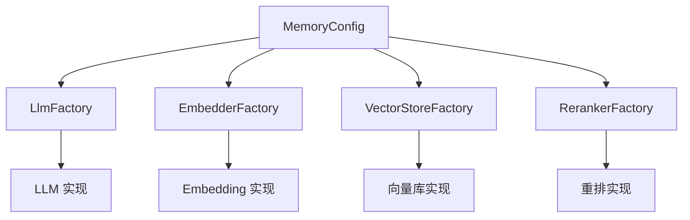

# Provider 插件体系

## 这个体系解决什么

Mem0 的核心逻辑（怎么提取、怎么检索）与"用哪个模型、存进哪个库"是解耦的。解耦的接口就是**四类 Provider**：LLM 负责提取事实，Embedding 负责把文本变成向量，VectorStore 负责存向量并做相似度检索，Reranker 负责可选的重排。应用通过一个 `MemoryConfig` 声明要用哪几个，Mem0 在构造时把它们实例化出来。

四类 Provider 各有一个工厂，形状一致：内部维护一张"provider 名 → 实现类路径"的映射表，`create()` 时按名取路径、动态导入并实例化。下图是配置到实例的流向。



该看什么：四类之间有耦合，但方向是单向的——VectorStore 的配置会被**同时**传给 Embedding 工厂（用于判断某些向量库的"自带嵌入"特性）。除此之外各自独立，换一个不影响其余三个。

## 内置 Provider 清单

| 类别 | 内置 provider 名 |
|------|-----------------|
| LLM | `openai`、`anthropic`、`azure_openai`、`gemini`、`deepseek`、`groq`、`together`、`aws_bedrock`、`xai`、`minimax`、`sarvam`、`ollama`、`lmstudio`、`vllm`、`litellm`、`langchain`，以及 `openai_structured` / `azure_openai_structured` 两个走结构化输出的变体 |
| Embedding | `openai`、`azure_openai`、`gemini`、`vertexai`、`aws_bedrock`、`together`、`huggingface`、`fastembed`、`ollama`、`lmstudio`、`langchain` |
| VectorStore | `qdrant`、`pgvector`、`chroma`、`milvus`、`pinecone`、`weaviate`、`elasticsearch`、`opensearch`、`redis`、`valkey`、`mongodb`、`supabase`、`faiss`、`cassandra`、`azure_ai_search`、`azure_mysql`、`databricks`、`s3_vectors`、`upstash_vector`、`vertex_ai_vector_search`、`turbopuffer`、`oracledb`、`neptune`、`baidu`、`langchain` |
| Reranker | `cohere`、`huggingface`、`sentence_transformer`、`llm_reranker`、`zero_entropy` |

这张表决定了"能不能换"：想用的后端若不在列，就得自己注册一个（见下）。其中 `langchain` 在四类里各有一个适配实现，是"借用 LangChain 生态已有组件"的入口。

## Provider 配置里的三个"隐式输入"

多数 provider 配置是显式的：写什么用什么。但有三类输入会在配置之外生效，换后端时最容易在这里踩坑。

| 隐式输入 | 表现的 provider | 规则 |
|---------|----------------|------|
| 环境变量兜底 | `vllm` 的 base URL、`huggingface` embedding 的 API key | 显式配置 > 对应环境变量 > 内置默认值 |
| 从模型标识推断 | `aws_bedrock` 的模型家族 | 从模型 ID 里匹配厂商名，据此选择请求/响应的封装方式 |
| 新增字段的严格校验 | `redis` 的配置对象 | 未知字段直接报错，按 Pydantic 标准错误返回 |

**环境变量兜底**的语义是"不覆盖只补缺"：`vllm` 的 `vllm_base_url` 未显式传入时才读 `VLLM_BASE_URL`，再没有才落到 localhost；`huggingface` embedding 在配了自定义 base URL（典型是自建的 TEI 服务）却没给 key 时，依次取 `HUGGINGFACE_API_KEY`，最后用一个占位 key——因为底层的 OpenAI 兼容客户端在构造时就要求 key 非空，而很多自建端点并不校验它。

**从模型标识推断**是 Bedrock 特有的难题：请求封装要按模型家族（Anthropic / Amazon / Meta / Mistral / Cohere / AI21）分流，而家族名通常出现在模型 ID 里。问题出在**应用推理配置文件 ARN**——这类 ARN 里只有一段不透明的 ID，推断必然失败。解法是加一个显式的 `provider_override` 字段：

| 场景 | 配置 |
|------|------|
| 普通模型 ID | 不填 `provider_override`，按 ID 自动识别 |
| 应用推理配置文件 ARN | 填上家族名，例如 `anthropic`；填了不存在的名字会立刻报错并列出合法取值 |

Python 与 TypeScript 两个 SDK 的字段名不同（`provider_override` 与 `providerOverride`），语义一致。

**严格校验**方面，`redis` 的配置对象改用 Pydantic 原生的未知字段禁止策略，效果与之前的自定义校验相同，但报错信息变成标准的 Pydantic 格式。这条对使用者是"行为不变、错误信息变了"，对维护者是删掉了一段重复逻辑。

## 配置对象的三种传入形态

每个工厂的 `create()` 都接受三种形态的 config，这是为了让"用默认配置""写字典""传已构造好的配置对象"都能走同一个入口：

| 传入 | 工厂的行为 |
|------|-----------|
| `None` | 用该 provider 的 Config 类加额外 kwargs 构造一个默认配置 |
| `dict` | 把字典与 kwargs 合并后构造 Config 对象 |
| 已是基础配置对象 | 若目标 provider 有自己的 Config 类，则按字段**转换**过去；否则原样使用 |

第三种形态里有个必要小心：不同 provider 的 Config 接受的字段并不完全一致（例如推理相关字段）。工厂会用内省检查目标 Config 是否接受某些字段，**只把对方认得的字段带过去**，避免因为多传一个参数而构造失败。

## 接一个自有 Provider

四类工厂的映射表都是类属性，而 LLM 工厂额外提供了 `register_provider()`，可以在运行时把"名字 → 类路径 → 配置类"注册进映射表。因此接入自有的 LLM 不需要改 Mem0 源码，只要先把实现导入，再注册名字，之后就能在配置里用这个名字。

以下是最小的接入形态（名字与类路径均为占位，用于说明调用顺序）：

```python
from mem0 import Memory
from mem0.utils.factory import LlmFactory

LlmFactory.register_provider(
    name="my_llm",
    class_path="my_pkg.llm.MyLLM",
    config_class=MyLLMConfig,
)
memory = Memory.from_config({
    "llm": {"provider": "my_llm", "config": {...}},
    "embedder": {"provider": "openai", "config": {...}},
})
```

要实现的约定是：LLM 与 Embedding 提供 `generate_response()` 与 `embed()` / `embed_batch()`，VectorStore 继承 `VectorStoreBase` 并实现 insert / search / update / delete / list 等；若想启用混合检索，还要实现 `keyword_search()`（基类给了"不支持"的默认实现）。

## 边界与限制

- **反射式加载的错误出现在运行时**：provider 名拼错或类路径不可导入，要到实例化那一刻才报错，配置校验阶段发现不了。
- **`register_provider` 目前只在 LLM 工厂**：Embedding、VectorStore、Reranker 的映射表没有对应的注册方法，接入自有实现需要直接改映射表或走 `langchain` 适配。
- **可选后端的依赖是分开装的**：pyproject 把向量库、LLM、NLP 的依赖拆成不同 extra，装 `mem0ai` 只带默认组合（Qdrant + OpenAI），其余按需安装。
- **`keyword_search` 未实现会静默降级**：检索会退化为纯语义，只在初始化打 warning，见 [retrieval.md](retrieval.md)。

> 依据：`mem0/utils/factory.py:29-32`、`mem0/utils/factory.py:35-149`、`mem0/utils/factory.py:152-177`、`mem0/utils/factory.py:180-223`、`mem0/utils/factory.py:226-280`、`mem0/configs/base.py:29-57`、`mem0/vector_stores/base.py:4-85`、`mem0/configs/llms/vllm.py:40-57`、`mem0/configs/llms/aws_bedrock.py:20-70`、`mem0/llms/aws_bedrock.py:23-40`、`mem0/embeddings/huggingface.py:14-25`、`mem0/configs/vector_stores/redis.py:1-9`、`mem0-ts/src/oss/src/llms/aws_bedrock.ts:29-48`、`mem0-ts/src/oss/src/types/index.ts:74-84`、`pyproject.toml`
