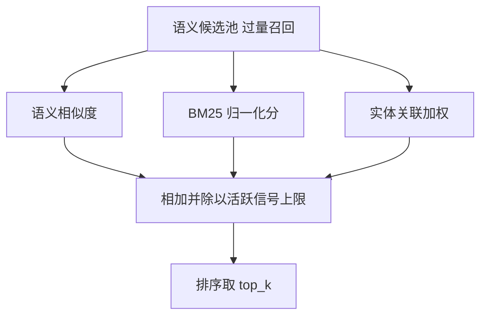

# 多信号检索

## 为什么不是纯向量检索

纯语义检索的盲区很具体：查询里出现一个**专有名词、编号或缩写**时，向量相似度可能把"语义相近但事实不同"的记忆排在前面；查询在问"某个人的偏好"时，向量又无法保证召回所有提到这个人的记忆。Mem0 的做法是让一路信号变成三路，各自补对方的短板：

| 信号 | 强在哪 | 弱在哪 |
|------|-------|-------|
| 语义（向量相似度） | 概念级、换词也能召回 | 对专名、编号不敏感；容易召回"看起来像"的记忆 |
| 关键词（BM25） | 精确词匹配、名字与编号 | 换个说法就失效，不理解语义 |
| 实体（关联加权） | 抓住查询里的人物/项目/实体 | 依赖抽取质量，未装 spaCy 时整体失效 |

三路不是"取交集"，而是**先各自打分、再相加融合**。下面的图给出一次检索里分数的来源与去向。

该看什么：候选池只来自**语义检索**——关键词与实体信号不能引入新候选，只能给已经进入候选池的记忆调整分数。这个设计决定了"向量库召不回来的记忆，另外两路也救不回来"。

## 候选怎么来

检索开始时对查询做三件事：词形还原（供 BM25 用）、实体抽取（供实体加权用）、向量嵌入（供语义检索用）。语义检索的召回量是 `top_k` 的 4 倍且不少于 60 条，这一"过量召回"是后续重新排序的前提。

关键词检索走向量库的 `keyword_search` 接口。并非所有向量库都实现它——基类的默认实现表示"不支持"，此时这一步返回空，**融合过程自动退化为只有语义（加实体）两路**。这不是错误，能力会静默变弱，只在初始化时打过一条 warning。

## 三路信号怎么打分

**语义分**直接来自向量库返回的相似度，是唯一被阈值门控的信号。

**BM25 分**需要先归一化。原始 BM25 分数无上界，且查询越长原始分越高，因此用逻辑斯蒂（sigmoid）把分数压到 0 到 1，并按查询词数动态调整中点与陡峭度：

| 查询词数 | sigmoid 中点 | 陡峭度 |
|---------|------------|-------|
| ≤ 3 | 5.0 | 0.7 |
| ≤ 6 | 7.0 | 0.6 |
| ≤ 9 | 9.0 | 0.5 |
| ≤ 15 | 10.0 | 0.5 |
| > 15 | 12.0 | 0.5 |

**实体分**由查询实体反查实体存储得到。每个匹配到的实体有一个相似度，只有不低于 0.5 才算数；它带来的加权是"相似度 × 实体权重（0.5）× 一个随关联记忆数衰减的系数"。关联的记忆越多，单个记忆分到的加权越小——这是为了不让"关联了几千条记忆的热门实体"把分数整体抬高。同一个记忆被多个实体命中时取最大值。

## 融合与阈值

融合是**相加再除以活跃信号的上限**：

| 活跃信号 | 上限（分母） |
|---------|------------|
| 仅语义 | 1.0 |
| 语义 + 实体 | 1.5 |
| 语义 + 关键词 | 2.0 |
| 语义 + 关键词 + 实体 | 2.5 |

除以活跃上限意味着"少一路信号"不会让所有分数系统性偏低，最终分数始终落在 0 到 1。有一个容易忽略的顺序：**阈值只在融合前门控语义分**，语义分低于 `threshold` 的候选会被直接排除，哪怕它的关键词或实体分很高也救不回来。

`explain=True` 时每条结果会附上 `score_details`，逐个列出语义分、BM25 分、实体加权、原始和、上限与阈值——排查"为什么这条排前面"时这是唯一直接的依据。

## 重排与元数据过滤

- **重排（rerank）**：`search(rerank=True)` 且配置了 reranker 时，融合后的结果会再过一遍 reranker；重排过程抛错则回退到融合结果，不影响可用性。
- **增强元数据过滤**：除了 `user_id` / `agent_id` / `run_id`，筛选条件支持一组算子，会在检索前被翻译成向量库能理解的过滤条件。

| 类别 | 算子 |
|------|------|
| 比较 | `eq`、`ne`、`gt`、`gte`、`lt`、`lte` |
| 集合 | `in`、`nin`、`contains`、`icontains` |
| 通配 | `"*"` |
| 逻辑 | `AND`、`OR`、`NOT` |

- **过期过滤**：默认不返回已过期记忆，`show_expired=True` 时才包含。

## 边界与限制

- **关键词与实体信号无法新增候选**：候选池完全由语义检索决定，召回率的上限在向量库这一步。
- **实体加权依赖 spaCy 与实体库的非空**：查询抽不出实体、或实体库为空时，实体分整体为 0。
- **阈值语义容易误解**：它约束的是语义分而非最终分，调大 `threshold` 会先砍掉语义弱的候选。
- **reranker 是可选桩**：不配置就没有重排；配置了但调用失败也只是回退。
- **时间感知检索不在开源版**：查询里带时间意图不会触发任何时间排序；时间相关的参数在开源 SDK 会直接报错。

> 依据：`mem0/memory/main.py:1369-1512`、`mem0/memory/main.py:1618-1721`、`mem0/memory/main.py:1723-1803`、`mem0/utils/scoring.py:12-139`、`mem0/vector_stores/base.py:68-85`、`mem0/utils/lemmatization.py`
