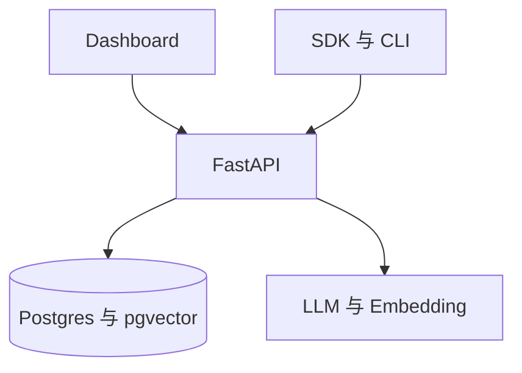
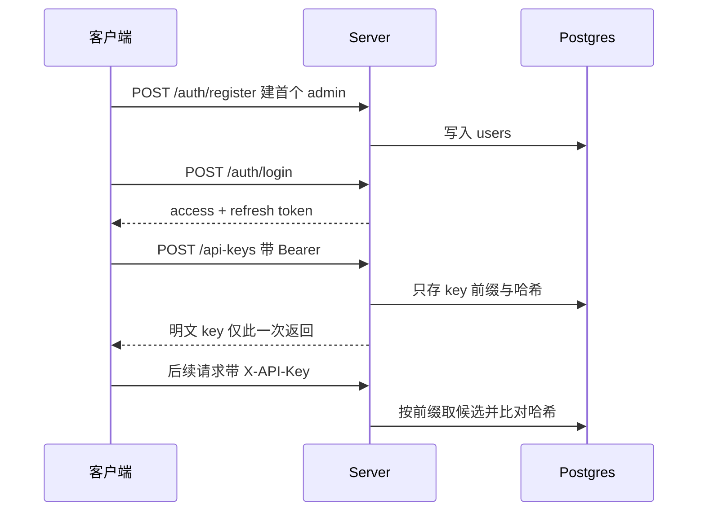

# 自托管 Server

## 部署形态

自托管形态把 Mem0 包成一个 REST 服务：一个 FastAPI 应用对外提供记忆接口与认证，一个 Postgres（带 pgvector 扩展）既是元数据库也是默认向量库，一个 Dashboard 提供可视化界面。SDK 与 CLI 通过 HTTP 调用它，而不是直连本地 Provider。



该看什么：Server 侧有两套数据——**认证与配置**存在 `mem0_app` 库，**记忆向量**存在同一 Postgres 实例的 `postgres` 库。二者同机不同库，是部署时需要留意的细节。

## 前置依赖

| 依赖 | 用途 |
|------|------|
| Postgres + pgvector | 元数据表与默认向量存储 |
| 至少一个 LLM 供应商密钥 | 提取事实（默认 OpenAI） |
| Docker 与 Compose | 一键起栈 |
| `JWT_SECRET` | 签发登录令牌；未设置且未显式关闭认证时会拒绝启动 |

## 两套认证

Server 默认**开启认证**，提供两种凭据，服务不同用途：

| 凭据 | 传递方式 | 用途 |
|------|---------|------|
| API key | 请求头 `X-API-Key` | 程序化访问；创建时只在响应里出现一次，之后不可找回 |
| JWT | 请求头 `Authorization: Bearer` | Dashboard 的浏览器会话；access 短时效、refresh 长时效 |

API key 的前缀固定，校验时先按前缀缩小候选、再逐个比对哈希，避免全表扫描。refresh token 采用**一次性使用**语义：换发时用一个条件更新原子占用该 jti，重复使用会被拒绝，堵住重放。

权限上区分**管理员与普通用户**。系统只允许注册**第一个**用户，且强制其为 admin；对「全量列举记忆」「重置全部」「改配置」这类端点要求 admin 权限。此外提供了一个 `ADMIN_API_KEY` 环境变量作为运维入口，以及 `AUTH_DISABLED` 用于纯本地开发——后者会打警告，不应带入生产。



## 元数据表

Server 的元数据用 SQLAlchemy 定义、Alembic 迁移，共五张表：

| 表 | 作用 | 关键字段 |
|----|------|---------|
| `users` | 用户与角色 | email、password_hash、role、last_login_at |
| `api_keys` | API key 记录 | key_prefix、key_hash、label、revoked_at、last_used_at |
| `request_logs` | 请求审计 | method、path、status_code、latency_ms、auth_type |
| `refresh_token_jtis` | refresh 单次使用 | jti、expires_at、used_at |
| `settings` | 运行时配置覆盖 | key、value |

其中 `request_logs` 是**追加式**的：高并发下增长很快，Server 提供了按保留天数清理的脚本与 Make target，并把它建的时间索引改成 BRIN，便于按时间范围批量删除。

## REST 路由

记忆接口直接定义在主应用上，认证、密钥、实体、审计四组路由拆成独立模块：

| 分组 | 代表端点 | 说明 |
|------|---------|------|
| 记忆 | `POST /memories`、`GET /memories`、`POST /search`、`PUT /memories/{id}`、`DELETE /memories/{id}` | 核心 CRUD 与检索 |
| 历史与重置 | `GET /memories/{id}/history`、`POST /reset` | 变更记录；重置需 admin |
| 配置 | `GET /configure`、`POST /configure`、`GET /configure/providers` | 运行时改 Provider 配置（改配置需 admin） |
| 认证 | `/auth/register`、`/auth/login`、`/auth/refresh`、`/auth/me` | 首用户注册、登录与令牌换发 |
| API key | `GET/POST /api-keys`、`DELETE /api-keys/{id}` | 自助管理自己的 key |
| 实体 | `GET /entities`、`DELETE /entities/{type}/{id}` | 聚合实体与级联删除（删除需 admin） |
| 审计 | `GET /requests` | 请求日志（需 admin） |

认证相关端点带**按 IP 限流**（登录、注册、刷新各有限额），超限会返回限流响应。运行时可改的 Provider 配置会持久化到 `settings` 表，重启后重放。

## 启动与验证

`server/` 下提供 Make target 把"起栈 → 建 admin → 发首个 API key"串成一条命令，输出里会打印 admin 凭据与 API key：

```bash
cd server && make bootstrap
# 也可给出自定义凭据
EMAIL=you@example.com PASSWORD=****** make bootstrap
```

`make up` 则只起栈（Dashboard 在 3000、API 在 8888、OpenAPI 在 `/docs`），人工在浏览器里走初始化向导。可选环境变量覆盖 LLM/Embedding 默认模型、遥测开关与请求日志保留天数。

## 运维要点

- **忘记密码**：官方恢复路径是提供 Make target 重置管理员密码，而不是改库。
- **请求日志膨胀**：需要周期性清理，默认保留 30 天；README 建议接 cron 或 systemd 定时任务。
- **遥测**：默认开启，最多上报"注册管理员""完成引导"两个事件，可用环境变量关闭。
- **升级注意**：容器启动命令会先跑 Alembic 迁移再起 API，因此升级顺序（先起数据库、恢复数据、再起 API）不能反，否则认证数据可能被覆盖。

## 边界与限制

- **认证默认开启**：从旧版（无认证）升级需补齐 `JWT_SECRET` 或注册管理员，否则无法直接使用。
- **Server 复用 SDK 的 `Memory` 实例**：它并不是另一套记忆实现，而是在 SDK 之上包了认证、多租户与配置管理。
- **Dashboard 与 API 是独立镜像**：Dashboard 的对外地址在运行时注入，构建期与运行期的环境变量需要分清楚。

> 依据：`server/main.py:120-172`、`server/auth.py:15-220`、`server/models.py:18-74`、`server/db.py:7-31`、`server/routers/auth.py:26-220`、`server/routers/api_keys.py:39-93`、`server/routers/entities.py:43-76`、`server/routers/requests.py:30-46`、`server/docker-compose.yaml:1-76`、`server/Makefile:43`、`server/README.md`
