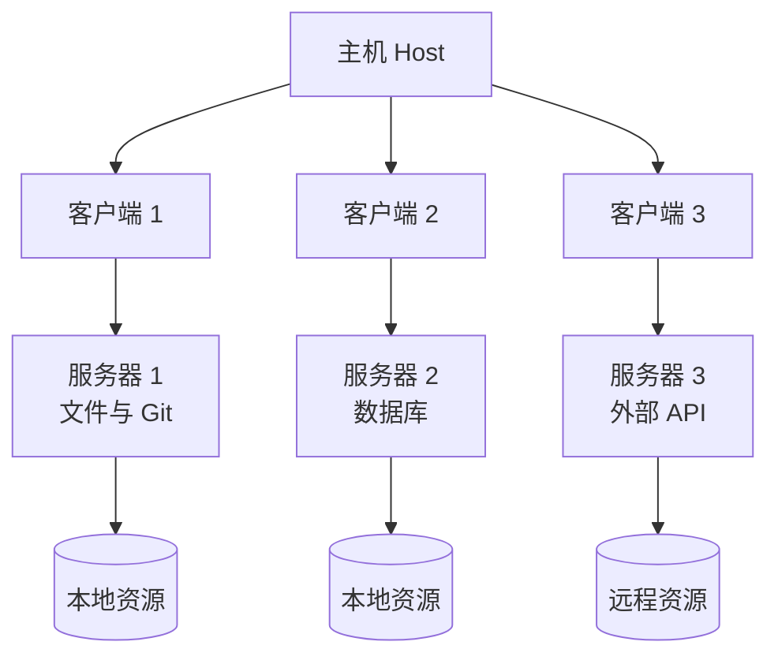
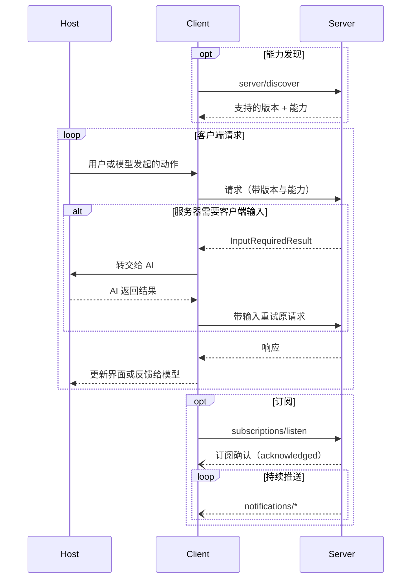

这页回答三个问题：MCP 由哪些角色组成？它们之间怎么连接、为什么这样隔离？一次请求从发起到返回，中间经历了什么？

## 三个角色

MCP 遵循「主机—客户端—服务器」（client-host-server）结构。一个主机进程内部可以同时运行多个客户端，每个客户端只连一个服务器。

| 角色 | 谁扮演 | 核心职责 |
|---|---|---|
| 主机 Host | 面向用户的应用程序 | 创建并管理客户端、控制连接权限与生命周期、执行安全策略与用户授权、协调 AI 集成、汇总上下文 |
| 客户端 Client | 主机内部为每个服务器创建的连接器 | 只与一个服务器通信；每个请求都带上协议版本与能力；双向路由消息、管理订阅与通知；在服务器之间维持安全边界 |
| 服务器 Server | 本地进程或远程服务 | 通过 MCP 原语对外提供资源、工具与提示；职责单一、彼此独立；在回复里用 `InputRequiredResult` 向客户端索要输入；必须遵守安全约束 |

一个关键约束：客户端与服务器是 **一对一** 关系。主机要接入三个服务器，就创建三个客户端实例，而不是让一个客户端轮流连三台。这样隔离由结构本身保证，而不是靠约定。

## 连接关系与隔离

下图是官方架构图的简化版：主机向下派生多个客户端，每个客户端各自连一个服务器；服务器再访问本机资源或外部 API。

该看什么：主机处在唯一的中枢位置，所有跨服务器协调都必须经过它。每个服务器只看得见自己那条支路——这对应一条明确的设计原则：**服务器不应该读到完整对话，也不应该「看穿」其他服务器**。对话历史留在主机，服务器只拿到完成任务所必需的那部分上下文。

这种隔离是有代价的：凡是需要跨服务器协同的场景，都得由主机来编排，服务器本身无法自行串联。

## 设计原则

官方列出了四条原则，它们解释了上面那张图为什么长这样。

| 原则 | 含义 | 对实现的影响 |
|---|---|---|
| 服务器应极易构建 | 复杂的编排责任交给主机 | 服务器只专注一组明确定义的能力，接口尽量简单 |
| 服务器应高度可组合 | 每个服务器提供独立且聚焦的功能 | 多个服务器可以无缝组合，模块化、可扩展 |
| 服务器应相互隔离 | 只接收必要上下文，完整历史留在主机 | 跨服务器交互由主机控制，安全边界由主机进程强制执行 |
| 能力可渐进添加 | 核心协议只提供最小必需功能 | 客户端与服务器可各自独立演进，并保持向后兼容 |

这四条共同指向一个取舍：**把复杂度推给数量少、受信任的主机，让数量多、来源杂的服务器尽量简单**。MCP 生态里服务器会由大量第三方编写，降低单个服务器的实现门槛，比让每个服务器都自洽地处理安全与编排更重要。

## 能力协商与请求生命周期

MCP 不在连接建立时做一次握手，而是让能力随每个请求一起传递。客户端在 `_meta` 里带上自己的协议版本与能力；服务器则通过 `server/discover` 对外声明自己支持什么。服务器可以声明工具支持、资源订阅、提示模板等能力，客户端可以声明采样、elicitation 等能力，双方都必须遵守已声明的能力。

下面这张时序图把「发现—请求—按需索取输入—订阅」串了起来。

该看什么：三条路径值得注意。

- **能力发现是可选的前置步骤**。客户端可以先调 `server/discover` 摸清对方底细，也可以直接发业务请求、在报错时再处理版本不匹配。
- **服务器需要额外输入时不再主动发请求**，而是在响应里返回 `InputRequiredResult`，由客户端带着输入重试原请求。这条「多轮往返」（MRTR）路径是 `2026-07-28` 版本的核心机制，取代了早期版本里服务器主动向客户端发起请求的做法。
- **变更通知走一条长连接流**。客户端用 `subscriptions/listen` 打开一条持续推送的通知流，服务器只能推送客户端订阅过的通知类型。

## 无状态是这版架构的底色

`2026-07-28` 起，MCP 被明确设计为无状态协议：每个请求自包含，并自带协议版本与能力。这带来两个直接结果。其一，服务器可以在任意实例上处理任意请求，天然适合横向扩展与负载均衡。其二，早期版本里那套「连接建立后维持会话」的机制（会话 ID、初始化握手）被移除，跨调用的状态改由服务器自己签发句柄、由客户端在后续工具参数里回传来承载。

理解了这一层，后面几页的内容就顺理成章：传输页讲这些自包含请求怎么在线上传递，版本与兼容页讲版本不匹配时怎么办，消息模式页则展开 MRTR 与订阅的具体形态。

> 依据：`docs/specification/2026-07-28/architecture/index.mdx:15-48`、`docs/specification/2026-07-28/architecture/index.mdx:50-82`、`docs/specification/2026-07-28/architecture/index.mdx:84-114`、`docs/specification/2026-07-28/architecture/index.mdx:116-174`、`docs/specification/2026-07-28/basic/index.mdx:182-220`
