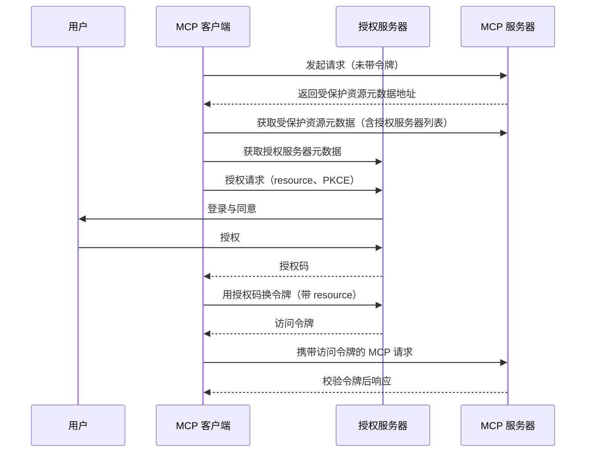

MCP 里的「授权」（Authorization）解决一个问题：当客户端要访问一个受保护的 MCP 服务器时，服务器如何确认调用方有权限、以及调用方如何拿到并使用一张被认可的门票。

它和「认证」（确认你是谁）不是一回事。授权关心的是：客户端拿到的访问令牌是否**专门签发给这个服务器**，以及服务器是否只把数据交给持票的合法调用方。

## 授权是可选的，但只面向 HTTP 传输

授权是整个协议里的一个**可选项**，不是所有 MCP 部署都必须启用。是否引入，取决于这种传输能否承载 OAuth 的重定向与令牌交换：

| 传输类型 | 对授权的态度 | 原因 |
| --- | --- | --- |
| 基于 HTTP 的传输 | **应该（SHOULD）**遵循本规范 | 能承载标准 OAuth 重定向与令牌端点 |
| stdio 传输 | **不应该（SHOULD NOT）**遵循 | 凭证应直接来自运行环境（如环境变量），无需 OAuth 流程 |
| 其他自定义传输 | **必须（MUST）**遵循 | 只要涉及受保护资源，就沿用同一套授权语义 |

换句话说：决定引入授权的是「传输能不能承载 OAuth」，以及「这个服务器是否要保护资源」，而不是协议强制。

## 参与授权的三个角色

整个授权过程由三方协作完成，MCP 客户端既要对用户负责，也要对服务器负责：

| 角色 | 在 MCP 中对应谁 | 主要职责 |
| --- | --- | --- |
| 客户端 | MCP 客户端 | 发起授权请求、保管令牌、按资源绑定请求令牌 |
| 资源服务器 | MCP 服务器 | 校验传入令牌是否为自己签发，拒绝来历不明的令牌 |
| 授权服务器 | 独立的授权服务 | 认证用户、发放与刷新令牌、注册客户端 |

注意「资源服务器」和「授权服务器」在现代部署里通常是两个独立系统。MCP 服务器本身一般是资源服务器，它通过元数据把自己信任的授权服务器地址告诉客户端。

## 依赖的标准

MCP 授权层不重新发明轮子，而是把一组 OAuth 相关规范组合起来，并在关键处收紧要求：

| 标准 | 作用 |
| --- | --- |
| OAuth 2.1（IETF 草案） | 授权流程与安全实践的总体框架 |
| RFC 6750 | 访问令牌在 HTTP 请求中的携带方式 |
| RFC 8414 | 授权服务器元数据发现 |
| RFC 7591 | 动态客户端注册（向后兼容用） |
| RFC 8707 | 资源指示器，把令牌绑定到目标资源 |
| RFC 9728 | 受保护资源元数据发现 |

此外还引用了 OpenID Connect Discovery 1.0、RFC 9207（授权服务器标识）等，用于处理特定的安全边界。

## 一次授权要走完哪些步骤

下图把发现、授权、换令牌、带令牌调用串了起来。核心是：客户端先问清楚「该找哪个授权服务器」，再带着「目标资源」和 PKCE 参数去换一张**只对这个服务器有效**的令牌。

该看什么：注意第 4、7、8 步。授权请求和换令牌请求都必须带上 `resource` 参数，把令牌明确绑定到目标 MCP 服务器；否则令牌可能被拿去访问别的服务。代价是客户端需要先完成两轮「发现」（受保护资源元数据、授权服务器元数据），比直接写死授权服务器地址更啰嗦，但换来了可迁移性。

## 授权服务器怎么被发现

客户端通常不知道服务器信任哪个授权服务器，这靠**受保护资源元数据**解决：

- MCP 服务器**必须**实现 RFC 9728 的受保护资源元数据，且元数据里**必须**包含 `authorization_servers` 字段，列出至少一个授权服务器地址。
- 客户端拿到列表后，自行挑选一个授权服务器（多服务器场景按 RFC 9728 的规则选择）。
- 客户端标识（client ID）只对签发它的那个授权服务器有效，不能跨服务器复用。

这样设计的好处是：授权服务器可以更换，客户端不必被告知——它每次都从服务器当前公布的元数据里重新发现。

## 客户端怎么注册

客户端在授权前需要先有一个身份。MCP 提供三种注册方式，按「有没有既有关系」来选择：

| 方式 | 适用场景 | 关键做法 |
| --- | --- | --- |
| 客户端 ID 元数据文档（CIMD） | 客户端与服务器**没有**既有关系（最常见） | 客户端把元数据托管在自己的 HTTPS 地址上，用这个 URL 当 client ID |
| 预注册 | 客户端与服务器**已有**关系 | 提前拿到固定的 client ID 与凭证 |
| 动态客户端注册（DCR） | 仅用于向后兼容 | 通过授权服务器接口即时申请 client ID（已弃用） |

如果客户端三种都支持，**应该**按下面的优先级选择：

1. 先用已经预注册好的客户端信息；
2. 否则用客户端 ID 元数据文档（前提是授权服务器通过 `client_id_metadata_document_supported` 声明支持）；
3. 否则退回动态客户端注册（前提是授权服务器公布了注册端点）；
4. 以上都不可用时，提示用户手动输入客户端信息。

**客户端 ID 元数据文档**是这套规范的重点：客户端把自己的元数据（含 `client_id`、`client_name`、`redirect_uris` 等）以 JSON 形式挂在 HTTPS 地址上，`client_id` 就是这个 URL，必须使用 `https` 且带路径，并且文档里的 `client_id` 值必须与 URL 完全一致。授权服务器遇到 URL 形式的 client ID 时去抓取并校验。它的 client ID 天生可跨授权服务器使用，因此授权服务器更换时无需重新注册。

**动态客户端注册**虽然仍在规范里，但已被标记为弃用，新实现应改用元数据文档；它保留只为兼容那些暂不支持元数据文档的旧授权服务器。使用它时客户端**必须**声明合适的 `application_type`（原生应用用 `native`，远程 Web 应用用 `web`），否则可能因重定向地址约束被拒。

无论走哪种方式，客户端**必须**把凭证与**签发它的授权服务器**绑定（以其 `issuer` 为键）：一旦发现服务器公布的授权服务器变了，**必须**停止复用旧凭证并重新注册，避免把凭证交给错误的授权服务器。

## 访问令牌如何使用

令牌的使用规则围绕一个目标：**令牌只能被它真正服务的那个 MCP 服务器接受**。

- 客户端**必须**在授权请求和换令牌请求里带上 `resource` 参数（RFC 8707），明确令牌的目标资源。
- MCP 服务器**必须**在处理请求前校验令牌，确认它是**专门为本服务器签发**的，拒绝 audience 不包含自己的令牌。
- 服务器**必须不能**把自己收到的令牌直接透传给上游 API：访问上游 API 时，它作为独立的 OAuth 客户端，应使用另一张由上游授权服务器签发的令牌。

令牌本身也有生命周期约束：授权服务器**应该**签发短期访问令牌，且对公共客户端**必须**轮换刷新令牌。

## 安全清单

规范专门用一章列出一批**必须**处理的安全风险。它们大多不是 MCP 独有，而是 OAuth 部署里的常见坑：

| 风险 | 要求 |
| --- | --- |
| 授权码被窃取 | 客户端**必须**使用 PKCE，并在有能力时用 `S256`；授权服务器元数据缺少 PKCE 支持声明时，客户端**必须**拒绝继续 |
| 令牌被窃取 | 安全存储令牌；签发短期访问令牌；对公共客户端轮换刷新令牌 |
| 通信被窃听 | 授权服务器端点**必须**走 HTTPS；重定向地址**必须**是 `localhost` 或 HTTPS |
| 混搭攻击（mix-up） | 按授权响应校验规则确认授权服务器身份（RFC 9207） |
| 开放重定向 | 重定向地址**必须**精确匹配预注册值；客户端**应该**校验 `state` |
| 元数据文档滥用 | 授权服务器**应该**防范 SSRF；对 `localhost` 重定向**必须**展示主机名并加警告 |
| 混淆代理 | 静态 client ID 的代理服务器在转发前**必须**为每个动态注册客户端取得用户同意 |
| 权限越界 | 服务器**必须**只接受面向自己的令牌，并保证不向未授权方返回数据 |

该看什么：这张表既是实现清单，也是评审清单。最容易漏的是「PKCE 支持检测」和「不接受非本服务器令牌」两条——它们都要求实现方主动拒绝，而不是默认放行。

> 依据：`docs/specification/2026-07-28/basic/authorization/index.mdx:8-135`、`docs/specification/2026-07-28/basic/authorization/index.mdx:136-324`、`docs/specification/2026-07-28/basic/authorization/index.mdx:325-424`、`docs/specification/2026-07-28/basic/authorization/authorization-server-discovery.mdx:11-144`、`docs/specification/2026-07-28/basic/authorization/client-registration.mdx:7-202`、`docs/specification/2026-07-28/basic/authorization/security-considerations.mdx:8-131`
