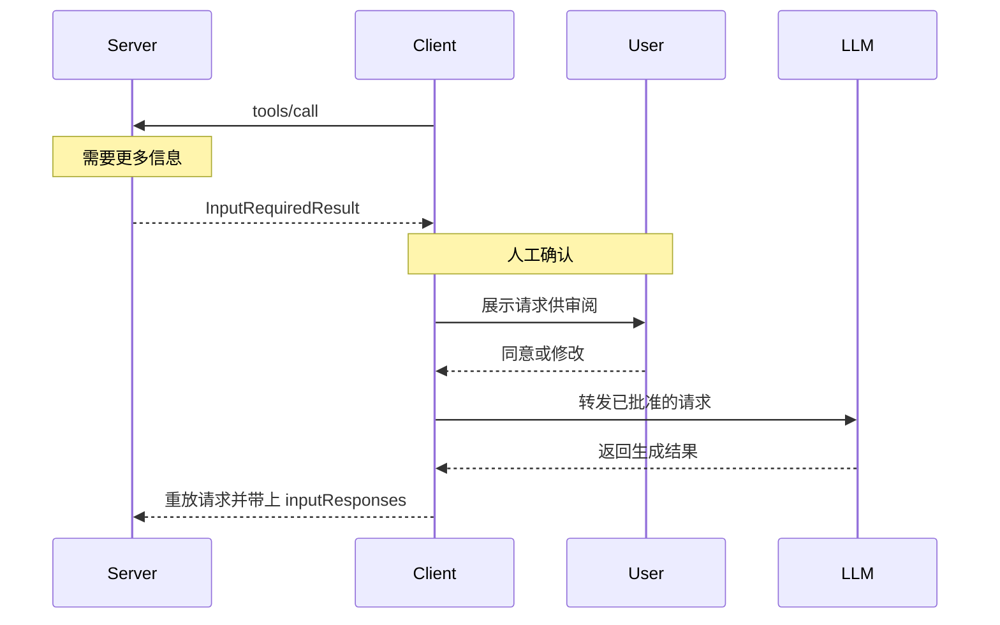
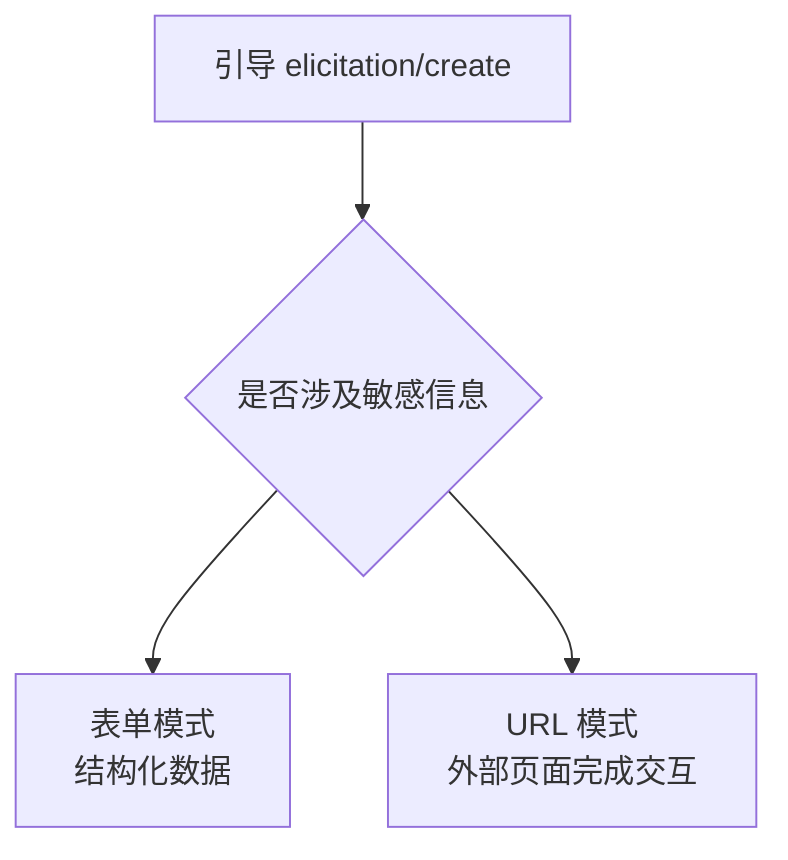

MCP 的协议消息默认是「客户端请求、服务端响应」。但有几类事情只有客户端能做：向用户询问信息、代服务端调用大模型、告诉服务端自己能访问哪些本地文件。这三类能力由客户端**提供给服务端**，方向上与工具调用相反。

## 一次看懂三类能力

| 能力 | 解决什么 | 能力声明 | 当前状态 |
| --- | --- | --- | --- |
| 引导 Elicitation | 向用户索取信息或引导用户去某个 URL 完成交互 | `elicitation` | 推荐使用 |
| 采样 Sampling | 服务端借用客户端背后的大模型完成一次生成 | `sampling`（工具用需加 `sampling.tools`） | 已弃用（`2026-07-28` 起） |
| 根目录 Roots | 告知服务端客户端愿意暴露哪些本地目录/文件 | `roots` | 已弃用（`2026-07-28` 起） |

三类能力都**必须由客户端在每次请求的元数据里显式声明**，服务端不得对未声明该能力的客户端发起调用。客户端能力与协议版本、客户端身份一起随请求元数据传送，这是无握手设计的一部分。

## 服务端如何调用这三类能力

服务端不能再主动向客户端发消息，只能在同一轮请求里返回「需要更多输入」，由客户端补上回答后**重放**原请求。这个模式叫多轮往返（MRTR），也是这三类能力唯一的到达路径。下图以采样为例，展示一次带回环的调用。

该看什么：服务端不是「等待」一次异步回包，而是在原请求的响应里发起子请求（`InputRequiredResult`），客户端把结果放回 `inputResponses` 重试同一请求。理解这条路径，就理解了这三类能力在无握手协议下如何仍然可用。代价是服务端需要重放请求，且用户拒绝时无需再补一条错误响应，服务端本就不在等待。

引导、采样、根目录全部走这条路径；服务端不得再用旧的「服务端主动发起请求」方式。

## 引导：向用户要信息

引导用于服务端在任务中途需要用户补充信息，或需要用户到浏览器里完成一段交互。它只用一条请求 `elicitation/create`，但有两种模式：

| 模式 | 用途 | 数据是否经过 MCP 客户端 |
| --- | --- | --- |
| 表单模式 Form | 让用户填写结构化数据，可选 JSON Schema 约束 | 是 |
| URL 模式 Url | 让用户到外部页面完成交互（如 OAuth 授权） | 否，只传 URL |

关键约束：服务端**不得**用表单模式收集密码、API 密钥、访问令牌、支付凭证等敏感信息；这些场景**必须**改用 URL 模式，让敏感数据在 MCP 链路之外流转。一般的联系方式/个人信息（姓名、邮箱、用户名等）不在这一禁令范围内。

用户对一次引导可以接受、拒绝或取消，服务端据此决定后续流程。

该看什么：模式选择不是风格偏好，而是安全要求。凡是凭证类信息，一律走 URL 模式。

## 采样：借用客户端的大模型

采样让服务端在自身没有模型密钥的前提下，借用客户端背后的大模型完成一次生成，用来实现「嵌套在服务端功能里的模型调用」。

采样已在该版本被标记为**弃用**：现有实现对新的功能**不应**再采用采样，而**应**改为直接集成各模型提供商的 API；该能力至少保留十二个月才会进入可移除阶段。

采样的能力声明分三层：基础采样用 `sampling`；需要让模型调用工具时，还须声明 `sampling.tools`；旧的上下文注入用 `sampling.context`，也已弃用。

服务端在请求里可以提供以下控制项：

| 字段 | 作用 | 客户端能否改 |
| --- | --- | --- |
| `messages` | 对话消息列表（角色仅 user/assistant） | 否 |
| `tools` 与 `toolChoice` | 本次采样可用的工具及选择策略 | 否 |
| `modelPreferences` | 抽象偏好：成本/速度/智能三项优先级加模型名提示 | 自行选择最终模型 |
| `systemPrompt` | 建议的系统提示词 | 可修改或忽略 |
| `includeContext` | 是否附加上下文（旧值已弃用） | 可修改或忽略 |
| `temperature` / `stopSequences` / `metadata` | 生成微调参数 | 可修改或忽略 |
| `maxTokens` | 最大生成量 | **必须**遵守 |

模型选择用「能力优先级 + 模型名提示」的抽象方式表达，因为服务端与客户端可能对接不同厂商：服务端给出成本、速度、智能三个 0 到 1 的优先级，再给出可作子串匹配的模型名提示；提示仅作建议，最终由客户端决定，必要时映射到其他厂商的等价模型。

启用工具后会是多轮循环：模型请求调用工具，服务端执行后把结果追加进新一次采样请求，如此往复，服务端通常会设迭代上限，并在最后一轮强制不出工具以拿到最终答案。为此协议对消息内容有硬性约束：

- 含工具结果的消息**只能**包含工具结果，不得与文本、图像、音频混合；
- 每条含工具调用的助手消息，**必须**紧跟一条只含工具结果的用户消息，且每个调用都要有对应结果。

采样的结果除内容和模型名外，还带一个停止原因，取值为 `endTurn`、`stopSequence`、`maxTokens`、`toolUse` 之一（实现也可自定义）。

## 根目录：告知可见的文件范围

根目录让客户端在连接时告知服务端自己愿意暴露哪些本地目录或文件。它同样已在 `2026-07-28` 起被标记弃用：新实现**不应**采用，**应**改为通过工具参数、资源 URI 或服务端配置来传递目录与文件。

需要特别澄清一点：根目录只是**信息性提示，不是访问控制**。协议不强制服务端只在根目录范围内操作；它可以用于告知服务端去哪里找内容，但不能当作安全边界。

## 注意

- 采样的弃用（`2026-07-28`）与根目录的弃用同属一次变更；`includeContext` 的旧取值也被单独标记为弃用，最晚随采样整体移除。
- 引导不受上述弃用影响，是三者中当前唯一被推荐的用法。
- 采样的安全要点包括：客户端应提供用户批准与限流，双方都应校验消息内容并处理敏感数据；使用工具时，服务端必须保证每个工具调用都有匹配的结果、且用户消息只含工具结果。

> 依据：`docs/specification/2026-07-28/client/elicitation.mdx:17-49`、`docs/specification/2026-07-28/client/elicitation.mdx:83-321`、`docs/specification/2026-07-28/client/elicitation.mdx:322-384`、`docs/specification/2026-07-28/client/elicitation.mdx:385-468`、`docs/specification/2026-07-28/client/elicitation.mdx:469-592`、`docs/specification/2026-07-28/client/elicitation.mdx:593-671`、`docs/specification/2026-07-28/client/sampling.mdx:26-110`、`docs/specification/2026-07-28/client/sampling.mdx:111-277`、`docs/specification/2026-07-28/client/sampling.mdx:278-375`、`docs/specification/2026-07-28/client/sampling.mdx:376-489`、`docs/specification/2026-07-28/client/sampling.mdx:490-518`、`docs/specification/2026-07-28/client/sampling.mdx:519-661`、`docs/specification/2026-07-28/client/sampling.mdx:662-678`、`docs/specification/2026-07-28/client/roots.mdx:26-52`、`docs/specification/2026-07-28/client/roots.mdx:53-93`、`docs/specification/2026-07-28/client/roots.mdx:94-159`、`docs/specification/2026-07-28/changelog.mdx:1-121`、`docs/specification/2026-07-28/deprecated.mdx:1-41`
