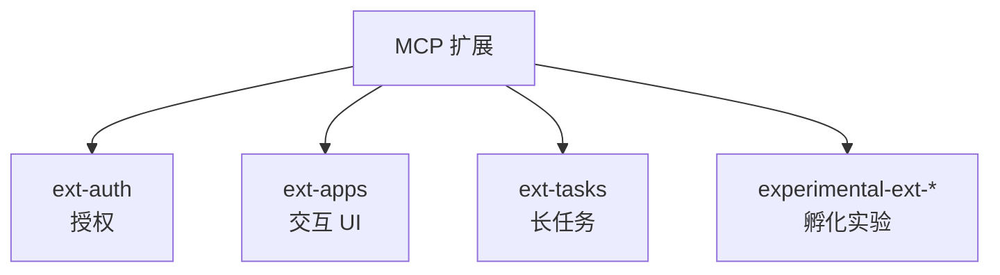
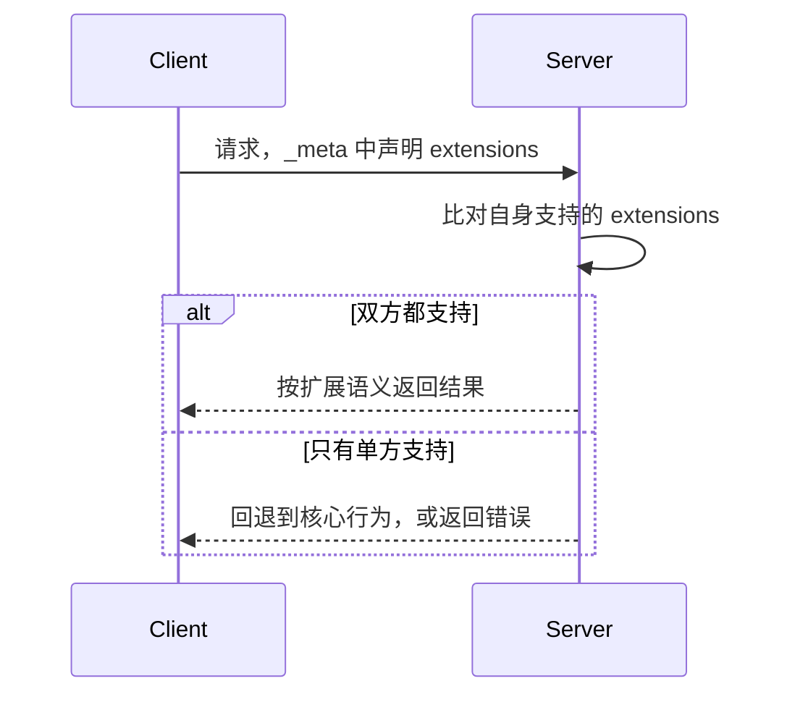

MCP 核心规范刻意保持精简：它只定义客户端与服务器之间最小的一套交互。真正让生态活起来的是核心之外的三条线——**扩展**（协议的可选加装件）、**MCP Registry**（服务器怎么被找到），以及 **社区工作组**（新东西从哪来）。

## 扩展：协议的可选加装件

扩展是对规范的**可选补充**，用来承载超出核心协议的能力。它们可以是模块化的（比如某种授权机制）、垂直领域的（比如某个行业的专用逻辑），也可以是实验性的（正在孵化、未来可能进入核心的新特性）。

每个扩展用唯一的**扩展标识符**命名，格式为 `{vendor-prefix}/{extension-name}`，例如 `io.modelcontextprotocol/oauth-client-credentials`。标识符的规则与 `_meta` 的键一致，但**必须带前缀**：官方扩展统一用 `io.modelcontextprotocol`，第三方则用自己拥有的反向域名，以避免冲突——拥有 `example.com` 的公司用 `com.example/`。

官方扩展都放在 GitHub 的 `modelcontextprotocol` 组织下、以 `ext-` 为前缀的仓库里。目前有三大家族：

| 仓库 | 扩展 | 用途 |
| --- | --- | --- |
| `ext-auth` | OAuth Client Credentials | 机器对机器的 OAuth 2.0 客户端凭证流程 |
| `ext-auth` | Enterprise-Managed Authorization | 需要集中访问控制的企业环境框架 |
| `ext-apps` | MCP Apps | 让服务器在对话里内联展示交互式 UI（图表、表单、播放器） |
| `ext-tasks` | MCP Tasks | 长任务的异步执行，支持轮询、中途输入与持久句柄 |

## 实验性扩展与「毕业」

在正式写 SEP 之前，工作组和兴趣组可以先用**实验性扩展**来试水。这类仓库以 `experimental-ext-` 为前缀（如 `experimental-ext-interceptors`），并遵守几条底线：必须挂靠在某个工作组或兴趣组下；仓库与已发布的包要清楚标明实验状态；Core Maintainer 保留归档或删除这些仓库的权力。

实验性扩展要升级为官方扩展，走的是标准 SEP 流程里的 **Extensions Track**。孵化阶段做出来的参考实现正好可以在 SEP 评审时用来证明可行性。

## 一个扩展是怎么诞生的

官方扩展的生命周期完全基于 SEP，由 SEP-2133 定义，分五步：

1. **提案**：在主仓库按标准 SEP 指南提交一份 **Extensions Track** 类型的 SEP。
2. **实现**：在某个官方 SDK 里做出至少一个参考实现——这是 SEP 能被评审的前提。
3. **评审**：Core Maintainer 评审并拥有最终决定权。
4. **发布**：通过后，向扩展仓库提交 PR 把它加进去。
5. **采用**：此后其他客户端、服务器、SDK 都可以实现它。

配套要求与边界：

- 扩展规范必须使用 RFC 2119 的关键词（MUST、SHOULD、MAY），并且必须关联一个工作组或兴趣组。
- SDK **可以**实现扩展，但这不是协议一致性（protocol conformance）的必需项，由各 SDK 维护者自主决定；若实现，应在文档中列出支持了哪些扩展。
- 扩展**默认关闭**，必须由开发者显式启用。
- 扩展独立于核心协议演进，其更新由扩展仓库维护者管理，无需 Core Maintainer 评审。改动时优先用能力标志或扩展设置对象里的版本号，而不是新建标识符；若不得不做破坏性改动（删改字段、改类型、改语义、加必填字段），才起一个新标识符，例如 `io.modelcontextprotocol/my-extension-v2`。

## 扩展如何协商与降级

双方在各自的能力声明里的 `extensions` 字段中广播对扩展的支持：客户端在每次请求的 `_meta["io.modelcontextprotocol/clientCapabilities"]` 里声明，服务器则在 `server/discover` 的响应里声明。每个扩展自己规定其设置对象的 schema，空对象表示没有设置。

该看什么：最后那个分支是扩展设计的重点。当一方支持而另一方不支持时，支持方要么**优雅回退**到核心协议行为，要么在扩展是强制要求时**直接拒绝**并返回恰当错误。是否回退、怎么回退由每个扩展自行规定，好的做法会把它写进文档——比如一个提供 UI 增强的工具，对不支持 UI 扩展的客户端仍应返回有意义的文本内容；而一个强制要求特定授权扩展的服务器，则可以拒绝不支持它的连接。

## MCP Registry：服务器的官方黄页

包注册中心（npm、PyPI、Docker Hub）托管的是代码和二进制，而 **MCP Registry** 托管的是**指向那些包的元数据**。它是公开 MCP 服务器的官方集中式元数据中心，由 Anthropic、GitHub、PulseMCP、Microsoft 等生态主要贡献者支持。目前仍处于 **preview** 阶段，在正式可用前可能出现破坏性改动或数据重置。

它提供四件事：给服务器作者一个统一发布元数据的地方、基于 DNS 验证的命名空间管理、供客户端与聚合器发现服务器的 REST API，以及标准化的安装与配置信息。服务器元数据存成统一的 `server.json`，包含唯一名称（如 `io.github.user/server-name`）、服务器位置（npm 包名或远端 URL）、执行方式（命令行参数、环境变量）等发现数据。

| 关系 | 说明 |
| --- | --- |
| 与包注册中心 | 前者托管代码，Registry 只托管指向它们的元数据 |
| 与服务器开发者 | 同时支持开源与闭源，但安装方式须公开可达；**不支持私有服务器** |
| 与下游聚合器 | Registry 面向聚合器（如市场页面）消费，元数据刻意保持中立，聚合器再叠加评分与策展 |
| 与宿主应用 | 宿主应用不直接消费 Registry，而应消费符合其 OpenAPI 规范的本地/下游注册中心 API |
| 与自建注册中心 | 官方代码库**不设计用于自托管**，选择 fork 的团队需自行维护 |

信任与安全上，Registry 用**反向 DNS 命名空间**把服务器绑定到经过验证的 GitHub 账号或域名（如 `io.github.username/server`、`com.example/server`），确保只有合法拥有者才能在对应命名空间下发布。安全扫描则**委托**给底层包注册中心和下游聚合器，Registry 自己只专注于命名空间认证与元数据托管。防滥用方面有命名空间认证、字段字符数限制与正则校验，以及人工下架三道措施。

## 社区怎么组织：工作组与兴趣组

新功能能长出来，靠的是社区里的两种协作形式。二者的分工很清晰：

| 维度 | 兴趣组 IG | 工作组 WG |
| --- | --- | --- |
| 目的 | 识别并讨论问题 | 构建具体方案 |
| 产出 | 问题陈述、用例、建议 | SEP、实现、代码 |
| 存续 | 只要话题相关就持续 | 直到交付物完成 |
| 负责人 | Facilitator | Lead |
| 决策 | 大致共识，无约束力 | 有约束力（惰性共识 → 投票 → 上报） |

典型的路径是：在兴趣组里讨论问题 → 确认值得解决 → 组建或加入工作组来造方案 → 提交 SEP → 实现。不过这些都不是硬性顺序：IG 不是加入 WG 的前置条件，提交 SEP 也不需要先加入 WG。任何组都必须有章程，并且组与其负责人要有**至少两名 Core Maintainer 或一名 Lead Maintainer** 的联署支持。

工作组的决策按三步递进，前一步失败才进入下一步：

- **惰性共识**（默认）：提前公布截止时间（小事至少 5 天、大事 10 天），沉默即同意；任何 WG Member 都可带书面异议阻止，阻止时必须给出替代方案或明确的解决标准。
- **正式投票**（共识被阻止时）：法定人数为活跃 WG Member 的 50%，常规事项简单多数、范围变更需三分之二多数。
- **上报**（投票也解决不了时）：由 Lead 带着决策记录、备选方案与分歧点上报 Core Maintainer 组。

范围争议、权限争议、跨组冲突、行为准则问题、成员资格争议这几类不适合组内解决，应直接上报；Core Maintainer 会指定一名**与当事各方无组织关联**的成员来处理，并承诺 5 个工作日内给出初次回应。

> 依据：`docs/extensions/overview.mdx:8-58`、`docs/extensions/overview.mdx:60-113`、`docs/extensions/overview.mdx:114-185`、`docs/registry/about.mdx:6-93`、`docs/community/working-interest-groups.mdx:8-36`、`docs/community/working-interest-groups.mdx:75-138`、`docs/community/working-interest-groups.mdx:140-186`、`docs/community/working-interest-groups.mdx:226-258`
