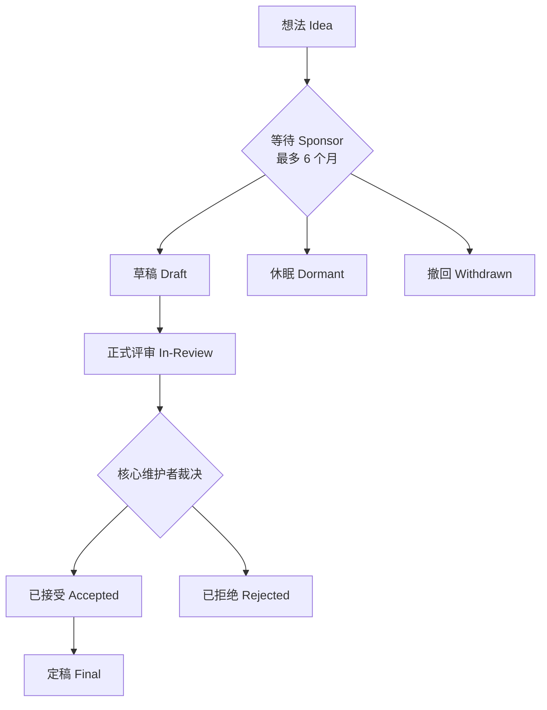

MCP 不是某家公司私有的一份协议，而是一个放在 Linux Foundation 下、由多家公司共同参与的开源标准。协议往哪个方向走、某个功能何时被废弃、多久之后才能删掉，都有一套公开的规则。这一页讲两件事：**谁在做决定、怎么改协议**，以及**一个功能从上线到退役要走完哪些状态**。

## 谁在维护这套协议

项目采用类似 Python、PyTorch 的分层结构。所有维护者角色都是发给**个人**而不是公司的，没有任何席位预留给特定企业。

| 角色 | 负责范围 | 权限边界 |
| --- | --- | --- |
| Lead Maintainer | 最终决策人（俗称 BDFL） | 可否决 Core Maintainer 或 Maintainer 的任何决定 |
| Core Maintainer | 把握项目整体方向 | 多数票可否决 Maintainer 决定，任命或移除 Maintainer |
| Maintainer | 某个具体领域，如 SDK、文档、工作组 | 领域内独立决策，必要时上报 Core Maintainer |
| Contributor | 提 issue、提交 PR、参与讨论 | 与外部贡献者走同一套流程 |

三类 Maintainer 合称 **MCP Steering Group**。Lead Maintainer 也属于 Core Maintainer 群体，并且被要求公开说明自己的判断理由。除这些角色外，Contributor Ladder 还定义了不属于 Steering Group 的 Member 和 Community Moderator。

## 决策怎么做出

- Core Maintainer 组每两周开会，讨论并投票提案；较小的提案可以直接在共享 Discord 服务器上讨论投票。
- Lead、Core、Maintainer 三层成员被鼓励每三到六个月线下碰一次面。
- 维护者**不直接改仓库**，而是和外部贡献者一样走 pull request 流程，这样决策意图有迹可循、也留出讨论空间。

协作围绕两种组织形式展开：**Interest Group** 负责发现并描述 MCP 应该解决的问题，**Working Group** 负责产出具体交付物，比如 SEP 或参考实现。

## 想改协议，就写一份 SEP

SEP 是 Specification Enhancement Proposal（规范增强提案）。它是提出重大新功能、收集社区意见、记录设计决策的**主要机制**，平时以 markdown 文件存放在仓库的 `seps/` 目录里，其修订历史就是这项功能提案的历史记录。`seps/README.md` 只有三行，指向官网的 SEP 指南。

并非所有改动都需要 SEP。新功能、破坏性改动、治理或流程变更、有争议的复杂话题才需要走 SEP；bug 修复、错别字、文档澄清、给已有功能补示例则直接提普通 PR。

SEP 分四类：

| 类型 | 用途 |
| --- | --- |
| Standards Track | 描述新功能或实现，或核心规范之外支持的一种互操作标准 |
| Informational | 描述设计议题或向社区提供指南，但不提出新功能 |
| Process | 描述 MCP 相关流程或修改流程，本文档本身就属于这一类 |
| Extensions Track | 描述协议扩展，评审与接受流程同 Standards Track |

一份标准 SEP 从想法到定稿要经过这些状态：

该看什么：真正的瓶颈在 `Sponsor` 这一步。一份 SEP 如果六个月里找不到 Sponsor，就会进入 `Dormant`（休眠）——注意休眠不等于拒绝，只要之后找到 Sponsor 就能复活；而 `Withdrawn` 才是作者主动撤回。被拒绝也不是终点，可以修改后重投、换一种思路提竞争提案，或者等社区需求变化后再来。

只有被接受之后才进入实现阶段：先完成参考实现，涉及可观测协议行为的 Standards Track SEP 还必须合并一份一致性测试（conformance test），两者齐备并合入规范后才算 `Final`。

## 一句话看懂 SEP 的每个状态

| 状态 | 含义 |
| --- | --- |
| `draft` | 已有 Sponsor，正在非正式评审 |
| `in-review` | 可进入 Core Maintainer 正式评审 |
| `accepted` | 已通过，等待实现与一致性测试 |
| `rejected` | 被 Core Maintainer 拒绝 |
| `withdrawn` | 作者撤回 |
| `final` | 实现与一致性测试均已完成 |
| `superseded` | 被更新的 SEP 取代 |
| `dormant` | 六个月内没找到 Sponsor，可被唤醒 |

状态由 **Sponsor 负责更新**，作者应通过 Sponsor 变更状态，而不是自己改。markdown 文件里的状态字段是权威记录，PR 上的标签同步维护，便于筛选检索。

## 功能本身也有生命周期

上面讲的是「提案」的流程，下面讲「功能」的流程。两者是分开的：一份 SEP 可以让某个功能进入废弃状态，而功能自身则按 Active → Deprecated → Removed 这套生命周期走。规范文档自己的版本线（Draft / Current / Final）又是另一回事。

| 状态 | 含义 | 实现者该怎么做 |
| --- | --- | --- |
| Active | 属于当前 Current 版本 | 按规范要求实现 |
| Deprecated | 仍保留在规范里，但已排期移除，且有迁移路径 | 新实现不应采用；现有实现应在最早移除日之前完成迁移 |
| Removed | 已从 `draft` 删除，下个 Current 版本不再包含 | 针对下个 Current 版本的实现不得再依赖它 |

这套生命周期由 SEP-2596 确立。几个关键约束：

- **废弃必须走 SEP**。提案要指明功能名称、给出废弃理由、写清迁移路径，并设定一个**最短废弃窗口**——至少十二个月，从功能首次被标为 Deprecated 的那个版本发布时算起，而不是从 SEP 定稿时算起。
- **移除是 Core Maintainer 在发版准备时的决定**。窗口跑完后功能只是「最早可移除」，实际删不删、何时删由维护者定，也可能长期挂着不删。
- **提前移除**只在功能构成活跃安全风险（有公开安全公告或已被实际利用、且无法就地缓解）时才允许，且无论如何仍要保证从废弃到最早移除之间至少九十天。
- 规范移除不等于 SDK 必须跟着删，SDK 何时下线由它自己的版本支持策略决定。

## 已经被标记为废弃的功能

仓库里有一页专门的注册表，集中列出所有处于 Deprecated 或 Removed 状态的功能，回答「什么正在退场、截止到什么时候」，省得实现者去翻各版本的 changelog。它是从各功能的废弃说明和 changelog 派生出来的视图，规范性记录仍以那些原文为准。

| 功能 | 废弃于 | 迁移路径 |
| --- | --- | --- |
| Roots | `2026-07-28` | 改为通过工具参数、资源 URI 或服务器配置传入目录/文件 |
| Sampling | `2026-07-28` | 直接对接 LLM 提供方 API |
| Logging | `2026-07-28` | stdio 传输写 `stderr`；可观测性改用 OpenTelemetry |
| Dynamic Client Registration | `2026-07-28` | 改用 Client ID Metadata Documents |
| HTTP+SSE 传输 | `2025-03-26` | 改用 Streamable HTTP |

前四项的最早可移除时间都是「2027-07-28 当日或之后发布的第一个版本」。截至目前，**还没有任何功能真正被移除**。

## 路线图：当前的重点方向

路线图由社区共同书写，明确标注「这些想法不是承诺」，最后更新于 2026-03-05。落在重点方向内的 SEP 会得到加快评审，方向之外也不是自动拒绝，只是周期更长、门槛更高。

| 重点方向 | 想达成的目标 |
| --- | --- |
| 传输演进与可扩展性 | 让 Streamable HTTP 能无状态地横向扩展、在负载均衡后正确工作；定义可恢复的会话模型；推出 MCP Server Cards |
| Agent 通信 | 补齐 Tasks 扩展的重试语义与结果过期策略 |
| 治理成熟 | 定义 Contributor Ladder、工作组委派模型、统一的 charter 模板 |
| 企业就绪 | 审计与可观测性、企业托管认证、网关/代理模式、配置可移植性 |

此外还有一些「地平线之外」的方向：触发器与事件驱动更新、结果类型改进（流式结果与引用式结果）、更细粒度的安全与授权、以及扩展生态的成熟化。这些有社区和 Core Maintainer 的兴趣，但优先级更靠后。

> 依据：`docs/community/governance.mdx:8-18`、`docs/community/governance.mdx:20-61`、`docs/community/governance.mdx:68-128`、`docs/community/sep-guidelines.mdx:6-115`、`docs/community/sep-guidelines.mdx:118-241`、`docs/community/feature-lifecycle.mdx:6-153`、`docs/specification/2026-07-28/deprecated.mdx:7-41`、`docs/development/roadmap.mdx:6-97`
