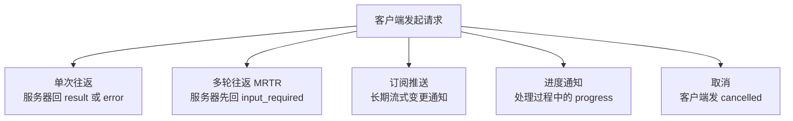
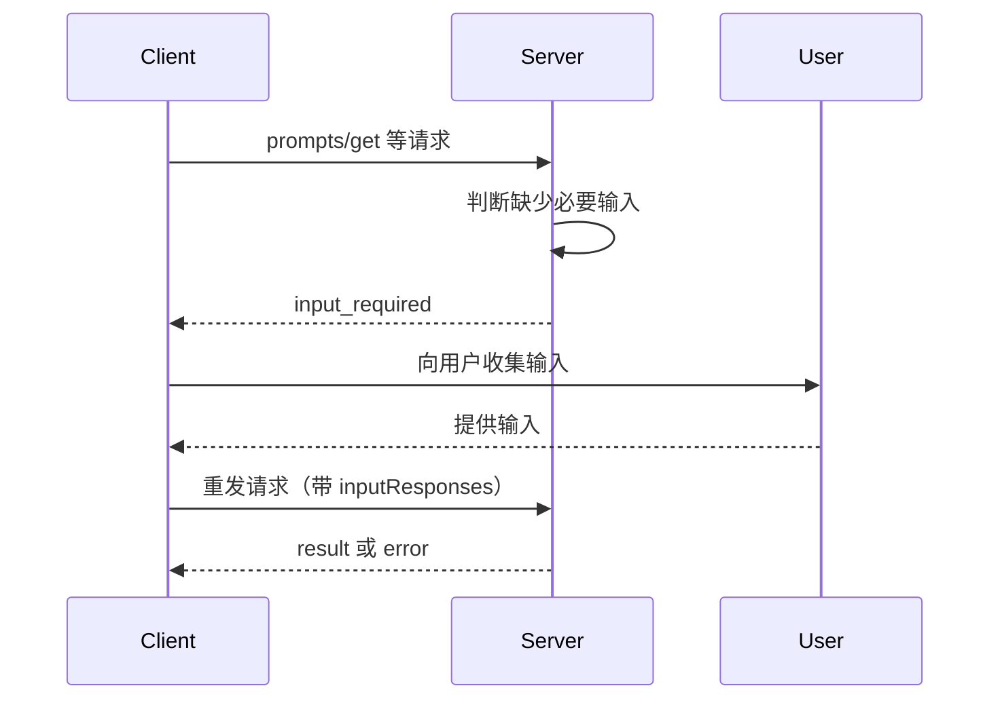
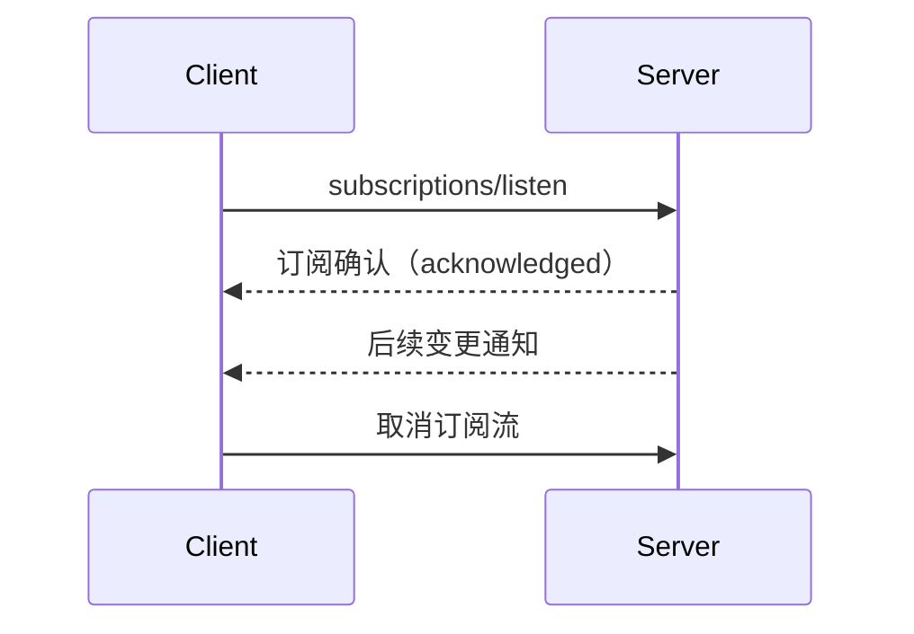

MCP 的每一次交互都由客户端发起。规范把「请求、响应、通知如何组合成一次完整交互」抽象为**消息模式**，它独立于传输层——同一套模式在 stdio 和 Streamable HTTP 上都能用，只是载体不同。`2026-07-28` 引入了多轮往返（MRTR），并把「服务器主动发起请求」这条路彻底去掉，是整个版本里影响面最大的改动之一。

## 五种模式一览

无论哪种模式，客户端都负责发起，服务器都以「响应 + 可选的通知」作答；服务器**不得**主动发起 JSON-RPC 请求，客户端也不发送响应。

| 模式 | 触发方 | 典型用途 | 关键约束 |
|---|---|---|---|
| 单次往返 | 客户端请求 | 绝大多数请求 | 一条请求对应一条响应（`result` 或 `error`） |
| 多轮往返 MRTR | 客户端请求，服务器中途索取输入 | 采样、引导、列根目录 | 服务器回 `input_required`，客户端补全后重发 |
| 订阅推送 | 客户端 `subscriptions/listen` | 列表变化、资源更新 | 只推客户端显式订阅的类型 |
| 进度通知 | 客户端提供 `progressToken` | 长任务反馈 | `progress` 每次必须递增 |
| 取消 | 客户端发 `notifications/cancelled` | 终止已发出的请求 | 越界取消可被忽略 |

该看什么：五种模式共享同一条基线——**交互由客户端开启**。右侧四类都不是独立通道，而是叠加在同一条请求上的可选行为。

## 多轮往返（MRTR）

MRTR 是本版新增的模式，用来让服务器在**处理客户端请求的过程中**反过来向客户端索取额外输入。它完全取代了旧版「服务器主动发起请求」（如 `roots/list`、`sampling/createMessage`、`elicitation/create`），属于破坏性变更。

流程是：客户端发出初始请求 → 服务器判断缺少必要输入，回复一个 `resultType` 为 `input_required` 的 `InputRequiredResult` → 客户端收集输入后**带着原始请求重发**一条新请求 → 服务器给出最终 `result` 或 `error`。整个过程不需要共享状态，也不必假设负载均衡把两条请求送到同一个实例。

只有三类客户端请求可以使用 MRTR：

| 客户端请求 | 能否使用 MRTR |
|---|---|
| `prompts/get` | 可以 |
| `resources/read` | 可以 |
| `tools/call` | 可以 |
| 其他任何请求 | 不可以 |

`InputRequiredResult` 里有两个关键字段：`inputRequests` 是「服务器分配的键 → 具体请求对象」的映射（值是引导、采样或列根目录请求）；`requestState` 是一段**服务器自用、对客户端不透明**的状态串，用来让重发时能接上上下文。两者至少要出现一个，且服务器**不得**为客户端未声明过的能力发 `inputRequests`。

服务器**可以**在同一个请求上多次回复 `input_required`。收到应答后，服务器应当校验这些输入；若校验失败或仍然缺信息，应当再回一个新的 `input_required`，而把真正的协议级错误用 JSON-RPC 错误返回。

客户端这边有几条硬约束：重发前必须先构造好输入；必须**原样回传** `requestState`，不得解析或修改它；重发的请求必须用一个**不同于最初**的 JSON-RPC id。

值得单独提醒的是 `requestState` 的安全面：它要经过客户端再回到服务器，因此服务器**必须**把它当作不可信输入校验；如果它会影响鉴权、资源访问或业务逻辑，就**必须**加完整性保护（如 HMAC 或 AEAD）。建议在其中带上已认证的调用主体、有效期和原始请求 id；涉及敏感操作时还**必须**在服务器侧强制一次性使用。

## 订阅与变更通知（subscriptions/listen）

`subscriptions/listen` 开启一条**服务器到客户端的长连接流**，直到客户端取消为止，用来推送变更通知。它取代了旧版的 `resources/subscribe` RPC 和 HTTP GET 端点。

客户端在请求里用一个过滤器声明它关心哪些变更：

| 过滤字段 | 订阅的变更 |
|---|---|
| `toolsListChanged` | 工具列表变化 |
| `promptsListChanged` | 提示词列表变化 |
| `resourcesListChanged` | 资源列表变化 |
| `resourceSubscriptions` | 指定 URI 的资源更新（字符串数组） |

服务器**不得**推送任何未被显式订阅的通知类型。

一条重要的时序规则：服务器**必须**把 `notifications/subscriptions/acknowledged` 作为**第一条**消息发出，带上分配好的 `subscriptionId`；在此之前**不得**发送任何通知，而确认里反映的订阅集就是双方达成一致的子集。此后每条通知都在 `_meta` 里带上该 `subscriptionId`，客户端据此区分来自不同订阅流的消息。

正常收尾时，服务器**应当**在关闭前先返回一个空结果。在 stdio 上，如果连接中断后重连，客户端**必须**重新发送 `subscriptions/listen`。

## 进度通知

进度是可选机制。客户端在请求的 `_meta` 里放一个 `progressToken`（必须是字符串或整数，且在所有进行中的请求里唯一）来启用它。服务器**可以**在处理期间发 `notifications/progress`，携带同一个 token、当前的 `progress`，以及可选的 `total` 和给用户看的 `message`。

核心规则是：**每次通知的 `progress` 必须递增**，即使总量未知也一样；`progress` 和 `total` 都允许是浮点数。服务器**必须**只引用进行中操作的 token，应当跟踪这些 token、做发送限流，并在操作完成后停止发送。

## 取消

客户端要终止一条自己发出的请求时，**应当**发送 `notifications/cancelled`，带上目标 `requestId` 和可选的 `reason`。

服务器侧有一条专门的规则：当它要拆掉某条 `subscriptions/listen` 的流时，**必须**发送一条引用该订阅请求 id 的 `notifications/cancelled`；除此之外**不得**用它做别的用途。

取消的载体因传输而异：

| 传输 | 取消信号 |
|---|---|
| Streamable HTTP | 关闭 SSE 响应流即为取消；服务器**必须**把客户端断开视为取消，无需另发通知 |
| stdio | 客户端**必须**显式发送 `notifications/cancelled` |

双方都**应当**设置超时并在超时时取消；收到进度通知时**可以**重置超时计时。对于无效或超出范围的取消，**应当**直接忽略。

## 落地时要注意什么

- **服务器不能主动发起请求**。任何「服务器需要更多信息」的场景都必须走 MRTR，这是从旧版升级时最容易踩的坑。
- **`requestState` 按不可信数据处理**。它穿过客户端一圈才回来，完整性保护与一次性校验应在服务器侧完成。
- **订阅要先确认再推送**。`acknowledged` 是每条订阅流的第一个消息，客户端要等到它才能确定服务器实际同意了哪些通知。
- **进度靠 token 关联、取消靠 `requestId` 关联**，两者都要求实现能追踪进行中的操作。

> 依据：`docs/specification/2026-07-28/basic/patterns/index.mdx:7-85`、`docs/specification/2026-07-28/basic/patterns/mrtr.mdx:7-272`、`docs/specification/2026-07-28/basic/patterns/subscriptions.mdx:7-165`、`docs/specification/2026-07-28/basic/patterns/progress.mdx:7-90`、`docs/specification/2026-07-28/basic/patterns/cancellation.mdx:7-122`
