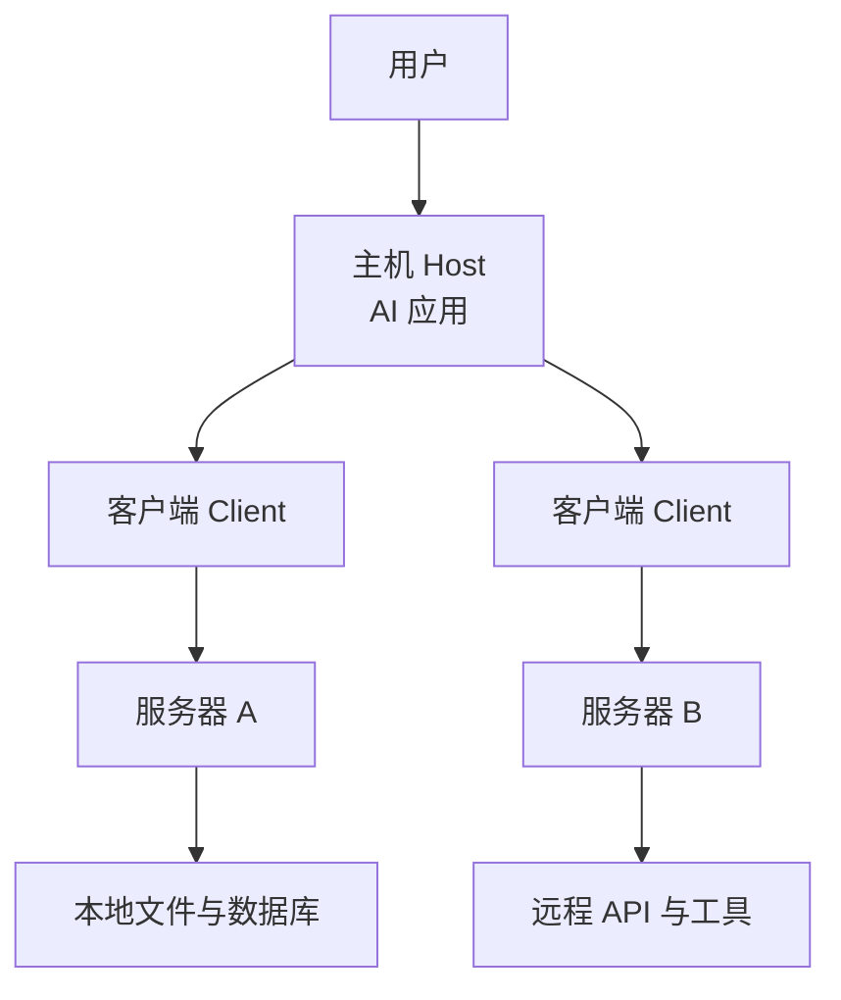

# 总览

这页回答四个问题：MCP 是什么、它替谁解决了什么麻烦、它一共提供哪些能力、以及它在整个 AI 应用生态里占据什么位置。读完这页，你应该能判断自己手上的场景是否需要 MCP，然后再决定要不要往后翻架构与协议细节。

## 一句话概括

MCP 是一套 **开放协议**，规定 AI 应用与「提供上下文和能力的服务」之间怎么对话。它把过去散落在各家插件里的接口约定，收敛成一份可被多语言实现的公共标准：**一次接入、处处复用**——服务器实现一次就能被所有 MCP 客户端调用，客户端接一次就能连上所有 MCP 服务器。

这句话里有两个关键角色需要区分清楚：**主机（Host）** 是承载模型与用户交互的应用本身，**客户端（Client）** 是主机内部用来连接某个服务器的连接器。一个主机可以同时建多个客户端，去连多个服务器。

## 它解决什么问题

在 MCP 出现之前，想让模型用上外部数据和工具，每个应用都要为每个数据源或工具写一套自己的对接代码，接 N 个应用就要写 N 遍。MCP 参照的是 **Language Server Protocol** 的思路：LSP 把「编辑器支持某门语言」标准化，让一门语言的工具能用在所有编辑器里；MCP 做的是同一件事，只不过对象换成了「AI 应用接入外部上下文与工具」。

官方给的类比是 **USB-C 接口**：就像 USB-C 用统一接口连接各种外设，MCP 用统一协议连接 AI 应用与外部系统。对使用者的直接收益随角色不同：

| 角色 | MCP 带来的收益 |
|------|----------------|
| 开发者 | 构建或对接 AI 应用/智能体时，减少开发时间与复杂度 |
| AI 应用 / 智能体 | 获得一个数据源、工具与应用的生态，增强能力、改善终端体验 |
| 终端用户 | 得到更能干的 AI 应用，能访问你的数据并在必要时替你执行操作 |

典型场景包括：让智能体访问你的日历与笔记充当更个性化的助手；让编码助手用设计稿直接生成完整网页应用；让企业聊天机器人连接内部多个数据库；让模型生成 3D 设计并驱动打印机输出。

## 核心能力

MCP 的能力分层很清晰：底层是基础协议，上面是服务器提供的特性、客户端提供的特性、以及一批公共工具，最外层是可选的扩展。服务器与客户端各有自己的「原语」，并且**任何一项能力都必须显式声明才算支持**。

| 能力 | 由谁提供 | 一句话职责 |
|------|----------|------------|
| 资源（Resources） | 服务器 | 供用户或模型使用的上下文与数据 |
| 提示（Prompts） | 服务器 | 给用户的模板化消息与工作流 |
| 工具（Tools） | 服务器 | 供模型执行的函数 |
| 引导（Elicitation） | 客户端 | 服务器发起、向用户索取补充信息 |
| 配置、进度、取消、错误上报 | 协议公共 | 支撑请求生命周期的通用设施 |
| 扩展（Extensions） | 双方协商 | 核心之外的模块化、专门或实验性能力 |

扩展本身也分几类，官方已列出一些代表：**Tasks** 负责长时操作的异步执行（轮询、飞行中输入、持久句柄）；**Skills over MCP** 面向智能体工作流提供结构化指令；**MCP Apps** 让图表、表单、视频等交互 UI 直接渲染在对话里。所有扩展都是**选择性加入**，且必须客户端与服务器双方都显式支持、在初始化时协商。

## 消息模型与角色关系

协议用 **JSON-RPC 2.0** 作为消息格式，采用**无状态、自包含**的请求，并把能力协商下沉到**每个请求**里。下图给出最简的角色关系：用户通过主机操作，主机的多个客户端分别连向不同服务器，服务器再去访问外部系统。

看这张图要抓住一点：**服务器不直接认识用户，也不直接认识主机**，它只认识某个客户端，所有交互都是「客户端 ↔ 服务器」这一条边上的 JSON-RPC 消息。用户同意与数据外发由主机在客户端之上把关，协议本身不做强约束。

## 技术栈与生态位

理解 MCP 时要分清**协议**与**实现**。本仓库是协议规范与文档仓库，持有按日期分版的协议正文、TypeScript 定义的 Schema、由 Schema 生成的 JSON Schema 与文档产物，以及 SEP、治理文件和脚本；可以运行的 SDK 在各语言官方仓库，本仓库里没有可启动的客户端或服务器。

生态侧，MCP 已被广泛支持：Claude、ChatGPT 等 AI 助手，以及 Visual Studio Code、Cursor、MCPJam 等开发工具都支持 MCP，使得「构建一次、处处集成」成为现实。

## 安全基调

MCP 打开了任意数据访问与代码执行的通路，因此规范把安全提到很高的位置，列出三条原则：**用户同意与控制**（用户必须明确同意并理解所有数据访问与操作，且始终掌握共享什么数据、执行什么动作）、**数据隐私**（主机在把用户数据暴露给服务器前必须获得明确同意，未经同意不得再次外传）、**工具安全**（工具本质是任意代码执行，其行为描述与注解在不可信来源下应视为不可信，调用任何工具前主机必须获得用户明确同意）。

需要强调的是，MCP **无法在协议层面强制**这些原则，只能规定实现者 **SHOULD**：构建健壮的同意与授权流程、写清安全影响文档、实施访问控制与数据保护、遵循安全最佳实践、在功能设计中考虑隐私。

## 现状与边界

- **已有正式路线图但只是方向而非承诺**。官方把优先领域分为传输演进与可扩展性、智能体通信、治理成熟度、企业就绪四块，并说明这些是「想法」而非承诺。
- **协议处于活跃演进中**。`2026-07-28` 是一次破坏性重置，移除了握手与协议级会话、新增必实现的 `server/discover`，并让多项能力进入弃用期；面向旧版本编写的实现需要兼容层。
- **扩展与注册表仍在预览**。官方服务器注册表处于 preview 阶段，可能出现破坏性变更或重置。

选型时请以本文档基线与 [现状与边界](README.md) 一节的硬事实为准，不要依据未发布的规划做长期依赖。

> 依据：`docs/specification/2026-07-28/index.mdx:7-46`、`docs/specification/2026-07-28/index.mdx:48-87`、`docs/specification/2026-07-28/index.mdx:89-125`、`docs/docs/2026-07-28/getting-started/intro.mdx:6-33`、`docs/development/roadmap.mdx:22-82`
