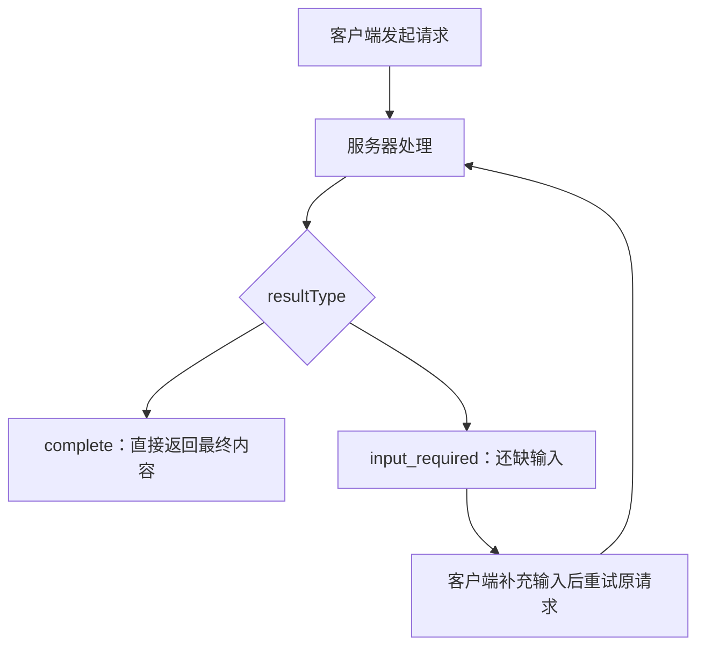

这页讲协议最底层的东西：消息长什么样、一次交互的几种基本形态、出错时怎么报、以及为什么这些消息必须「自带全部信息」。任何一版 MCP 实现都必须支持这一层。

## 消息建立在 JSON-RPC 2.0 之上

客户端与服务器之间的所有消息都遵循 JSON-RPC 2.0。在这套通用格式上，MCP 只引入了三种消息类型。

| 消息类型 | 方向 | 带 ID | 是否期待回复 | 用途 |
|---|---|---|---|---|
| 请求 Request | 客户端 → 服务器 | 必须 | 是 | 发起一次操作 |
| 响应 Response | 服务器 → 客户端 | 必须（回填请求 ID） | 否 | 返回结果或错误 |
| 通知 Notification | 双向 | 禁止 | 否 | 单向事件，接收方不得回复 |

两个和标准 JSON-RPC 不同的地方值得记住。第一，请求 ID **不得为 `null`**，而且同一个发送方在收到回复之前，不能复用在途请求的 ID。第二，通知绝对不能带 ID——一旦带上，接收方就无法判断该不该回复。

## 一次请求的结果有「类型」

MCP 的响应不是只有「成功」和「失败」两态。成功响应里有一个 `resultType` 字段，用来告诉客户端这份结果该怎么解析。这是 `2026-07-28` 版本引入的关键机制，也是多轮往返（MRTR）的基础。

该看什么：`input_required` 让服务器能「中途叫停」，但它不主动发请求，而是把「我需要什么」写进结果返回；客户端拿到后补齐输入、重试原请求。这条回路就是后面消息模式页要展开的 MRTR。为兼容更早的服务器（它们没有 `resultType` 字段），客户端必须把缺失的 `resultType` 当作 `complete` 处理。

| `resultType` | 含义 | 客户端动作 |
|---|---|---|
| `complete` | 请求已完成，结果里是最终内容 | 直接使用结果 |
| `input_required` | 请求未完成，需要更多信息 | 补齐输入后重试 |
| 其他 / 无法识别 | 由扩展引入的值 | 未识别一律视为无效 |

## 错误码怎么分区

通用 JSON-RPC 错误码（`-32700`、`-32600` 到 `-32603`）用于协议层面的失败。JSON-RPC 2.0 把 `-32000` 到 `-32099` 留给实现自定义错误，MCP 又把这段细分成三块，各自规则不同。

| 区间 | 归属 | 规则 |
|---|---|---|
| `-32000` ~ `-32019` | 历史遗留 | 早期实现用过；新代码不得在此分配，新实现最好完全不用；除 `-32002` 外，接收方不得假设其含义 |
| `-32020` ~ `-32099` | MCP 规范专用 | 只能由规范定义并在 schema 中登记；实现不得发出未定义的码，也不得改变已定义码的含义 |
| `-32768` ~ `-32000` 之外 | 应用自定义 | 本规范未定义的新错误码建议分配在这里 |

规范自身定义了三个错误码：头部不匹配（`-32020`）、缺少必需的客户端能力（`-32021`）、不支持的协议版本（`-32022`）。被替代的历史码会被永久保留、不再复用，例如资源未找到的 `-32002` 已由 `-32602` 取代，但客户端仍应接受较早服务器返回的 `-32002`。

## 无状态是硬性约束

MCP 被定义为**无状态协议**：处理一个请求所需的全部信息都在这条请求里。服务器处理每条请求都应当独立，不得从同一条连接或流上的先前请求推断出任何状态。

这不是建议，而是带 MUST 的规则：

- 服务器不得依赖同一连接上的先前请求来获得上下文（能力、协议版本、客户端身份等），这些元数据每条请求都会自带。
- 需要跨请求延续的状态（长任务、应用层句柄）必须由一个显式标识符承载，由客户端在每次请求里传回。
- 客户端不应把单次任务或会话当作 stdio 进程的生命周期边界。

一个直接推论：**一条打开的连接（比如一个 STDIO 进程）不等于一次会话**。客户端可以在同一个传输上交错发送互不相关的请求。像 `subscriptions/listen` 这样的长生命周期请求也不例外——它依然是「请求/响应」，只不过响应是一条持续输出的通知流，其状态归属于该请求本身，而不是底层连接。

## `_meta`：随请求携带的元数据

既然不能靠连接记状态，版本、能力、身份这些东西就都得挂在每条消息的 `_meta` 里。`_meta` 的键名由「可选前缀 + 名称」两段组成；任何第二段标签是 `modelcontextprotocol` 或 `mcp` 的前缀都被 MCP 预留（例如 `io.modelcontextprotocol/`）。规范预留了若干键：

| `_meta` 键 | 作用 |
|---|---|
| `io.modelcontextprotocol/protocolVersion` | 本条请求使用的协议版本 |
| `io.modelcontextprotocol/clientCapabilities` | 本条请求相关的客户端能力 |
| `io.modelcontextprotocol/clientInfo` / `serverInfo` | 客户端、服务器自报的名称与版本 |
| `progressToken` | 让该请求加入进度通知 |
| `io.modelcontextprotocol/logLevel` | 该请求期望的最低日志级别 |
| `io.modelcontextprotocol/subscriptionId` | 把通知关联回其来源订阅 |
| `traceparent` / `tracestate` / `baggage` | OpenTelemetry 链路上下文 |

其中 `protocolVersion` 与 `clientCapabilities` 是**每条请求必带**的字段。缺任一项即视为格式错误，服务器必须以 `-32602`（非法参数）拒绝；走 HTTP 时响应状态必须为 `400`。反过来，服务器不得依赖客户端没有声明过的能力：如果完成请求所需的能力不在 `clientCapabilities` 里，必须返回「缺少必需客户端能力」错误，并在数据里列出缺了哪些。

有一点容易被误用：`clientInfo` 与 `serverInfo` 都是发送方**自报**的，协议不做校验，仅用于展示、日志和排查。规范明确要求实现不要用它们改变行为，更不要拿来做安全判断。

## 用 JSON Schema 做校验

协议内部用 JSON Schema 做校验，规则上有一条重要默认值：schema 若未写 `$schema`，按 **JSON Schema 2020-12** 处理；实现至少要支持 2020-12，且应当声明自己还支持哪些方言。

安全上有两条硬约束。其一，实现**不得**自动解引用指向网络 URI 的 `$ref`；若提供可选的联网抓取，必须默认关闭，并配合主机白名单、超时、大小限制等措施。其二，组合关键字（`anyOf`、`oneOf`、`allOf`、`if`/`then`/`else`）和 `$defs` 虽然表达力强，但校验开销可能很大，实现应当设置深度上限、子 schema 数量上限或时间预算，避免恶意 schema 把校验器拖垮。

## 图标（icons）

服务器可以为资源、工具、提示和实现本体附带 `icons` 数组，用于界面展示。每个图标包含 `src`（必填，HTTP/HTTPS 或 `data:` URI）、可选的 `mimeType`、`sizes` 和 `theme`（`light`/`dark`）。渲染图标的客户端至少要支持 PNG 与 JPEG，建议再支持 SVG 与 WebP。

安全语气在这里格外重：图标元数据和字节都要当作**不可信输入**。客户端必须拒绝 `javascript:`、`file:`、`ftp:` 等不安全 scheme 与重定向，抓取时不得携带 cookie 或凭据，建议校验图标与服务器同源；由于 SVG 可能内嵌脚本，渲染前应做内容类型校验与净化。

> 依据：`docs/specification/2026-07-28/basic/index.mdx:25-173`、`docs/specification/2026-07-28/basic/index.mdx:174-219`、`docs/specification/2026-07-28/basic/index.mdx:221-318`、`docs/specification/2026-07-28/basic/index.mdx:320-446`、`docs/specification/2026-07-28/basic/index.mdx:448-498`
